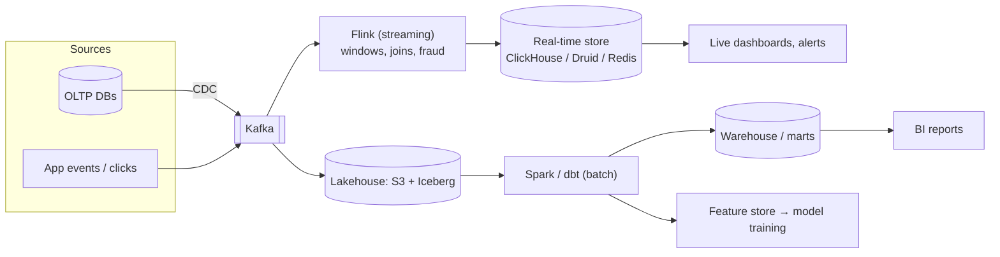
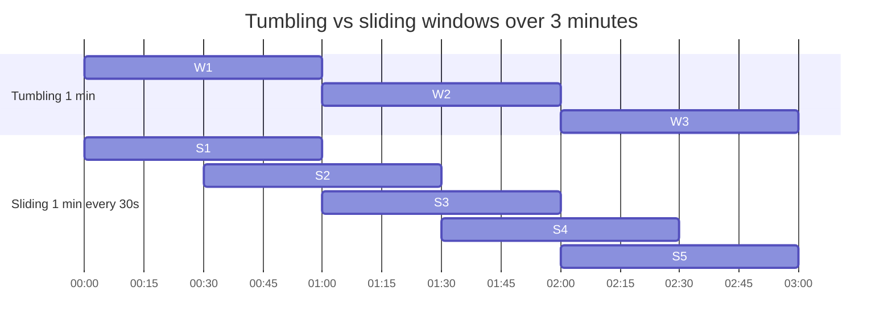
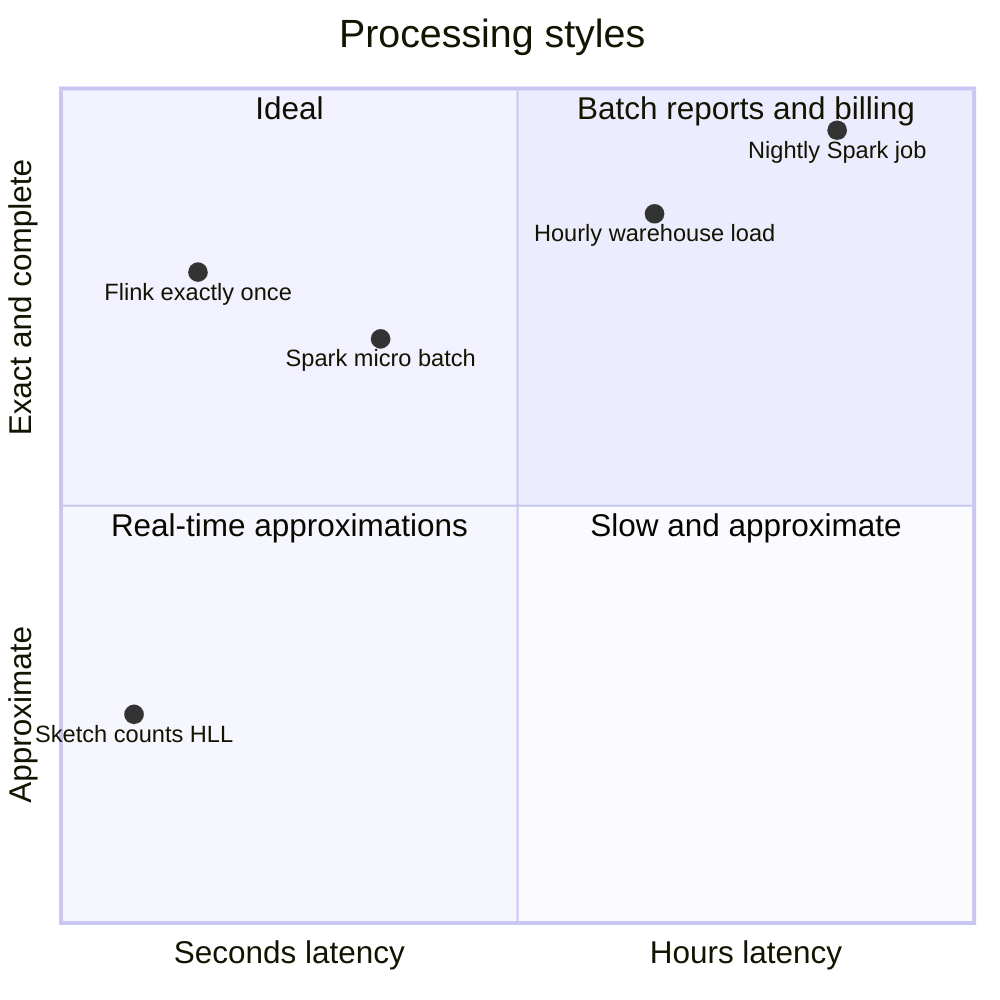

# Batch and Stream Processing

## What is it?

- **Batch:** process a large, bounded dataset all at once (nightly revenue report, retrain a model). Throughput-oriented, latency of minutes–hours.
- **Stream:** process unbounded events continuously as they arrive (fraud check per payment, live ad-click counts, surge pricing). Latency of ms–seconds.

## MapReduce intuition

```text
Input: billions of log lines → "count orders per city"
MAP     each line → (city, 1)
SHUFFLE group by key across machines → (Bengaluru, [1,1,1,…])
REDUCE  sum → (Bengaluru, 1,240,331)
```

Move computation to the data, parallelise across many machines, tolerate failures by re-running tasks. **Spark** generalised it: in-memory DAGs, SQL, ML — much faster than Hadoop MapReduce, now the batch default.

## Stream processing concepts

| Concept | Meaning |
|---|---|
| **Event time vs processing time** | When it happened vs when we saw it (mobile clicks arrive late!) |
| **Windows** | Tumbling (fixed, non-overlapping 1-min), sliding (1-min every 10 s), session (gap-based) |
| **Watermarks** | "I believe all events up to time T have arrived" → close windows; late events handled by allowed lateness |
| **State** | Running counts/aggregates kept by the processor, checkpointed for recovery |
| **Exactly-once state** | Flink checkpoints + replayable source (Kafka) + transactional/idempotent sink |

Engines: **Apache Flink** (true streaming, stateful, event time — the 2026 default), Spark Structured Streaming (micro-batch), Kafka Streams (library), Apache Beam/Dataflow.

## Lambda vs Kappa architecture

| | Lambda | Kappa |
|---|---|---|
| Idea | Batch layer (accurate, slow) + speed layer (fast, approximate), merged at query | One streaming pipeline; reprocess by replaying the log |
| Pros | Batch corrects streaming errors | One codebase |
| Cons | **Two codebases** for the same logic | Needs long log retention & a powerful stream engine |
| Today | Still used for billing reconciliation | Common default with Kafka + Flink |

## Storage: warehouse vs lake vs lakehouse

| | Data warehouse | Data lake | Lakehouse |
|---|---|---|---|
| Data | Structured, modelled | Raw, any format (JSON, Parquet, images) | Raw files + table format with ACID |
| Schema | On write | On read | On write, evolvable |
| Examples | Snowflake, BigQuery, Redshift | S3/GCS + Parquet | **Delta Lake, Apache Iceberg, Hudi** on S3 + Spark/Trino |
| Users | BI analysts, dashboards | Data scientists, ML | Both |

## ETL vs ELT

- **ETL:** transform before loading (classic, pre-cloud).
- **ELT:** load raw into the warehouse/lake, transform inside it with SQL (dbt). Default with cheap cloud storage/compute.

## 📊 Visual model

**A modern data platform:**



**Window types on a timeline (events = ticks):**



**Latency vs completeness:**



## Common mistakes

> [!warning] Traps to avoid
> 1. Running analytics queries on the OLTP primary.
> 2. Using processing time when event time matters (late mobile events counted in the wrong minute).
> 3. Lambda architecture without acknowledging the double-codebase cost.
> 4. Forgetting idempotent sinks → double counting on recovery.
> 5. Calling a data lake a "dump" with no catalog/schema → data swamp.

## Interview understanding

> [!question] What the interviewer is really testing
> - *"How do you compute X in real time?"* — Kafka → Flink with event-time windows + watermarks → OLAP store; batch job to reconcile.
> - *Tricky:* "Event time vs processing time?" — When it happened vs when processed; windows by event time + watermarks for late data.
> - *Tricky:* "Why not just Spark for everything?" — Micro-batch latency; Flink better for low-latency stateful streaming.
> - *Tricky:* "Lake vs warehouse?" — Raw/cheap/schema-on-read vs modelled/fast SQL; lakehouse bridges them.

## Mini quiz
1. Three window types?
2. What's a watermark?
3. Lambda vs Kappa in one line?
4. ETL vs ELT?
5. Name two table formats for lakehouses.

> [!success]- Answers (click to reveal)
> 1. Tumbling, sliding, session.
> 2. A progress marker asserting events up to time T have arrived.
> 3. Batch + speed layers vs one replayable streaming pipeline.
> 4. Transform before load vs load raw then transform in the warehouse.
> 5. Apache Iceberg, Delta Lake (also Hudi).

---
**Next:** [[Modern-Topics-MOC]] · **Up:** [[Production-MOC]]

## 📚 Resources
- 📖 *DDIA* Ch. 10–11 — batch and stream processing.
- 📄 [Tyler Akidau — Streaming 101](https://www.oreilly.com/radar/the-world-beyond-batch-streaming-101/)
- 📄 [Apache Flink docs — concepts](https://nightlies.apache.org/flink/flink-docs-stable/docs/concepts/overview/)

## My notes
-
