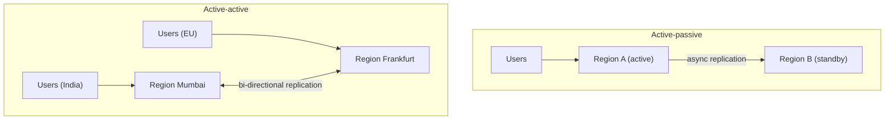
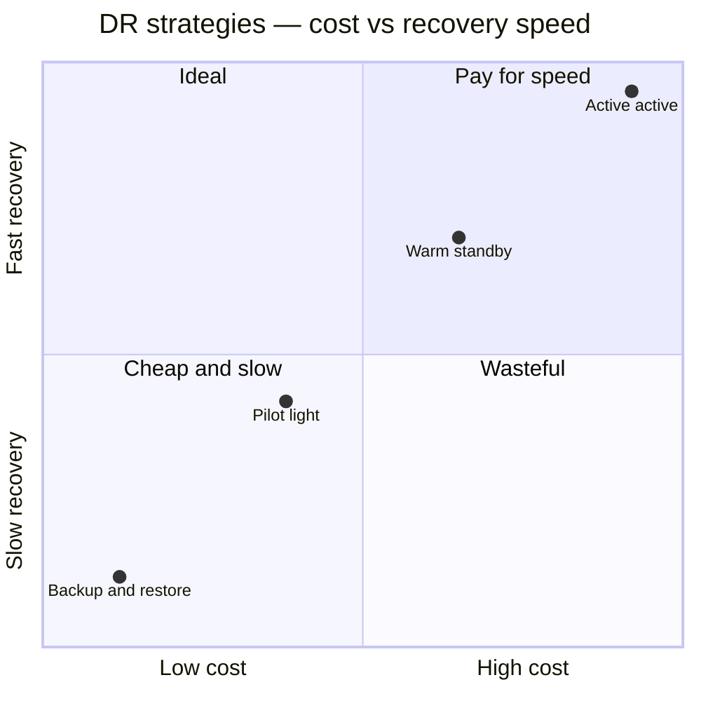

# Multi-Region and Disaster Recovery

## What is it?

- **Multi-region:** running your system in more than one geographic cloud region.
- **Disaster recovery (DR):** the plan + mechanisms to restore service and data after a large failure (region outage, data corruption, ransomware, bad deploy).

## Why

1. **Availability** beyond a single region (regions do go down).
2. **Latency** for global users.
3. **Compliance / data residency** (e.g., India's data localisation rules for payment data).

## RPO and RTO (must know)

| | Meaning | Question |
|---|---|---|
| **RPO** — Recovery Point Objective | Max acceptable **data loss** (time) | "How much data can we lose?" |
| **RTO** — Recovery Time Objective | Max acceptable **downtime** | "How fast must we be back?" |

```text
──────●──────────────X═════════════●──────▶ time
   last backup     disaster      recovered
   |←── RPO ──→|              |←── RTO ──→|
```

## DR strategies (cheapest → most resilient)

| Strategy | Setup | RPO | RTO | Cost |
|---|---|---|---|---|
| **Backup & restore** | Backups copied to another region | Hours | Hours–days | $ |
| **Pilot light** | Data replicated; minimal core infra off/idle in DR region | Minutes | 10s of minutes–hours | $$ |
| **Warm standby** | Scaled-down full copy running | Seconds–minutes | Minutes | $$$ |
| **Active-active (multi-site)** | Full capacity in ≥2 regions serving traffic | ~0 | ~0 (seconds) | $$$$ |

## Active-passive vs active-active



| | Active-passive | Active-active |
|---|---|---|
| Writes | One region | Multiple regions |
| Conflicts | None | **Yes** — need conflict resolution or data partitioned by home region |
| Failover | Promote standby (minutes) | Shift traffic (seconds) |
| Latency for far users | Worse | Better |
| Complexity | Moderate | High |

**Practical active-active trick:** give each user a **home region** (writes for that user go there), replicate for reads/failover. Avoids most write conflicts. Or use a globally consistent DB (Spanner, CockroachDB, DynamoDB global tables with LWW caveats).

## Traffic routing between regions

GeoDNS / latency-based DNS (Route 53), anycast + global load balancers (Cloudflare, GCP global LB), health-checked failover records. DNS TTLs bound how fast clients move. → [[CDN]]

## Cell-based architecture

Split the system into many independent, identical **cells** (each with its own app + data for a subset of customers). A bad deploy or poison request affects one cell, not everyone — **blast radius reduction**. Used by AWS services, Slack, DoorDash. Combine with shuffle sharding for multi-tenant isolation.

## Backups (replicas are not backups)

- Point-in-time recovery (PITR) via WAL archiving.
- Cross-region, immutable/versioned backups (ransomware protection).
- **Test restores regularly** — an untested backup is a hope, not a plan.

## 📊 Visual model



**Region failover drill:**

```mermaid
gantt
    title Active-passive failover (target RTO 15 min)
    dateFormat HH:mm
    axisFormat %H:%M
    section Detect
    Health checks fail       :crit, d1, 10:00, 3m
    Page on-call             :d2, after d1, 2m
    section Decide
    Confirm region outage    :d3, after d2, 3m
    section Act
    Promote standby DB       :a1, after d3, 3m
    Flip DNS / global LB     :a2, after a1, 2m
    section Verify
    Smoke tests + SLO check  :milestone, v1, after a2, 0m
```



## Common mistakes

> [!warning] Traps to avoid
> 1. Active-active hand-waved without conflict handling.
> 2. Treating replicas as backups.
> 3. Never practising failover ("game days").
> 4. Forgetting stateful dependencies (caches, queues, secrets, DNS) in the DR plan.
> 5. DR region with insufficient capacity quotas for full traffic.

## Interview understanding

> [!question] What the interviewer is really testing
> - *"How does your system survive a region outage?"* — State RPO/RTO targets → pick strategy → explain data replication + traffic failover + what's lost.
> - *Tricky:* "Active-active with a single Postgres primary?" — That's not active-active for writes; either home-region partitioning or a multi-region DB.
> - *Tricky:* "RPO zero across regions — cost?" — Synchronous cross-region replication → +RTT latency on every write (e.g., +50–150 ms). PACELC in action. → [[CAP-and-PACELC]]
> - *Tricky:* "What's blast radius and how do you reduce it?" — Scope of impact; cells, shuffle sharding, staged rollouts.

## Mini quiz
1. RPO vs RTO?
2. Cheapest DR strategy?
3. Main extra problem in active-active?
4. Why are replicas not backups?
5. What is a cell?

> [!success]- Answers (click to reveal)
> 1. Max data loss vs max downtime.
> 2. Backup & restore.
> 3. Write conflicts / cross-region consistency.
> 4. Mistakes and corruption replicate too.
> 5. An independent full-stack slice serving a subset of users to limit blast radius.

---
**Next:** [[Observability-and-SLOs]] · **Up:** [[Production-MOC]]

## 📚 Resources
- 📄 [AWS — Disaster recovery options in the cloud](https://docs.aws.amazon.com/whitepapers/latest/disaster-recovery-workloads-on-aws/disaster-recovery-options-in-the-cloud.html)
- 📄 [AWS — Reducing the scope of impact with cell-based architecture](https://docs.aws.amazon.com/wellarchitected/latest/reducing-scope-of-impact-with-cell-based-architecture/reducing-scope-of-impact-with-cell-based-architecture.html)

## My notes
-
