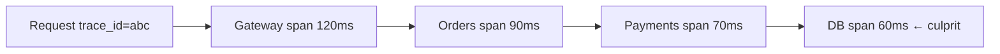
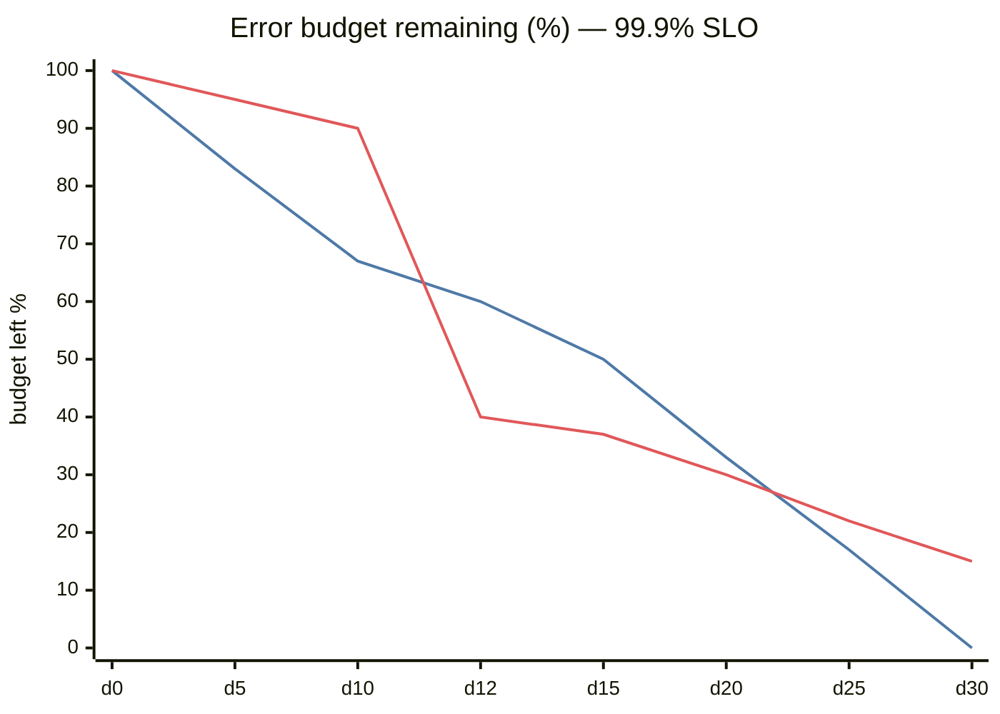
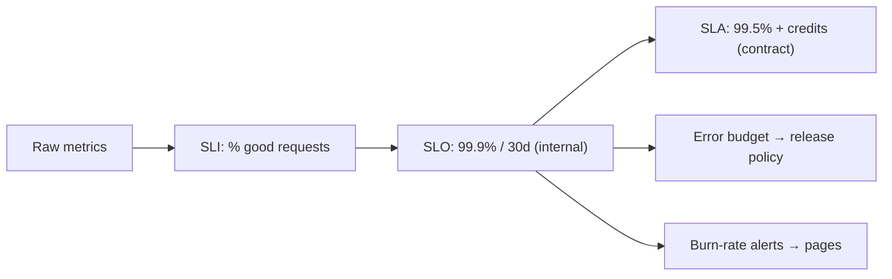

# Observability and SLOs

## What is it?

- **Observability:** being able to understand what's happening inside a system from its outputs — **logs, metrics, traces**.
- **SLI/SLO/SLA:** how you define and measure "good enough" reliability.

## The three pillars

| Pillar | What | Good for | Tools |
|---|---|---|---|
| **Metrics** | Numeric time series (RPS, error rate, p99 latency, queue depth) | Dashboards, alerting, trends — cheap at scale | Prometheus, Grafana, Datadog, CloudWatch |
| **Logs** | Timestamped events with context (structured JSON) | Debugging specific requests/errors | ELK/OpenSearch, Loki, Splunk |
| **Traces** | A request's path across services as spans with timings | Finding which hop is slow in microservices | **OpenTelemetry**, Jaeger, Tempo, Zipkin |

Correlate them with a **request/trace ID** propagated through headers (`traceparent`). OpenTelemetry is the vendor-neutral standard for all three.

## What to measure — golden signals

**Google's 4 golden signals:** Latency, Traffic, Errors, Saturation.
**RED** (per service): Rate, Errors, Duration. **USE** (per resource): Utilisation, Saturation, Errors.
Plus **business metrics:** orders/minute, payment success rate, messages delivered — often the first thing to show an outage.

## SLI, SLO, SLA

| Term | Definition | Example |
|---|---|---|
| **SLI** (indicator) | A measured ratio of good events | % of checkout requests completing < 300 ms with 2xx |
| **SLO** (objective) | Internal target for an SLI over a window | 99.9% over 30 days |
| **SLA** (agreement) | External contract with **penalties** | 99.5% or service credits |

SLA ≤ SLO (keep a buffer).

## Error budgets

Error budget = 100% − SLO. At 99.9% over 30 days → **~43 minutes** of "bad" allowed.
- Budget left → ship features faster, take risks.
- Budget burned → freeze risky launches, focus on reliability.
**Burn-rate alerts** (e.g., "burning 14× faster than allowed over 1h") page people for real problems, not every blip.

## Alerting principles

- Alert on **symptoms users feel** (SLO burn, error rate), not every cause (CPU 80%).
- Every page must be actionable; link a runbook.
- Avoid alert fatigue.

## In a system design interview (60-second version)

> "I'd emit RED metrics per service and business metrics like orders/min, trace every request with OpenTelemetry, and alert on SLO burn rate for the checkout SLI — 99.9% of checkouts succeed under 500 ms. Queue age and consumer lag get dashboards and warning alerts."

## 📊 Visual model

**Error budget over a 30-day window (illustrative):**

> [!note] Line 1 = burning exactly on pace. Line 2 = an incident on day 12 burned 50% in hours → freeze risky deploys until it recovers.

$$\text{error budget} = (1 - \text{SLO}) \times \text{window} = 0.001 \times 43{,}200\ \text{min} \approx 43\ \text{min}$$

**SLI → SLO → SLA:**

## Common mistakes

> [!warning] Traps to avoid
> 1. Alerting on averages (use percentiles).
> 2. Unstructured logs with no request IDs.
> 3. High-cardinality labels in metrics (user_id as a Prometheus label → explosion).
> 4. SLO of 100% (impossible, blocks all change).
> 5. Logging every health check / PII in logs.

## Interview understanding

> [!question] What the interviewer is really testing
> - *"How would you know if this is broken?"* — SLIs + dashboards + burn-rate alerts + tracing.
> - *Tricky:* "SLO vs SLA?" — Internal target vs external contract with penalties.
> - *Tricky:* "Logs vs metrics for counting errors at 1M RPS?" — Metrics (cheap aggregates); logs for sampled detail.
> - *Tricky:* "How do you find which microservice adds latency?" — Distributed tracing.

## Mini quiz
1. Three pillars?
2. Four golden signals?
3. 99.9% monthly error budget ≈ ?
4. Alert on symptoms or causes?
5. What standard unifies telemetry?

> [!success]- Answers (click to reveal)
> 1. Metrics, logs, traces.
> 2. Latency, traffic, errors, saturation.
> 3. ~43 minutes.
> 4. Symptoms (user-facing SLO impact).
> 5. OpenTelemetry.

---
**Next:** [[Authentication-and-Authorization]] · **Up:** [[Production-MOC]]

## 📚 Resources
- 📄 [Google SRE Book — Service Level Objectives](https://sre.google/sre-book/service-level-objectives/)
- 📄 [Google SRE Workbook — Alerting on SLOs](https://sre.google/workbook/alerting-on-slos/)
- 📄 [OpenTelemetry docs](https://opentelemetry.io/docs/)

## My notes
-
