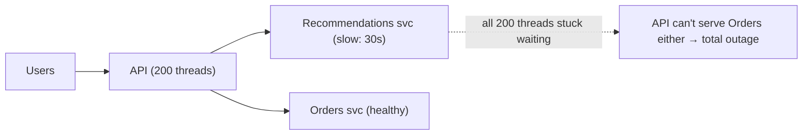
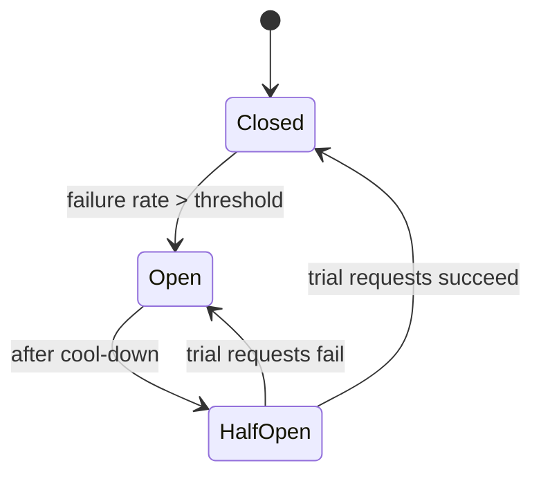
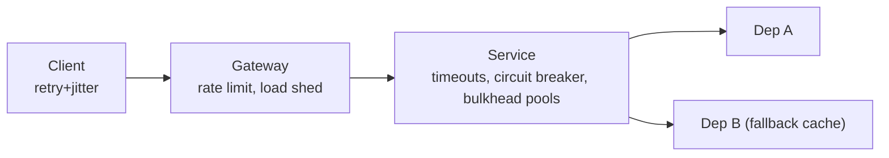
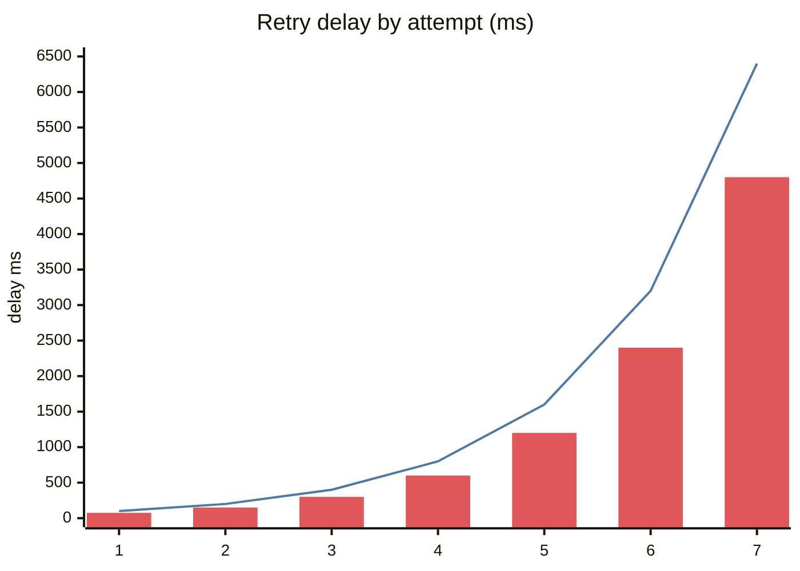
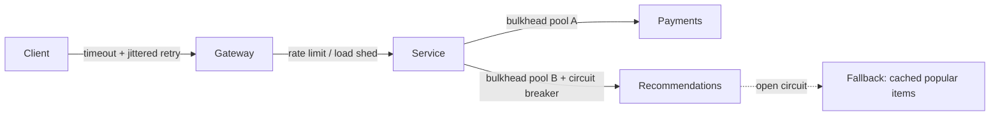

# Resilience Patterns

## What is it?

Techniques that stop **one failing dependency from taking down everything** and let the system **degrade gracefully** instead of collapsing.

## The failure we're preventing — cascading failure



## The toolkit

### 1. Timeouts — always

Every network call gets a timeout, sized from the dependency's p99 (e.g., p99 = 80 ms → timeout 200 ms). Propagate **deadlines** down the call chain (gRPC does this) so downstream doesn't work on requests the caller already abandoned.

### 2. Retries — with backoff + jitter, only when safe

```text
delay = min(cap, base × 2^attempt) × random(0.5, 1.0)     # exponential backoff + jitter
```

- Retry only **idempotent** operations or with idempotency keys. → [[Idempotency]]
- Retry only **transient** errors (timeouts, 503, 429 with Retry-After) — not 400s.
- Cap attempts (2–3). Use a **retry budget** (e.g., retries ≤ 10% of requests) to avoid **retry storms** that amplify an outage (3 layers × 3 retries = 27× load).
- **Jitter** prevents synchronised retry waves (thundering herd).

### 3. Circuit breaker



- **Closed:** calls flow, failures counted.
- **Open:** fail fast immediately (return fallback) — gives the dependency room to recover.
- **Half-open:** let a few trial requests through.
Libraries: Resilience4j, Polly, Envoy/Istio outlier detection.

### 4. Bulkheads

Isolate resources per dependency/tenant (separate thread pools, connection pools, queues, even separate clusters) so one flooding the system can't sink the rest — like watertight compartments in a ship. **Cell-based architecture** is bulkheading at the infrastructure level. → [[Multi-Region-and-Disaster-Recovery]]

### 5. Graceful degradation & fallbacks

| Dependency down | Degrade to |
|---|---|
| Recommendations | Show trending/popular items (cached) |
| Personalised feed ranking | Chronological feed |
| Reviews service | Hide reviews section |
| LLM provider | Fallback model / cached answer / "try again" |
| Search | Basic DB prefix search |

Decide **critical vs non-critical** paths upfront. Checkout is critical; "people also bought" is not.

### 6. Load shedding & rate limiting

When overloaded, **reject early and cheaply** (429/503) rather than accepting everything and timing out everything. Prioritise: shed analytics before checkout. Admission control at the gateway. → [[Design-Rate-Limiter]]

### 7. Backpressure

Bounded queues; when full, slow down producers rather than buffering infinitely (memory blowup). → [[Message-Queues]]

### 8. Health checks & self-healing

Liveness/readiness probes, auto-replacement of instances, autoscaling. → [[Load-Balancing]]

## The resilience layer in a diagram



## Chaos engineering

Deliberately inject failures (kill instances, add latency) in controlled ways to verify these patterns actually work — Netflix Chaos Monkey, AWS Fault Injection Service, Gremlin.

## 📊 Visual model

**Exponential backoff with and without jitter (base 100 ms):**



> [!note] Line = pure exponential (everyone retries at the same instant). Bars = average with full jitter — retries spread out, so the recovering service isn't hit by synchronised waves.

$$\text{delay}_n = \text{random}\big(0,\ \min(\text{cap},\ \text{base} \cdot 2^n)\big)$$

**Defence in depth:**



## Common mistakes

> [!warning] Traps to avoid
> 1. No timeouts (default is often infinite).
> 2. Retrying at every layer → retry storms.
> 3. Retrying non-idempotent writes.
> 4. Fallbacks that call another fragile dependency.
> 5. Circuit breaker thresholds never tuned or tested.

## Interview understanding

> [!question] What the interviewer is really testing
> - *"What if service X is slow/down?"* — Timeout → retry (if idempotent, with jitter, budgeted) → circuit breaker → fallback; bulkhead so others are unaffected.
> - *Tricky:* "Why add jitter?" — Without it, clients retry in synchronised waves and re-overload the recovering service.
> - *Tricky:* "Retries made the outage worse — why?" — Amplification across layers; fix with retry budgets, only retry at one layer, circuit breakers.
> - *Tricky:* "Circuit breaker vs rate limiter?" — Breaker protects the **caller** from a failing dependency; limiter protects the **service** from too many callers.

## Mini quiz
1. Three states of a circuit breaker?
2. Why exponential backoff *and* jitter?
3. What is a bulkhead?
4. Load shedding — what and why?
5. What's a retry budget?

> [!success]- Answers (click to reveal)
> 1. Closed, open, half-open.
> 2. Backoff reduces load over time; jitter desynchronises clients.
> 3. Isolated resource pools so one dependency's failure can't exhaust shared resources.
> 4. Rejecting excess/low-priority work early to keep serving the rest.
> 5. A cap on retries as a fraction of total requests to prevent amplification.

---
**Next:** [[Multi-Region-and-Disaster-Recovery]] · **Up:** [[Production-MOC]]

## 📚 Resources
- 📄 [AWS Builders' Library — Timeouts, retries and backoff with jitter](https://aws.amazon.com/builders-library/timeouts-retries-and-backoff-with-jitter/)
- 📄 [AWS Builders' Library — Using load shedding to avoid overload](https://aws.amazon.com/builders-library/using-load-shedding-to-avoid-overload/)
- 📖 *Release It!* (Michael Nygard) — origin of circuit breaker & bulkhead patterns.

## My notes
-
