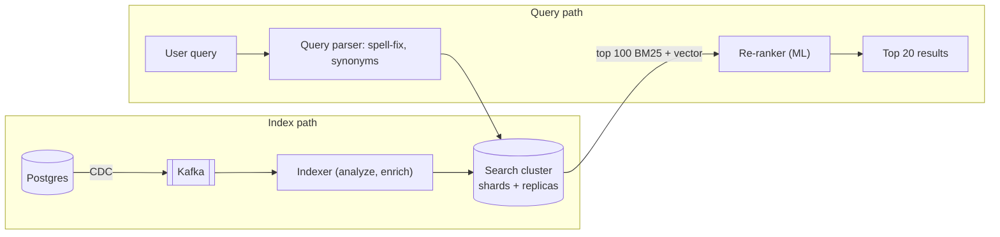
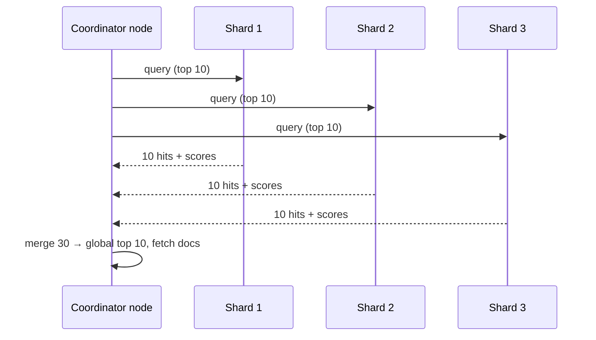
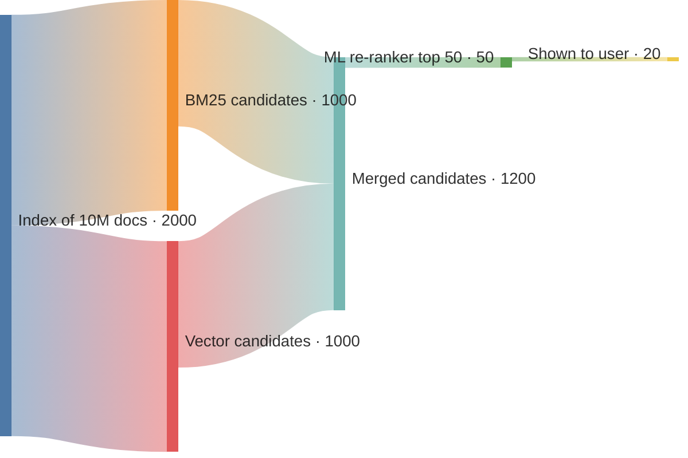

# Search Systems

## What is it?

Finding documents by **words and relevance**, not by exact key. "biryani near koramangala" should match restaurants whose name, menu or tags contain those terms, ranked by relevance, distance, rating.

## Why a normal DB index isn't enough

`WHERE name LIKE '%biryani%'` can't use a B-tree (leading wildcard) → full scan; no typo tolerance, no stemming ("run" vs "running"), no relevance ranking.

## The inverted index

Map **term → list of documents (postings)** containing it — like the index at the back of a textbook.

```text
Docs:  1 "Spicy chicken biryani"   2 "Veg biryani"   3 "Chicken tikka"

term      → postings (doc_id: positions)
biryani   → [1:2, 2:1]
chicken   → [1:1, 3:0]
spicy     → [1:0]
veg       → [2:0]
tikka     → [3:1]

query "chicken biryani" → intersect(chicken, biryani) = [1]  → rank
```

## The text pipeline (analysis)

`"Running SHOES for Men"` → **tokenise** → lowercase → remove stop words → **stem/lemmatise** → `[run, shoe, men]`. Same analyzer at index and query time. Extras: synonyms ("tee" = "t-shirt"), n-grams/edge n-grams for prefix matching, fuzzy matching (edit distance) for typos, language-specific analyzers (Hinglish transliteration is a real Indian e-commerce problem).

## Relevance

- **TF-IDF / BM25** (Elasticsearch default): a term matters more if it appears often in this doc (TF) and rarely across all docs (IDF), normalised by doc length.
- Boost fields (title > description), business signals (rating, popularity, distance, freshness), personalisation.
- Modern: **hybrid search** = BM25 + vector (semantic) search, then a **re-ranker** (often an ML/cross-encoder model). → [[RAG-and-Vector-Databases]] · [[Recommendation-and-Ranking-Systems]]

## Elasticsearch / OpenSearch basics

| Concept | Meaning |
|---|---|
| Index | Collection of documents (≈ table) |
| Shard | Partition of an index (a Lucene index); primary + replicas |
| Document | JSON object |
| Mapping | Schema: field types + analyzers |
| Refresh interval | Docs become searchable after refresh (~1 s) → **near real-time** |

Query = scatter to all shards → each returns top-k → coordinator merges (**scatter-gather**).

## Keeping search in sync with the DB

**DB is the source of truth; search is a derived index.** Sync via CDC (Debezium → Kafka → indexer) or the outbox. Indexer must be idempotent (upsert by doc ID with version). Rebuild from scratch via a batch job + **alias swap** for zero-downtime reindexing. → [[Event-Driven-Architecture]]

## 📊 Visual model

**Indexing and query paths:**



**Scatter-gather across shards:**



**Search ranking funnel:**



## Common mistakes

> [!warning] Traps to avoid
> 1. Using Elasticsearch as the primary database.
> 2. Forgetting near-real-time refresh (a new product isn't searchable instantly).
> 3. Dual-writing DB and ES from the app (drift) instead of CDC/outbox.
> 4. Too many shards for small data (overhead) or too few (can't scale).
> 5. No plan for reindexing when mappings change.

## Interview understanding

> [!question] What the interviewer is really testing
> - *"How does search work in your design?"* — Inverted index in Elasticsearch, fed by CDC, BM25 + business boosts, optionally vector hybrid + re-ranker.
> - *Tricky:* "Why can't `LIKE '%x%'` use an index?" — Leading wildcard defeats B-tree ordering.
> - *Tricky:* "How do you reindex with zero downtime?" — Build new index in background, dual-feed, swap alias.
> - *Tricky:* "Search vs autocomplete?" — Autocomplete is prefix-based and latency-critical (< 50 ms) → tries/edge n-grams + heavy caching. → [[Design-Typeahead]]

## Mini quiz
1. What's an inverted index?
2. What does IDF reward?
3. Why is ES "near real-time"?
4. How should search stay in sync with the DB?
5. What's hybrid search?

> [!success]- Answers (click to reveal)
> 1. Map from term → documents containing it.
> 2. Terms that are rare across the corpus.
> 3. Docs become searchable only after the periodic refresh (~1 s).
> 4. CDC/outbox → Kafka → idempotent indexer.
> 5. Combining keyword (BM25) and vector (semantic) retrieval, then re-ranking.

---
**Next:** [[Batch-and-Stream-Processing]] · **Up:** [[Production-MOC]]

## 📚 Resources
- 📄 [Elasticsearch guide — how search works](https://www.elastic.co/guide/en/elasticsearch/reference/current/index.html)
- 📖 *Introduction to Information Retrieval* (Manning et al.) — free online.

## My notes
-
