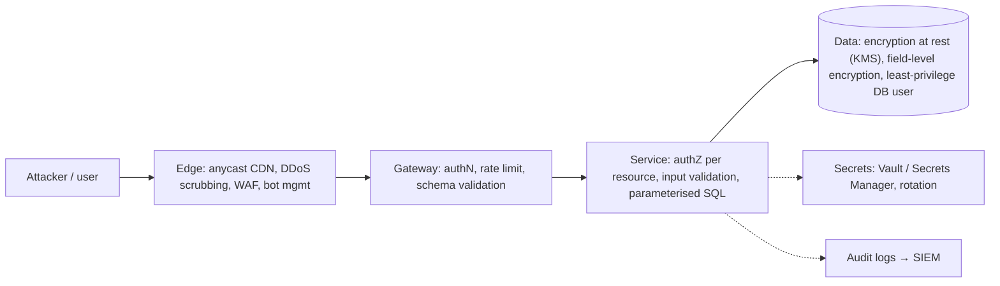
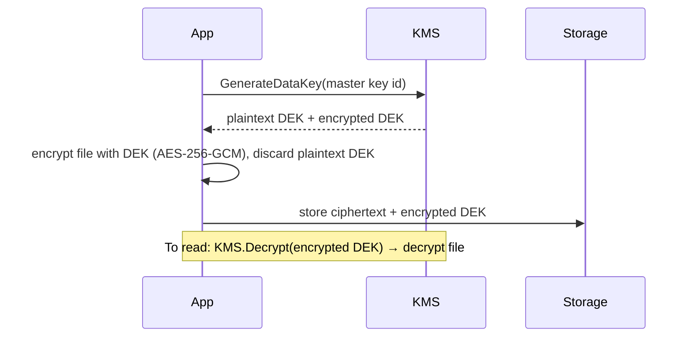
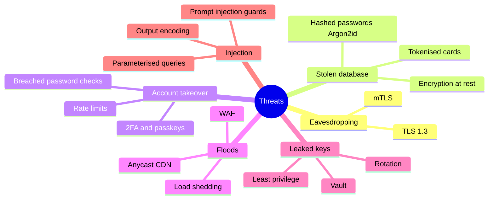

# Security Essentials

## What is it?

The security layer every design should mention in ~60 seconds: **encrypt in transit and at rest, hash passwords properly, protect the edge, manage secrets, least privilege, and validate everything.**

## Encryption

| Where | How | Notes |
|---|---|---|
| **In transit** | TLS 1.2+/1.3 everywhere; mTLS between services (mesh) | Terminate at CDN/LB; re-encrypt internally for sensitive data |
| **At rest** | AES-256 disk/DB/S3 encryption via **KMS** | Envelope encryption: data key encrypts data, KMS master key encrypts data key |
| **Field-level** | Encrypt specific columns (PAN, Aadhaar, PII) in the app | Even DB admins can't read; complicates search |
| **Tokenisation** | Replace card numbers with tokens; real PAN in a PCI vault | Payments (RBI card-on-file tokenisation in India) |

## Password storage

Never encrypt passwords — **hash** them with a slow, salted algorithm: **Argon2id** (preferred), **bcrypt**, scrypt. Never MD5/SHA-1/plain SHA-256. A unique random salt per user defeats rainbow tables; slowness defeats brute force.

Better still: passkeys (WebAuthn) and OTP/2FA.

## DDoS and abuse protection

| Layer | Defence |
|---|---|
| L3/L4 floods (SYN, UDP) | Anycast CDN/scrubbing (Cloudflare, AWS Shield) absorbs volume |
| L7 floods (HTTP) | WAF rules, rate limiting, bot detection, CAPTCHA/challenges |
| Expensive endpoints | Auth before work, caching, per-user quotas |
| Credential stuffing | Rate limit by IP + account, breached-password checks, 2FA |
| Penetration of non-existent keys | Bloom filter / negative caching → [[Cache-Pitfalls]] |

→ [[Design-Rate-Limiter]] · [[CDN]]

## Secrets management

- No secrets in code, images or git. Use **Vault**, AWS Secrets Manager, GCP Secret Manager, or Kubernetes Secrets (+ external secrets operator, encryption at rest).
- **Short-lived, auto-rotated credentials** (IAM roles, Vault dynamic DB creds) > long-lived keys.
- Audit access.

## Least privilege & zero trust

- Every service/user gets the minimum permissions it needs (IAM roles per service, scoped DB users).
- **Zero trust:** don't trust the network — authenticate and authorise every call (mTLS + identity), even inside the VPC.
- Network segmentation: DBs in private subnets; only the app tier can reach them.

## Input validation & OWASP basics

SQL injection (parameterised queries), XSS (output encoding, CSP), CSRF (SameSite cookies, CSRF tokens), SSRF (block internal metadata IPs from user-supplied URLs — relevant for web crawlers and "fetch this URL" features), file upload validation, **prompt injection** for LLM features (treat model output and retrieved content as untrusted). → [[AI-Agent-Systems]]

## Compliance hooks (say one line when relevant)

PCI-DSS (cards), GDPR / India's **DPDP Act 2023** (personal data), RBI data localisation (payment data stored in India), HIPAA (health, US). Implications: data residency, retention, right to deletion, audit logs.

## 📊 Visual model

**Defence in depth:**

**Envelope encryption:**

**Threat → control map:**

## Common mistakes

> [!warning] Traps to avoid
> 1. Encrypting (reversibly) instead of hashing passwords.
> 2. Secrets in environment files committed to git.
> 3. Public S3 buckets / DBs with public IPs.
> 4. Trusting internal traffic implicitly.
> 5. Forgetting SSRF in features that fetch user-provided URLs.

## Interview understanding

> [!question] What the interviewer is really testing
> - *"How do you secure this system?"* — 60-second sweep: TLS everywhere, authN at gateway + authZ in services, encryption at rest with KMS, secrets in Vault, least privilege, WAF + rate limits + CDN for DDoS, audit logs.
> - *Tricky:* "Why bcrypt over SHA-256 for passwords?" — Deliberately slow + salted; SHA-256 is fast → GPU brute force.
> - *Tricky:* "How do you store card numbers?" — You mostly don't: tokenise via a PCI-compliant vault/gateway.
> - *Tricky:* "What's envelope encryption and why?" — Data keys encrypt data, KMS key encrypts data keys; fast bulk encryption + central key control/rotation.

## Mini quiz
1. Best password hashing algorithm today?
2. What does a salt prevent?
3. Envelope encryption in one line?
4. One L7 DDoS defence?
5. What's SSRF?

> [!success]- Answers (click to reveal)
> 1. Argon2id (bcrypt acceptable).
> 2. Precomputed rainbow-table attacks / identical hashes for identical passwords.
> 3. Encrypt data with a data key; encrypt the data key with a KMS master key.
> 4. WAF rules / rate limiting / bot challenges.
> 5. Tricking a server into making requests to internal resources (e.g., cloud metadata endpoint).

---
**Next:** [[Search-Systems]] · **Up:** [[Production-MOC]]

## 📚 Resources
- 📄 [OWASP Top 10](https://owasp.org/www-project-top-ten/)
- 📄 [OWASP Password Storage Cheat Sheet](https://cheatsheetseries.owasp.org/cheatsheets/Password_Storage_Cheat_Sheet.html)
- 📄 [AWS KMS — envelope encryption concepts](https://docs.aws.amazon.com/kms/latest/developerguide/kms-cryptography.html#enveloping)

## My notes
-
