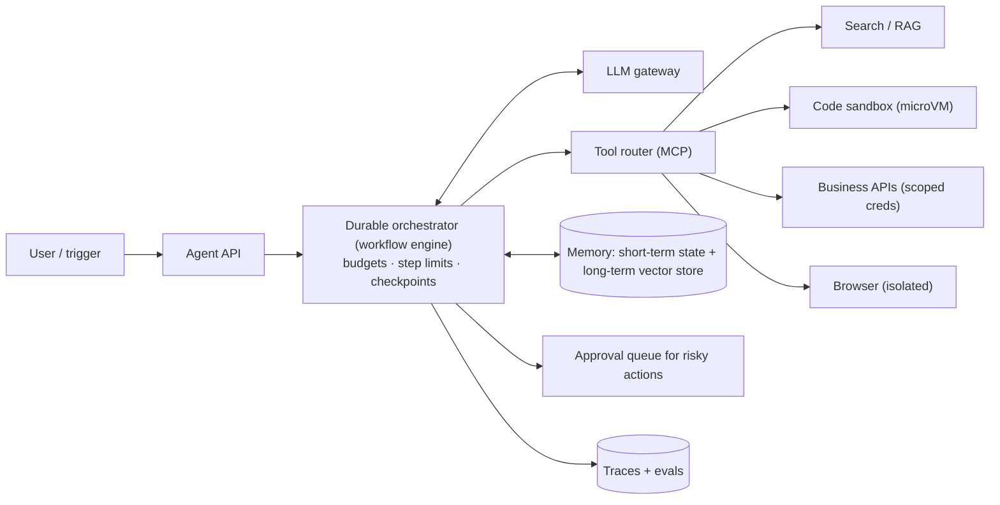
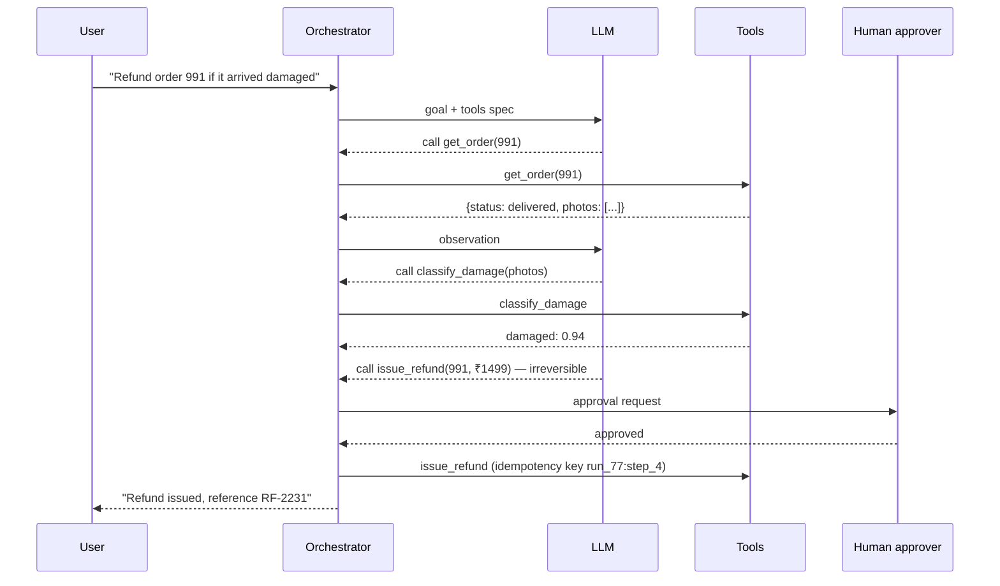
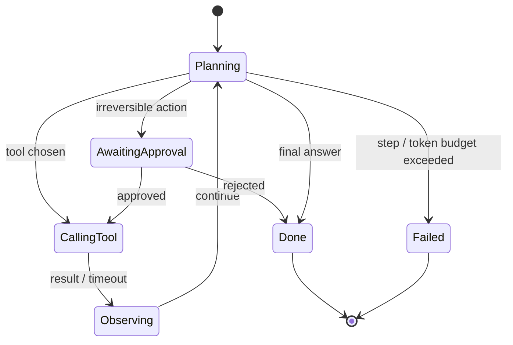
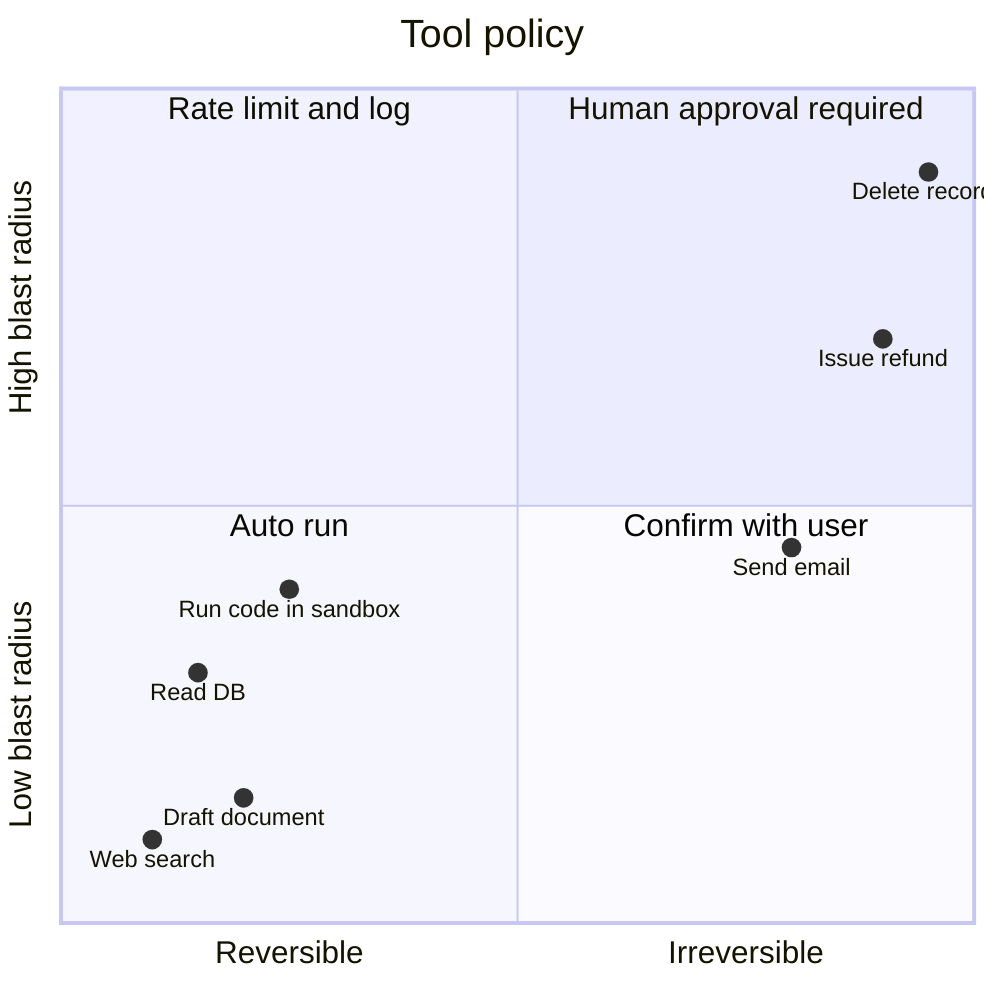

# AI Agent Systems ➕

## What is it?

An **agent** is an LLM running in a loop: it reads the goal + context, decides to **call a tool** (search, run code, query a DB, call an API), observes the result, and repeats until done. The system-design problem is everything around that loop: orchestration, state, tools, sandboxing, cost, safety, and debugging.

## The agent loop

```text
while not done and steps < max_steps and budget_left:
    action = llm(goal, history, tool_specs)        # think → choose tool or answer
    if action.type == "final": return action.answer
    result = run_tool_sandboxed(action.tool, action.args)   # with auth, timeout, idempotency
    history.append(action, result)                 # memory
```

## Components

| Component | Responsibility | Design notes |
|---|---|---|
| **Orchestrator** | Runs the loop, enforces step/time/token budgets | Long-running → durable workflow engine (Temporal) so a crash resumes mid-task → [[Distributed-Transactions]] |
| **Tool registry** | Tool schemas (JSON schema), auth scopes, rate limits | Standard protocols like **MCP (Model Context Protocol)** expose tools uniformly |
| **Sandbox** | Executes code/browsing in isolation | Firecracker microVMs / gVisor containers, no network by default, CPU/mem/time limits, ephemeral FS |
| **Memory** | Short-term (conversation/scratchpad), long-term (facts, past tasks) | Summarise/compact history; long-term memory in a vector store/DB with user scoping |
| **Retrieval** | Ground the agent in docs | → [[RAG-and-Vector-Databases]] |
| **Guardrails** | Input/output filtering, policy checks, PII redaction | Treat tool outputs and web pages as **untrusted** (prompt injection) |
| **Human-in-the-loop** | Approval for irreversible actions (payments, emails, deletes) | Pause workflow, notify, resume on approval |
| **Tracing & evals** | Record every step (prompt, tool call, result, tokens, latency) | Replay failures; task-success evals in CI |
| **Metering** | Tokens + tool costs per run per tenant | Budgets and hard caps |

## Design concerns interviewers probe

- **Reliability:** LLM outputs are non-deterministic → validate tool args against schemas, retry with feedback, cap steps, fall back.
- **Idempotent tools:** the orchestrator may retry a step after a crash → side-effecting tools need idempotency keys. → [[Idempotency]]
- **Security:** least-privilege credentials per tool, scoped to the user; sandbox egress allow-lists; confirm before irreversible actions; defend against injected instructions in retrieved content.
- **Latency & cost:** parallel tool calls, smaller models for routing/classification, caching tool results, prompt caching of long system prompts.
- **Multi-agent:** planner + specialised workers — adds coordination cost; use only if a single agent with tools fails.

## 📊 Visual model

**Architecture:**



**One run, step by step:**



**Agent run state machine:**



**Risk vs autonomy for tools:**



## Common mistakes

> [!warning] Traps to avoid
> 1. No step/token budgets → runaway loops and bills.
> 2. Tools with broad credentials ("the agent has admin").
> 3. Running generated code without isolation.
> 4. Non-idempotent side-effecting tools behind a retrying orchestrator.
> 5. No tracing → impossible to debug "why did it do that?".

## Interview understanding

> [!question] What the interviewer is really testing
> - *"Design infrastructure for AI agents."* — Durable orchestrator, tool registry (MCP), sandboxes, memory, guardrails, HITL, tracing/evals, metering.
> - *Tricky:* "How do you make a 2-hour agent task survive a crash?" — Durable workflow engine with checkpointed steps; idempotent tools; resume from last completed step.
> - *Tricky:* "How do you defend against prompt injection from a web page?" — Treat content as data; restrict tool permissions; require confirmation for sensitive actions; separate instructions from retrieved text; output filtering.
> - *Tricky:* "Single agent vs multi-agent?" — Start single with good tools; multi-agent when tasks are parallelisable or need distinct specialisations, accepting coordination cost.

## Mini quiz
1. What's the agent loop?
2. Why a durable workflow engine?
3. What isolates code execution?
4. Which actions need human approval?
5. What's MCP?

> [!success]- Answers (click to reveal)
> 1. LLM decides → tool runs → observation appended → repeat until final answer or budget.
> 2. Long-running, multi-step tasks must survive crashes and resume.
> 3. Sandboxes — microVMs (Firecracker) / gVisor with resource and network limits.
> 4. Irreversible or high-blast-radius ones (payments, deletes, external messages).
> 5. Model Context Protocol — a standard way to expose tools/data to models.

---
**Next:** [[Interview-Playbook-MOC]] · **Up:** [[Modern-Topics-MOC]]

## 📚 Resources
- 📄 [Anthropic — Building effective agents](https://www.anthropic.com/research/building-effective-agents)
- 📄 [Model Context Protocol](https://modelcontextprotocol.io/)
- 📄 [OWASP Top 10 for LLM Applications](https://owasp.org/www-project-top-10-for-large-language-model-applications/)

## My notes
-
