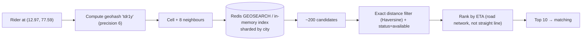
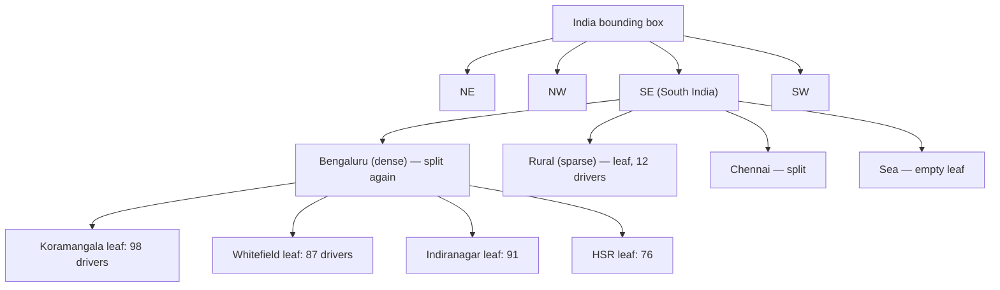
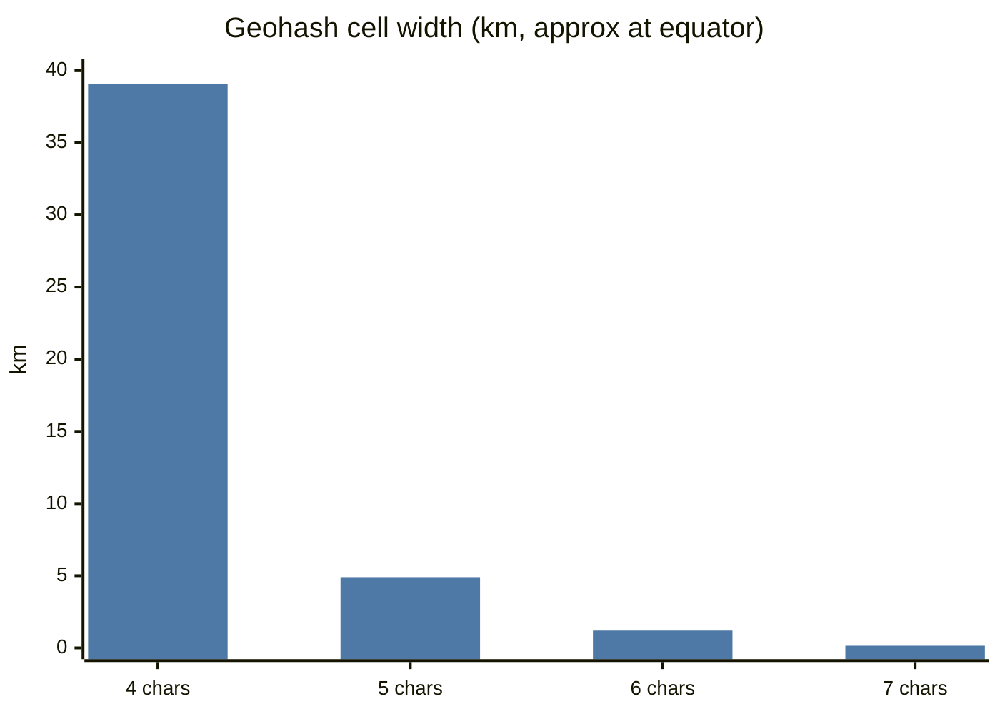
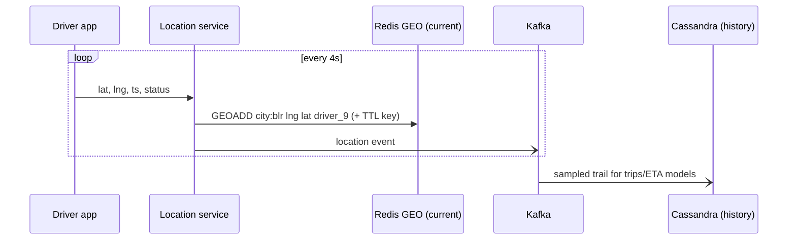

# Geospatial Indexing ➕

## The problem

"Find drivers within 2 km of me" over 500k moving drivers, refreshed every few seconds. A B-tree on `(lat)` or `(lng)` alone can't do 2-D proximity efficiently; scanning everyone is O(N) per request.

## The four approaches

| Approach | Idea | Pros | Cons | Used by |
|---|---|---|---|---|
| **Geohash** | Interleave lat/lng bits → base32 string; shared prefix ≈ nearby | Simple, works in any KV/B-tree as a string prefix | Edge effects (neighbours can have different prefixes); cells are rectangles that vary with latitude | Redis GEO (52-bit geohash in a sorted set), Elasticsearch |
| **Quadtree** | Recursively split a square into 4 until each cell has ≤ K points | Adapts to density (dense Bengaluru, sparse rural) | In-memory tree, rebalancing with moving points | Many in-memory location services |
| **Google S2** | Project Earth onto a cube, Hilbert curve over cells | Uniform-ish cells, great coverings | More complex | Google Maps, Foursquare, older Uber |
| **Uber H3** | Hierarchical **hexagons** (16 resolutions) | Equal-distance neighbours, great for surge/supply grids | Not perfectly nested | Uber (surge pricing, dispatch), many delivery apps |
| R-tree / PostGIS GiST | Bounding-box tree in a DB | Rich queries (polygons, delivery zones) | DB-bound, write cost | PostGIS, delivery zone polygons |

## Geohash in one minute

- Precision vs cell size: 5 chars ≈ 4.9 km × 4.9 km, 6 chars ≈ 1.2 km × 0.6 km, 7 chars ≈ 153 m × 153 m.
- Query = compute user's geohash at the right precision + its **8 neighbours** → fetch candidates → exact distance filter (Haversine) → sort.

$$d = 2r \arcsin\left(\sqrt{\sin^2\frac{\Delta\phi}{2} + \cos\phi_1\cos\phi_2\sin^2\frac{\Delta\lambda}{2}}\right)$$

## Handling moving objects (drivers)

- Location pings every ~4 s → **write-heavy** (500k drivers / 4 s = **125k writes/s**).
- Keep the **current** location in memory (Redis GEO / in-memory quadtree sharded by city/region), with TTL so offline drivers disappear.
- Persist a **sampled trail** asynchronously (Kafka → Cassandra) for trip history, ETA models, disputes.
- Shard by geography (city / H3 cell at a coarse resolution) — beware hot cells (airport, stadium).

## 📊 Visual model

**Query flow for "drivers near me":**

**Quadtree adapts to density:**

**Cell size by geohash precision:**

**Write-heavy location pipeline:**

## Common mistakes

> [!warning] Traps to avoid
> 1. Storing live locations in Postgres with a row update every 4 s per driver.
> 2. Querying only the user's geohash cell (misses nearby drivers across the boundary — always include neighbours).
> 3. Using straight-line distance for ETA (rivers, one-ways, traffic).
> 4. Not expiring stale locations.

## Interview understanding

> [!question] What the interviewer is really testing
> - *"How do you find nearby drivers?"* — Geohash/H3/quadtree in memory, neighbours + exact filter, sharded by region, TTL for liveness.
> - *Tricky:* "Geohash edge problem?" — Two points metres apart can have different prefixes; query neighbour cells.
> - *Tricky:* "Why hexagons (H3)?" — All 6 neighbours equidistant → smoother aggregation for supply/demand and surge.
> - *Tricky:* "Quadtree with moving points?" — Rebuild periodically or update leaves on move; hold in memory per region; or prefer fixed grids (geohash/H3) for simplicity.

## Mini quiz
1. Why can't a regular B-tree on lat do proximity well?
2. Geohash precision for ~150 m cells?
3. What does Redis GEO use under the hood?
4. Writes/s for 1M drivers pinging every 5 s?
5. Why include neighbouring cells?

> [!success]- Answers (click to reveal)
> 1. It orders one dimension only; 2-D proximity needs both.
> 2. 7 characters.
> 3. A sorted set with geohash-encoded scores.
> 4. 200k writes/s.
> 5. Boundary effect — nearby points can fall in adjacent cells.

---
**Next:** [[Real-Time-Collaboration-CRDTs]] · **Up:** [[Modern-Topics-MOC]]

## 📚 Resources
- 📄 [Uber Engineering — H3: hexagonal hierarchical spatial index](https://www.uber.com/blog/h3/)
- 📄 [Redis — Geospatial](https://redis.io/docs/latest/develop/data-types/geospatial/)
- 📄 [Geohash explained (Movable Type)](https://www.movable-type.co.uk/scripts/geohash.html)

## My notes
-
