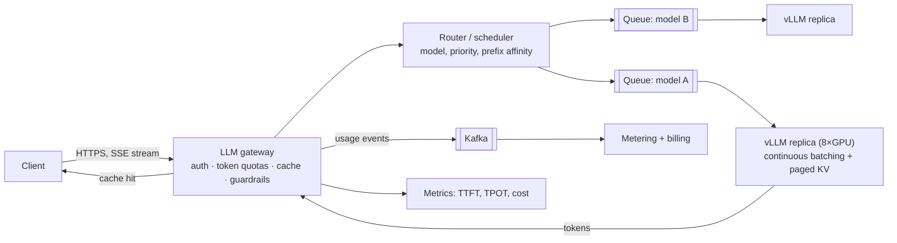
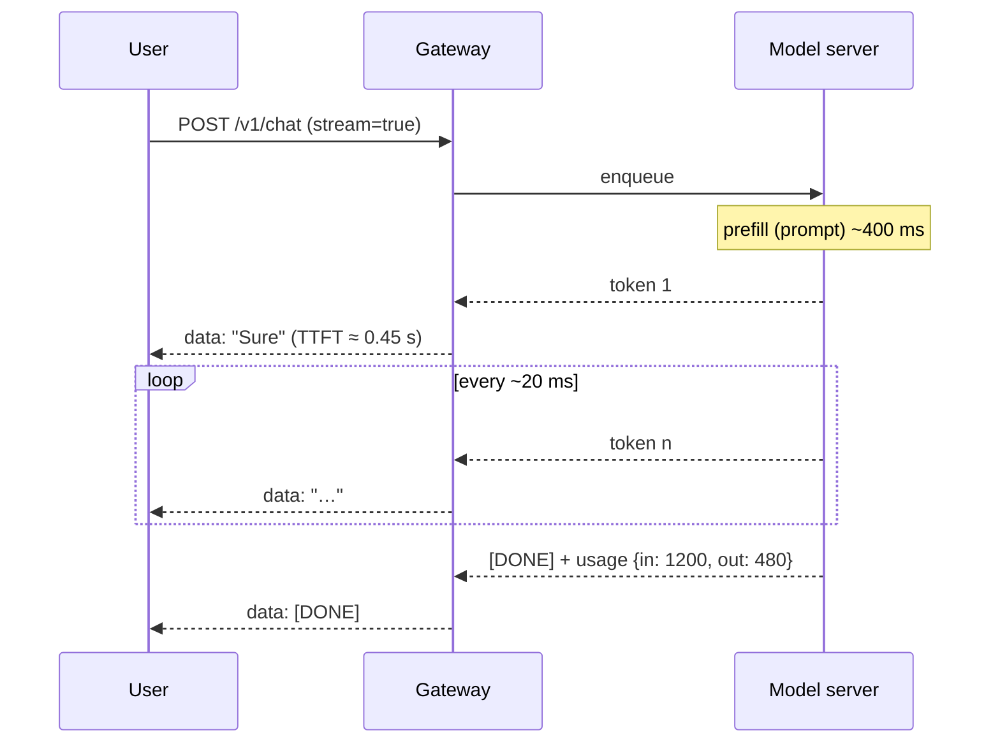
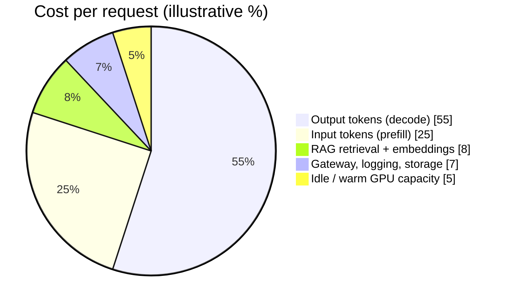
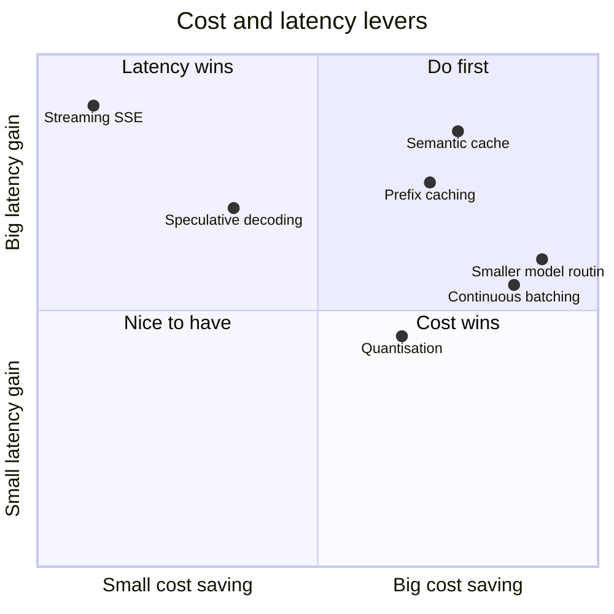

# LLM Serving and Inference ➕

> [!info] Why this is added
> "Design an LLM inference API" is reported as the most-asked AI-era question — "the new URL shortener". The interesting parts are GPUs as the scarce resource, **tokens** as the unit of work, streaming, batching, and cost.

## How generation works (just enough)

1. **Prefill:** the whole prompt is processed in one parallel pass → produces the first token. Compute-bound. Drives **TTFT** (time to first token).
2. **Decode:** generate one token at a time; each step reuses the **KV cache** (attention keys/values of all previous tokens). Memory-bandwidth-bound. Drives **TPOT** (time per output token) / tokens/s.

$$\text{latency} \approx \text{TTFT} + (\text{output tokens} - 1) \times \text{TPOT}$$

> [!example] Numbers
> TTFT 400 ms, TPOT 20 ms, 500 output tokens → ≈ 0.4 + 499 × 0.02 ≈ **10.4 s**. That's why you **stream** tokens (SSE) — perceived latency becomes TTFT. → [[Real-Time-Communication]]

## The key serving techniques

| Technique | What | Why it matters |
|---|---|---|
| **Continuous (in-flight) batching** | Add/remove requests from the GPU batch at every decode step, instead of waiting for the whole batch | Huge throughput gain; GPUs stay busy (vLLM, TGI, TensorRT-LLM, SGLang) |
| **KV cache** | Store attention K/V per token per request in GPU memory | Avoids recomputation; but **memory is the limit on concurrency** |
| **PagedAttention** | Allocate KV cache in fixed pages (like OS virtual memory) | Less fragmentation → more concurrent requests (vLLM) |
| **Prefix / prompt caching** | Reuse KV cache for shared prompt prefixes (system prompt, RAG docs) | Lower TTFT and cost; providers discount cached input tokens |
| **Speculative decoding** | Small draft model proposes tokens, big model verifies several at once | Faster decode |
| **Quantisation** | FP16 → FP8/INT8/INT4 weights | Smaller memory, more throughput, slight quality loss |
| **Tensor / pipeline parallelism** | Split a big model across GPUs | Models bigger than one GPU's memory |
| **Prefill/decode disaggregation** | Separate GPU pools for prefill and decode | Each phase tuned independently |

## The platform around the model

- **LLM gateway:** auth, per-tenant **token-based** rate limits & budgets, routing to model/provider, fallbacks, retries, semantic + exact caching, logging, PII redaction, guardrails. → [[Proxies-and-API-Gateways]]
- **Scheduler / router:** route by model, by prefix-cache affinity (same system prompt → same replica), by queue depth; priority tiers (paid vs free).
- **Autoscaling on GPUs:** scale on queue depth / KV-cache utilisation / tokens/s, not CPU. Cold start is slow (loading tens of GB of weights) → keep warm pools.
- **Multi-tenancy & isolation:** quotas, fair scheduling, separate pools for big customers.
- **Billing/metering:** count input/output/cached tokens per request → Kafka → aggregation → invoices. → [[Design-Ad-Click-Aggregator]] (same pattern)
- **Model versioning & A/B:** canary new model versions, compare evals and user feedback.
- **Observability:** TTFT, TPOT, tokens/s, queue time, GPU utilisation, KV cache hit rate, cost per request, error/refusal rates.

## 📊 Visual model

**Request path:**

**Static vs continuous batching (GPU timeline):**

```mermaid
gantt
    title Static batching wastes GPU slots; continuous batching refills them
    dateFormat X
    axisFormat %s
    section Static batch
    Req A (short)           :0, 3
    idle slot (waiting for D) :crit, 3, 10
    Req B (medium)          :0, 6
    idle slot               :crit, 6, 10
    Req D (long)            :0, 10
    section Continuous
    Req A                   :0, 3
    Req E joins at step 3   :3, 7
    Req G joins at step 7   :7, 10
    Req B                   :0, 6
    Req F joins at step 6   :6, 10
    Req D                   :0, 10
```

**Streaming timeline (what the user perceives):**

**Where money goes (illustrative cost split for a chat product):**

**Levers by effect:**

## Common mistakes

> [!warning] Traps to avoid
> 1. Rate limiting by requests instead of **tokens**.
> 2. Autoscaling GPU pools on CPU usage.
> 3. Forgetting the KV-cache memory limit on concurrency ("just add more requests to the batch").
> 4. No streaming → 10-second blank screens.
> 5. Ignoring cost entirely — at scale it's the dominant NFR.

## Interview understanding

> [!question] What the interviewer is really testing
> - *"Design an LLM inference API."* — Gateway (auth, token quotas, caching), router + per-model queues, GPU replicas with continuous batching + paged KV cache, SSE streaming, autoscaling on queue depth, metering via Kafka, observability on TTFT/TPOT/cost.
> - *Tricky:* "Why is decode memory-bound?" — Each step generates one token but must read all weights + the KV cache from GPU memory.
> - *Tricky:* "How do you cut cost 50%?" — Route easy queries to a small model, prefix/semantic caching, quantisation, batch offline jobs (batch APIs), shorter prompts.
> - *Tricky:* "How do you rate limit fairly?" — Token bucket in **tokens/min** per tenant, with separate input/output accounting and concurrency caps.

## Mini quiz
1. TTFT vs TPOT?
2. What does continuous batching do?
3. What limits concurrent requests per GPU?
4. Why stream with SSE?
5. Two ways to cut inference cost?

> [!success]- Answers (click to reveal)
> 1. Time to first token (prefill) vs time per subsequent token (decode).
> 2. Inserts/removes requests at every decode step so GPU slots aren't idle.
> 3. KV-cache memory.
> 4. Perceived latency drops to TTFT; one-way server push fits SSE.
> 5. Smaller-model routing, prefix/semantic caching, quantisation, batching.

---
**Next:** [[RAG-and-Vector-Databases]] · **Up:** [[Modern-Topics-MOC]]

## 📚 Resources
- 📄 [vLLM paper — Efficient Memory Management with PagedAttention](https://arxiv.org/abs/2309.06180)
- 📄 [Anyscale — How continuous batching enables 23× throughput](https://www.anyscale.com/blog/continuous-batching-llm-inference)
- 📄 [Anthropic docs — Prompt caching](https://docs.claude.com/en/docs/build-with-claude/prompt-caching)

## My notes
-
