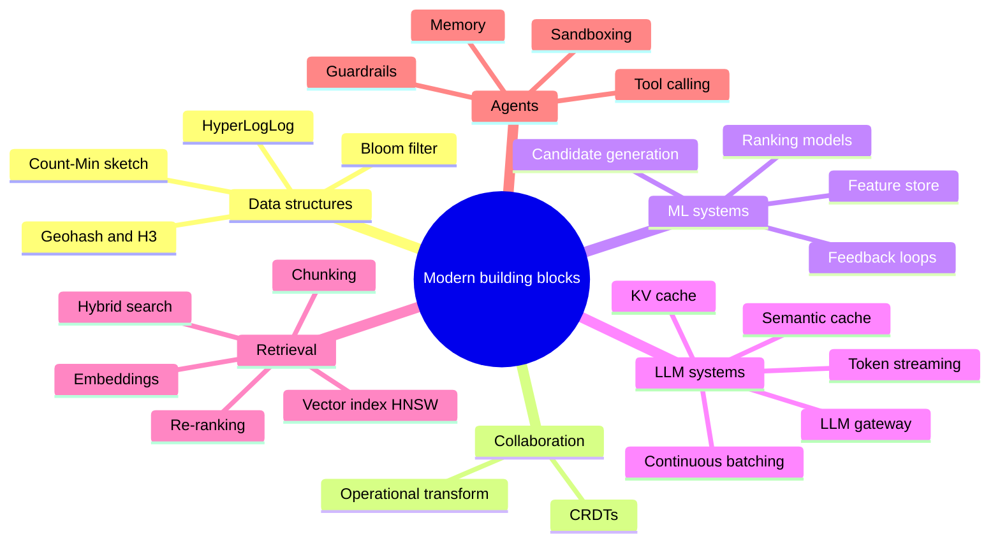

# 🚀 08 · Modern & Upcoming Topics MOC ➕

> [!important] Why this module exists
> None of these are in the original syllabus. They're here because 2026 interview reports show (a) classic questions now come with AI/ranking extensions, and (b) brand-new AI-native questions like "design an LLM inference API" are appearing. See [[System-Design-Trends-2026]].

| # | Note | Priority | Shows up in |
|---|---|---|---|
| 1 | [[Probabilistic-Data-Structures]] | ⭐ | Bloom filters (cache penetration, crawler), HLL (unique counts), Count-Min (top-K) |
| 2 | [[Geospatial-Indexing]] | ⭐ | Ride sharing, food delivery, "near me" |
| 3 | [[Real-Time-Collaboration-CRDTs]] | 💡 | Google Docs / Notion / Figma-style editing |
| 4 | [[Recommendation-and-Ranking-Systems]] | 💡 | Personalised feeds, "Twitter 2026", product recs |
| 5 | [[LLM-Serving-and-Inference]] | 💡 | "Design an LLM inference API", AI gateways, cost |
| 6 | [[RAG-and-Vector-Databases]] | 💡 | Enterprise search Q&A, "Slack + AI" |
| 7 | [[AI-Agent-Systems]] | 💡 | Agent infra, tool use, sandboxing |

**Case studies that use this module:** [[Design-LLM-Chat-Service]] · [[Design-Ride-Sharing]] · [[Design-Food-Delivery]] · [[Design-News-Feed]] · [[Design-Web-Crawler]] · [[Design-Leaderboard-Top-K]]

**Next module:** [[Interview-Playbook-MOC]] · **Up:** [[System-Design-MOC]]
