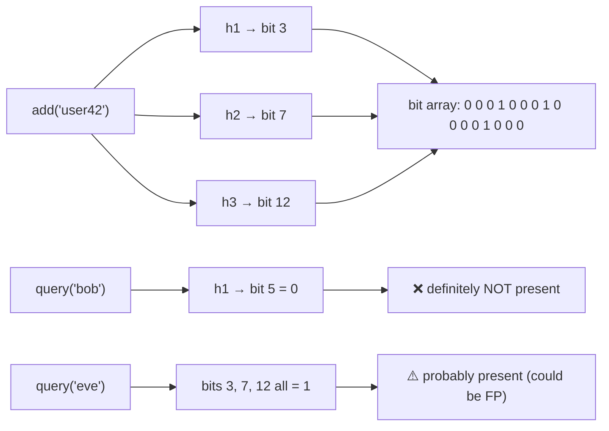
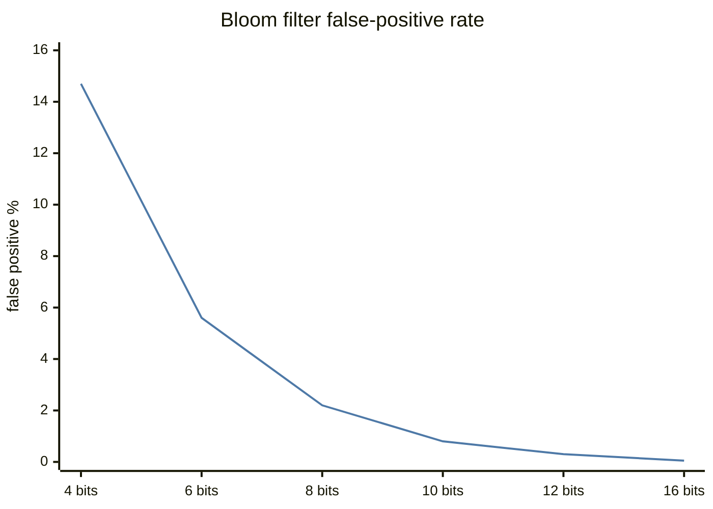
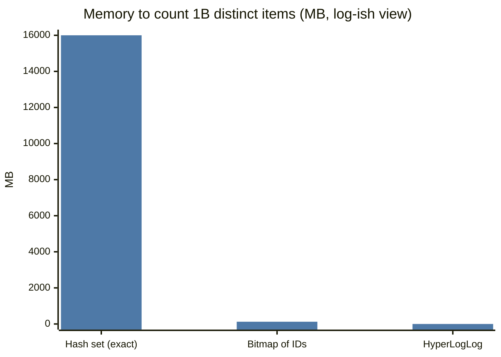
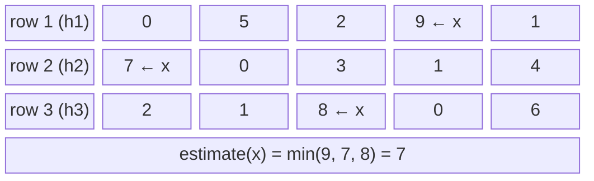

# Probabilistic Data Structures ➕

## What are they?

Data structures that answer questions **approximately** using **tiny, fixed memory** — trading a small, bounded error for massive savings. At billions of items, exact answers can cost terabytes; sketches cost kilobytes.

| Structure | Answers | Error type | Memory |
|---|---|---|---|
| **Bloom filter** | "Is X in the set?" | False positives (never false negatives) | ~10 bits/item for 1% FPR |
| **HyperLogLog (HLL)** | "How many distinct items?" | ~0.8% std error (Redis) | **12 KB** for billions |
| **Count-Min Sketch** | "How often did X occur?" | Overestimates only | width × depth counters |
| Cuckoo filter | Membership **with deletes** | False positives | Similar to Bloom |
| Top-K (heavy hitters) | "Most frequent items?" | Approximate | Count-Min + heap, or Space-Saving |

## Bloom filter

`m` bits, `k` hash functions. **Add:** set bits at `h1(x)…hk(x)`. **Query:** if any bit is 0 → *definitely not present*; if all 1 → *probably present*.

$$P_{\text{false positive}} \approx \left(1 - e^{-kn/m}\right)^k \qquad k_{\text{opt}} = \frac{m}{n}\ln 2$$

**Uses:** skip disk reads in LSM trees (Cassandra, RocksDB) → [[Indexing]]; block cache penetration → [[Cache-Pitfalls]]; crawler "already visited this URL?" → [[Design-Web-Crawler]]; "username taken?" pre-check; CDN "one-hit wonder" filtering (cache only on 2nd request).

## HyperLogLog

Hash each item; track the **max run of leading zeros** per bucket (seeing a hash starting with 20 zeros suggests ~2²⁰ distinct items). Average across thousands of buckets (harmonic mean) for accuracy. Mergeable: HLL(day1) ∪ HLL(day2) = HLL(both) → weekly uniques from daily sketches.

**Uses:** unique visitors per page, DAU, distinct search queries. Redis: `PFADD`, `PFCOUNT`, `PFMERGE`.

## Count-Min Sketch

`d` rows of `w` counters, one hash per row. **Add x:** increment one counter per row. **Estimate x:** **minimum** across rows (collisions only inflate counts).

**Uses:** trending hashtags, heavy hitters, per-IP request counts for abuse detection, top-K search queries → [[Design-Leaderboard-Top-K]] · [[Design-Typeahead]].

## 📊 Visual model

**Bloom filter add and query:**

**False-positive rate vs bits per item (optimal k):**

**Memory: exact vs sketch for 1 billion distinct user IDs (8-byte IDs):**

> [!note] The HLL bar is invisible — that's the point. ~16 GB vs ~125 MB vs **12 KB**.

**Count-Min Sketch estimate:**

## Common mistakes

> [!warning] Traps to avoid
> 1. Using a Bloom filter where false positives are unacceptable without a fallback check.
> 2. Deleting from a standard Bloom filter (breaks it) — use counting Bloom or cuckoo filters.
> 3. Sizing filters for today's item count; FPR climbs as n grows.
> 4. Using HLL when exact counts are legally required (billing) — sketches for dashboards, exact for invoices.

## Interview understanding

> [!question] What the interviewer is really testing
> - *"How do you check if a URL was crawled among 10B URLs?"* — Bloom filter in memory (~12 GB at 1% FPR), with exact check in the URL store on "maybe".
> - *"Count unique visitors per page per day?"* — HLL per (page, day) in Redis; merge for weekly.
> - *Tricky:* "Can a Bloom filter have false negatives?" — No (unless you delete).
> - *Tricky:* "Why does Count-Min take the minimum?" — Collisions only add; the smallest counter is least polluted.

## Mini quiz
1. Which structure never gives false negatives?
2. HLL memory in Redis?
3. Count-Min over- or under-estimates?
4. Structure for membership with deletes?
5. One LSM-tree use of Bloom filters?

> [!success]- Answers (click to reveal)
> 1. Bloom filter.
> 2. ~12 KB per key.
> 3. Overestimates only.
> 4. Cuckoo filter (or counting Bloom).
> 5. Skip SSTables that can't contain the key.

---
**Next:** [[Geospatial-Indexing]] · **Up:** [[Modern-Topics-MOC]]

## 📚 Resources
- 📄 [Redis — Probabilistic data types](https://redis.io/docs/latest/develop/data-types/probabilistic/)
- 📄 [Flajolet et al. — HyperLogLog paper](https://algo.inria.fr/flajolet/Publications/FlFuGaMe07.pdf)
- 🎮 [Bloom filter interactive (Jason Davies)](https://www.jasondavies.com/bloomfilter/)

## My notes
-
