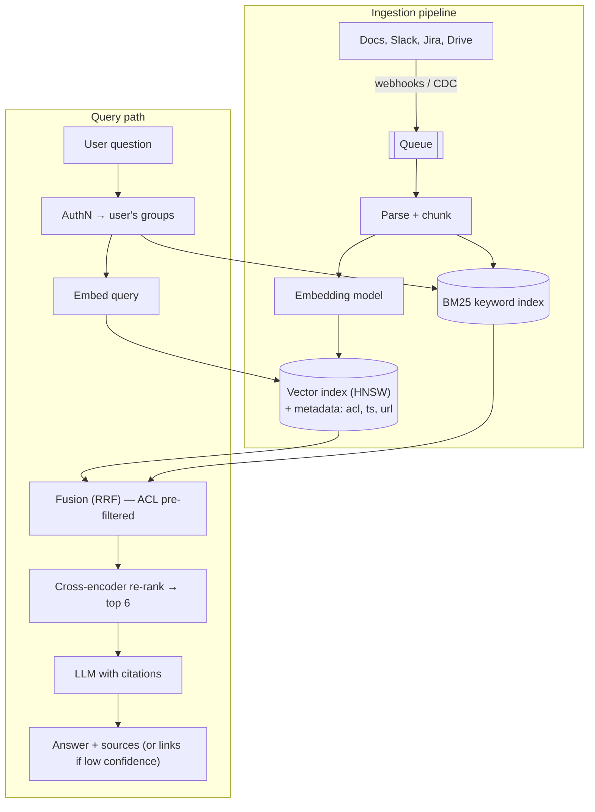
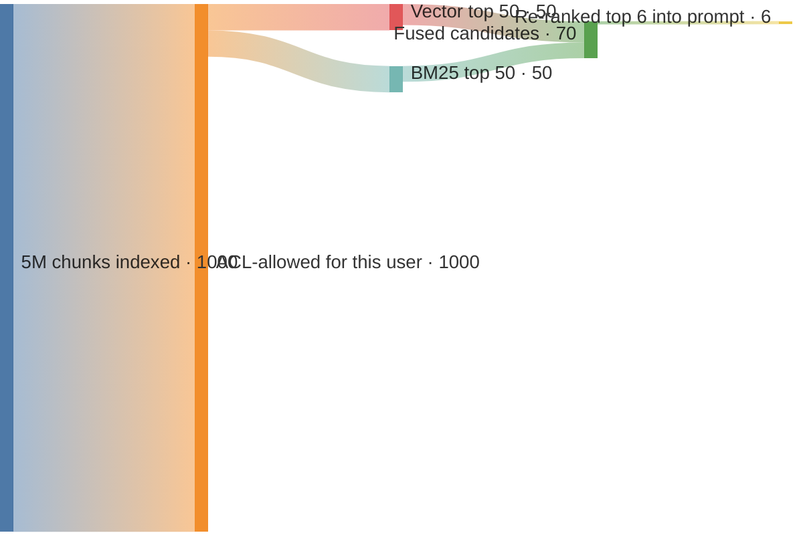
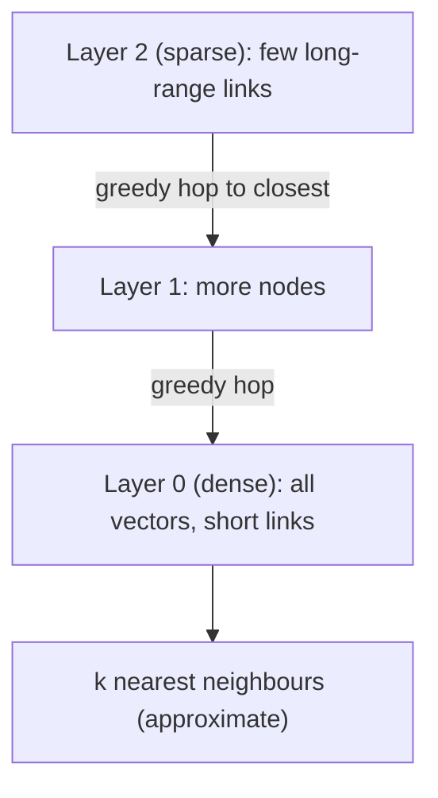
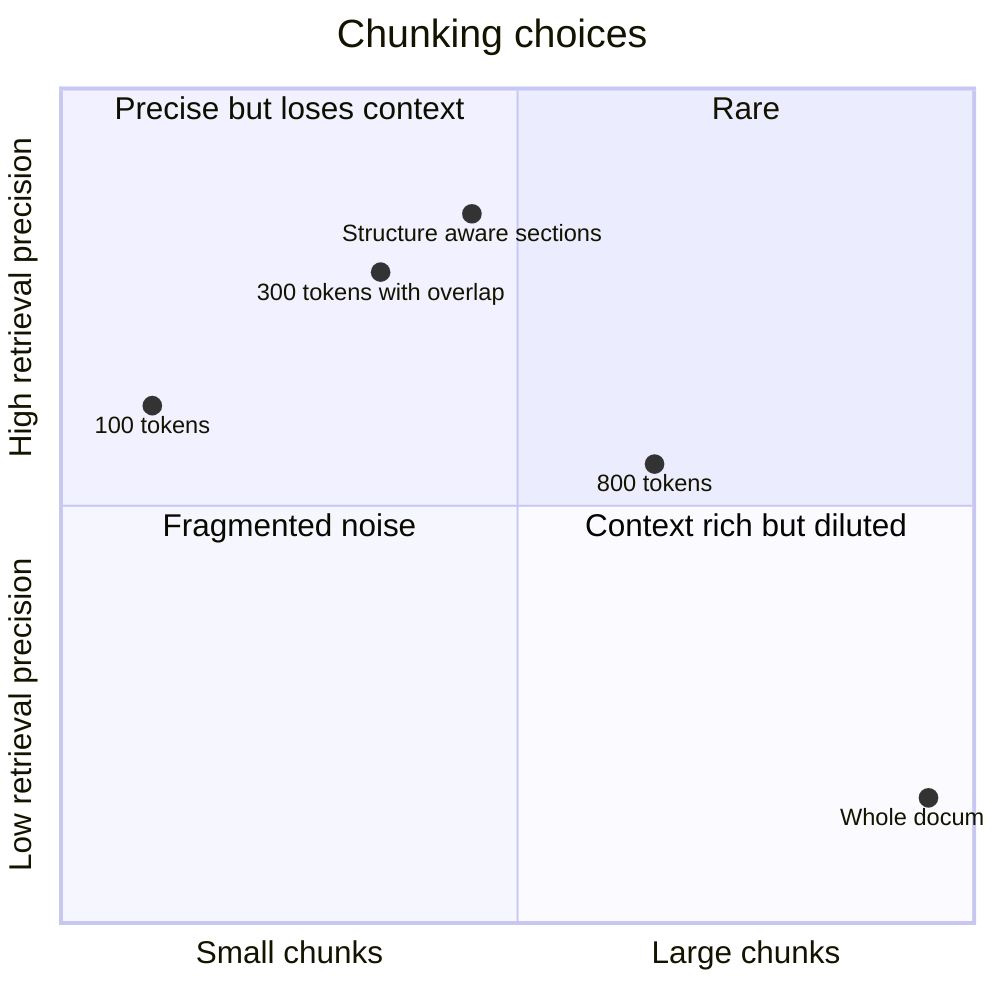

# RAG and Vector Databases ➕

## What is it?

**RAG (Retrieval-Augmented Generation):** before the LLM answers, **retrieve** relevant chunks from your own data and put them in the prompt, so answers are grounded, current, and citeable — without retraining the model.

**Vector database:** stores **embeddings** (dense vectors that encode meaning) and finds the nearest ones to a query vector fast (**ANN — approximate nearest neighbour** search).

## Why it exists

LLMs don't know your private/fresh data (company docs, Slack, tickets) and hallucinate when unsure. RAG = search engine + LLM.

## The two pipelines

**Ingestion (offline / streaming):** source connectors → parse (PDF, HTML, Slack) → **chunk** (e.g., 300–800 tokens with overlap, structure-aware: headings, code blocks) → **embed** → upsert into vector index **with metadata** (doc ID, ACL groups, timestamp, source URL) + keyword index.

**Query (online):** rewrite query (optionally) → embed → **hybrid retrieval** (vector ANN + BM25) with **ACL filter** → merge (reciprocal rank fusion) → **re-rank** top ~50 with a cross-encoder → top ~5–10 chunks into the prompt → LLM answers **with citations** → if low confidence, return links instead.

## Vector indexes (ANN)

| Index | Idea | Trade-off |
|---|---|---|
| Flat (brute force) | Compare against every vector | Exact, slow beyond ~1M |
| **HNSW** | Multi-layer proximity graph; greedy search from top layer down | Fast, high recall, **memory-heavy**; default in most vector DBs |
| IVF (+PQ) | Cluster vectors; search only nearest clusters; compress with product quantisation | Less memory, slightly lower recall; billion-scale |
| DiskANN | Graph index on SSD | Billion-scale on one machine |

Similarity: cosine / dot product / L2. Tune recall vs latency (`ef_search`, `nprobe`).

## Choosing a vector store

| Option | When |
|---|---|
| **pgvector** (Postgres) | Up to tens of millions of vectors, want transactions + joins + ACL filters in one DB |
| Elasticsearch/OpenSearch kNN | Already running search; hybrid in one engine |
| Pinecone, Weaviate, Qdrant, Milvus | Large scale, managed or specialised features |
| Vespa | Heavy hybrid ranking at scale |

## The hard parts interviewers probe

- **Access control:** filter by the user's groups **at retrieval** (pre-filter), never rely on the LLM to hide data. Sync ACL changes fast.
- **Freshness:** CDC/webhooks from sources → re-embed changed docs within an SLA (e.g., < 5 min); delete tombstones.
- **Chunking quality** decides answer quality more than the vector DB choice.
- **Hybrid search:** pure vectors miss exact tokens (ticket IDs, error codes, names) → add BM25.
- **Evaluation:** retrieval recall@k on a labelled set; answer faithfulness/groundedness (LLM-as-judge + human review); track in CI.
- **Prompt injection:** retrieved text is untrusted — it may contain "ignore previous instructions". → [[AI-Agent-Systems]]
- **Cost:** embedding at ingestion (one-time per chunk), context tokens per query (re-ranking lets you send fewer, better chunks), caching.

## 📊 Visual model

**End-to-end RAG architecture:**

**Retrieval funnel:**

**HNSW search intuition:**

**Chunk size trade-off (qualitative):**

## Common mistakes

> [!warning] Traps to avoid
> 1. Relying on the LLM prompt to enforce permissions.
> 2. Vector-only retrieval (misses exact IDs/keywords).
> 3. Stuffing 50 chunks into the prompt (cost, "lost in the middle").
> 4. No re-embedding/deletion pipeline → stale or leaked content.
> 5. No evaluation set — "it looks good" isn't a metric.

## Interview understanding

> [!question] What the interviewer is really testing
> - *"Design Q&A over company docs/Slack."* — Two pipelines, hybrid retrieval with ACL pre-filtering, re-ranking, citations, freshness SLA, evals, cost.
> - *Tricky:* "pgvector or a dedicated vector DB?" — pgvector until scale/latency demands otherwise; joins + ACLs + transactions are a big win.
> - *Tricky:* "How do you stop users seeing docs they can't access?" — Store ACLs as metadata, filter at query time by the user's resolved groups; propagate permission changes quickly.
> - *Tricky:* "HNSW vs IVF-PQ?" — Recall/latency with more RAM vs compressed memory for billion scale with some recall loss.

## Mini quiz
1. Two pipelines in RAG?
2. Why hybrid search?
3. Default ANN index type?
4. Where must access control happen?
5. One retrieval metric and one answer metric?

> [!success]- Answers (click to reveal)
> 1. Ingestion (parse, chunk, embed, index) and query (retrieve, re-rank, generate).
> 2. Vectors catch meaning, BM25 catches exact terms like IDs and names.
> 3. HNSW.
> 4. At retrieval time, via metadata filters — before anything reaches the LLM.
> 5. Recall@k; faithfulness/groundedness.

---
**Next:** [[AI-Agent-Systems]] · **Up:** [[Modern-Topics-MOC]]

## 📚 Resources
- 📄 [Lewis et al. — Retrieval-Augmented Generation (2020)](https://arxiv.org/abs/2005.11401)
- 📄 [Malkov & Yashunin — HNSW paper](https://arxiv.org/abs/1603.09320)
- 📄 [pgvector](https://github.com/pgvector/pgvector)
- 📄 [Anthropic — Contextual Retrieval](https://www.anthropic.com/news/contextual-retrieval)

## My notes
-
