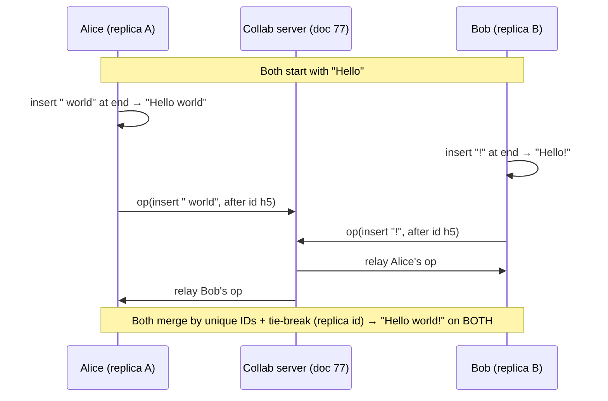
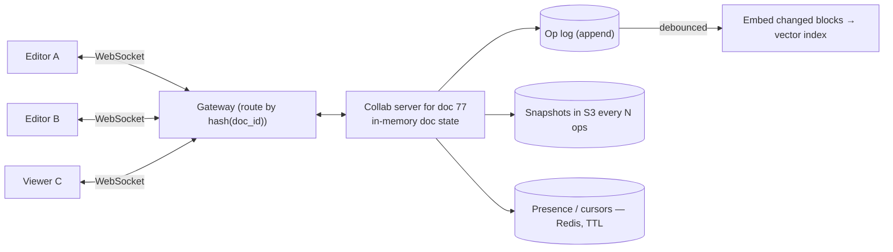
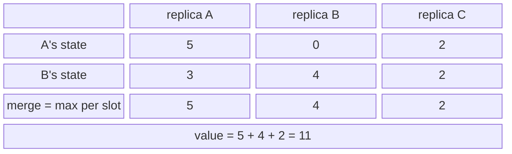

# Real-Time Collaboration and CRDTs ➕

> [!info] Why this is added
> 2026 reports say "Design Dropbox" is increasingly "Design Notion/Google Docs — real-time editing (+ AI summarisation)". The core problem is **concurrent edits that must converge**.

## The problem

Alice and Bob edit the same paragraph at the same time, possibly offline. Both edits must survive, and every replica must end up **identical** without a central lock.

## Two approaches

| | Operational Transformation (OT) | CRDTs |
|---|---|---|
| Idea | Transform each incoming op against concurrent ops so intent is preserved | Data types whose merges are mathematically guaranteed to converge |
| Needs central server? | Typically yes (server orders ops) | **No** — peer-to-peer & offline-first possible |
| Complexity | Transformation functions are notoriously tricky | Simpler merge logic, but metadata overhead |
| Used by | **Google Docs** (historically), Etherpad | **Figma** (CRDT-inspired), Notion-like apps, Apple Notes, Linear, Automerge, **Yjs** |

## CRDT intuition

Merges must be **commutative, associative, idempotent** → apply updates in any order, any number of times, same result.

| CRDT | How | Use |
|---|---|---|
| G-Counter | Each replica has its own counter; value = sum; merge = per-replica max | View counts |
| PN-Counter | Two G-counters (incr, decr) | Likes/unlikes |
| LWW-Register | Keep value with highest (timestamp, replica) | Single fields (title) |
| OR-Set | Adds tagged with unique IDs; remove only seen tags | Tags, shopping cart |
| Sequence CRDT (RGA, YATA/Yjs, Fugue) | Each character has a unique, ordered ID; inserts reference neighbours | **Collaborative text** |

## The collaboration architecture

- Clients edit locally (instant), send small **ops/updates** over WebSocket. → [[Real-Time-Communication]]
- A **collab server** per document (route all editors of a doc to the same server — consistent hashing on `doc_id`) relays ops, persists them, broadcasts to others.
- Persist an **op log** + periodic **snapshots** (compaction) in a DB/object store.
- **Presence & cursors** are ephemeral → in-memory/Redis, not the op log.
- Offline: queue ops locally, merge on reconnect (CRDT shines here).
- AI features: debounce re-embedding of changed blocks; summarise from snapshots. → [[RAG-and-Vector-Databases]]

## 📊 Visual model

**Concurrent edits converging:**

**System layout:**

**G-Counter merge (3 replicas):**

## Common mistakes

> [!warning] Traps to avoid
> 1. Locking the whole document for edits.
> 2. LWW on the full document body (loses one person's edits).
> 3. Broadcasting cursor moves through the durable op log.
> 4. Letting the op log grow forever without snapshots/compaction.
> 5. Spreading editors of one doc across servers without coordination.

## Interview understanding

> [!question] What the interviewer is really testing
> - *"How do two people edit the same doc simultaneously?"* — OT (server-ordered) or CRDT (convergent merges); route a doc's editors to one collab server; op log + snapshots.
> - *Tricky:* "OT vs CRDT?" — OT needs central ordering, complex transforms; CRDT converges peer-to-peer/offline but carries metadata.
> - *Tricky:* "How do you scale to thousands of concurrent editors on one doc?" — One doc server is the bottleneck: batch/coalesce ops, fan out via pub/sub tier, viewers get throttled snapshots instead of every keystroke.
> - *Tricky:* "What's a G-Counter's merge?" — Per-replica max, value = sum.

## Mini quiz
1. Three properties a CRDT merge must have?
2. Which approach suits offline-first?
3. Where do cursors/presence live?
4. Why snapshots?
5. How do you route editors of the same doc?

> [!success]- Answers (click to reveal)
> 1. Commutative, associative, idempotent.
> 2. CRDTs.
> 3. In-memory / Redis with TTL (ephemeral).
> 4. Bound op-log replay time and storage.
> 5. Consistent hashing on doc_id to one collab server.

---
**Next:** [[Recommendation-and-Ranking-Systems]] · **Up:** [[Modern-Topics-MOC]]

## 📚 Resources
- 📄 [Figma — How Figma's multiplayer technology works](https://www.figma.com/blog/how-figmas-multiplayer-technology-works/)
- 📄 [crdt.tech — resources](https://crdt.tech/)
- 📄 [Yjs docs](https://docs.yjs.dev/)
- 📄 [Martin Kleppmann — CRDTs: The hard parts (talk)](https://martin.kleppmann.com/2020/07/06/crdt-hard-parts-hydra.html)

## My notes
-
