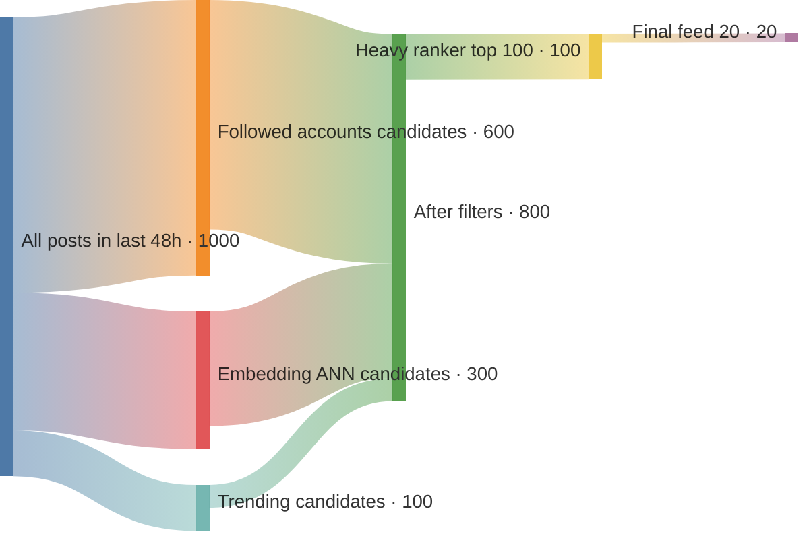
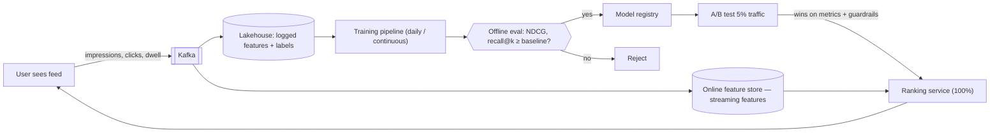

# Recommendation and Ranking Systems ➕

> [!info] Why this is added
> "Design Twitter/Instagram feed" in 2026 increasingly expects a **ranking layer**: candidate generation → feature hydration → ML ranking inside a latency budget (~200 ms p95), plus evals and feedback loops. You don't need to be an ML engineer — you need the **system** around the model.

## The multi-stage funnel

Scoring every item for every user is impossible (billions × millions). So narrow down in stages, each more expensive per item:

| Stage | Input → output | Technique | Budget |
|---|---|---|---|
| **Candidate generation (retrieval)** | Millions → ~1,000 | Followed accounts, collaborative filtering, **two-tower embeddings + ANN search**, trending, location | ~20–50 ms |
| **Filtering** | Remove seen, blocked, unsafe, out-of-stock | Bloom filters, rules | ~5 ms |
| **Feature hydration** | Fetch features for (user, item) pairs | **Feature store** (online: Redis/Cassandra) | ~20–40 ms |
| **Ranking** | ~1,000 → ~100 scored | Gradient-boosted trees / deep model predicting P(click), P(like), watch time | ~50–80 ms |
| **Re-ranking / policy** | → final 20 | Diversity, freshness, ads insertion, business rules, exploration | ~10 ms |

## Key components

- **Two-tower model:** user tower → user embedding; item tower → item embedding; similarity = dot product. Item embeddings precomputed + indexed in an ANN index (FAISS/ScaNN/vector DB) → fast retrieval. → [[RAG-and-Vector-Databases]]
- **Feature store:** same feature definitions offline (training) and online (serving) to avoid **training–serving skew**. Feast, Tecton, in-house.
- **Logging & feedback loop:** impressions, clicks, dwell time → Kafka → training data. Log the features *used at serving time*.
- **Offline evals:** NDCG, recall@k, AUC on held-out data — run in CI on every model change.
- **Online evals:** A/B tests on business metrics (engagement, retention, GMV) with guardrail metrics.
- **Exploration vs exploitation:** reserve slots for new/uncertain items (epsilon-greedy, Thompson sampling, bandits) to avoid filter bubbles and cold start.
- **Cold start:** new users → popular/trending + onboarding signals; new items → content-based embeddings.

## 📊 Visual model

**The ranking funnel:**

**Serving path with latency budget:**

```mermaid
gantt
    title Feed request — 200 ms p95 budget
    dateFormat x
    axisFormat %L ms
    section Retrieval
    Candidate generation (parallel sources) :0, 40
    Filtering (seen, blocked)               :40, 50
    section Features
    Feature store lookups                   :50, 90
    section Ranking
    Model inference (GPU/CPU batch)         :90, 160
    Re-rank + diversity + ads               :160, 175
    section Response
    Hydrate post content from cache         :175, 195
```

**Offline/online loop:**

## Common mistakes

> [!warning] Traps to avoid
> 1. Treating the model as a black box ("ML magic ranks it").
> 2. Ranking millions of items in one stage.
> 3. No feature store → training/serving skew.
> 4. No exploration → feedback loop narrows content.
> 5. Ignoring latency budget and fallbacks (ranking down → chronological).

## Interview understanding

> [!question] What the interviewer is really testing
> - *"How do you personalise the feed?"* — Multi-stage funnel with numbers, feature store, ranking model, logging, A/B tests, fallback.
> - *Tricky:* "What's training–serving skew?" — Features computed differently offline vs online → model sees different data in production.
> - *Tricky:* "How do you handle a new user?" — Popular/trending, onboarding choices, contextual signals; explore aggressively.
> - *Tricky:* "Ranking service is slow — degrade how?" — Lighter model, cached rankings, or chronological feed.

## Mini quiz
1. Stages of the funnel?
2. What does a two-tower model produce?
3. Why a feature store?
4. Name an offline and an online metric.
5. Why exploration?

> [!success]- Answers (click to reveal)
> 1. Candidate generation → filtering → feature hydration → ranking → re-ranking.
> 2. User and item embeddings whose dot product approximates relevance.
> 3. Consistent features for training and serving; low-latency online lookups.
> 4. Offline: NDCG / recall@k. Online: CTR, watch time, retention via A/B.
> 5. Avoid filter bubbles; learn about new items/users (cold start).

---
**Next:** [[LLM-Serving-and-Inference]] · **Up:** [[Modern-Topics-MOC]]

## 📚 Resources
- 📄 [Twitter/X — recommendation algorithm (open-sourced, 2023)](https://blog.x.com/engineering/en_us/topics/open-source/2023/twitter-recommendation-algorithm)
- 📄 [Covington et al. — Deep Neural Networks for YouTube Recommendations](https://research.google/pubs/deep-neural-networks-for-youtube-recommendations/)
- 📄 [Eugene Yan — System design for recommendations and search](https://eugeneyan.com/writing/system-design-for-discovery/)

## My notes
-
