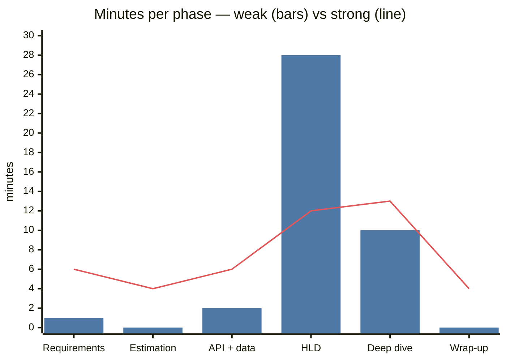
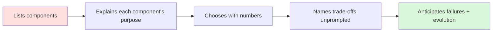

# ❌ → ✅ Common Mistakes and a Mock Interview

## The 15 mistakes that sink candidates

| # | Mistake | Fix |
|---|---|---|
| 1 | Drawing boxes in minute 1 | 5–7 min of requirements first |
| 2 | No scope boundaries | Say what's out of scope |
| 3 | No numbers | 3-minute estimate; tie each number to a decision |
| 4 | Buzzword soup ("Kafka, K8s, microservices") | Every component must answer "what problem does this solve here?" |
| 5 | Over-engineering for 1k users | Design for the stated scale + one step beyond |
| 6 | Under-engineering for 100M users | Single DB with no replicas/cache at stated scale |
| 7 | Silent thinking | Narrate options and why you pick one |
| 8 | No trade-offs | "I chose X over Y because…, cost is…" |
| 9 | Hand-waving the hard part | Go deep on the bottleneck, not the easy parts |
| 10 | Ignoring failure | What if the cache/DB/region dies? |
| 11 | Ignoring consistency per feature | Money/seats strict; likes eventual |
| 12 | Forgetting idempotency on writes | Idempotency keys on POSTs and consumers |
| 13 | Fighting the interviewer's hint | Hints are steering — follow them |
| 14 | Running out of time with no deep dive | Keep HLD to the happy path; time-box |
| 15 | Not summarising | 60-second wrap: design, trade-offs, next steps |

## 📊 Visual model

**Where weak candidates spend time vs strong candidates (45 min):**

**Signal ladder:**

---

## Mock: "Design a URL shortener" — done badly

> **Interviewer:** Design a URL shortener.
> **Candidate:** OK, so we'll have a load balancer, then microservices — a URL service and an analytics service — on Kubernetes. We'll use Kafka for events and Cassandra because it scales. For the short code I'll hash the URL with MD5. Redis for caching. *(draws for 20 minutes)*
> **Interviewer:** How many URLs per day?
> **Candidate:** Uh, a lot? Millions.
> **Interviewer:** What happens if two URLs hash to the same code?
> **Candidate:** MD5 collisions are rare so it's fine.
> **Interviewer:** 301 or 302?
> **Candidate:** 301, it's standard.
> **Interviewer:** You lose click analytics then.
> **Candidate:** Oh. Then 302.

**What went wrong:** no requirements, no numbers, buzzword stack with no justification, truncated hash collision hand-waved, didn't know the redirect trade-off, no deep dive, no failure discussion.

## Same problem — done well

> **Candidate:** Before designing, a few questions. Core features: shorten a URL and redirect — anything else? Custom aliases? Expiry? Analytics?
> **Interviewer:** Custom aliases optional, basic click counts yes.
> **Candidate:** Scale — how many new URLs per day, and the read:write ratio?
> **Interviewer:** 100M new per day, reads 10× writes.
> **Candidate:** So writes ≈ 100M / 10⁵ ≈ 1.2k/s avg, ~3k peak; reads ≈ 12k/s avg, ~30k peak — read-heavy, so cache the redirect path. Over 5 years that's ~180B URLs; at ~500 bytes each ≈ 90 TB, so we'll need a horizontally scalable store. 7 base62 characters give 62⁷ ≈ 3.5 trillion codes — plenty.
> For the API: `POST /urls {longUrl, alias?}` → `{shortUrl}`, and `GET /{code}` → redirect.
> I'll draw the happy path… *(LB → write service → ID generator → KV store; read service → Redis → KV store)*
> For codes I see two options: hashing + collision check, or a counter + base62. Hashing needs a lookup on every write to detect collisions; a counter guarantees uniqueness. I'll use a counter with **range allocation** — each write server leases blocks of 1M IDs from a coordinator, so there's no per-request coordination. Trade-off: codes are sequential and guessable; if that matters I'd shuffle the bits with a reversible permutation.
> Redirect: **302** because we need click counts; 301 would let browsers cache and skip us. Clicks go async to Kafka → aggregator so the redirect path stays ~10 ms.
> Storage: a KV store like DynamoDB/Cassandra keyed by code — pure key lookups, 90 TB, horizontally scalable. Cache hot codes in Redis — access is skewed so an LRU cache with a 90%+ hit rate takes reads off the store.
> Failures: if Redis dies, reads fall back to the KV store, which can handle 30k/s; if an ID-range server dies we just lose the unused part of its range — gaps are fine.
> **Interviewer:** Nice. What if one URL goes viral?
> **Candidate:** Hot key — it's in Redis, but one shard could saturate; add an in-process L1 cache with a few seconds' TTL on read servers, and the CDN can cache 302s for a short TTL if we accept slightly undercounted clicks…

**Why it works:** scoped, quantified, every component justified, options + trade-offs, failure handling, handles the follow-up with a known pattern. Full design → [[Design-URL-Shortener]].

---
**Next:** [[Trade-off-Language]] · **Up:** [[Interview-Playbook-MOC]]

## 📚 Resources
- 🎥 Search "mock system design interview" on [Exponent](https://www.youtube.com/@tryexponent) and [Hello Interview](https://www.youtube.com/@hello_interview) — watch one weak and one strong.
- 📄 [Hello Interview — common mistakes](https://www.hellointerview.com/learn/system-design/in-a-hurry/introduction)

## My notes
-
