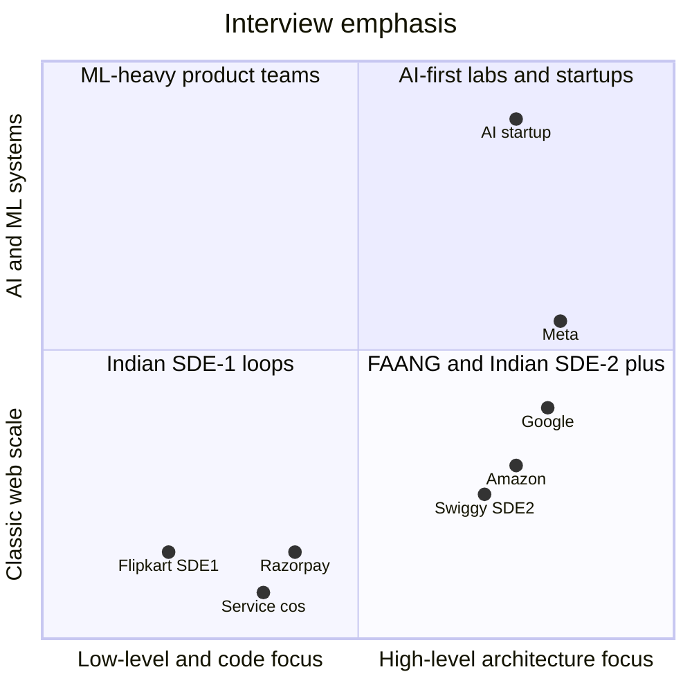
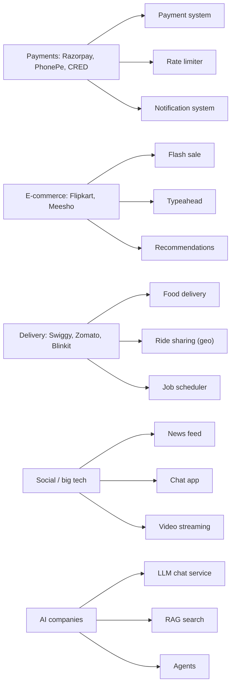

# 🏢 Company Patterns — What Gets Asked Where

> [!warning] Treat as directional
> Compiled from public interview-experience posts and prep-platform write-ups (sources below). Loops change often — always confirm the round structure with your recruiter.

## Indian product companies & unicorns

| Company | Loop shape (reported) | Design themes to prepare |
|---|---|---|
| **Flipkart** | OA → **machine coding (90 min, working code)** → DSA ×2 → HM; SDE-2+ adds HLD | Inventory, flash sales (Big Billion Days), e-commerce features, recommendations → [[Design-Flash-Sale]] |
| **Razorpay** | OA → DSA → **machine coding/LLD** → HLD → culture | Payment gateway, reconciliation, subscriptions, fraud → [[Design-Payment-System]] |
| **Swiggy** | OA → DSA ×2 → HLD (SDE-2+) → HM; machine coding sometimes; high LLD bar reported for SDE-1 | Delivery routing, ETA, partner assignment → [[Design-Food-Delivery]] |
| **Zomato / Blinkit** | OA/take-home → DSA → HLD (SDE-2+) → HM/founder | Restaurant search & ranking, delivery assignment, dark-store inventory, surge pricing |
| **Meesho** | OA → DSA → DSA or machine coding → HLD → HM | Recommendations for small sellers, order tracking |
| **PhonePe** | Similar to Flipkart; HLD for SDE-2+ | UPI-style payments, high-TPS transaction systems, idempotency |
| **CRED** | Selective; DSA + design, strong code-quality emphasis | Clean LLD, payments/rewards |

**Pattern:** Indian SDE-1 loops lean on **machine coding/LLD**; HLD becomes the deciding round from SDE-2. Domain-flavoured problems are common — prepare the company's own product as a design problem.

## FAANG / big tech

| Company | What's distinctive |
|---|---|
| **Google** | Often open-ended, scale-heavy (YouTube, Drive, Maps, search). Deep probing on one component; numbers expected. |
| **Amazon** | System design + **Leadership Principles** woven in; ownership & operational excellence (monitoring, failure handling). |
| **Meta** | "Product design" vs "system design" rounds; feeds, messaging, live video, ranking. |
| **Microsoft** | Mix of HLD and LLD depending on team; Teams/Outlook-style messaging, collaborative docs. |
| **Uber** | Geo, dispatch, surge, payments, real-time — heavy on geospatial + streaming. |

## AI-first companies & AI teams (2026)

- LLM inference API, RAG over enterprise data, model-serving platforms, agent infrastructure. → [[Modern-Topics-MOC]]
- Some allow AI assistance in the round; graded on **verifying** outputs and reasoning, not producing diagrams.
- Cost-per-request and evaluation pipelines are expected discussion points.

## Service companies & mass recruiters

TCS, Infosys, Wipro, Accenture, Cognizant, Capgemini: mostly conceptual questions (what is load balancing, SQL vs NoSQL, REST, caching, microservices), occasionally a simple design. → [[Conceptual-Questions]]

## 📊 Visual model

**Where each type of company puts weight:**

**Domain → case study map:**

Notes: [[Design-Payment-System]] · [[Design-Rate-Limiter]] · [[Design-Notification-System]] · [[Design-Flash-Sale]] · [[Design-Typeahead]] · [[Recommendation-and-Ranking-Systems]] · [[Design-Food-Delivery]] · [[Design-Ride-Sharing]] · [[Design-Job-Scheduler]] · [[Design-News-Feed]] · [[Design-Chat-App]] · [[Design-Video-Streaming]] · [[Design-LLM-Chat-Service]] · [[RAG-and-Vector-Databases]] · [[AI-Agent-Systems]]

## How to prepare for a specific company (checklist)

- [ ] Read 5 recent interview experiences (LeetCode Discuss, GeeksforGeeks, Glassdoor) — note the round structure.
- [ ] Design **their core product** end to end once (Swiggy → food delivery).
- [ ] Read 2 of their engineering-blog posts (most Indian unicorns publish: Swiggy Bytes, Razorpay Engineering, Flipkart Tech, Zomato blog).
- [ ] Prepare 2 project stories that map to their domain.

---
**Next:** [[Common-Mistakes-and-Mock-Interview]] · **Up:** [[Interview-Playbook-MOC]]

## 📚 Sources
- [Indian Unicorn Interviews: Flipkart, Meesho, Zomato, Razorpay (Jobrise, 2026)](https://jobrise.io/blog/flipkart-meesho-zomato-interview-india)
- [Swiggy SDE-1 — high expectation in LLD round (LeetCode Discuss)](https://leetcode.com/discuss/interview-experience/7278246)
- [Flipkart SDE-2 interview experience (LeetCode Discuss)](https://leetcode.com/discuss/post/5470072/Flipkart-Interview-Experience-or-SDE-2-or-June-2024/)
- [AI in System Design Interviews 2026 (techinterview.org)](https://www.techinterview.org/post/3233474919/ai-in-system-design-interviews-2026/)

## My notes
-
