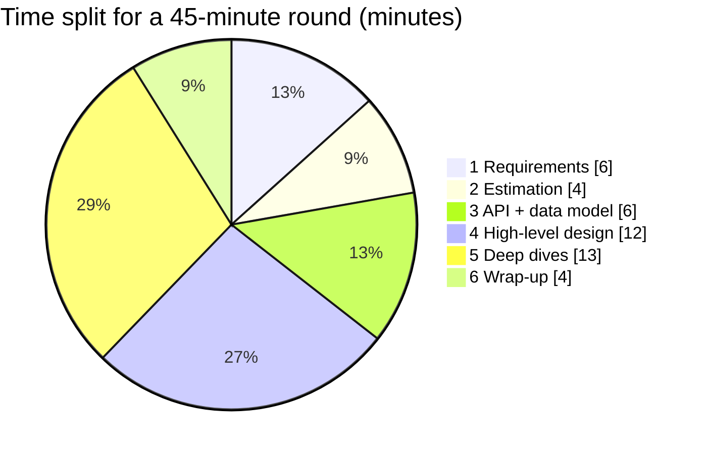
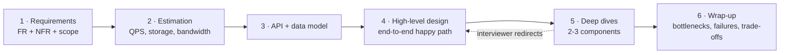
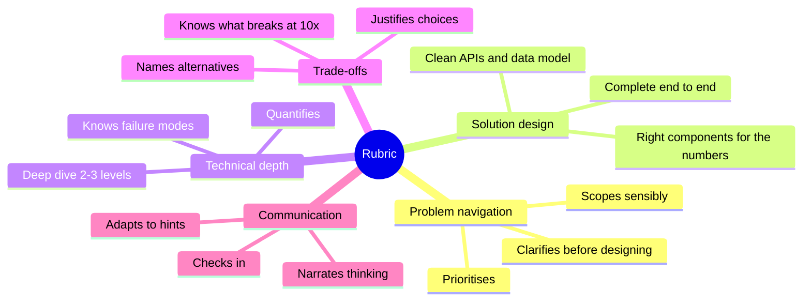
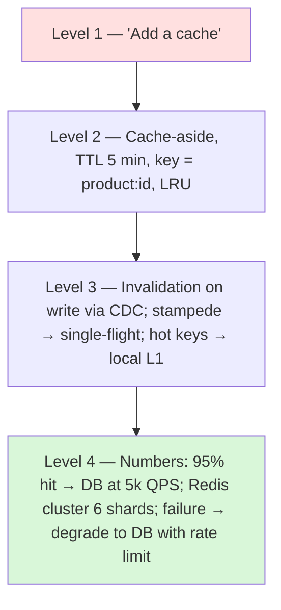
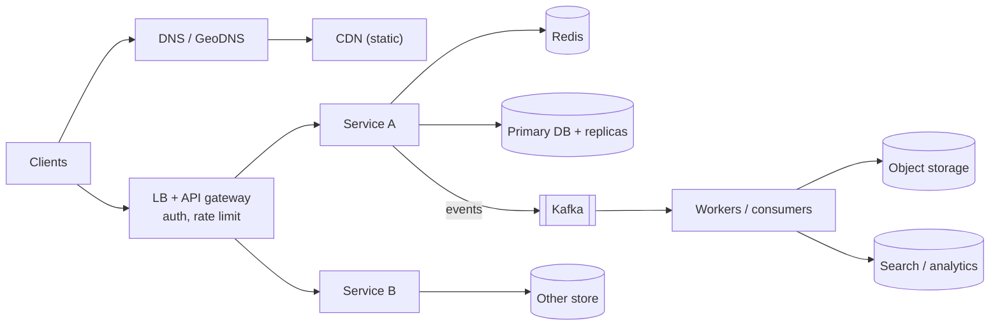

# 🧭 The System Design Interview Framework

> [!important] The one rule
> **You drive.** The interviewer is a stakeholder, not a guide. Narrate, decide, justify, and check in — every 5 minutes.

## The 6 steps (45-minute round)





---

### Step 1 — Requirements (5–7 min)

**Functional:** list 3–5 core features. Explicitly park the rest: *"Out of scope: payments, admin panel, analytics."*

**Non-functional — always ask about:**
- Scale: DAU, read/write ratio, peak events (sale days, IPL final)
- Latency target (p99)
- Consistency needs per feature (money? seats? likes?)
- Availability target
- Durability, data retention, compliance/region
- (2026) Cost sensitivity, especially for LLM features

**Clarifying questions template:**
```text
Who are the users and how many (DAU, peak)?
What are the 3 most important actions?
Read-heavy or write-heavy?
How fresh must data be? Which data can never be wrong?
Mobile, web, or both? Global or India-only?
Any existing infra I should assume (cloud, Kafka)?
```

### Step 2 — Estimation (3–5 min)

Only what changes the design: QPS (avg, peak), storage/year, bandwidth, maybe number of servers/connections. **End each number with "…so we need X."** → [[Estimation-and-Latency-Numbers]]

### Step 3 — API + data model (5–7 min)

- 3–6 endpoints: method, path, key params, response. Mention idempotency keys and cursor pagination where relevant. → [[API-Design]]
- Core entities and the **access pattern** for each → pick storage. → [[Choosing-a-Database]]

### Step 4 — High-level design (10–12 min)

Draw the **happy path end to end** first: client → edge → LB/gateway → services → data stores → async pipeline. Walk one request through it out loud. Don't optimise yet.

### Step 5 — Deep dives (12–15 min)

Pick (or let the interviewer pick) the 2–3 hardest parts. For each: the problem, 2 options, the trade-off, your choice, what breaks at 10×.

Typical deep dives: hot keys / celebrity problem, consistency of a critical write, fan-out strategy, real-time delivery, ID generation, cache invalidation, geo queries, exactly-once/idempotency, failure of a dependency.

### Step 6 — Wrap-up (3–5 min)

- Bottlenecks & single points of failure, and how you'd remove them.
- Monitoring: the 2–3 SLIs you'd alert on.
- What you'd do with more time (multi-region, ML ranking, cost optimisation).

---

## 📊 Visual model

**What interviewers score (typical rubric dimensions):**



**The deep-dive ladder — how far to go on one component:**



SDE-1 reaching level 2–3 is strong. SDE-2 should reach 3 on at least two components. Senior should hit 4 unprompted.

## The universal HLD skeleton (adapt per problem)



## Communication habits that score

- Think out loud: *"I'm considering X and Y; X is simpler but Y handles celebrities…"*
- Check in after each step: *"Does this scope match what you had in mind?"*
- When stuck: state what you know, pick a reasonable assumption, move on.
- When the interviewer hints: take it gracefully, they're steering you toward what they want to grade.
- Use the interviewer's numbers; write them down visibly.

## Common mistakes

> [!warning] Traps to avoid
> See [[Common-Mistakes-and-Mock-Interview]] for the full list. Top three: designing before clarifying, no numbers, no trade-offs.

## Interview understanding

> [!question] What the interviewer is really testing
> - *"Where do I start?"* — Always requirements. Even if the interviewer says "just design it", spend 3 minutes confirming scope.
> - *"The interviewer keeps interrupting with questions."* — Good sign: answer, then return to your agenda.
> - *"I ran out of time before deep dives."* — You over-spent on requirements/estimation or drew too much detail early. Keep step 4 to the happy path.

## Mini quiz
1. The 6 steps in order?
2. How many minutes for deep dives in 45?
3. What do NFRs drive?
4. How do you end every estimate?
5. What goes in the wrap-up?

> [!success]- Answers (click to reveal)
> 1. Requirements → estimation → API/data model → HLD → deep dives → wrap-up.
> 2. ~12–15.
> 3. The architecture (storage, replication, caching, consistency).
> 4. "…so we need X" — tie it to a design decision.
> 5. Bottlenecks/SPOFs, monitoring, failure handling, what you'd improve.

---
**Next:** [[Level-Expectations]] · **Up:** [[Interview-Playbook-MOC]] · **Practise on:** [[Case-Studies-MOC]]

## 📚 Resources
- 📖 *System Design Interview Vol 1 & 2* (Alex Xu) — Ch. 3 "A framework for system design interviews".
- 📄 [Hello Interview — System design delivery framework](https://www.hellointerview.com/learn/system-design/in-a-hurry/delivery)
- 🎥 Syllabus L22 — Padhowithpratyush.

## My notes
-
