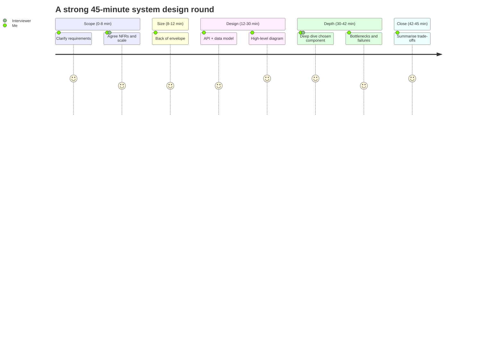

# 🎤 09 · Interview Playbook MOC

| # | Note | What it gives you |
|---|---|---|
| 1 | [[Interview-Framework]] (L22) | The 6-step, 45-minute script — use it for every case study |
| 2 | [[Level-Expectations]] | What SDE-1 vs SDE-2 vs Senior must show |
| 3 | [[Company-Patterns]] | What Indian product companies, FAANG and AI startups ask |
| 4 | [[Common-Mistakes-and-Mock-Interview]] | A mock done badly, then well — side by side |
| 5 | [[Trade-off-Language]] | Phrases that make your reasoning audible |
| 6 | [[LLD-and-Machine-Coding-Primer]] | SOLID, patterns, LRU/parking lot — for SDE-1 machine coding rounds |

**Next:** [[Case-Studies-MOC]] · **Up:** [[System-Design-MOC]]
