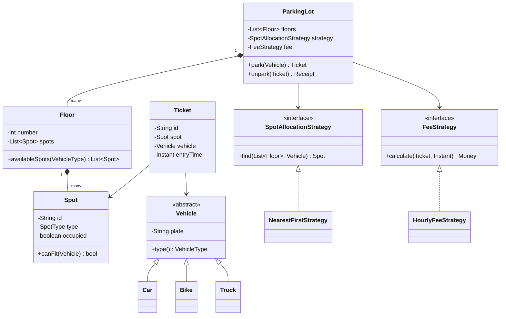
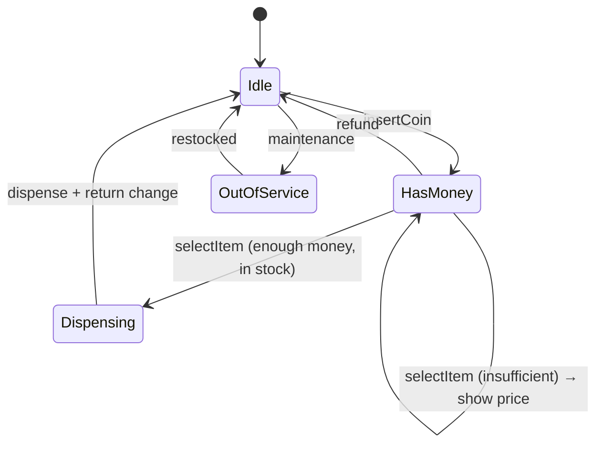
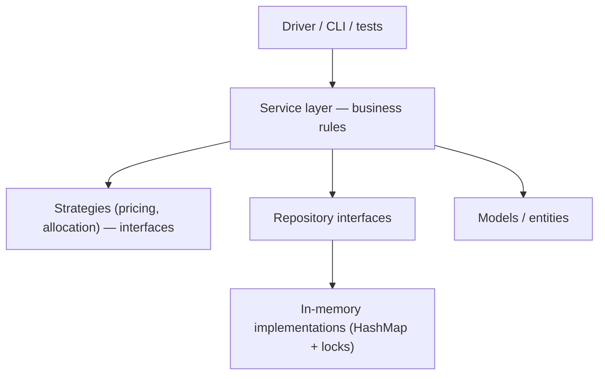

# 🧩 LLD and Machine Coding Primer ➕

> [!info] Why this is here
> For **SDE-1 in Indian product companies** (Flipkart, Razorpay, Swiggy, CRED), the design round is usually **low-level design / machine coding** — build a working, extensible program in ~90 minutes. HLD knowledge helps you talk; LLD gets you hired at this level.

## What graders look for

| Criterion | What it means |
|---|---|
| **Working code** | It runs, main flows demoed, edge cases handled |
| **Modelling** | Right entities, clear responsibilities |
| **Extensibility** | New vehicle type / payment method / pricing rule = new class, not `if` chains |
| **SOLID + patterns** | Used where they help, not sprinkled |
| **Clean code** | Naming, small methods, no god classes, separation of layers |
| **Concurrency awareness** | Thread safety where shared state exists |
| **Testability** | Interfaces, dependency injection, at least a driver/test |

## SOLID in one line each

| Principle | One-liner | Smell when violated |
|---|---|---|
| **S**ingle responsibility | One reason to change per class | `ParkingLot` also calculates fees and prints tickets |
| **O**pen/closed | Extend with new code, don't edit old | `switch(vehicleType)` everywhere |
| **L**iskov substitution | Subtypes usable wherever the base type is | `Penguin extends Bird` but `fly()` throws |
| **I**nterface segregation | Small, focused interfaces | `Machine` with print/scan/fax for a simple printer |
| **D**ependency inversion | Depend on abstractions | Service `new`s a concrete `MySQLRepo` |

## Patterns that show up most

| Pattern | Use in machine coding |
|---|---|
| **Strategy** | Pricing/fee rules, payment methods, splitting algorithms (Splitwise), rate-limit algorithms |
| **Factory** | Create vehicles/spots/notifications by type |
| **Singleton** (sparingly) | Single in-memory store/manager in a demo |
| **Observer** | Notify subscribers (order status, stock alerts) |
| **State** | Vending machine, order lifecycle, elevator |
| **Builder** | Complex object construction (orders, queries) |
| **Decorator** | Add-ons (pizza toppings, logging/caching wrappers) |
| **Command** | Undo/redo, job queues |
| **Chain of responsibility** | Request validation pipelines, middleware |

## Most-asked LLD / machine coding problems

Parking lot · Splitwise · Snake & ladder · Tic-tac-toe/chess · Elevator system · Vending machine · **LRU cache** · Rate limiter (in-memory) · Library management · BookMyShow (in-memory) · Cab booking (in-memory) · Inventory management · Logger/pub-sub · Key-value store with TTL · Meeting room scheduler · Food ordering (in-memory)

## Worked example — Parking lot model



Concurrency: two cars racing for the last spot → lock per spot / `synchronized` allocation / `AtomicBoolean.compareAndSet` on `occupied`.

## Worked example — LRU cache (O(1))

```python
class Node:
    __slots__ = ("k", "v", "prev", "next")
    def __init__(self, k=None, v=None):
        self.k, self.v, self.prev, self.next = k, v, None, None

class LRUCache:
    def __init__(self, capacity: int):
        self.cap, self.map = capacity, {}
        self.head, self.tail = Node(), Node()          # sentinels: head <-> ... <-> tail
        self.head.next, self.tail.prev = self.tail, self.head

    def _remove(self, n):  n.prev.next, n.next.prev = n.next, n.prev
    def _add_front(self, n):
        n.next, n.prev = self.head.next, self.head
        self.head.next.prev = n; self.head.next = n

    def get(self, k):
        if k not in self.map: return -1
        n = self.map[k]; self._remove(n); self._add_front(n)
        return n.v

    def put(self, k, v):
        if k in self.map: self._remove(self.map[k])
        n = Node(k, v); self.map[k] = n; self._add_front(n)
        if len(self.map) > self.cap:
            lru = self.tail.prev; self._remove(lru); del self.map[lru.k]
```

Follow-ups: thread safety (lock or segment locks), TTL per key, LFU variant, distributed version → [[Caching]] · [[Redis-Deep-Dive]].

## 📊 Visual model

**Vending machine as a State pattern:**



**The 90-minute machine-coding plan:**

```mermaid
gantt
    title Machine coding round — 90 minutes
    dateFormat HH:mm
    axisFormat %H:%M
    section Understand
    Read problem, ask questions, list features :a1, 00:00, 10m
    section Model
    Entities, interfaces, patterns on paper     :a2, after a1, 10m
    section Build
    Core models + in-memory repos               :a3, after a2, 20m
    Services + main flows                       :a4, after a3, 25m
    section Polish
    Edge cases, validation, concurrency         :a5, after a4, 10m
    Driver / demo + tests                       :a6, after a5, 10m
    section Buffer
    Explain extensibility to interviewer        :milestone, a7, after a6, 5m
```



**Layering every solution should have:**



## Common mistakes

> [!warning] Traps to avoid
> 1. Coding before modelling — 10 minutes of design saves 30 of refactoring.
> 2. Everything in one class / `main`.
> 3. Pattern stuffing (a Singleton for everything).
> 4. Not finishing — a working subset beats an elegant half.
> 5. Ignoring concurrency when the problem has shared resources (spots, seats, inventory).

## Interview understanding

> [!question] What the interviewer is really testing
> - *"Add a new vehicle type / payment method."* — If your answer is "add a class, register it", you've shown Open/Closed.
> - *Tricky:* "Make it thread-safe." — Identify shared mutable state; lock at the smallest scope; or CAS/atomic operations.
> - *Tricky:* "How would this become a distributed service?" — Bridge to HLD: repos → DB, locks → DB constraints/distributed locks, in-memory queue → Kafka.

## Mini quiz
1. Which pattern for interchangeable pricing rules?
2. Data structures for an O(1) LRU?
3. State vs Strategy?
4. What does Open/Closed look like in code?
5. First 10 minutes of machine coding?

> [!success]- Answers (click to reveal)
> 1. Strategy.
> 2. Hash map + doubly linked list.
> 3. State: behaviour changes with internal state transitions; Strategy: caller picks an interchangeable algorithm.
> 4. New behaviour via a new class implementing an interface, no edits to existing logic.
> 5. Clarify requirements, list features, agree on scope.

---
**Up:** [[Interview-Playbook-MOC]] · **Related:** [[Level-Expectations]]

## 📚 Resources
- 📄 [Refactoring.Guru — Design patterns](https://refactoring.guru/design-patterns) — *Why:* the clearest visual explanations.
- 📄 [awesome-low-level-design (GitHub, ashishps1)](https://github.com/ashishps1/awesome-low-level-design)
- 📖 *Head First Design Patterns*.

## My notes
-
