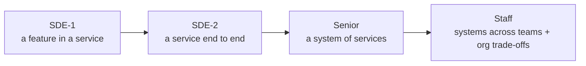

# 🪜 Level Expectations — SDE-1 vs SDE-2 vs Senior

## The short version

| | SDE-1 (0–2 yrs) | SDE-2 (2–5 yrs) | Senior / SDE-3+ (5+ yrs) |
|---|---|---|---|
| Round in India | Often **LLD / machine coding**; light HLD or none | **Dedicated HLD** + LLD/machine coding | HLD (sometimes 2), architecture/behavioural depth |
| Who drives | Interviewer guides; you follow the framework | You drive; interviewer probes | You drive **and** reshape the problem |
| Breadth | Standard components, correct placement | Complete design with justified choices | Complete + alternatives + evolution path |
| Depth | 1 component to level 2–3 | 2–3 components to level 3 | Multiple to level 4, unprompted |
| Numbers | Basic QPS/storage | Numbers drive decisions | Numbers + cost + capacity planning |
| Trade-offs | Names them when asked | Names them proactively | Quantifies them, discusses org/ops impact |
| Failure handling | Mentions replicas/retries | Specific failure modes + mitigation | Blast radius, multi-region, degradation strategy, SLOs |
| Typical problems | URL shortener, rate limiter, parking lot (LLD), LRU cache | Chat, feed, notifications, payments, booking | Payments at scale, global systems, LLM platform, ambiguous product prompts |

## 📊 Visual model

**What each level is expected to show (score 1–5):**

```mermaid
%%{init: {"themeVariables": {"xyChart": {"plotColorPalette": "#4E79A7, #E15759, #59A14F, #F28E2B, #B07AA1"}}}}%%
xychart-beta
    title "Expected bar by level (1-5) — requirements, numbers, breadth, depth, trade-offs, failures"
    x-axis ["Requirements", "Numbers", "Breadth", "Depth", "Trade-offs", "Failures"]
    y-axis "expected score" 0 --> 5
    bar [3, 2, 3, 2, 2, 2]
    bar [4, 4, 4, 3, 4, 3]
    line [5, 5, 5, 5, 5, 5]
```

> [!note] Bars = SDE-1, SDE-2. Line = Senior.

**Scope of ownership grows with level:**

## SDE-1 — what "strong" looks like

- Follows [[Interview-Framework]] cleanly, asks good clarifying questions.
- Correct basics: stateless servers + LB, SQL vs NoSQL with a reason, cache-aside, replicas, a queue for async work.
- Can implement/discuss LLD: classes, interfaces, patterns, concurrency basics, clean runnable code in machine coding. → [[LLD-and-Machine-Coding-Primer]]
- Honest: "I haven't used Kafka in production, but my understanding is…"

## SDE-2 — what "strong" looks like

- Drives the whole round; uses numbers to decide (shard or not, cache or not).
- Deep dives: e.g., fan-out on write vs read with celebrity handling; idempotency + saga for payments; WebSocket routing across servers.
- Identifies failure modes and mitigations without being asked.
- Domain sense for the company's problems (payments for Razorpay, delivery for Swiggy).

## Senior — what "strong" looks like

- Challenges requirements ("Do we need strong consistency here, or read-your-writes?").
- Presents an evolution path (v1 monolith → v2 split at X scale).
- Talks cost, operability, team boundaries, migrations, multi-region, SLOs and error budgets.
- Handles ambiguity: "Design a system to reduce delivery ETAs" — frames metrics, data, and architecture.

## Tailoring this vault to me (Agnik — SDE, ~0–1 yr exp, targeting product companies + big tech)

- Priority 1: [[LLD-and-Machine-Coding-Primer]] + tier-1 concepts in [[Where-to-Focus]] — that's the SDE-1 bar.
- Priority 2: the 10 core case studies to SDE-2 depth — that's what makes an SDE-1 candidate stand out.
- Use my real projects as talking points: Wish Karo's website stack (scaling a commerce site, caching product pages, payment flows), Kublet's Gemini integration (LLM cost, latency, streaming → [[LLM-Serving-and-Inference]]), JobPilot/Impleo (queues for background research jobs, rate limits on third-party APIs).

## Mini quiz
1. Which round dominates SDE-1 loops in Indian product companies?
2. Biggest jump from SDE-1 to SDE-2 in HLD?
3. What does a senior add beyond trade-offs?
4. How deep should SDE-2 go on deep dives?

> [!success]- Answers (click to reveal)
> 1. Machine coding / LLD (plus DSA).
> 2. Driving the round and letting numbers + trade-offs drive decisions proactively.
> 3. Evolution path, cost, operability, org boundaries, quantified failure handling.
> 4. Level 3 on at least two components.

---
**Next:** [[Company-Patterns]] · **Up:** [[Interview-Playbook-MOC]] · **Full ladder (SDE-1 → Staff) + market context:** [[SDE-Career-Ladder]] · [[Market-Research-2026]]

## 📚 Resources
- 📄 [Jobrise — Indian unicorn interview processes (2026)](https://jobrise.io/blog/flipkart-meesho-zomato-interview-india)
- 📄 [Hello Interview — what's expected at each level](https://www.hellointerview.com/learn/system-design/in-a-hurry/introduction)

## My notes
-
