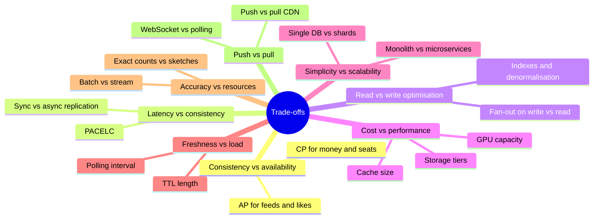
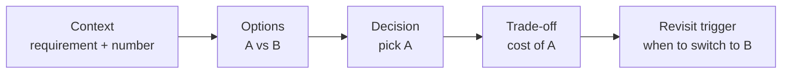
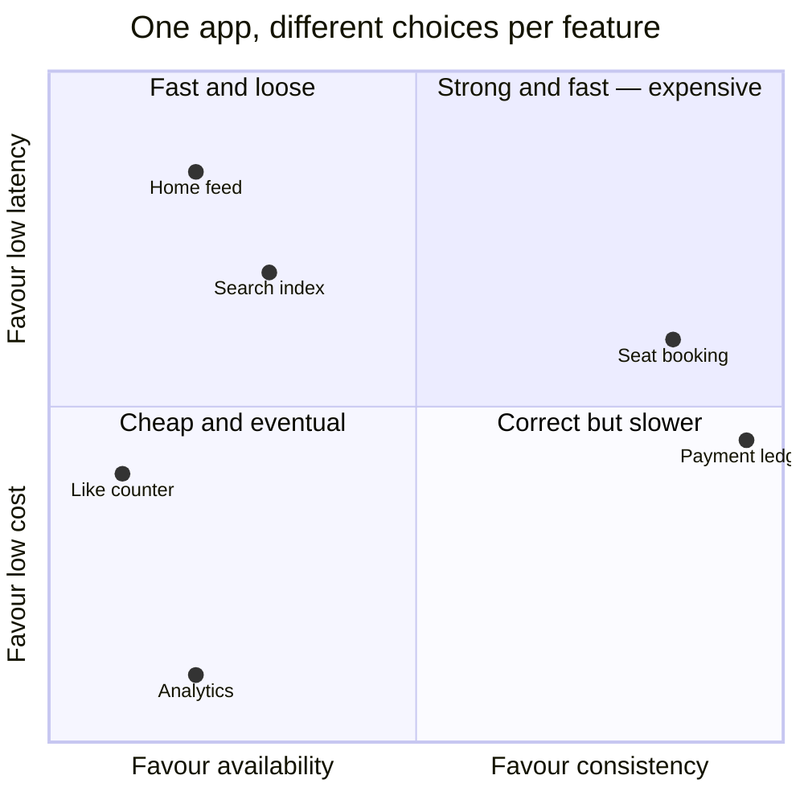

# 🗣️ Trade-off Language

> The difference between a "hire" and a "strong hire" is often whether the interviewer can **hear** your reasoning. These phrases make it audible.

## The trade-off sentence template

> **"I'm choosing ___ over ___ because ___ (requirement/number). The cost is ___. If ___ changes, I'd switch to ___."**

Example: *"I'm choosing fan-out on write over fan-out on read because reads outnumber writes 100:1 and feed latency is our key NFR. The cost is write amplification for users with millions of followers. If celebrities become a big share of posts, I'd switch to a hybrid: fan-out on read for them."*

## The classic trade-off axes

## Phrase bank

**Scoping**
- "To keep this focused, I'll treat X as out of scope unless you'd like me to include it."
- "I'll assume India-first with ~10M DAU — tell me if the scale is different."

**Deciding**
- "Given the 100:1 read ratio, the read path is what I'll optimise."
- "This is the critical path, so it stays synchronous; everything else goes async through a queue."
- "Here we need correctness over availability — a double booking is worse than a brief error."

**Quantifying**
- "That's ~12k QPS — a single Postgres primary with replicas handles it; sharding isn't needed yet."
- "At 95% cache hit rate the DB sees ~600 QPS."

**Acknowledging limits**
- "The weak point of this design is ___; here's how I'd mitigate it."
- "This is eventually consistent — users might see a like count a few seconds stale, which is acceptable here."

**Evolving**
- "V1 would be a monolith with these modules; I'd split out ___ when ___."
- "If traffic grows 10×, the first thing to break is ___."

**Checking in**
- "Does this match what you had in mind, or should I go deeper on ___?"
- "I see two directions — the storage layer or real-time delivery. Which is more interesting to you?"

## 📊 Visual model

**The decision record you're speaking out loud:**

**Pick a position on each axis per feature:**

---
**Next:** [[LLD-and-Machine-Coding-Primer]] · **Up:** [[Interview-Playbook-MOC]] · **Practise:** [[Trade-off-Questions]]

## My notes
-
