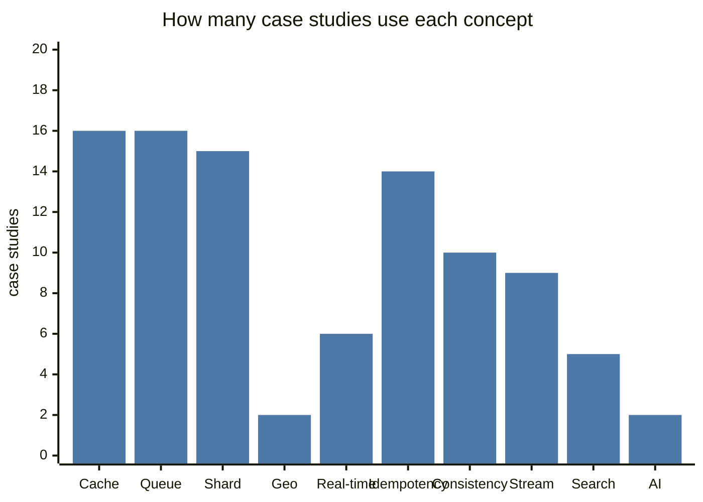

# 🏗️ 10 · Case Studies MOC

> [!important] How to use these
> Never read a case study first. Read the **problem box only**, set a 45-minute timer, solve it with [[Interview-Framework]], *then* open the note and diff. Log what you missed in "My gaps". Visual board: [[Case-Study-Concept-Map.canvas|Case-study concept map (Canvas)]].

## The list

| # | Case study | Source | Level | Signature concepts |
|---|---|---|---|---|
| 1 | [[Design-URL-Shortener]] | L23 | 🟢 | IDs, base62, read-heavy cache, 301 vs 302 |
| 2 | [[Design-Rate-Limiter]] | L24 | 🟡 | Token bucket, sliding window, Redis Lua |
| 3 | [[Design-Chat-App]] | L25 | 🟡 | WebSockets, registry, per-conv ordering, receipts |
| 4 | [[Design-News-Feed]] | L26 | 🟡 | Fan-out on write vs read, celebrities, ranking |
| 5 | [[Design-Video-Streaming]] | L27 | 🟡 | Transcoding DAG, HLS/ABR, CDN, live spikes |
| 6 | [[Design-Ticket-Booking]] | L28 | 🟡 | Seat locking, holds with TTL, waiting room |
| 7 | [[Design-Ride-Sharing]] | L29 | 🔴 | Geo index, 250k writes/s, matching, surge |
| 8 | [[Design-Payment-System]] | L30 | 🔴 | Idempotency, ledger, reconciliation |
| 9 | [[Design-Notification-System]] | Practice | 🟡 | Priority queues, retries, dedupe, fallback |
| 10 | [[Design-Typeahead]] | Practice | 🟡 | Trie + top-k, offline pipeline, edge caching |
| 11 | [[Design-File-Storage-Sync]] | Practice | 🔴 | Chunking, dedup, change journal, conflicts |
| 12 | [[Design-Key-Value-Store]] | Practice | 🔴 | Consistent hashing, quorum, hinted handoff, LSM |
| 13 | [[Design-Food-Delivery]] | Practice | 🔴 | Geo + saga + dispatch + tracking (India favourite) |
| 14 | [[Design-Web-Crawler]] | ➕ | 🟡 | Frontier, politeness, Bloom filter |
| 15 | [[Design-Job-Scheduler]] | ➕ | 🔴 | Leases, fencing, timing wheel, :00 spikes |
| 16 | [[Design-Leaderboard-Top-K]] | ➕ | 🟡 | Redis ZSET, Count-Min + heap |
| 17 | [[Design-Flash-Sale]] | ➕ | 🔴 | Oversell prevention, hot key, waiting room |
| 18 | [[Design-Ad-Click-Aggregator]] | ➕ | 🔴 | Flink windows, dedupe, Lambda reconciliation |
| 19 | [[Design-LLM-Chat-Service]] | ➕ 2026 | 🔴 | Streaming, token quotas, GPU batching, RAG |

🟢 warm-up · 🟡 core · 🔴 deep

## 📊 Concept coverage matrix

Which concepts each case study forces you to use (great for picking what to practise next):

| Case ↓ / Concept → | Cache | Queue | Shard | Geo | Real-time | Idempotency | Consistency | Stream | Search | AI |
|---|---|---|---|---|---|---|---|---|---|---|
| URL shortener | ✅ | ✅ | ✅ | | | | | | | |
| Rate limiter | ✅ | | ✅ | | | | ✅ | | | |
| Chat | ✅ | ✅ | ✅ | | ✅ | ✅ | ✅ | | | |
| News feed | ✅ | ✅ | ✅ | | | | | ✅ | | ✅ |
| Video | ✅ | ✅ | | | | ✅ | | ✅ | | |
| Ticket booking | ✅ | ✅ | | | | ✅ | ✅ | | ✅ | |
| Ride sharing | ✅ | ✅ | ✅ | ✅ | ✅ | ✅ | ✅ | ✅ | | |
| Payment | | ✅ | ✅ | | | ✅ | ✅ | ✅ | | |
| Notification | ✅ | ✅ | | | ✅ | ✅ | | | | |
| Typeahead | ✅ | | ✅ | | | | | ✅ | ✅ | |
| File sync | ✅ | ✅ | ✅ | | ✅ | ✅ | ✅ | | | |
| KV store | | | ✅ | | | | ✅ | | | |
| Food delivery | ✅ | ✅ | ✅ | ✅ | ✅ | ✅ | ✅ | ✅ | ✅ | |
| Web crawler | ✅ | ✅ | ✅ | | | ✅ | | | ✅ | |
| Job scheduler | | ✅ | ✅ | | | ✅ | ✅ | | | |
| Leaderboard | ✅ | ✅ | ✅ | | | ✅ | | ✅ | | |
| Flash sale | ✅ | ✅ | ✅ | | | ✅ | ✅ | | | |
| Ad clicks | ✅ | ✅ | ✅ | | | ✅ | | ✅ | | |
| LLM chat | ✅ | ✅ | | | ✅ | ✅ | | ✅ | ✅ | ✅ |

> [!tip] Reading the chart
> Caching, queues, sharding and idempotency appear in almost every design — that's why they're tier 1 in [[Where-to-Focus]].

## Suggested order

```mermaid
flowchart LR
    A["URL shortener"] --> B["Rate limiter"] --> C["Chat"] --> D["Notification"] --> E["News feed"]
    E --> F["Ticket booking"] --> G["Payment"] --> H["Ride sharing"] --> I["Food delivery"]
    I --> J["Video"] --> K["Typeahead"] --> L["File sync"] --> M["KV store"]
    M --> N["Flash sale"] --> O["Job scheduler"] --> P["Leaderboard"] --> Q["Ad clicks"] --> R["Web crawler"] --> S["LLM chat"]
```

## Unseen-problem list (for timed mocks — no notes here, on purpose)

Design: Google Calendar · Uber Eats group ordering · Instagram Stories · Zoom/Google Meet · Pastebin · Distributed cache · Metrics/monitoring system (Prometheus-like) · Stock exchange order book · Splitwise at scale · Hotel booking (Airbnb) · E-commerce checkout · Slack + AI search · Online judge (LeetCode) · Distributed message queue (build Kafka) · Google Docs · Coupon/offer engine · UPI-style payment switch · Live comments on a cricket stream · Price tracker / alerts · Multiplayer game backend

---
**Up:** [[System-Design-MOC]] · **Framework:** [[Interview-Framework]]
