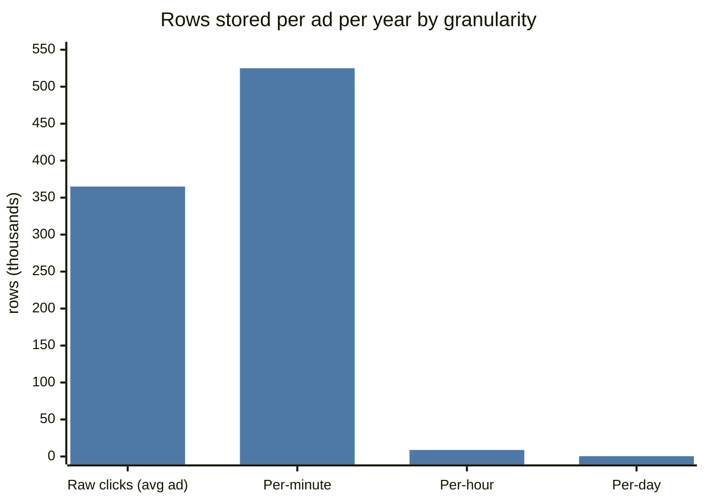
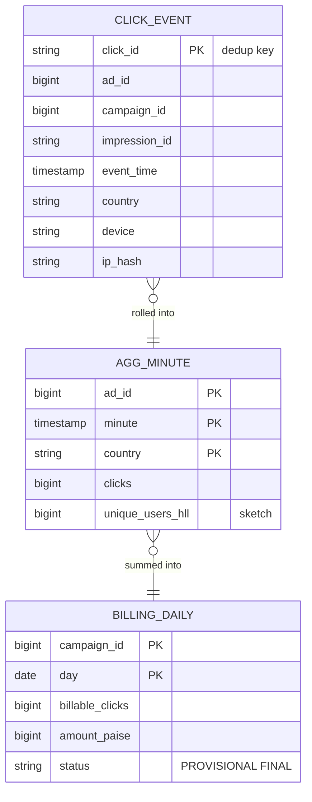
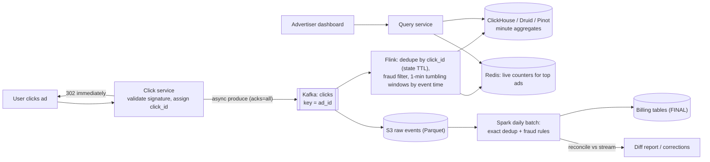
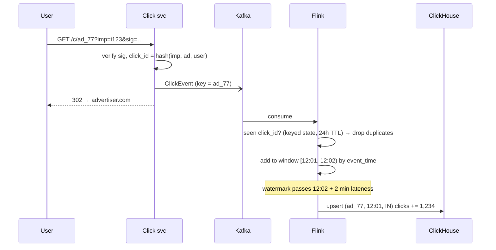

# 📊 Design an Ad Click Aggregator

> [!abstract] Problem
> Ads are shown and clicked billions of times a day. Advertisers need **near-real-time dashboards** (clicks per ad per minute) and **exact numbers for billing**. Clicks redirect users to the advertiser's site. (Same pattern powers: usage-based billing for LLM tokens, IoT metrics, page-view analytics.)

## 1. Clarifying questions

- Query patterns? → *clicks per ad/campaign per minute/hour/day, filtered by country/device*
- Latency of dashboards? → *≤ 1 minute*
- Billing accuracy? → *exact, deduplicated, auditable*
- Scale? → *10B clicks/day, peak 300k/s*
- Fraud? → *basic click-fraud filtering*

## 2. Requirements

| Functional | Non-functional |
|---|---|
| Record click + redirect user fast | Redirect p99 < 50 ms — never wait on analytics |
| Aggregate clicks by ad/campaign/time/dims | Dashboards fresh within ~1 min |
| Query aggregates over arbitrary ranges | **No double counting** (billing), no loss |
| Exact daily billing numbers | Handle late events (mobile offline) |

## 3. Estimation

```text
10B clicks/day ≈ 115k/s avg, 300k/s peak; event ~200 B → 2 TB/day raw
Aggregates: 10M active ads × 1440 minutes × few dims → ~10–50B rows/day before rollups
→ keep minute granularity for 7–30 days, hourly for a year, daily forever (rollups)
```



## 4. API

```http
GET /c/{adId}?imp={impressionId}&sig=…    → 302 to advertiser URL  (click recorded async)
GET /v1/ads/{adId}/metrics?from=&to=&granularity=minute&groupBy=country
GET /v1/campaigns/{id}/billing?date=2026-11-06    → exact, reconciled
```

## 5. Data model



## 6. High-level design



## 7. Key flows



**Late events and watermarks:**

```mermaid
gantt
    title Window 12:01-12:02 with 2 min allowed lateness
    dateFormat HH:mm:ss
    axisFormat %H:%M
    section Window
    Collect events (event time)     :w1, 12:01:00, 60s
    Allowed lateness                :w2, 12:02:00, 120s
    section Output
    Early result emitted            :milestone, m1, 12:02:05, 0s
    Final result (watermark passed) :milestone, m2, 12:04:00, 0s
    section Late beyond lateness
    Goes to side output → batch fix :crit, l1, 12:04:00, 60s
```



## 8. Deep dives

### Exactly-once counting
At-least-once into Kafka (producer idempotence on) → Flink dedupe by `click_id` with keyed state → Flink checkpoints + **idempotent/transactional sink** (upsert by primary key) → effectively-once aggregates. Batch reprocessing from raw S3 gives the final billing truth (**Lambda-style reconciliation** for money). → [[Idempotency]] · [[Batch-and-Stream-Processing]]

### Hot ads
A viral ad's key overloads one partition → **pre-aggregate** in a first stage keyed by `(ad_id, random salt)`, then merge by `ad_id`. → [[Sharding-and-Partitioning]]

### Storage choice
Columnar OLAP (ClickHouse/Druid/Pinot) — fast group-bys over billions of rows, rollups, TTL by granularity. Never the OLTP DB. → [[Choosing-a-Database]]

### Unique users
HyperLogLog per (ad, window) — mergeable across windows. → [[Probabilistic-Data-Structures]]

### Fraud
Stream rules (same IP/device clicking repeatedly, impossible click rates, no matching impression) + offline ML; flagged clicks excluded from billing.

## 9. Bottlenecks & trade-offs

| Choice | Trade-off |
|---|---|
| Stream only (Kappa) vs stream + batch (Lambda) | One codebase vs exact, auditable billing |
| Allowed lateness | Completeness vs result delay & state size |
| Minute granularity retention | Query flexibility vs storage cost |
| Dedupe window (24 h state) | Correctness vs Flink state size |

## 10. Follow-ups & tricky questions

- *"Kafka down?"* — Click service buffers locally to disk briefly; redirect still works; replay later.
- *"Advertiser sees 1,000 clicks on dashboard but billed 950?"* — Dashboard = provisional (stream), billing = reconciled (dedup + fraud) — state it in the product.
- *2026:* "Usage-based billing for an LLM API" — identical pipeline with tokens instead of clicks. → [[LLM-Serving-and-Inference]]

## 11. What each level should cover

| SDE-1 | SDE-2 | Senior |
|---|---|---|
| Async click logging, Kafka, aggregation job, OLAP | Event-time windows, watermarks, dedupe, idempotent sinks, hot keys | Lambda reconciliation for billing, fraud, retention/rollup economics |

## 🧠 Concepts used
[[Kafka-Deep-Dive]] · [[Batch-and-Stream-Processing]] · [[Idempotency]] · [[Probabilistic-Data-Structures]] · [[Choosing-a-Database]] · [[Sharding-and-Partitioning]]

## My gaps
-

---
**Next:** [[Design-LLM-Chat-Service]] · **Up:** [[Case-Studies-MOC]]
