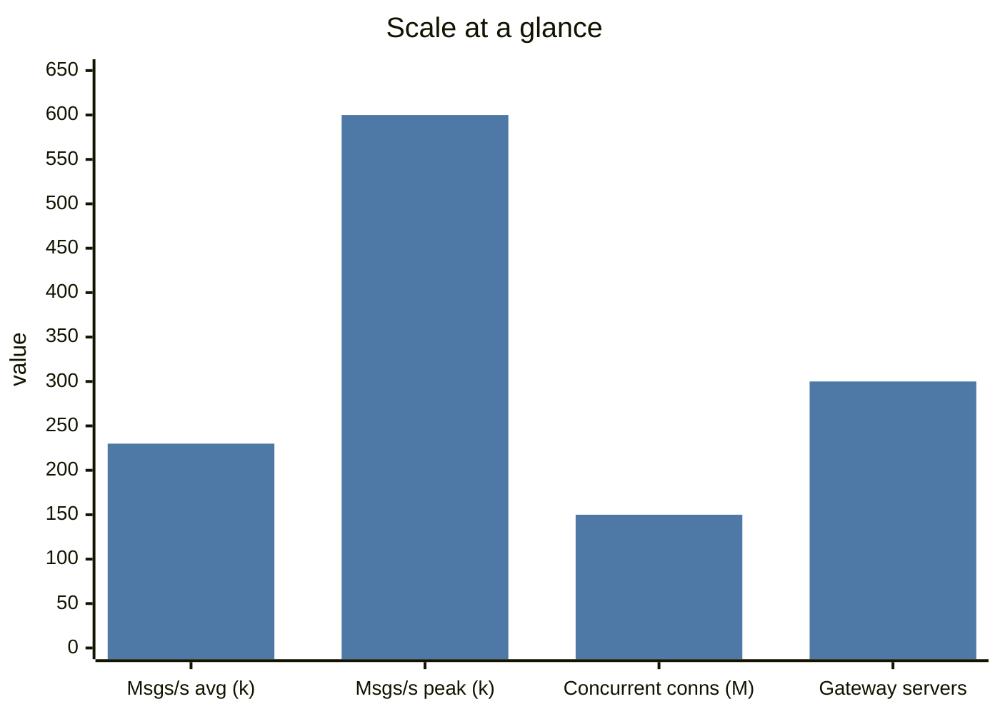
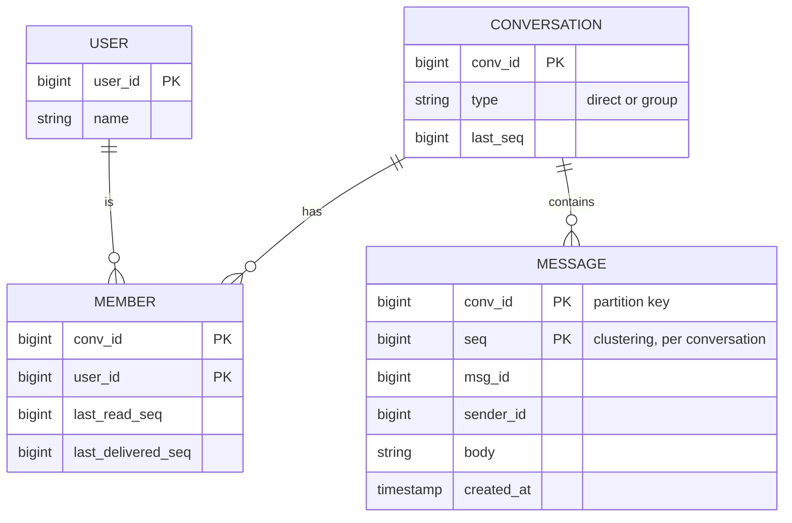
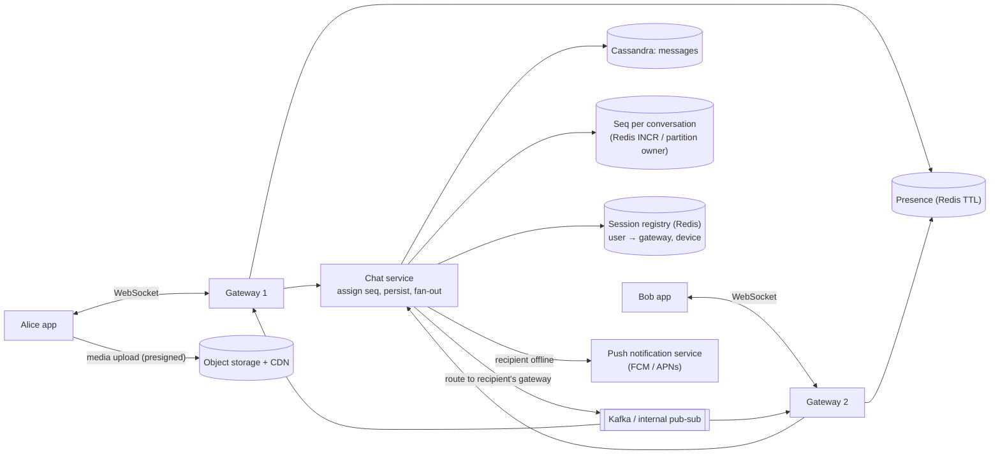
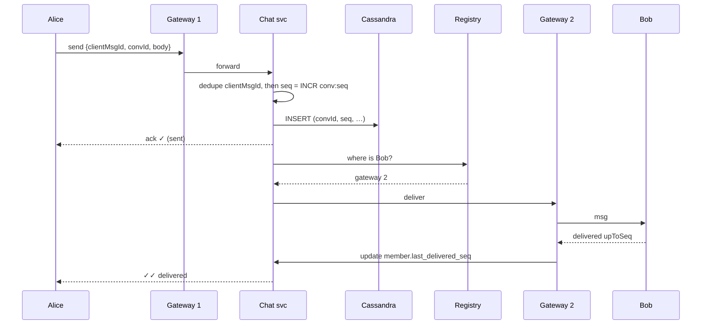
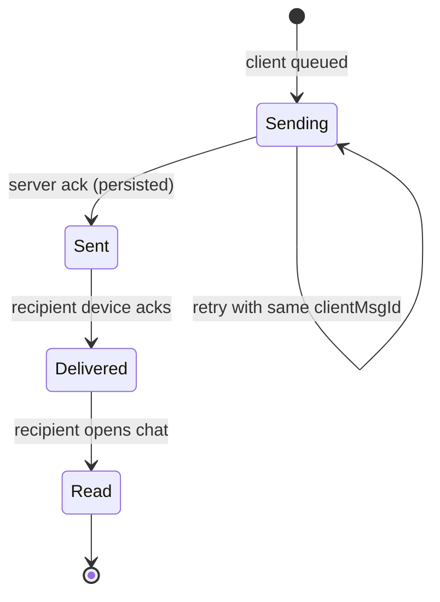

# 💬 Design a Chat App

> [!abstract] Problem
> 1:1 and group chat with delivery/read receipts, online presence, offline delivery and push notifications. Think WhatsApp.

## 1. Clarifying questions

- 1:1 and groups? Max group size? → *both, groups ≤ 1,000*
- Media? → *images/videos via links (object storage), focus on text*
- Receipts (sent/delivered/read)? Presence? Typing? → *yes, yes, nice-to-have*
- Message history — server-stored forever, or device-first (WhatsApp)? → *store on server, multi-device sync*
- E2E encryption? → *mention, not design deeply*

## 2. Requirements

| Functional | Non-functional |
|---|---|
| Send/receive 1:1 & group messages in real time | Delivery latency p99 < 300 ms when online |
| Sent / delivered / read receipts | **No message loss**; per-conversation ordering |
| Online/last-seen presence | Highly available (AP for presence; durable for messages) |
| Offline delivery + push notifications | 500M DAU scale |
| History sync across devices | |

## 3. Estimation

```text
500M DAU × 40 msgs/day = 20B msgs/day ≈ 230k msgs/s avg, ~600k/s peak
Avg msg 100 B (+ metadata ~200 B) → 20B × 300 B ≈ 6 TB/day → ~2 PB/yr (before replication)
Concurrent connections: ~30% online at peak → 150M WebSockets
At ~500k connections per gateway server → ~300 gateway servers (+ headroom)
```



## 4. API (over WebSocket + a little REST)

```text
WS  connect  wss://chat/ws?token=…             (auth on handshake)
→   {type:"send", clientMsgId, convId, body}    (clientMsgId = idempotency key)
←   {type:"ack", clientMsgId, msgId, seq}       (server accepted = "sent ✓")
←   {type:"msg", convId, msgId, seq, from, body}
→   {type:"delivered"|"read", convId, upToSeq}
REST GET /v1/conversations/{id}/messages?beforeSeq=…&limit=50   (history, cursor)
```

## 5. Data model



Messages → **Cassandra/ScyllaDB** partitioned by `conv_id` (+ time bucket for huge groups), clustered by `seq`. Members/conversations → SQL or Cassandra. Presence → Redis with TTL.

## 6. High-level design



## 7. Key flows

**Send a message (Bob online):**



**Message status:**



## 8. Deep dives

### Ordering
Server assigns a **monotonic `seq` per conversation** (Redis `INCR conv:{id}` or a single owner per conversation partition). Clients sort by `seq`, not client timestamps. Gaps in `seq` → client fetches missing range. → [[Clocks-and-Ordering]]

### Exactly-once from the user's view
Client retries with the same `clientMsgId`; server dedupes (unique `(conv_id, client_msg_id)`) → no duplicate bubbles. → [[Idempotency]]

### Offline delivery & multi-device
Every device tracks `last_delivered_seq` per conversation. On reconnect: `fetch messages where seq > last_seq`. Offline users get a push notification (no content if E2E). → [[Design-Notification-System]]

### Group fan-out
For a group of N: one message persisted once; deliver to each online member's gateway (fan-out on write to connections, not to storage). For very large groups/channels (10k+), switch to **pull-on-open** + notify, like Slack channels.

### Presence
Heartbeat every 30 s → `SET presence:{user} online EX 60`. "Last seen" written on disconnect. Fan out presence only to users who have the chat **open** (subscribe on view) — broadcasting every change to all contacts is a huge write amplification.

### Gateway scaling
Stateful connections → registry in Redis; graceful drain on deploy; clients reconnect with jittered backoff and resync from `last_seq`. → [[Real-Time-Communication]]

## 9. Bottlenecks, failures & trade-offs

| Risk | Mitigation |
|---|---|
| Gateway crash drops 500k connections | Clients reconnect to others (LB), resync by seq; jittered backoff avoids a reconnect storm |
| Hot group (huge, very active) | Partition by (conv_id, time bucket); pull-based delivery for big channels |
| Seq generator per conversation as bottleneck | Shard by conv_id; per-conversation rates are low |
| Kafka lag delays delivery | Direct gateway-to-gateway RPC for online delivery; Kafka for async side effects |
| Storage growth (PB/yr) | TTL/archival tiers; media in S3; compression |

## 10. Follow-ups & tricky questions

- *"How does E2E encryption change the design?"* — Server stores ciphertext only (Signal protocol); no server-side search; group keys per member device; push payloads contain no content.
- *"Typing indicators?"* — Ephemeral, not persisted, throttled (send at most every 3 s), only to open chats.
- *"Message search?"* — Without E2E: index into Elasticsearch async via CDC. With E2E: on-device search only.
- *2026 extension:* "AI summary of unread messages / smart replies" — call an LLM on the client-visible history, stream via SSE, cache per (conv, upToSeq). → [[Design-LLM-Chat-Service]]

## 11. What each level should cover

| SDE-1 | SDE-2 | Senior |
|---|---|---|
| WebSockets, message store, basic flow, push for offline | Registry routing, per-conv seq ordering, dedup, receipts, presence fan-out limits, Cassandra modelling | Multi-region, E2E implications, large channels, reconnect storms, cost/storage tiers |

## 🧠 Concepts used
[[Real-Time-Communication]] · [[SQL-vs-NoSQL]] · [[Sharding-and-Partitioning]] · [[Clocks-and-Ordering]] · [[Idempotency]] · [[Message-Queues]] · [[Redis-Deep-Dive]] · [[Object-Storage]]

## My gaps
-

---
**Next:** [[Design-News-Feed]] · **Up:** [[Case-Studies-MOC]]
