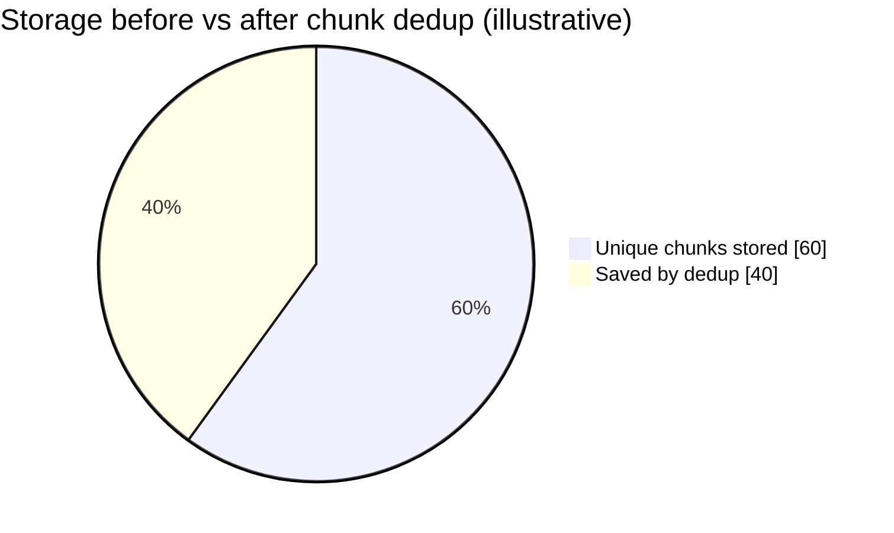
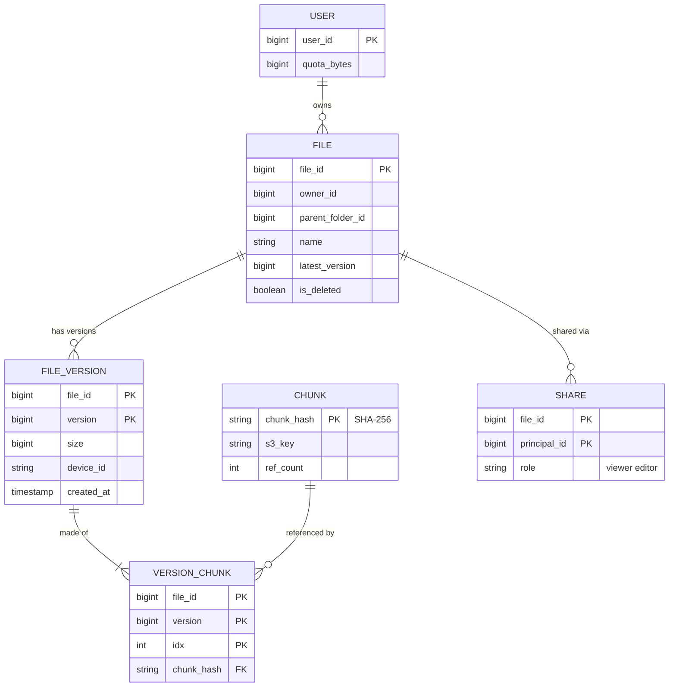
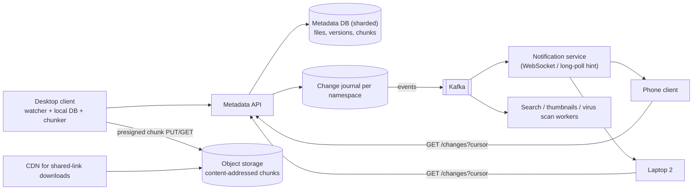
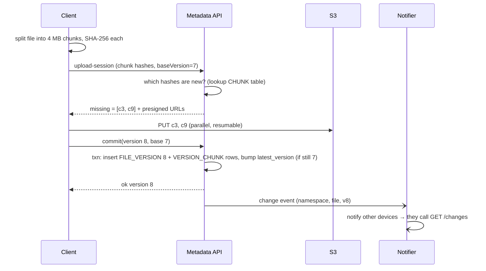
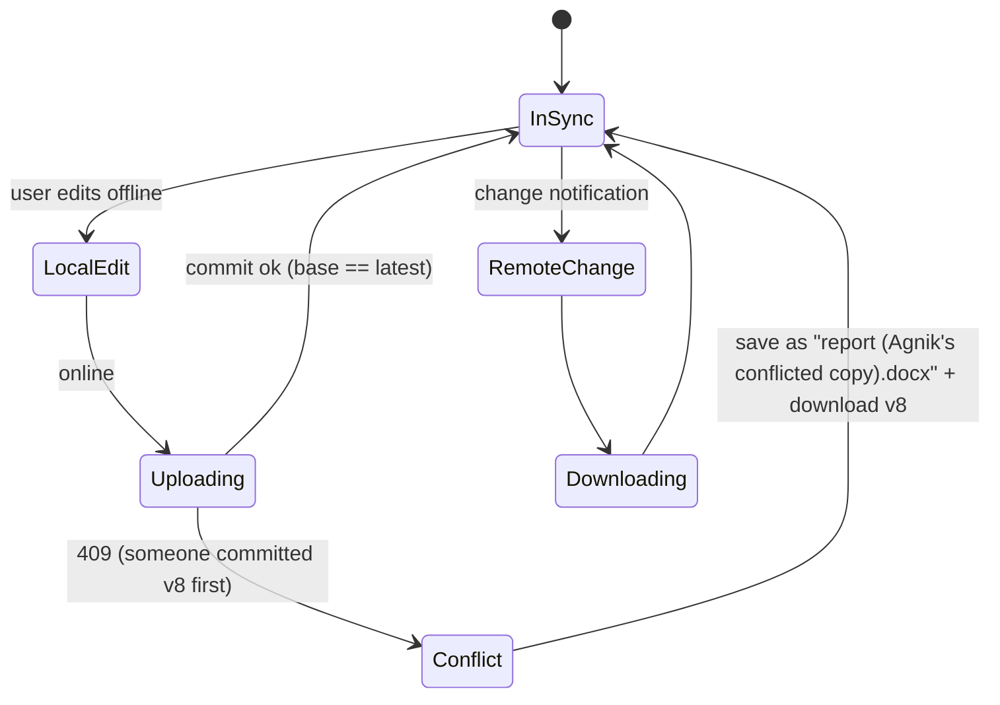

# 📁 Design File Storage and Sync

> [!abstract] Problem
> Users upload files from any device; files sync automatically to their other devices; they can share files/folders and see version history. Large files, flaky networks, offline edits.

## 1. Clarifying questions

- Max file size? → *up to 50 GB*
- Sync clients (desktop/mobile) + web? → *yes*
- Sharing & permissions? Version history? → *yes, 30 days of versions*
- Real-time co-editing? → *no — that's Google Docs (see CRDT note); here it's file-level sync*

## 2. Requirements

| Functional | Non-functional |
|---|---|
| Upload/download files and folders | Durability 11 nines; never lose a committed file |
| Automatic sync across devices | Sync latency: changes visible on other devices in seconds |
| Share with users/links, permissions | Efficient: only changed parts re-uploaded (delta sync) |
| Versions & restore; trash | Works offline; handles conflicts |

## 3. Estimation

```text
500M users, 100M DAU; avg 10 GB stored/user (paid skew) → 5 EB total logical; dedup saves 30–50%
Uploads: 100M DAU × 2 files × 5 MB ≈ 1 PB/day ingest
Metadata ops (list, sync polls, change notifications): ~1M/s peak → metadata DB is the hot path
Chunk size 4 MB → a 1 GB file = 256 chunks
```



## 4. API

```http
POST /v1/files/upload-session   {path, size, chunkHashes[]} → {sessionId, missingChunks[], presignedUrls[]}
PUT  <presigned S3 url>          (upload only the missing chunks)
POST /v1/files/commit            {sessionId, chunkHashes[], baseVersion} → {fileId, version}  (409 on conflict)
GET  /v1/changes?cursor=…        → {changes:[{fileId, version, op}], nextCursor}   (long-poll / push hint)
GET  /v1/files/{id}/download     → manifest of chunk URLs
POST /v1/shares                  {fileId, principal, role}
```

## 5. Data model



Metadata → **sharded SQL** (by owner/namespace; strong consistency for versions). Chunks → **S3**, content-addressed by hash. Change journal per namespace for sync cursors.

## 6. High-level design



## 7. Key flows

**Delta upload with dedup:**



**Sync conflict state:**



## 8. Deep dives

### Chunking & dedup
Fixed-size chunks are simple; **content-defined chunking** (rolling hash, e.g., Rabin) keeps boundaries stable when bytes are inserted early in a file → far better delta sync. Content-addressed storage (key = hash) gives cross-user dedup for free; track reference counts for garbage collection (careful: delete only when ref_count = 0 and after a grace period). → [[Object-Storage]]

### Sync protocol
Client keeps a local DB of `(path → version, chunk hashes)` + a **cursor** into the server change journal. Server pushes a lightweight "something changed" hint (WebSocket/long-poll); client pulls `GET /changes?cursor`. Cursor = monotonic journal sequence per namespace. → [[Real-Time-Communication]]

### Conflicts
Optimistic concurrency on `baseVersion`. On conflict, don't merge binaries — keep both (conflicted copy). Text co-editing is a different product → [[Real-Time-Collaboration-CRDTs]].

### Metadata scale
Metadata QPS ≫ chunk QPS. Shard by namespace (user or shared folder); keep a file's versions in one shard; cache folder listings. Dropbox moved metadata to its own sharded MySQL ("Edgestore") for this reason.

### Durability & cost
S3 cross-AZ (11 nines), optional cross-region replication; cold tier for old versions; erasure coding at the storage layer (Dropbox built "Magic Pocket").

## 9. Bottlenecks & trade-offs

| Choice | Trade-off |
|---|---|
| Chunk size small vs large | Better dedup/delta vs more metadata rows & requests |
| Cross-user dedup | Storage savings vs side-channel privacy risk ("does this file exist?") — dedup per user or use convergent encryption carefully |
| Push vs pull sync | Fast hints vs connection cost; hybrid push-hint + pull-changes |
| Strong metadata consistency | Correct versions vs cross-shard moves are complex |

## 10. Follow-ups & tricky questions

- *"Moving a folder with 1M files?"* — Metadata-only operation (update parent pointer); no chunk movement; journal one move event.
- *"Shared folder edited by 50 users?"* — Namespace per shared folder; journal per namespace; all members subscribe.
- *"Upload 50 GB on mobile?"* — Resumable multipart, background upload, Wi-Fi-only option.
- *2026:* "Notion-style docs + AI Q&A over the drive" → CRDT editing + RAG with ACL-filtered retrieval → [[RAG-and-Vector-Databases]].

## 11. What each level should cover

| SDE-1 | SDE-2 | Senior |
|---|---|---|
| Metadata vs blob split, presigned upload, versions | Chunking + dedup, delta sync, change journal + cursors, conflict handling | Content-defined chunking, GC of chunks, metadata sharding, privacy of dedup, cost tiers |

## 🧠 Concepts used
[[Object-Storage]] · [[Message-Queues]] · [[Consistency-Models]] · [[Transactions-and-Isolation-Levels]] · [[Sharding-and-Partitioning]] · [[Real-Time-Communication]] · [[Real-Time-Collaboration-CRDTs]]

## My gaps
-

---
**Next:** [[Design-Key-Value-Store]] · **Up:** [[Case-Studies-MOC]]
