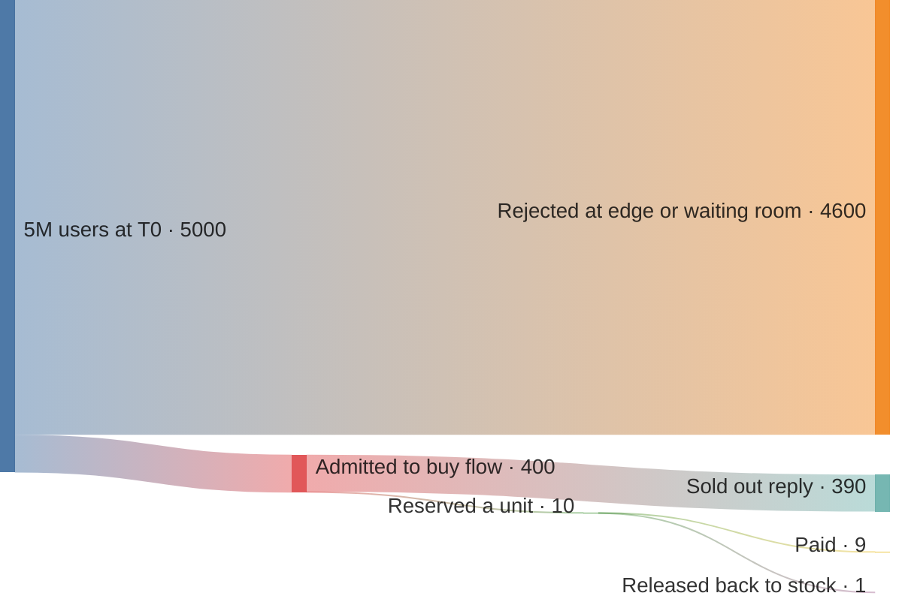
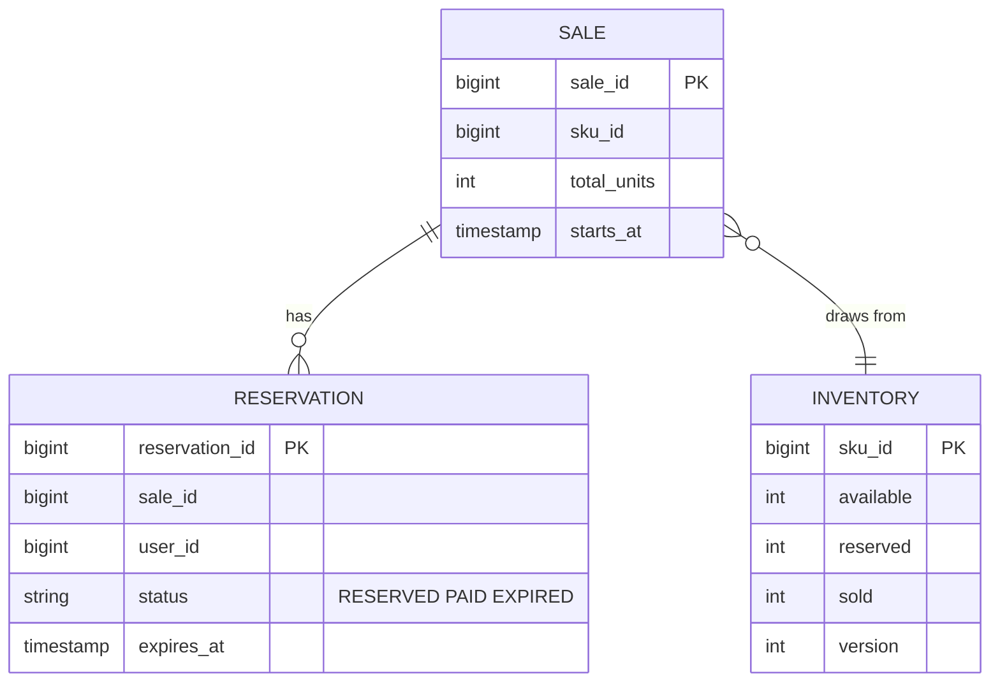
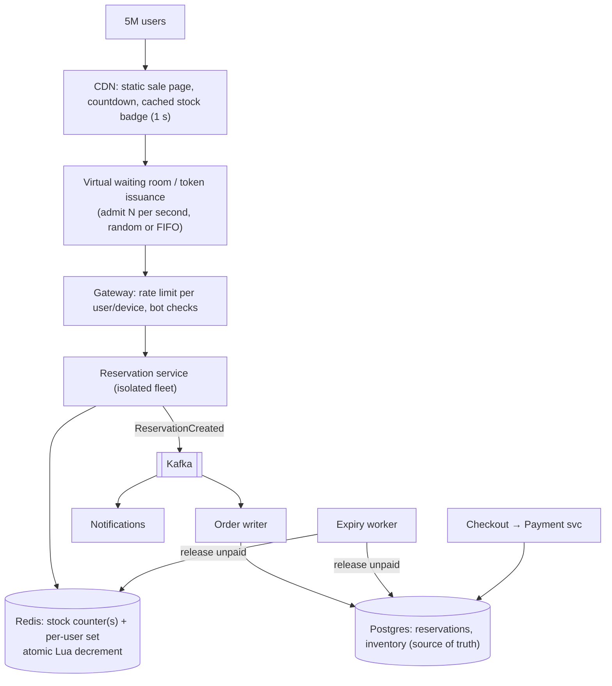
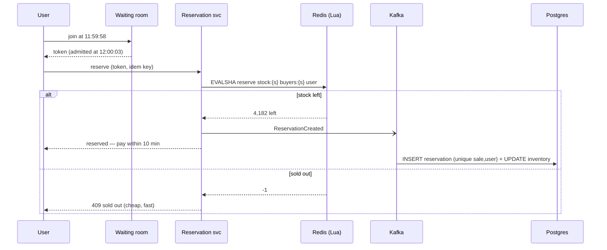
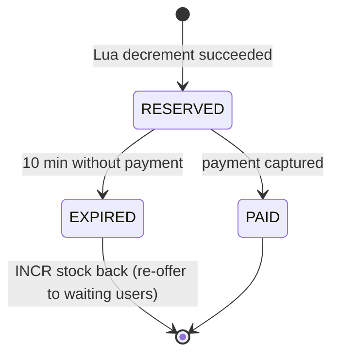

# ⚡ Design a Flash Sale / Inventory System

> [!abstract] Problem
> "iPhone at ₹9,999 — 10,000 units — sale starts 12:00:00." Millions of users hit "Buy" in the same second. **Never oversell**, stay up, be fair, and don't let bots win. (Flipkart Big Billion Days, Amazon Great Indian Festival, Blinkit dark-store stock.)

## 1. Clarifying questions

- Units vs demand? → *10k units, ~5M users at T0*
- Per-user limit? → *1 per user*
- Reservation then pay? → *reserve, then 10 min to pay, else release*
- Other products also on sale? → *yes — normal catalogue must stay healthy*

## 2. Requirements

| Functional | Non-functional |
|---|---|
| Show sale product, countdown, stock status | **Zero oversell** (strong consistency on stock) |
| Reserve unit (1/user), checkout, pay | Survive 1M+ req/s burst at T0 for a hot SKU |
| Release unpaid reservations | Fairness; bot resistance |
| Order confirmation + notifications | Rest of the site unaffected (isolation) |

## 3. Estimation

```text
5M users × ~3 clicks in the first 10 s → ~1.5M req/s at peak for ONE SKU
Only 10k can succeed → 99.8% of requests must be rejected CHEAPLY and EARLY
One Redis key handles ~100k+ ops/s → single hot key is a bottleneck → shard stock or queue
```



> [!note] Units are thousands of users; 10 = the 10k units.

## 4. API

```http
GET  /v1/sales/{saleId}                 → product, startsAt, status (CDN cached, 1 s)
POST /v1/sales/{saleId}/reserve         Idempotency-Key, waiting-room token → 200 {reservationId, expiresAt} | 409 SOLD_OUT | 429
POST /v1/reservations/{id}/checkout     → payment
```

## 5. Data model



Unique `(sale_id, user_id)` on RESERVATION → one per user.

## 6. High-level design — layers of defence



## 7. Key flows

**Atomic reserve in Redis (one round trip):**

```lua
-- KEYS[1] = stock:{sale}  KEYS[2] = buyers:{sale}   ARGV[1] = user_id
if redis.call('SISMEMBER', KEYS[2], ARGV[1]) == 1 then return -2 end   -- already bought
local left = tonumber(redis.call('GET', KEYS[1]))
if left <= 0 then return -1 end                                         -- sold out
redis.call('DECR', KEYS[1])
redis.call('SADD', KEYS[2], ARGV[1])
return left - 1
```



**Reservation lifecycle:**



## 8. Deep dives

### Why not just the database?
`UPDATE inventory SET available = available - 1 WHERE sku = ? AND available > 0` is **correct**, but every request serialises on one row lock → a few thousand/s at best. Use it as the source of truth; put the **fast gate** (Redis Lua or a queue) in front. → [[Transactions-and-Isolation-Levels]]

### Hot key beyond one Redis node
- **Split stock** across N keys (`stock:{sale}:0..9` with 1,000 each); route users by hash → each key handles 1/N of traffic; when a bucket empties, try another (or rebalance).
- Or **serialise via a queue**: requests go into a Kafka partition / in-memory queue; a single consumer decrements in order — perfect fairness, throughput bounded by one consumer (fine for 10k units).

### Waiting room & fairness
Admit users at the rate the backend can serve; randomised admission at T0 (everyone who arrived before T0 gets an equal chance) beats "fastest bot wins". Tokens are signed and short-lived. → [[Design-Ticket-Booking]]

### Bots
Device fingerprinting, CAPTCHA at queue entry, per-account/device/IP limits, require logged-in accounts with history, purchase limits per address/payment method. → [[Design-Rate-Limiter]]

### Consistency between Redis and DB
Redis is the gate, DB is the truth. Persist asynchronously through Kafka with idempotent writes; periodic reconciliation (`Redis sold + remaining == DB`); if Redis fails over and loses recent decrements, the DB unique constraint + inventory check still prevent overselling at checkout (some users may get "sorry, sold out" at payment — rare, acceptable).

### Isolation
Separate fleet, Redis, and queues for the sale SKU (bulkhead) so the rest of Flipkart keeps working; pre-scale; cache the product page at the CDN; disable heavy personalisation on the sale page. → [[Resilience-Patterns]]

## 9. Bottlenecks & trade-offs

| Choice | Trade-off |
|---|---|
| Redis Lua gate | Fast, atomic vs async durability (reconcile) |
| Split stock keys | Throughput vs "sold out" while another bucket has stock (rebalance) |
| Queue serialisation | Perfect fairness/order vs single-consumer throughput |
| Waiting room | Protection + fairness vs added user wait |

## 10. Follow-ups & tricky questions

- *"A user reserves then payment fails?"* — Release on failure/expiry; offer to the next in the waiting room.
- *"Show live stock count?"* — Cached, approximate ("Only a few left!"), refreshed every second at the CDN.
- *"Multiple warehouses?"* — Inventory per (SKU, warehouse); reserve from the warehouse serving the user's pincode.
- *"Blinkit dark store version?"* — Same atomic decrement per (store, SKU), smaller scale, plus picker/slot assignment.

## 11. What each level should cover

| SDE-1 | SDE-2 | Senior |
|---|---|---|
| Atomic DB decrement, 1/user constraint, cache the page | Redis Lua gate + async persist, reservations with TTL, rate limits | Waiting room fairness, stock sharding vs queue, bot strategy, reconciliation, bulkheads |

## 🧠 Concepts used
[[Transactions-and-Isolation-Levels]] · [[Redis-Deep-Dive]] · [[Cache-Pitfalls]] · [[Message-Queues]] · [[Design-Rate-Limiter]] · [[Resilience-Patterns]] · [[CDN]] · [[Idempotency]]

## My gaps
-

---
**Next:** [[Design-Ad-Click-Aggregator]] · **Up:** [[Case-Studies-MOC]]
