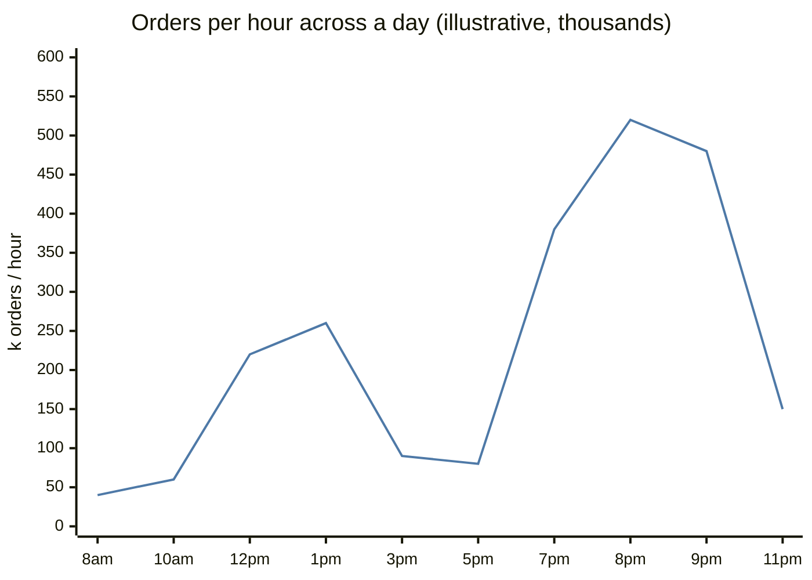
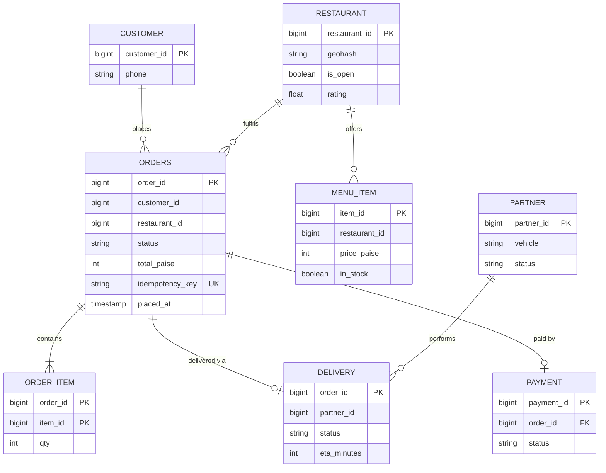
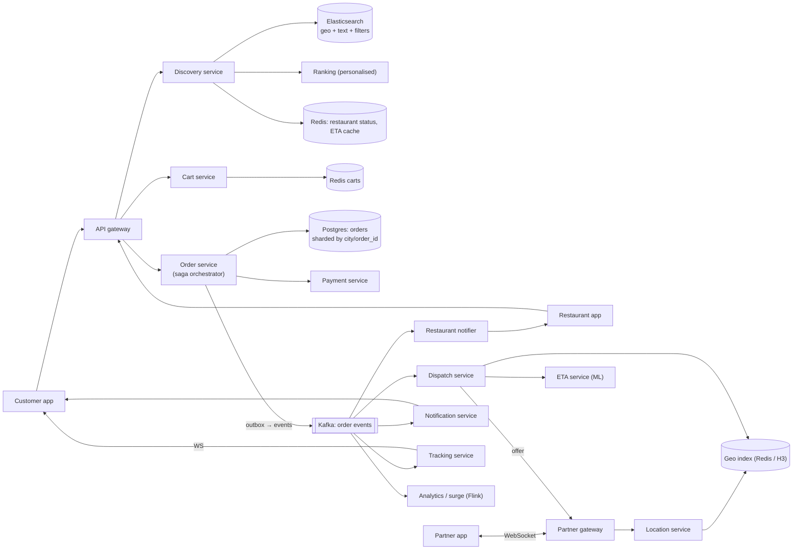
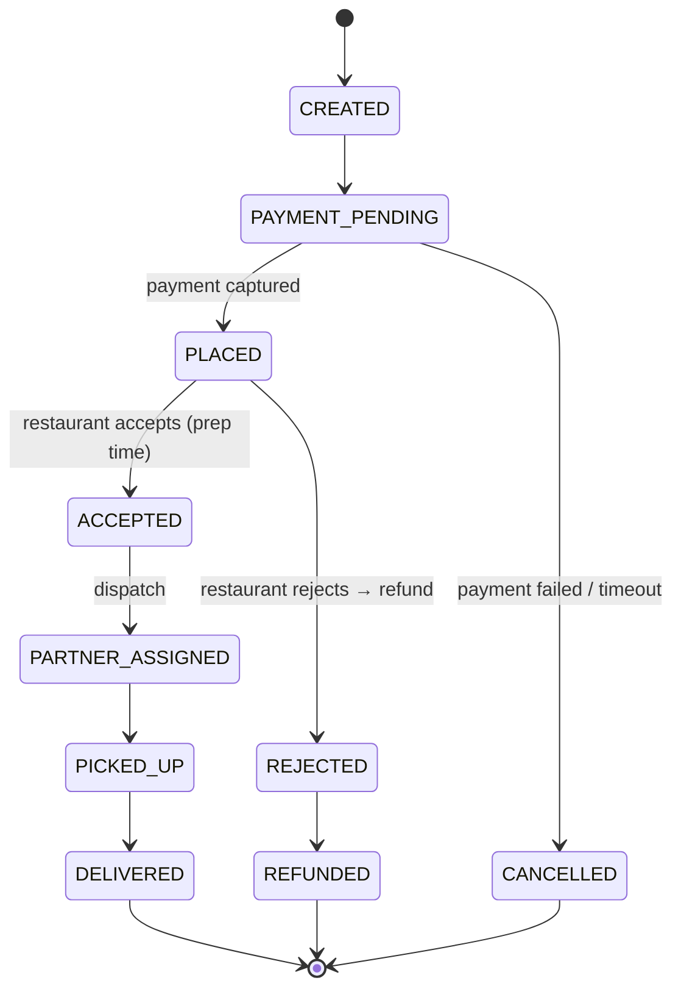
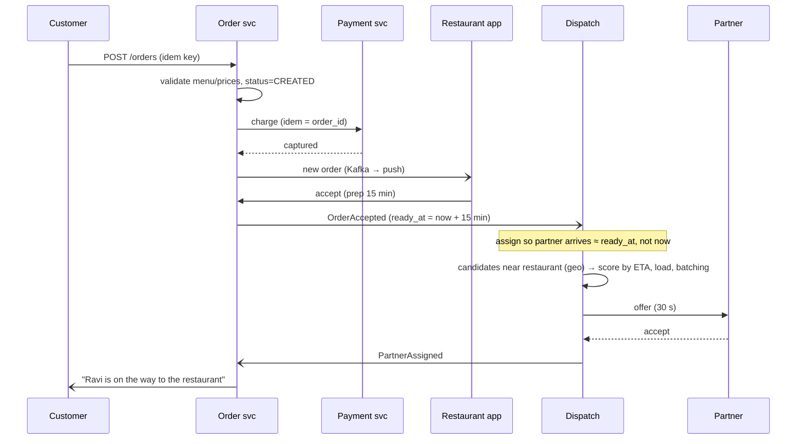

# 🍛 Design Food Delivery (Swiggy / Zomato)

> [!abstract] Problem
> Users discover restaurants near them, order food, pay, and track the order live. Restaurants accept and prepare; a delivery partner is assigned and picks up. Handle dinner peaks and rain surges. **The India favourite — it combines geo + payments + notifications + real-time.**

## 1. Clarifying questions

- Scope? → *discovery, cart/order, payment, restaurant acceptance, partner assignment, live tracking*
- Scale? → *3M orders/day, dinner peak 3× average; 300k active partners at peak*
- Delivery radius? → *~7 km; ETA promise shown before ordering*
- Instamart/grocery? → *out of scope (mention dark-store inventory)*

## 2. Requirements

| Functional | Non-functional |
|---|---|
| Search/browse restaurants by location, cuisine, ratings | Discovery p99 < 300 ms; can be slightly stale |
| Menu, cart, order placement, payment | Order placement: **no lost or duplicate orders**, exactly-once payment |
| Restaurant accept/reject, prep time | Partner assignment within ~1–2 min of acceptance |
| Assign delivery partner, live tracking | Tracking updates every few seconds |
| Notifications at each stage, ratings | 99.95%+ availability at dinner peak |

## 3. Estimation

```text
3M orders/day; dinner (7–10 pm) ≈ 50% of orders → 1.5M in 3 h ≈ 140 orders/s, spikes ~500/s (rain, IPL)
Discovery: ~20 browse requests per order → ~60M/day, peak ~10k/s → cache + search index
Partner pings: 300k / 5 s = 60k location writes/s → in-memory geo index
Order events: ~10 state changes per order → 30M events/day → Kafka
```



## 4. API

```http
GET  /v1/restaurants?lat=&lng=&q=biryani&cursor=   → list with ETA, rating, distance
GET  /v1/restaurants/{id}/menu
POST /v1/cart/items
POST /v1/orders               Idempotency-Key → {orderId, payable, paymentAction}
POST /v1/orders/{id}/payment  → (UPI/card via payment service)
WS   /v1/orders/{id}/track    ← status + partner location + ETA
Restaurant app:  POST /v1/orders/{id}/accept {prepMinutes} | /reject
Partner app:     WS location pings; POST /offers/{id}/accept; POST /orders/{id}/picked-up | /delivered
```

## 5. Data model



## 6. High-level design



## 7. Key flows

**Order lifecycle (orchestrated saga):**



**Place → accept → assign:**



## 8. Deep dives

### Discovery
Elasticsearch with `geo_distance` filter + text + filters (veg, rating, offers) → rank (distance, ETA, rating, personal history, promotions) → cache popular (city, geohash-6, filters) results for ~30–60 s. Restaurant open/closed and "busy" flags in Redis, refreshed in real time. → [[Search-Systems]] · [[Recommendation-and-Ranking-Systems]]

### Order placement correctness
Idempotency key from the app (flaky networks + double taps); orchestrated saga: order → payment → restaurant → dispatch, with compensations (refund on reject/cancel). Outbox for events. → [[Distributed-Transactions]] · [[Idempotency]] · [[Design-Payment-System]]

### Dispatch (the interesting part)
- Timing: assign so the partner arrives when food is ready (prep-time prediction) — idle partners at restaurants waste capacity.
- Scoring: distance/ETA to restaurant, current load, **order batching** (two orders from the same area/restaurant), partner fairness/earnings, vehicle type.
- Batch optimisation every few seconds per zone (assignment problem) vs greedy per order.
- Prevent double assignment: partner lock + conditional update. → [[Design-Ride-Sharing]] · [[Geospatial-Indexing]]

### ETA
ML model on prep time + travel time (road graph + traffic + weather + historical per restaurant) → shown before ordering; continuously updated during delivery.

### Peaks & rain
Surge fees and dynamic delivery radius per zone (stream supply/demand per H3 cell); throttle marketing notifications; prioritise order-path capacity (bulkheads); pre-scale for IPL nights. → [[Resilience-Patterns]]

## 9. Bottlenecks & trade-offs

| Risk | Mitigation |
|---|---|
| Partner shortage in a zone | Surge, increase radius, batch orders, show longer ETA / temporarily hide far restaurants |
| Restaurant tablet offline | Auto-reject after timeout → refund, or call fallback; mark restaurant busy |
| Payment pending | Order waits in PAYMENT_PENDING; reconcile; never prepare unpaid prepaid orders |
| Search index staleness | Real-time Redis flags override (closed/out-of-stock) |

## 10. Follow-ups & tricky questions

- *"Customer cancels after restaurant accepted?"* — Policy-based partial refund; compensation steps in the saga; notify restaurant/partner.
- *"How do you avoid stale menu prices at checkout?"* — Re-validate cart against menu service at order creation; show diff.
- *"Instamart (10-minute grocery)?"* — Dark-store inventory with atomic stock decrement (Redis + DB), slotting, picker assignment. → [[Design-Flash-Sale]]
- *2026:* LLM-powered "what should I eat?" conversational search → RAG over menus + ranking, with cost caching. → [[RAG-and-Vector-Databases]]

## 11. What each level should cover

| SDE-1 | SDE-2 | Senior |
|---|---|---|
| Services + order states + geo search + payment + notifications | Saga with compensations, idempotent order creation, dispatch scoring, tracking via WebSocket | Batch assignment optimisation, ETA/prep ML loop, zone-level surge & radius, peak capacity strategy |

## 🧠 Concepts used
[[Geospatial-Indexing]] · [[Search-Systems]] · [[Distributed-Transactions]] · [[Idempotency]] · [[Design-Payment-System]] · [[Design-Notification-System]] · [[Real-Time-Communication]] · [[Batch-and-Stream-Processing]] · [[Recommendation-and-Ranking-Systems]]

## My gaps
-

---
**Next:** [[Design-Web-Crawler]] · **Up:** [[Case-Studies-MOC]]
