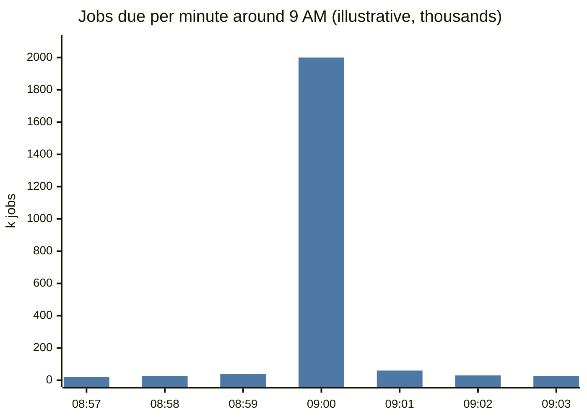
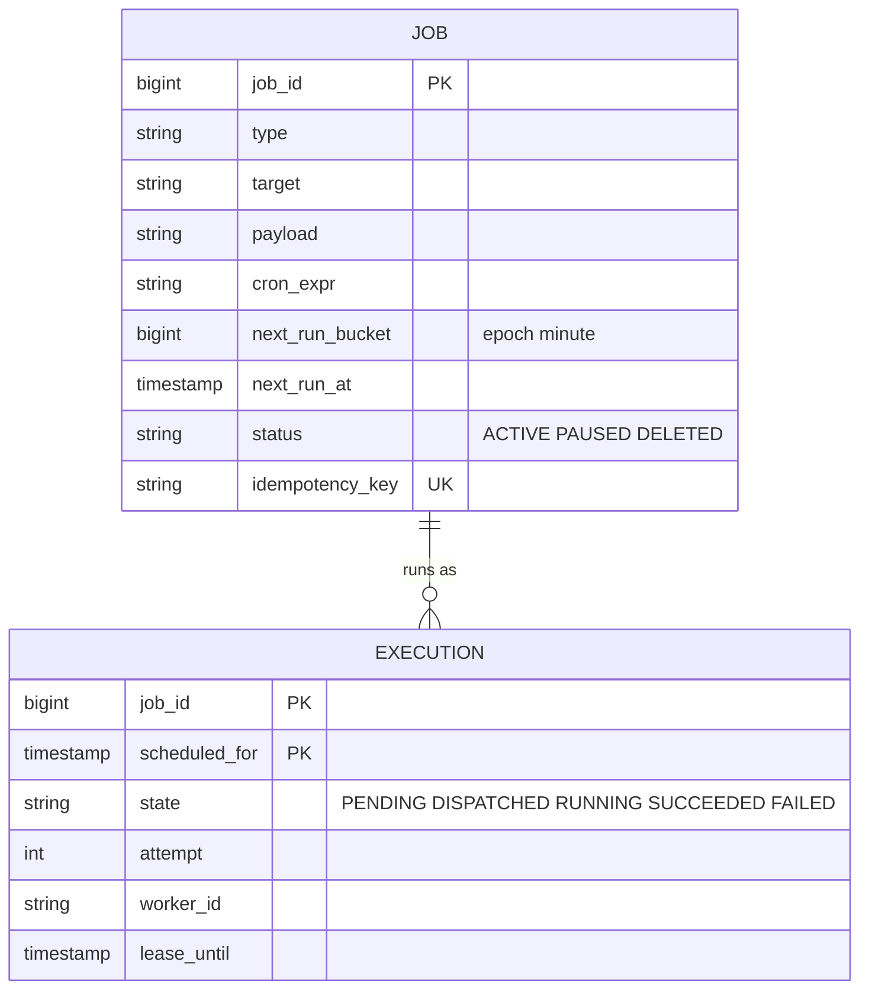
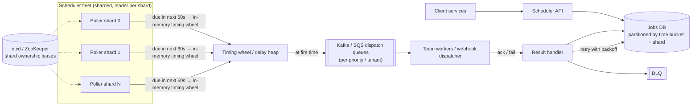
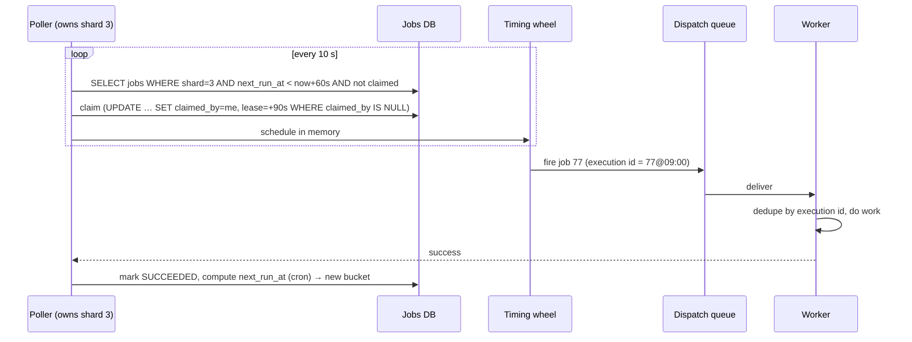
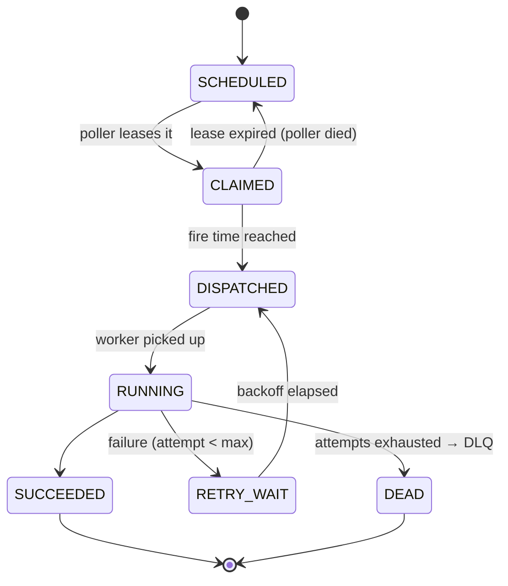

# ⏰ Design a Distributed Job Scheduler

> [!abstract] Problem
> Let services schedule jobs: one-off at a time ("send reminder at 9 am"), recurring (cron: "every night at 2 am"), or delayed ("retry in 5 min"). Jobs must run **on time** and **at least once** (ideally effectively once), at scale.

## 1. Clarifying questions

- One-off + cron + delayed? → *all three*
- Scale? → *100M scheduled jobs/day, peaks at round times (9:00:00 sharp!)*
- Precision? → *within ~1–2 seconds*
- Job execution: we run code or call webhooks/queues? → *we dispatch to queues/webhooks; workers belong to teams*

## 2. Requirements

| Functional | Non-functional |
|---|---|
| Create / cancel / update jobs | Fire within 2 s of scheduled time |
| One-off, cron, delayed | No job lost; at-least-once execution |
| Retries with backoff, DLQ | No double-firing in normal operation (dedupe) |
| History & status | Horizontally scalable, HA scheduler (no single leader bottleneck) |

## 3. Estimation

```text
100M executions/day ≈ 1.2k/s avg, but massive spikes at :00 (e.g., 2M jobs at 09:00:00)
Job record ~500 B → 100M/day × 30 days retention = 1.5 TB → partitioned table
Spike handling: spread the 2M over a few seconds via dispatch fleet → ~500k/s dispatch capacity or jitter
```



## 4. API

```http
POST /v1/jobs  { "type": "webhook" | "queue", "target": "...", "payload": {...},
                 "runAt": "2026-11-07T09:00:00+05:30" | "cron": "0 2 * * *",
                 "idempotencyKey": "...", "retry": {"max": 5, "backoff": "exp"} } → {jobId}
DELETE /v1/jobs/{id}
GET    /v1/jobs/{id}/executions
```

## 5. Data model



Partition `JOB` by `next_run_bucket` (time bucket) + shard → scanning "due in the next minute" touches only one bucket.

## 6. High-level design



## 7. Key flows



**Execution state machine:**



## 8. Deep dives

### Avoiding double-firing
Shard ownership via leases in etcd/ZooKeeper (one poller per shard) + DB claim with lease + **fencing token** → even after a paused poller wakes up, its stale claim is rejected. Execution ID `(job_id, scheduled_for)` makes workers idempotent. → [[Consensus-and-Leader-Election]] · [[Idempotency]]

### Precision without hammering the DB
Two-level design: coarse DB scan for "due within the next minute" + an in-memory **timing wheel / min-heap** for second-level precision. Redis ZSET (`score = runAt`) with `ZRANGEBYSCORE` is a common simpler alternative for delayed jobs.

### The :00 thundering herd
Encourage jitter for non-critical jobs (`runAt ± random(0, 30s)`), pre-load buckets early, autoscale dispatchers before known peaks, and per-tenant rate limits so one team's 2M jobs don't delay others' critical ones. → [[Resilience-Patterns]]

### Cron semantics
After each run compute `next_run_at` from the cron expression in the job's **time zone** (DST!); define misfire policy (run once now vs skip) if the system was down.

### Long-running jobs
Heartbeat to extend the lease; if heartbeats stop, the job is retried elsewhere — so job logic must be idempotent or checkpointed. For multi-step workflows → durable workflow engines (Temporal). → [[AI-Agent-Systems]]

## 9. Bottlenecks & trade-offs

| Choice | Trade-off |
|---|---|
| DB polling vs Redis ZSET vs Kafka delay topics | Durability/queryability vs simplicity/speed |
| Single leader vs sharded leaders | Simplicity vs throughput & blast radius |
| At-least-once | Simple & safe vs duplicates (needs idempotent workers) |
| Lease length | Fast failover vs false re-dispatch of slow jobs |

## 10. Follow-ups & tricky questions

- *"Exactly-once?"* — Not end to end; at-least-once + idempotent execution IDs.
- *"Cancel a job that's already dispatched?"* — Best effort: mark cancelled; workers check status before side effects.
- *"Priorities?"* — Separate dispatch queues & worker pools (bulkheads).
- *"How does Kubernetes CronJob / Airflow compare?"* — K8s CronJob: per-cluster, controller-based; Airflow: DAG orchestration for data pipelines, not millions of tiny per-user jobs.

## 11. What each level should cover

| SDE-1 | SDE-2 | Senior |
|---|---|---|
| Jobs table + poller + queue + workers + retries | Time-bucket partitioning, leases, idempotent executions, timing wheel, DLQ | Sharded leadership with fencing, :00 spikes, multi-tenant fairness, cron/DST semantics |

## 🧠 Concepts used
[[Message-Queues]] · [[Consensus-and-Leader-Election]] · [[Idempotency]] · [[Resilience-Patterns]] · [[Redis-Deep-Dive]] · [[Sharding-and-Partitioning]]

## My gaps
-

---
**Next:** [[Design-Leaderboard-Top-K]] · **Up:** [[Case-Studies-MOC]]
