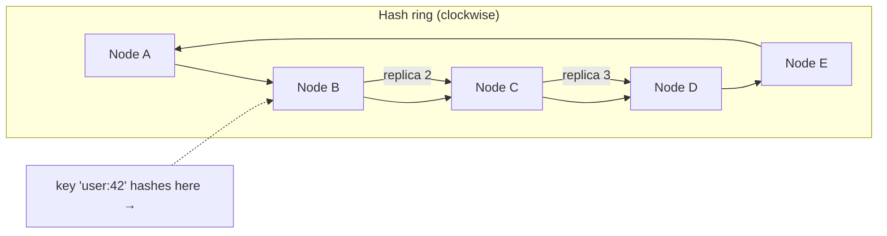
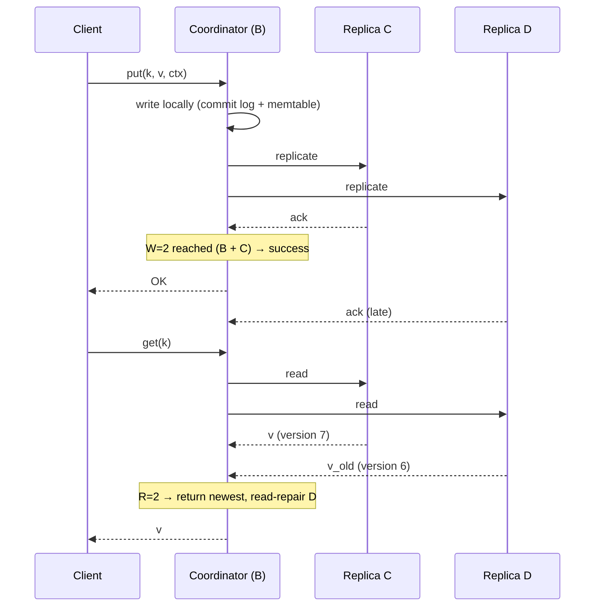
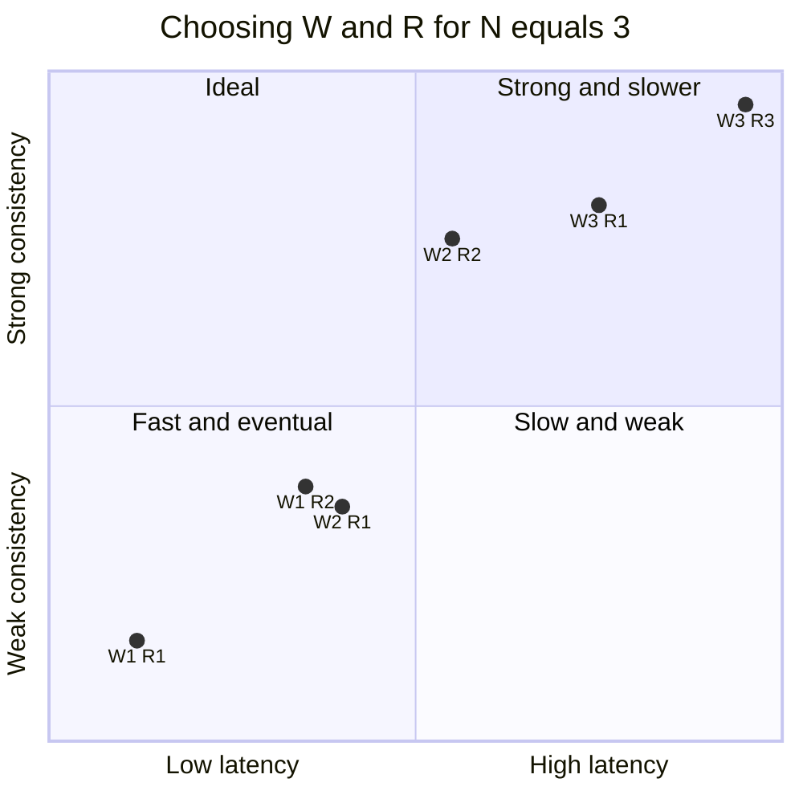
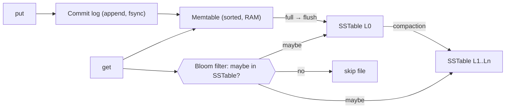

# 🗝️ Design a Distributed Key-Value Store

> [!abstract] Problem
> Build `put(key, value)` / `get(key)` that scales to petabytes and millions of ops/s across many nodes, stays available when nodes fail, with tunable consistency. Essentially: design Amazon Dynamo / Cassandra.

## 1. Clarifying questions

- Value size? → *≤ 1 MB, typical 1 KB*
- Consistency? → *tunable; default eventually consistent, option for quorum*
- Availability priority? → *always writable (AP)*
- Single region? → *start single region, multi-AZ*

## 2. Requirements

| Functional | Non-functional |
|---|---|
| `put`, `get`, `delete` | p99 < 10 ms |
| TTL optional | Highly available for writes (AP) |
| Tunable consistency per request | Horizontal scale, automatic rebalancing |
| | Durable (replication factor 3) |

## 3. Estimation

```text
100 TB data × RF 3 = 300 TB raw → at ~4 TB usable/node ≈ 75 nodes (+ headroom ≈ 100)
1M ops/s → ~10k ops/s per node — comfortable for an LSM engine on NVMe
```

## 4. The building blocks (this is the whole answer)

| Problem | Technique | Note |
|---|---|---|
| Partitioning | **Consistent hashing + vnodes** | [[Consistent-Hashing]] |
| High availability for writes | Replicate to N nodes on the ring (preference list) | [[Replication]] |
| Tunable consistency | **Quorum** W, R with W + R > N for strong-ish reads | |
| Concurrent writes | **Vector clocks** (conflict detection) or LWW timestamps | [[Clocks-and-Ordering]] |
| Temporary failures | **Sloppy quorum + hinted handoff** | |
| Permanent failures / drift | **Anti-entropy with Merkle trees** | |
| Failure detection & membership | **Gossip protocol** | |
| Storage engine | **LSM tree**: commit log + memtable + SSTables + compaction | [[Indexing]] |
| Fast negative lookups | **Bloom filters** per SSTable | [[Probabilistic-Data-Structures]] |

## 📊 Visual model

**Ring with replication (N = 3):**



Key lands on B (coordinator); replicas on the next two distinct nodes C and D.

**Quorum write and read (N=3, W=2, R=2):**



**Consistency vs latency knobs:**



**LSM write/read path inside a node:**



## 5. Deep dives

### Hinted handoff
If replica D is down, the coordinator writes to the next healthy node E with a **hint** ("this belongs to D"); E forwards when D returns. Keeps writes available (sloppy quorum) at the cost of weaker consistency during failures.

### Merkle-tree anti-entropy
Each node builds a hash tree over key ranges; replicas compare roots and descend only into differing branches → sync only the divergent keys, cheaply.

### Gossip
Every second each node exchanges membership/heartbeat state with a few random peers → cluster-wide view converges in O(log N) rounds without a central coordinator. Phi-accrual failure detection.

### Conflict resolution
Vector clocks → return siblings for the application to merge (Dynamo cart) **or** LWW by timestamp (Cassandra; simple, can lose writes). CRDT types for counters/sets. → [[Consistency-Models]]

### Deletes
Tombstones (a delete marker) replicated like writes; purged after `gc_grace` during compaction — otherwise deleted data can be "resurrected" by a replica that missed the delete.

## 6. Bottlenecks & trade-offs

| Choice | Trade-off |
|---|---|
| AP default | Always writable vs conflicts/staleness |
| LWW vs vector clocks | Simplicity vs never silently losing concurrent writes |
| LSM engine | Write throughput vs read amplification + compaction I/O |
| Leaderless vs leader-per-range (Raft, e.g. TiKV) | Availability vs linearizable ops |

## 7. Follow-ups & tricky questions

- *"How do you add a node?"* — It takes vnodes from others; data streams over; consistent hashing limits movement.
- *"Can you offer linearizable ops?"* — Lightweight transactions (Paxos per key in Cassandra) or a Raft group per range — at latency cost.
- *"Hot key?"* — Client-side caching, key splitting, read from any replica (R=1 for that key).
- *"Range queries?"* — Hash partitioning breaks them; use order-preserving partitioning within a partition key (clustering columns) or a range-partitioned design.

## 8. What each level should cover

| SDE-1 | SDE-2 | Senior |
|---|---|---|
| Hashing to nodes, replication, basic get/put | Consistent hashing + vnodes, quorum math, hinted handoff, LSM basics | Vector clocks vs LWW, Merkle anti-entropy, gossip, tombstones, linearizable options |

## 🧠 Concepts used
[[Consistent-Hashing]] · [[Replication]] · [[CAP-and-PACELC]] · [[Consistency-Models]] · [[Clocks-and-Ordering]] · [[Indexing]] · [[Probabilistic-Data-Structures]] · [[Consensus-and-Leader-Election]]

## My gaps
-

---
**Next:** [[Design-Food-Delivery]] · **Up:** [[Case-Studies-MOC]]
