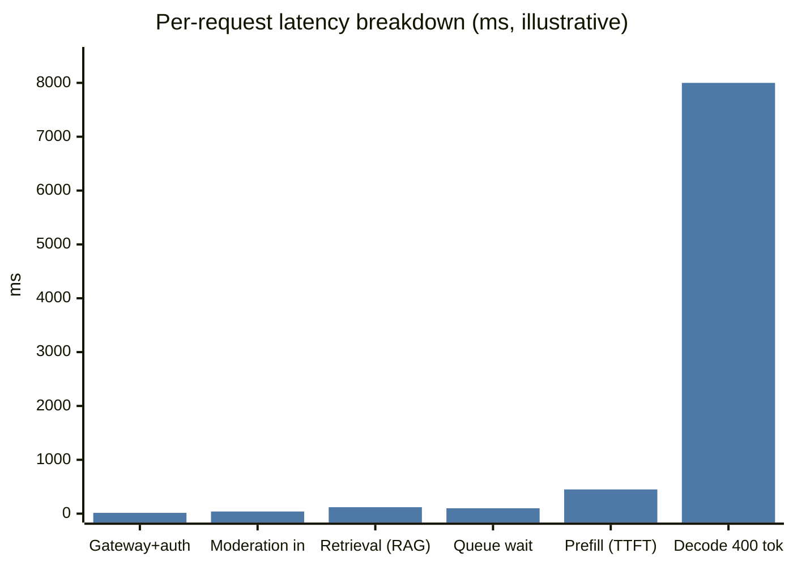
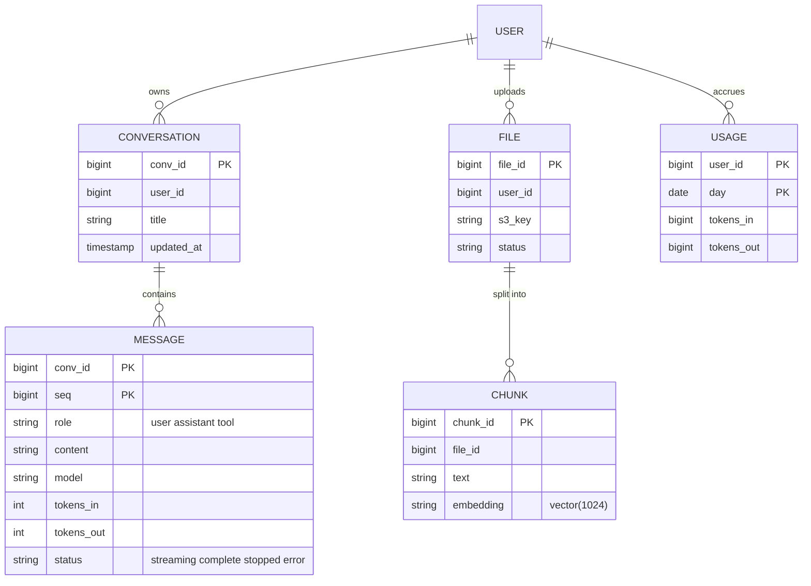
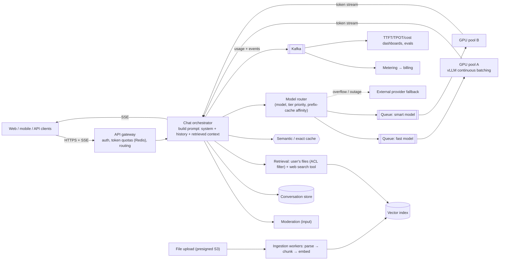
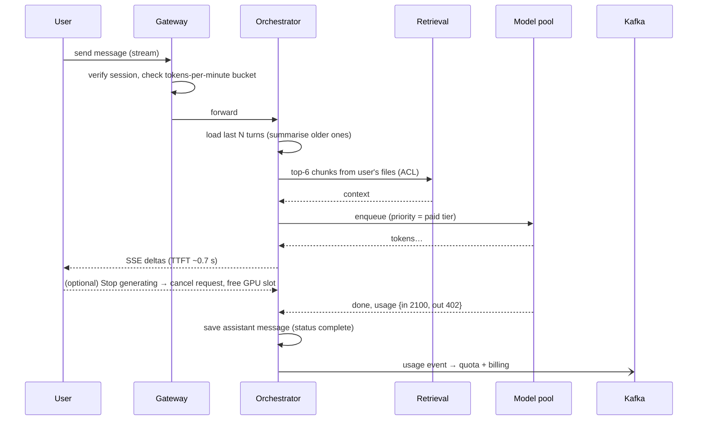
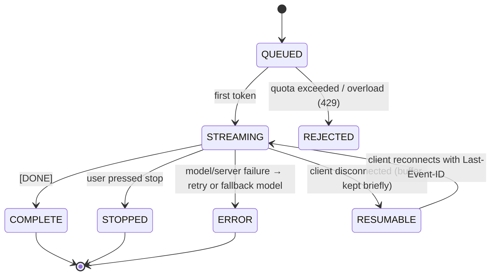

# 🤖 Design an LLM Chat Service

> [!abstract] Problem
> A consumer + API product: users chat with an LLM; responses **stream** token by token; conversations are saved; optional file upload / web search (RAG); free and paid tiers with usage limits; an API for developers billed per token. Reported as the "new URL shortener" of 2026 interviews.

## 1. Clarifying questions

- Are we serving our own models (GPUs) or calling providers? → *own models on GPUs, with provider fallback*
- Scale? → *10M DAU, 20 messages/day each*
- Features? → *streaming chat, history, file Q&A (RAG), tiers + API*
- Latency targets? → *TTFT p95 < 1 s; ~50 tokens/s per stream*
- Safety? → *input/output moderation*

## 2. Requirements

| Functional | Non-functional |
|---|---|
| Send message → streamed reply | TTFT p95 < 1 s, smooth streaming |
| Conversation history, titles, search | Fair usage: per-user/tenant **token** quotas |
| File upload → Q&A over files | GPU efficiency (biggest cost); cost per message tracked |
| Model picker (fast vs smart) | Availability: degrade to smaller model / queue under overload |
| Developer API + per-token billing | Safety filters; privacy (opt-outs, retention) |

## 3. Estimation

```text
10M DAU × 20 msgs = 200M msgs/day ≈ 2.3k/s avg, ~7k/s peak
Avg prompt incl. history ≈ 2,000 tokens in, 400 tokens out
Output tokens/s at peak: 7k × 400 / (400 / 50 tok/s = 8 s per reply) → ~7k × 8 ≈ 56k concurrent streams
If one 8-GPU replica sustains ~2,000 concurrent streams (model-dependent) → ~30 replicas at peak (+ headroom ×1.5)
Storage: 200M msgs × ~3 KB ≈ 600 GB/day of conversation text
```



> [!note] Decode dominates total time — but with streaming the user perceives ~TTFT (≈ 0.7 s here).

## 4. API

```http
POST /v1/conversations                               → {conversationId}
POST /v1/conversations/{id}/messages   (Accept: text/event-stream)
     { "content": "…", "model": "fast|smart", "attachments": [fileId] }
     ← data: {"delta":"Sure"} … data: {"usage":{"in":2100,"out":402}} data: [DONE]
POST /v1/files  → presigned upload → {fileId}  (async: parse, chunk, embed)
POST /v1/api/chat/completions  (developer API, API key, per-token billing)
```

## 5. Data model



Conversations/messages → Postgres or Cassandra (partition by `conv_id`); file chunks → pgvector / vector DB with `user_id` filter; usage → stream-aggregated (Kafka → OLAP + Redis counters).

## 6. High-level design



## 7. Key flows



**Message streaming states:**



## 8. Deep dives

### Token-based rate limiting & quotas
Token bucket in **tokens/min** per user/tier/API key (estimate input tokens on admission, reconcile output on completion) + max concurrent streams per user. Free tier gets lower priority in the GPU queue; paid gets reserved capacity. → [[Design-Rate-Limiter]]

### GPU efficiency
Continuous batching + paged KV cache (vLLM-style); **prefix-cache affinity** routing (same system prompt/long conversation → same replica); autoscale on queue depth & KV utilisation; keep warm replicas (weights take minutes to load). → [[LLM-Serving-and-Inference]]

### Long conversations (context management)
Context window is finite and every input token costs: keep recent turns verbatim, **summarise** older turns, retrieve relevant earlier messages by embedding similarity; prompt caching makes re-sending history cheaper.

### Streaming robustness
SSE through LB/CDN with buffering disabled; heartbeats (comment lines) to keep idle connections alive; resumable streams via `Last-Event-ID` and a short server-side token buffer; cancellations propagate to free GPU slots.

### Safety & privacy
Input/output moderation (small classifier models, run in parallel to reduce latency), PII redaction in logs, data-retention controls, tenant isolation for API customers, prompt-injection defence for file/web content. → [[AI-Agent-Systems]] · [[Security-Essentials]]

### Cost controls
Model routing (easy questions → small model), exact/semantic cache for repeated prompts, caching retrieval, limiting max output tokens per tier, batch API at discount for offline jobs. Track **cost per message** as a first-class metric. → [[Caching]]

### Metering & billing
Usage events → Kafka → dedupe by request ID → aggregation → invoices; same pattern as [[Design-Ad-Click-Aggregator]].

## 9. Bottlenecks & trade-offs

| Choice | Trade-off |
|---|---|
| Own GPUs vs provider API | Cost & control at scale vs elasticity & no ops |
| Bigger batches | Throughput/cost vs per-user latency (TPOT) |
| Semantic cache | Cost savings vs risk of wrong/stale answers (tight threshold, never for personal context) |
| Long context vs summarisation | Fidelity vs cost/latency |
| Strict moderation | Safety vs latency & false positives |

## 10. Follow-ups & tricky questions

- *"GPU capacity is exhausted at peak — what happens?"* — Queue with position/ETA, downgrade free tier to a smaller model, shed load (429 with Retry-After), overflow to external provider.
- *"How do you ship a new model version safely?"* — Shadow traffic → offline evals → canary 1–5% → compare quality metrics, latency, cost, user feedback → ramp.
- *"Add tools (web search, code execution)?"* — Agent loop with sandboxed tools, step budgets, streaming intermediate status. → [[AI-Agent-Systems]]
- *"Multi-region?"* — Stateless orchestrators per region; GPU pools where capacity exists; route by latency + capacity; conversation store replicated with home region per user.

## 11. What each level should cover

| SDE-1 | SDE-2 | Senior |
|---|---|---|
| SSE streaming, conversation storage, call model API, basic rate limits | Token quotas, queueing/priorities, RAG over files with ACL, context management, cost per message | GPU capacity planning, continuous batching/prefix affinity, model rollout & evals, multi-region, safety pipeline |

## 🧠 Concepts used
[[LLM-Serving-and-Inference]] · [[RAG-and-Vector-Databases]] · [[AI-Agent-Systems]] · [[Real-Time-Communication]] · [[Design-Rate-Limiter]] · [[Caching]] · [[Object-Storage]] · [[Kafka-Deep-Dive]] · [[Observability-and-SLOs]]

## My gaps
-

---
**Up:** [[Case-Studies-MOC]] · **Back to start:** [[Design-URL-Shortener]]
