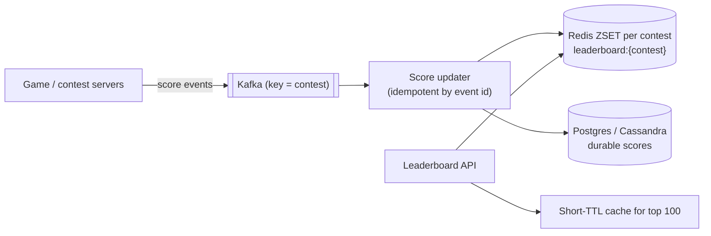
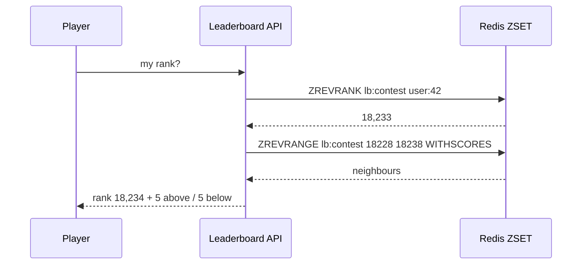
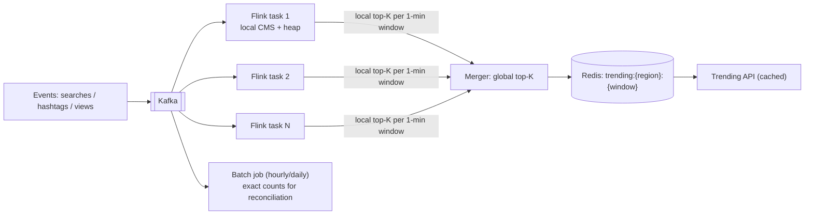
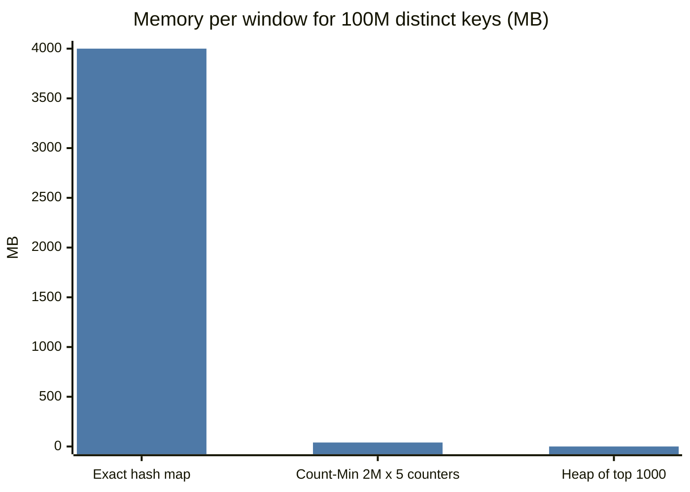

# 🏆 Design a Leaderboard / Top-K

> [!abstract] Problem
> Two flavours that interviewers mix:
> 1. **Leaderboard** — a game/contest (Dream11, a coding contest) with exact scores and ranks for millions of players: "top 100" and "what's my rank?".
> 2. **Top-K / trending** — the K most frequent items in a huge stream (trending hashtags, top-searched products in the last hour), where approximation is OK.

## 1. Clarifying questions

- Exact or approximate? → *leaderboard exact; trending approximate*
- Scale? → *10M players, 50k score updates/s; trending over 1M events/s*
- Time windows? → *leaderboard per contest/season; trending last 1 h, sliding*
- Ties? → *same score → earlier achiever ranks higher*

## 2. Requirements

| Functional | Non-functional |
|---|---|
| Update score | Rank queries < 50 ms |
| Top N, my rank, neighbours around me | Exact for leaderboards |
| Trending top K per window/region | Trending freshness ~1 min; approx OK |

## 3. Estimation

```text
Leaderboard: 10M members × ~50 B in a Redis ZSET ≈ 500 MB → fits one node (replicate)
ZINCRBY / ZREVRANK are O(log N) → 50k updates/s OK on one primary; shard if many contests
Trending: 1M events/s → exact counts for all keys too big per window → Count-Min Sketch + min-heap of K
```

## Part A — Exact leaderboard

### Design



```text
ZINCRBY leaderboard:ipl_final 25 user:42          # update
ZREVRANGE leaderboard:ipl_final 0 99 WITHSCORES   # top 100
ZREVRANK leaderboard:ipl_final user:42            # my rank (0-based)
ZREVRANGE leaderboard:ipl_final (rank-5) (rank+5) # neighbours
```

**Ties:** encode `score × 10^k + (MAX_TS − achieved_ts)` into the ZSET score so earlier achievers rank higher.

### Scaling past one Redis node
- Many contests → shard by contest ID (each contest's ZSET on one node).
- One contest with 100M players → **score-range sharding** (shard by score buckets; rank = count of members in higher buckets + rank within bucket) or approximate ranks for the long tail ("you're in the top 12%") with exact top 1000.



## Part B — Approximate Top-K trending

### Design



- Each parallel task keeps a **Count-Min Sketch** (frequency estimate) + a **min-heap of size K** for its partition; every window it emits local top-K; a merger combines them. → [[Probabilistic-Data-Structures]]
- Sliding "last hour" = sum of 60 one-minute windows (ring buffer of sketches or counts).
- Partition the stream by item key so each item's count lives on one task → local top-Ks are exact per item and the merge is correct.

**Window rollup:**

```mermaid
gantt
    title Last-hour trending = rolling sum of 1-minute windows
    dateFormat HH:mm
    axisFormat %H:%M
    section Windows kept
    Minute 1             :w1, 10:00, 1m
    Minute 2             :w2, 10:01, 1m
    Minutes 3 to 58      :w3, 10:02, 56m
    Minute 59            :w4, 10:58, 1m
    Minute 60 (current)  :active, w5, 10:59, 1m
    section Dropped
    Oldest minute expires :crit, w0, 09:59, 1m
```



**Exact vs approximate cost:**



## 4. Deep dives

- **Idempotent score updates:** dedupe events by ID (retries from game servers) — or use absolute `ZADD` of the computed score rather than increments. → [[Idempotency]]
- **Durability:** Redis is the serving layer; scores persisted in a DB; rebuild ZSET from DB/Kafka on failover.
- **Anti-cheat:** validate score events server-side; rate-limit updates per player.
- **Freshness vs cost (trending):** 1-min windows + 10-s refresh of the cached API response.

## 5. Bottlenecks & trade-offs

| Choice | Trade-off |
|---|---|
| Redis ZSET | Simple, exact, O(log N) vs memory-bound single key |
| Score-range sharding | Scales to 100M+ vs complex rank math |
| CMS + heap | Tiny memory vs overestimation errors |
| Partition by key | Correct merge vs hot keys (viral hashtag) → pre-aggregate locally first |

## 6. Follow-ups & tricky questions

- *"Rank for a user in the 100,000,000th place quickly?"* — Bucketed counts → approximate percentile; exact only near the top.
- *"Reset weekly?"* — New key per period (`lb:2026-W45`); old keys expire.
- *"Hot hashtag skews one partition?"* — Two-stage aggregation: local partial counts per task, then shuffle by key.

## 7. What each level should cover

| SDE-1 | SDE-2 | Senior |
|---|---|---|
| Redis ZSET commands, top N, my rank | Ties, durability, sharding by contest, CMS + heap for trending | Score-range sharding, stream two-stage aggregation, approximate ranks, anti-cheat |

## 🧠 Concepts used
[[Redis-Deep-Dive]] · [[Probabilistic-Data-Structures]] · [[Batch-and-Stream-Processing]] · [[Kafka-Deep-Dive]] · [[Sharding-and-Partitioning]] · [[Idempotency]]

## My gaps
-

---
**Next:** [[Design-Flash-Sale]] · **Up:** [[Case-Studies-MOC]]
