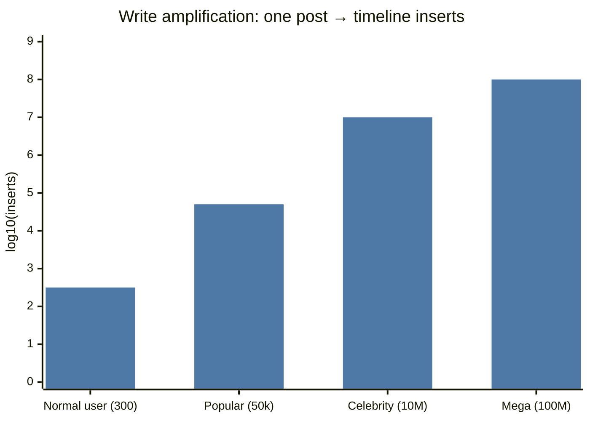
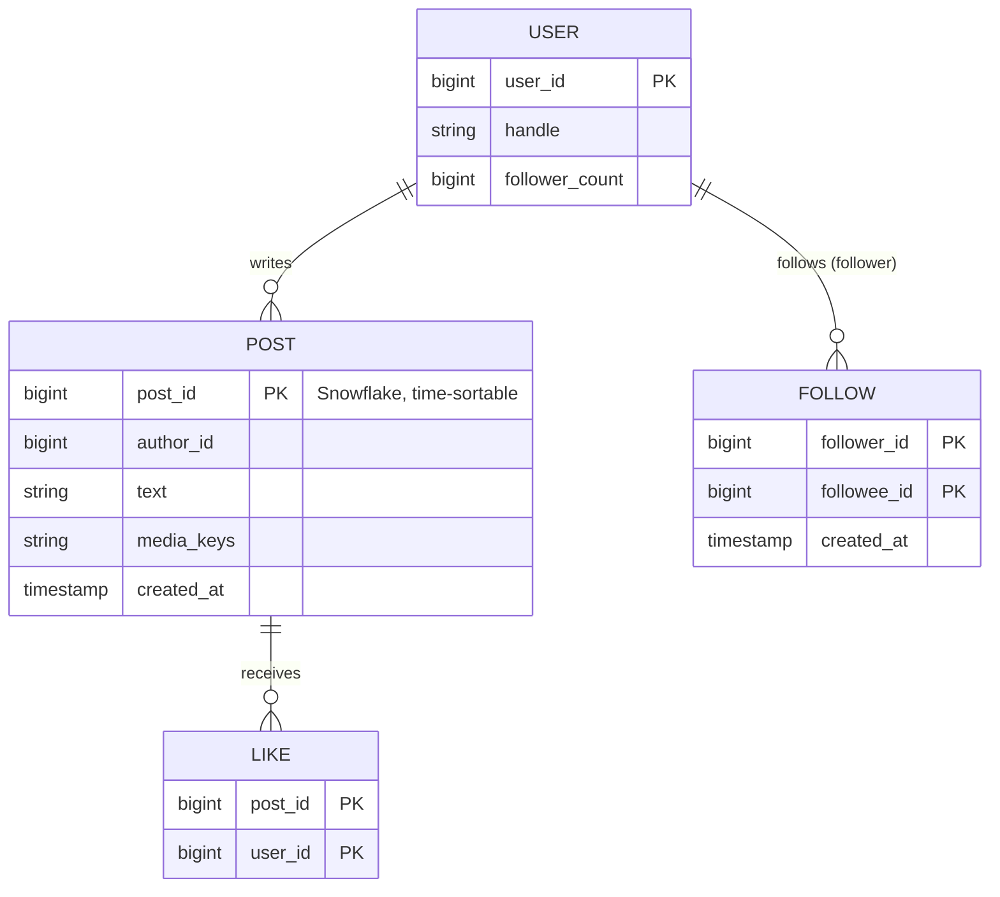
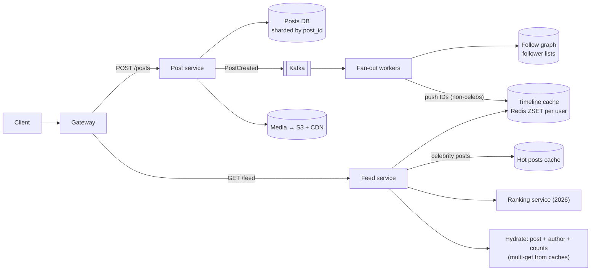
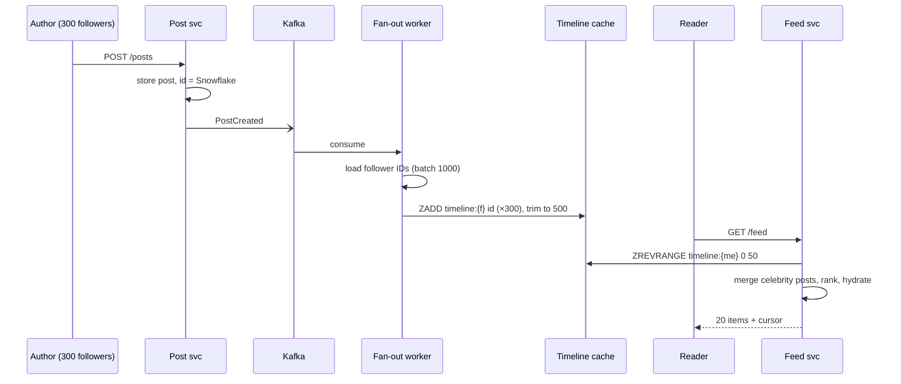

# 📰 Design a News Feed

> [!abstract] Problem
> Users follow others. Home feed shows recent (and in 2026: **ranked**) posts from people you follow. Posting, liking, and notifications.

## 1. Clarifying questions

- Chronological or ranked? → *start chronological, then add ranking (2026 expectation)*
- Media? → *images/videos via object storage + CDN*
- Follower distribution? → *most < 1k, celebrities up to 100M*
- Freshness? → *new posts visible within seconds*

## 2. Requirements

| Functional | Non-functional |
|---|---|
| Publish post | Feed load p99 < 200 ms |
| Follow/unfollow | Eventual consistency OK (seconds) |
| View home feed (paginated) | Highly available reads |
| Like/comment counts | 300M DAU, read-heavy |

## 3. Estimation

```text
300M DAU; each opens feed 10×/day → 3B feed reads/day ≈ 35k/s avg, ~100k/s peak
Posts: 300M × 0.5/day = 150M/day ≈ 1.7k/s avg
Avg follows 300 → fan-out on write ≈ 150M × 300 = 45B timeline inserts/day ≈ 520k/s
Timeline cache: keep last 500 post IDs/user × 8 B × 300M ≈ 1.2 TB in Redis (IDs only)
```



## 4. API

```http
POST /v1/posts                 { text, mediaIds[] } → 201 {postId}
GET  /v1/feed?cursor=…&limit=20 → { items: [ {postId, author, text, media, likes} ], nextCursor }
POST /v1/users/{id}/follow
POST /v1/posts/{id}/likes
```

## 5. Data model



Plus **timeline cache**: Redis list/ZSET `timeline:{userId}` → recent post IDs (scored by Snowflake ID/time).

## 6. Fan-out on write vs read — the core decision

| | Fan-out on write (push) | Fan-out on read (pull) |
|---|---|---|
| On post | Insert post ID into every follower's timeline | Nothing extra |
| On read | Read precomputed timeline (fast) | Fetch recent posts of all followees, merge (slow) |
| Good for | Normal users, read-heavy | Celebrities, inactive followers |
| Problem | Celebrity post → 100M writes | Following 2k accounts → 2k queries per read |

**Hybrid ✅:** push for normal authors; for celebrities (> ~100k followers) **don't fan out** — at read time, merge the user's precomputed timeline with recent posts from the few celebrities they follow (cached hot).

## 7. High-level design



## 8. Key flow



## 9. Deep dives

### Celebrity problem (hot key + write amplification)
Threshold by follower count; mark author as "pull". At read time merge from a small per-celebrity recent-posts cache (heavily cached, replicated). → [[Cache-Pitfalls]]

### Inactive users
Don't fan out to users inactive for 30+ days; rebuild their timeline on next login (pull). Cuts most fan-out writes.

### Ranking (the 2026 layer)
Candidates (timeline IDs + celebrity posts + recommended/trending) → features (author affinity, recency, engagement) → model → re-rank for diversity → page. Fallback to chronological if ranking is down. → [[Recommendation-and-Ranking-Systems]]

### Counters (likes)
Don't `UPDATE posts SET likes = likes + 1` on a hot post. Use Redis `INCR` / sharded counters, flush to DB periodically (write-back); counts are eventually consistent. → [[Caching]]

### Pagination
Cursor = last post ID (Snowflake = time-ordered). → [[API-Design]]

## 10. Bottlenecks & trade-offs

| Risk | Mitigation |
|---|---|
| Fan-out backlog after a viral author | Hybrid model; prioritise active followers; autoscale workers on lag |
| Timeline cache memory | Store IDs only, cap at 500, drop inactive users |
| Hot post hydration | Post cache + CDN media + local L1 for mega-viral |
| Unfollow consistency | Filter at read time against current follow set; lazy cleanup |

## 11. Follow-ups & tricky questions

- *"Why not just pull for everyone?"* — Read path becomes N queries + merge per page load at 100k/s.
- *"Deleted post still in timelines?"* — Filter at hydration (post missing/deleted → skip); async purge.
- *"How fresh is the feed?"* — Push path: seconds (Kafka lag). Celebrities: real-time on read.
- *2026:* "Add ML ranking within 200 ms" — multi-stage funnel, feature store, A/B tests, feedback logging.

## 12. What each level should cover

| SDE-1 | SDE-2 | Senior |
|---|---|---|
| Push vs pull explained, timeline cache, pagination | Hybrid with thresholds, inactive users, counters, numbers on amplification | Ranking pipeline with latency budget, experiment infra, multi-region, cost |

## 🧠 Concepts used
[[Caching]] · [[Cache-Pitfalls]] · [[Redis-Deep-Dive]] · [[Kafka-Deep-Dive]] · [[Sharding-and-Partitioning]] · [[Unique-ID-Generation]] · [[Recommendation-and-Ranking-Systems]] · [[CDN]]

## My gaps
-

---
**Next:** [[Design-Video-Streaming]] · **Up:** [[Case-Studies-MOC]]
