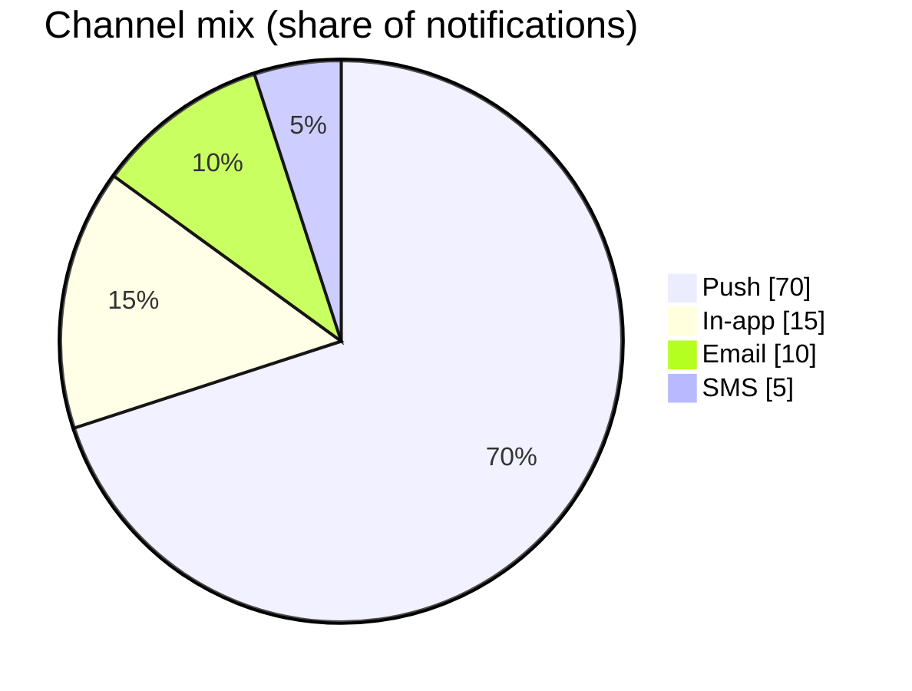
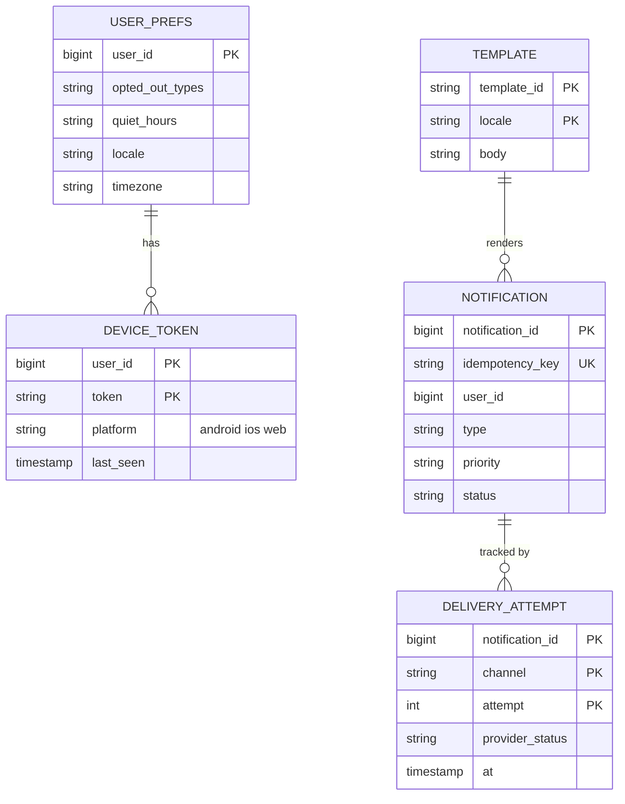
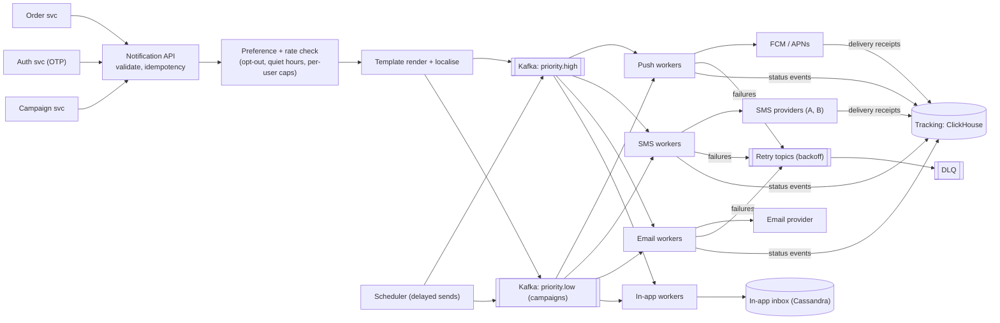
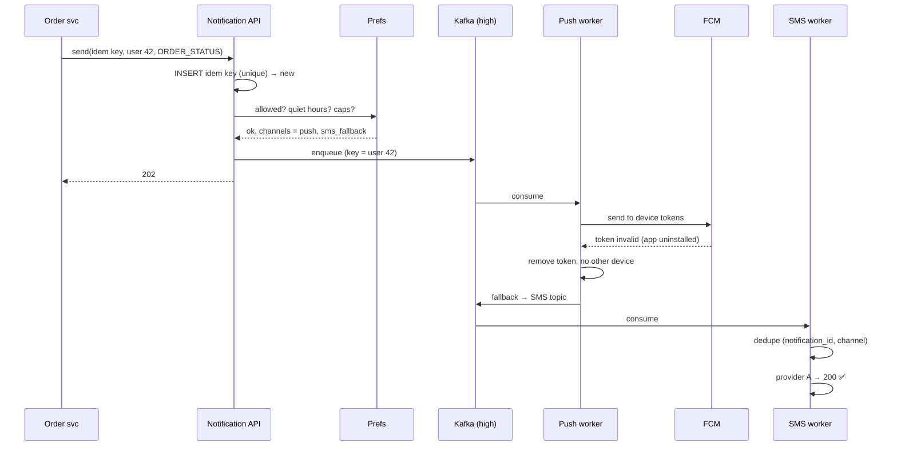
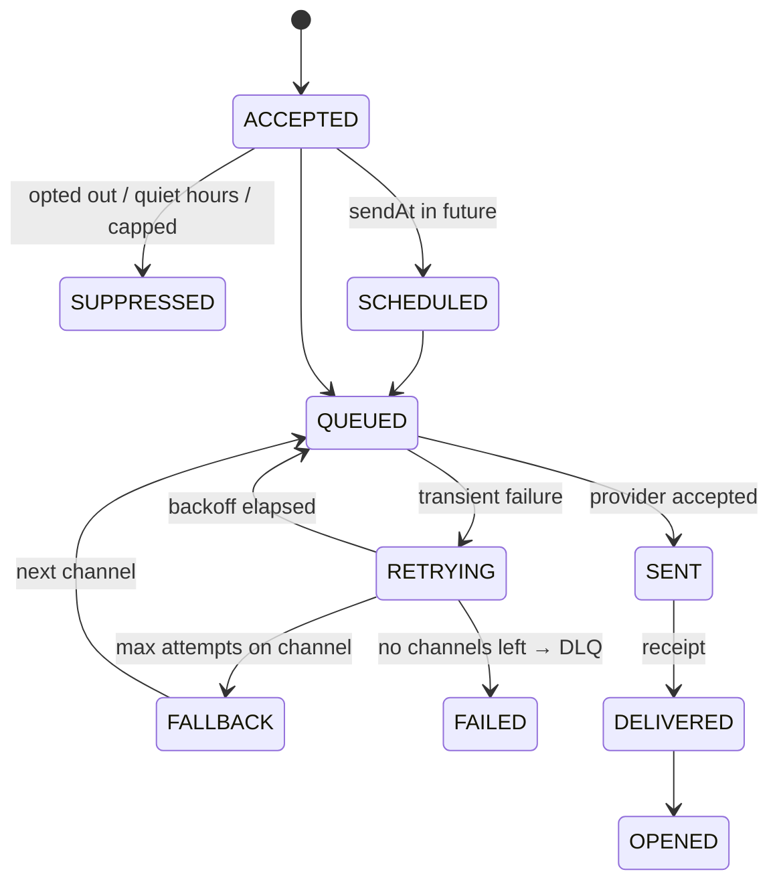

# 🔔 Design a Notification System

> [!abstract] Problem
> A platform service that other teams call to send notifications over **push, SMS, email, and in-app**, respecting user preferences, with retries, deduplication, rate limits, scheduling and templates. Think Swiggy "your order is out for delivery" + marketing campaigns.

## 1. Clarifying questions

- Transactional (OTP, order status) and marketing (campaigns)? → *both; transactional has priority*
- Channels? → *push (FCM/APNs), SMS, email, in-app*
- Scale? → *1B notifications/day, campaign bursts of 50M in an hour*
- Delivery guarantees? → *at-least-once; no duplicates visible to users*
- Scheduling, quiet hours, localisation? → *yes*

## 2. Requirements

| Functional | Non-functional |
|---|---|
| Send API for internal services (single + bulk/campaign) | OTP / transactional p99 < 5 s end to end |
| Templates + localisation | No loss; dedupe so users don't get doubles |
| User preferences, opt-outs, quiet hours | Priority isolation: campaigns never delay OTPs |
| Retries with fallback channel (push → SMS) | Respect provider rate limits; cost-aware (SMS is expensive) |
| Delivery tracking (sent, delivered, opened) | Horizontally scalable |

## 3. Estimation

```text
1B/day ≈ 11.5k/s avg; campaign burst 50M/h ≈ 14k/s extra → design for ~50k/s peak
Mix (typical): push 70%, in-app 15%, email 10%, SMS 5%
SMS @ ~₹0.15–0.25 each × 50M/day would be ₹ crores/month → prefer push, use SMS for OTP/fallback
Log storage: 1B × 300 B ≈ 300 GB/day of delivery events → Cassandra/ClickHouse with TTL
```



## 4. API

```http
POST /v1/notifications
{
  "idempotencyKey": "order_991_out_for_delivery",
  "userId": 42, "type": "ORDER_STATUS", "priority": "HIGH",
  "templateId": "order_out_v3", "params": {"eta": "12 min"},
  "channels": ["push", "sms_fallback"], "sendAt": null
}
→ 202 { notificationId }
POST /v1/campaigns  { segmentId, templateId, schedule, throttlePerSec }
GET  /v1/notifications/{id}  → status per channel
```

## 5. Data model



## 6. High-level design



## 7. Key flows



**Notification lifecycle:**



## 8. Deep dives

### Priority isolation
Separate topics/queues and **separate worker pools** (bulkheads) for transactional vs marketing. Campaigns are throttled (`throttlePerSec`) so a 50M blast can't starve OTPs. → [[Resilience-Patterns]]

### Dedup & idempotency
API-level idempotency key (caller-provided, e.g., `order_991_out_for_delivery`); worker-level dedupe on `(notification_id, channel)` before calling the provider (Redis `SET NX` with TTL). Accept that a provider timeout may still cause a rare duplicate — log it. → [[Idempotency]]

### Retries
Exponential backoff with jitter via **retry topics** (e.g., 1 min, 5 min, 30 min) rather than blocking workers; DLQ after N; fallback channel for HIGH priority. → [[Message-Queues]]

### Provider rate limits & failover
Token bucket per provider; health-check providers, circuit-break and switch SMS provider A → B. → [[Design-Rate-Limiter]]

### Campaign fan-out
Segment query → stream user IDs in batches (10k) → enqueue with throttle; spread over time windows and respect each user's time zone/quiet hours. Per-user frequency caps ("max 3 promos/day") in Redis counters.

### Scheduling
Delayed messages via a scheduler (time-bucketed tables / Redis ZSET by `sendAt`, polled every second) that emits to Kafka when due. → [[Design-Job-Scheduler]]

## 9. Bottlenecks & trade-offs

| Choice | Trade-off |
|---|---|
| Kafka vs SQS | Replay + high throughput vs simpler per-message retries/delays |
| Partition by user_id | Ordering per user vs hot users (rare) |
| SMS fallback | Reliability vs cost |
| Exactly-once | Not achievable with external providers — dedupe + idempotent keys minimise doubles |

## 10. Follow-ups & tricky questions

- *"Guarantee OTP within 5 s during a campaign blast?"* — Separate high-priority pipeline + reserved worker capacity + multiple SMS providers.
- *"User has 3 devices?"* — Fan out to all active tokens; in-app inbox syncs read state.
- *"Stale device tokens?"* — Remove on provider "unregistered" responses; refresh on app open.
- *2026:* AI-personalised content/timing (send-time optimisation) — ranking model picks channel/time; still behind the same preference & cap checks.

## 11. What each level should cover

| SDE-1 | SDE-2 | Senior |
|---|---|---|
| API + queue + channel workers + retries | Priority isolation, dedupe, fallback, provider limits, preferences | Campaign throttling at scale, cost optimisation, multi-provider failover, tracking analytics |

## 🧠 Concepts used
[[Message-Queues]] · [[Kafka-Deep-Dive]] · [[Idempotency]] · [[Resilience-Patterns]] · [[Design-Rate-Limiter]] · [[Design-Job-Scheduler]] · [[Real-Time-Communication]]

## My gaps
-

---
**Next:** [[Design-Typeahead]] · **Up:** [[Case-Studies-MOC]]
