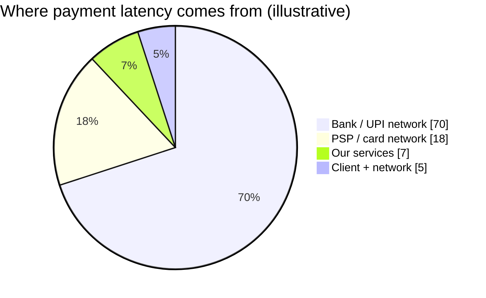
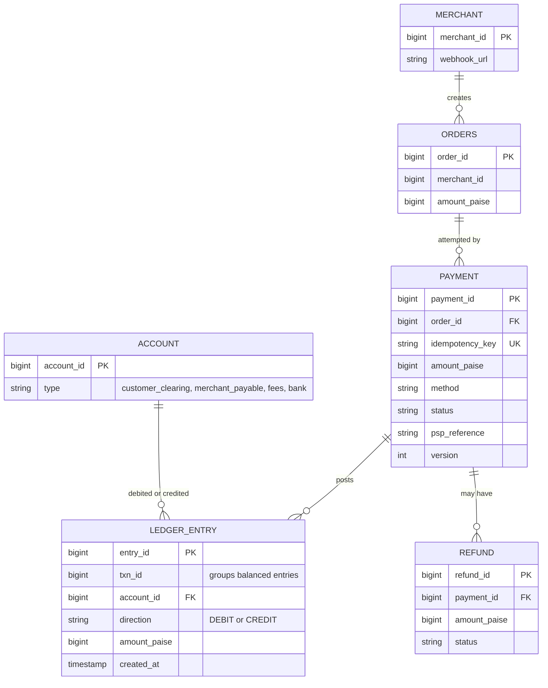
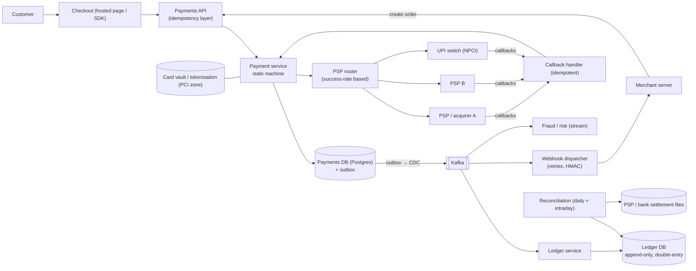
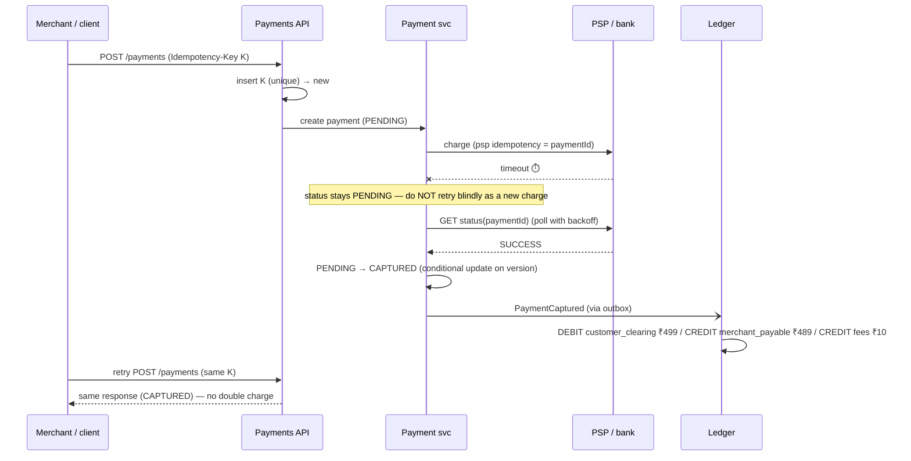
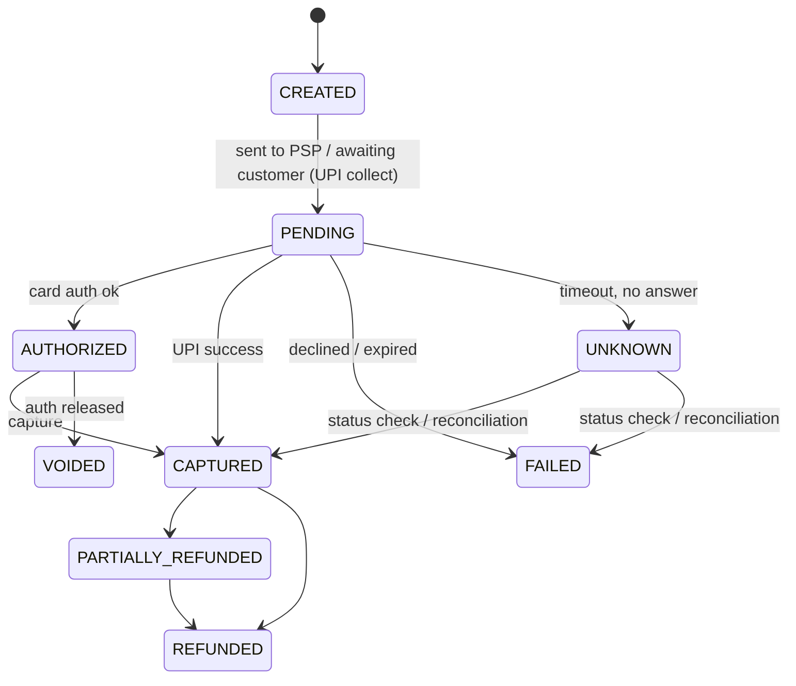
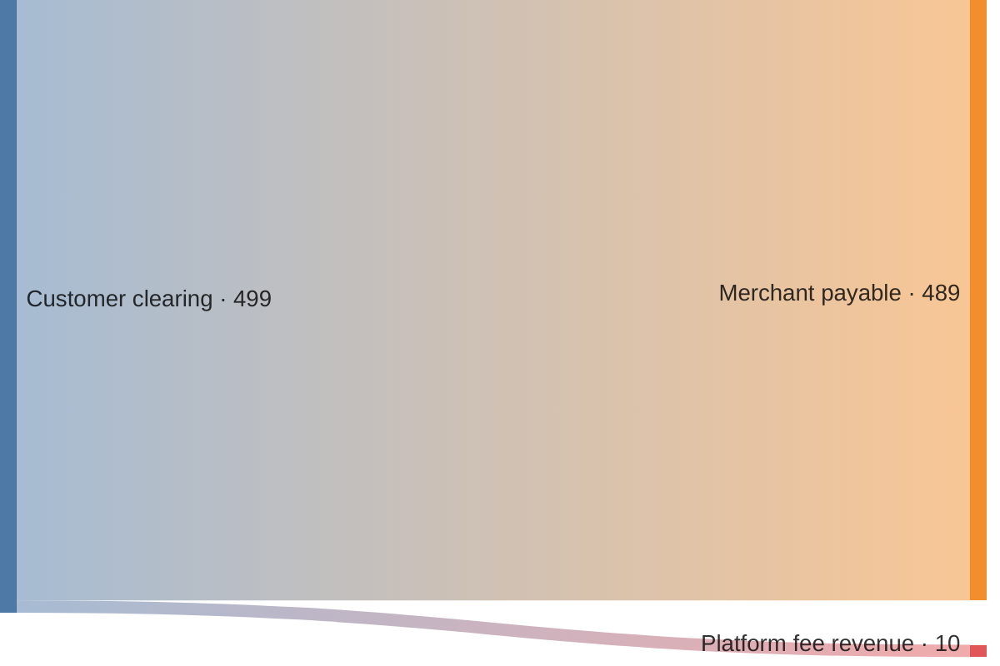

# 💳 Design a Payment System

> [!abstract] Problem
> A merchant checkout: customer pays via card/UPI/netbanking/wallet through external Payment Service Providers (PSPs) and banks. Record money movement correctly, notify merchants, handle refunds, and settle funds. **Correctness over everything.**

## 1. Clarifying questions

- Are we a merchant (using a PSP) or a payment gateway (like Razorpay)? → *a gateway-like platform serving merchants*
- Methods? → *cards, UPI, netbanking*
- Scale? → *10k payments/s peak (festival sale)*
- Refunds, payouts/settlement? → *refunds yes, settlement batch*

## 2. Requirements

| Functional | Non-functional |
|---|---|
| Create payment, redirect/collect, confirm | **Exactly-once effect** — never double charge |
| Webhooks to merchants | Strong consistency for balances/ledger |
| Refunds (full/partial) | Durability, full audit trail (immutable) |
| Ledger + settlement to merchants | Availability 99.99%; graceful handling of PSP outages |
| Reconciliation with banks/PSPs | Security: PCI-DSS, tokenisation, RBI data localisation |

## 3. Estimation

```text
Peak 10k payments/s; avg ~1k/s → ~86M/day
Each payment ≈ 5–10 ledger entries + state transitions + events
Ledger rows: ~600M/day → partition by time/account; archive to cold storage
Latency budget: our side < 300 ms; bank/PSP adds seconds (async confirmation common for UPI)
```



## 4. API

```http
POST /v1/orders            { amount: 49900, currency: "INR", receipt } → { orderId }
POST /v1/payments          Idempotency-Key: <uuid>
                           { orderId, method: "upi", vpa: "a@okbank" } → { paymentId, status: "PENDING", nextAction }
GET  /v1/payments/{id}     → { status: "CAPTURED" | "FAILED" | "PENDING" }
POST /v1/payments/{id}/refunds  Idempotency-Key → { refundId, status }
→ Webhook to merchant: payment.captured { paymentId, orderId, signature (HMAC) }
```

## 5. Data model



**Money as integers (paise)**, never floats. Ledger is **append-only, double-entry**: every txn's debits = credits.

## 6. High-level design



## 7. Key flows

**Payment with an unknown outcome handled safely:**



**Payment state machine:**



**Double-entry for one ₹499 payment (2% fee):**



## 8. Deep dives

### Idempotency end to end
Client key → API idempotency table (unique) → payment ID as PSP idempotency key → idempotent callback handler (dedupe by PSP reference) → ledger entries unique per `(txn_id, account, direction)`. → [[Idempotency]]

### Ledger
Append-only, double-entry, immutable — corrections are new reversing entries, never updates. Balances = sum of entries (with periodic snapshots for speed). Strong consistency (single Postgres/Spanner cluster or sharded by account with care). This is where **event sourcing** fits naturally. → [[Event-Driven-Architecture]]

### Reconciliation
Banks/PSPs send settlement files. Daily (and intraday) jobs match our records ↔ PSP ↔ bank: amounts, statuses, fees. Mismatches → auto-resolve rules (late success → capture; ghost charge → refund) or ops queue. **Reconciliation is how payment systems become correct** despite timeouts and partial failures. → [[Batch-and-Stream-Processing]]

### PSP routing & resilience
Route by method, issuer bank, live success rates and cost; circuit-break a degrading PSP and fail over to another. Timeouts → UNKNOWN, never auto-retry as a fresh charge. → [[Resilience-Patterns]]

### Webhooks to merchants
At-least-once with exponential backoff for ~24–72 h, HMAC signatures + timestamps, merchants dedupe by event ID; dashboard replay. → [[Real-Time-Communication]]

### Security & compliance
PCI-DSS scope minimised via a tokenisation vault; card-on-file tokenisation; encryption with KMS/HSM; India's RBI data localisation (payment data stored in India); fraud scoring in the stream (velocity checks, device fingerprinting). → [[Security-Essentials]]

## 9. Bottlenecks & trade-offs

| Choice | Trade-off |
|---|---|
| Sync ledger write vs async (via outbox) | Simpler reads vs payment latency; async + reconciliation is common |
| Single ledger DB vs sharded | Global consistency vs write scale (shard by account, keep a txn within one shard where possible) |
| Auto-retry on timeout | Never as a new charge — query status instead |
| Strong consistency | Lower availability on partitions — acceptable for money (CP) |

## 10. Follow-ups & tricky questions

- *"Customer charged but our DB says failed?"* — Reconciliation detects (PSP success, ours failed) → mark captured or auto-refund; notify.
- *"How do you prevent double refunds?"* — Idempotency key + `SUM(refunds) ≤ captured` checked in a transaction.
- *"Why integers for money?"* — Floats can't represent 0.1 exactly → rounding drift.
- *"Festival sale 10× spike?"* — Pre-scale, queue non-critical work (webhooks, analytics), PSP capacity agreements, rate-limit per merchant.
- *"How does UPI differ?"* — Push payments via NPCI; collect requests; async confirmation → PENDING handling is the norm.

## 11. What each level should cover

| SDE-1 | SDE-2 | Senior |
|---|---|---|
| Idempotency key, payment states, PSP integration, webhooks | Unknown-outcome handling, double-entry ledger, outbox, reconciliation, PSP failover | Sharded ledger design, compliance/localisation, routing optimisation, fraud stream, settlement |

## 🧠 Concepts used
[[Idempotency]] · [[Distributed-Transactions]] · [[Transactions-and-Isolation-Levels]] · [[Event-Driven-Architecture]] · [[Resilience-Patterns]] · [[Security-Essentials]] · [[Batch-and-Stream-Processing]] · [[CAP-and-PACELC]]

## My gaps
-

---
**Next:** [[Design-Notification-System]] · **Up:** [[Case-Studies-MOC]]
