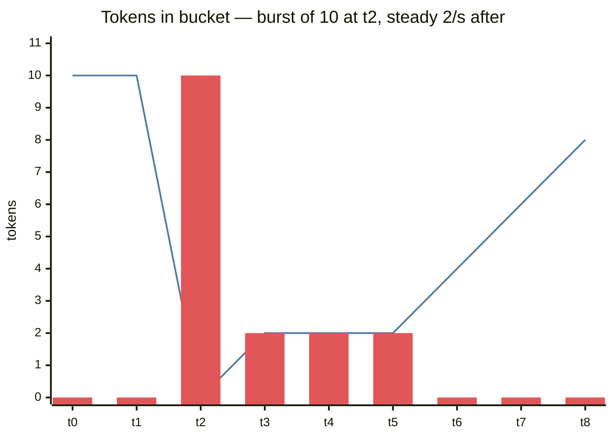
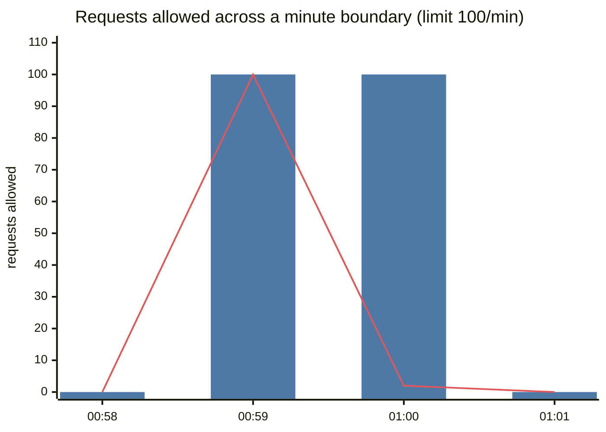
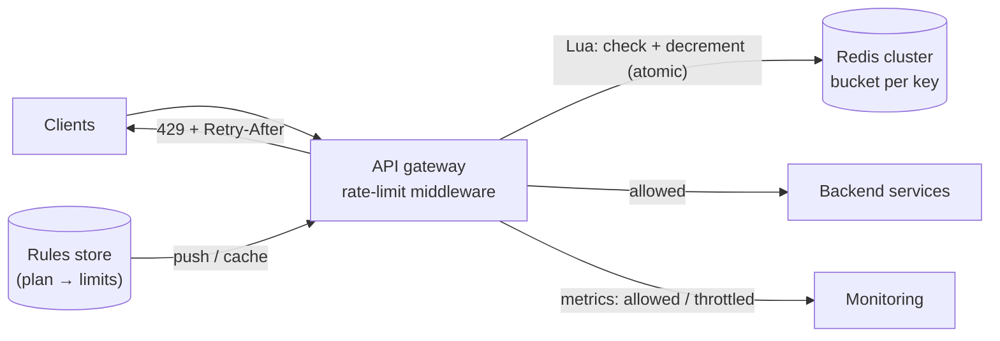
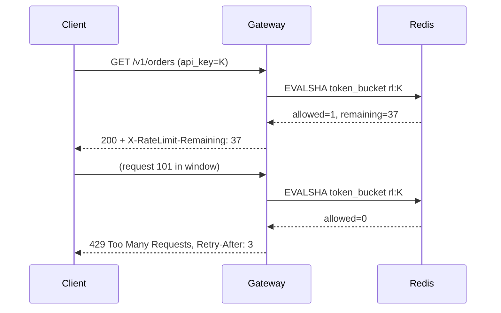

# 🚦 Design a Rate Limiter

> [!abstract] Problem
> Limit how many requests a client (user / API key / IP) can make in a time window — e.g., 100 requests/minute per API key — across a fleet of API servers. Return **429** when exceeded.

## 1. Clarifying questions

- Client-side or server-side? → *server-side, at the gateway*
- Keyed by? → *user ID, API key, and IP for anonymous*
- Hard or soft limits? Bursts allowed? → *allow short bursts*
- Distributed across regions? → *multi-server, single region first*
- Different limits per plan/endpoint? → *yes, configurable*

## 2. Requirements

| Functional | Non-functional |
|---|---|
| Configurable rules (key, endpoint, limit, window) | Adds < 1–2 ms p99 to each request |
| Reject with 429 + `Retry-After`, `X-RateLimit-Remaining` | Highly available — **fail open** if the limiter breaks (usually) |
| Works across many servers | Accurate enough (small overshoot acceptable) |
| | Memory efficient for millions of keys |

## 3. Estimation

```text
1M active API keys, 50k req/s peak through the gateway
Token bucket state per key ≈ 2 numbers + key ≈ ~100 B → 1M × 100 B = 100 MB → fits in one Redis (replicated)
Ops: 1 Redis call (Lua) per request → 50k ops/s → 1 node can do it; shard for headroom
```

## 4. The algorithms (the core of this question)

| Algorithm | How | Burst handling | Memory | Accuracy |
|---|---|---|---|---|
| **Token bucket** | Bucket of capacity B refills at r tokens/s; each request takes 1 | ✅ Allows bursts up to B | 2 values/key | Good |
| **Leaky bucket** | Requests enter a queue drained at fixed rate | Smooths output, no bursts | Queue/key | Good (shapes traffic) |
| **Fixed window counter** | `INCR key:minute`, reject over N | ❌ 2× burst at window edges | 1 counter | Edge problem |
| **Sliding window log** | Store timestamps (ZSET), count in last 60 s | Precise | **O(requests)** per key | Exact |
| **Sliding window counter** | Weighted current + previous window counts | Smooth | 2 counters | ~Approximate, very good |

**Fixed window edge problem:** 100 requests at 00:59 + 100 at 01:00 = 200 in 2 seconds.

**Sliding window counter estimate:**

$$\text{count} \approx C_{\text{current}} + C_{\text{previous}} \times \frac{\text{window} - \text{elapsed}}{\text{window}}$$

## 📊 Visual model

**Token bucket over time (capacity 10, refill 2/s):**



> [!note] Bars = requests allowed in that second. The burst of 10 is allowed instantly; afterwards clients are held to the refill rate.

**Fixed window vs sliding window at the boundary:**



> [!note] Bars = fixed window (200 in ~2 s). Line = sliding window (correctly blocks).

## 5. High-level design



## 6. Key flow (atomic token bucket in Redis)

```lua
-- KEYS[1] = bucket key; ARGV = capacity, refill_per_sec, now_ms, cost
local b = redis.call('HMGET', KEYS[1], 'tokens', 'ts')
local cap, rate, now, cost = tonumber(ARGV[1]), tonumber(ARGV[2]), tonumber(ARGV[3]), tonumber(ARGV[4])
local tokens = tonumber(b[1]) or cap
local ts = tonumber(b[2]) or now
tokens = math.min(cap, tokens + (now - ts) / 1000 * rate)        -- refill
local allowed = tokens >= cost
if allowed then tokens = tokens - cost end
redis.call('HSET', KEYS[1], 'tokens', tokens, 'ts', now)
redis.call('PEXPIRE', KEYS[1], math.ceil(cap / rate * 1000) * 2)  -- idle keys expire
return { allowed and 1 or 0, tokens }
```



## 7. Deep dives

### Why Lua / atomicity
Read-modify-write from the app (`GET` then `SET`) races across servers → overshoot. Lua (or `INCR` for fixed windows) executes atomically in Redis. → [[Redis-Deep-Dive]]

### Where to put it
Gateway/edge (central, protects everything) vs in each service (fine-grained) vs client SDK (cooperative only). Usually gateway + per-service for expensive endpoints.

### Scaling & latency
- Shard keys across a Redis cluster (key = `rl:{apiKey}`).
- **Local + global hybrid:** each gateway keeps a local token bucket and syncs with Redis periodically → fewer Redis calls, small inaccuracy.
- Multi-region: per-region limits (limit/N per region) or async-synced counters — accept approximate global limits.

### Failure mode
Redis down → **fail open** (allow, with a coarse local limiter as a safety net) for most APIs; **fail closed** for security-critical ones (login attempts, OTP sends).

### Response headers
`X-RateLimit-Limit`, `X-RateLimit-Remaining`, `X-RateLimit-Reset`, `Retry-After` — lets well-behaved clients back off. → [[Resilience-Patterns]]

## 8. Bottlenecks & trade-offs

| Choice | Trade-off |
|---|---|
| Token bucket vs sliding log | Memory O(1) vs exactness |
| Central Redis vs local buckets | Accuracy vs latency/availability |
| Fail open vs closed | Availability vs protection |
| Per-IP limits | Simple vs NAT/shared IPs (offices, mobile carriers) punishing many users |

## 9. Follow-ups & tricky questions

- *"Rate-limit an LLM API?"* — Limit **tokens per minute** (cost = tokens, estimate on request, reconcile on completion) + concurrent request caps per tenant. → [[LLM-Serving-and-Inference]]
- *"Different limits per plan?"* — Rules store keyed by plan; gateway caches rules; key includes plan/tenant.
- *"Throttle vs reject?"* — Leaky bucket/queue to delay instead of reject for internal batch traffic.
- *"How do you prevent one tenant from starving others?"* — Per-tenant limits + fair queuing + bulkheads.

## 10. What each level should cover

| SDE-1 | SDE-2 | Senior |
|---|---|---|
| 2–3 algorithms, Redis counter, 429 | Atomic Lua token bucket, sliding window math, fail-open/closed, headers | Multi-region accuracy, hybrid local/global, tenant fairness, token-based limits |

## 🧠 Concepts used
[[Redis-Deep-Dive]] · [[Proxies-and-API-Gateways]] · [[Resilience-Patterns]] · [[Security-Essentials]] · [[Consistent-Hashing]]

## My gaps
-

---
**Next:** [[Design-Chat-App]] · **Up:** [[Case-Studies-MOC]]
