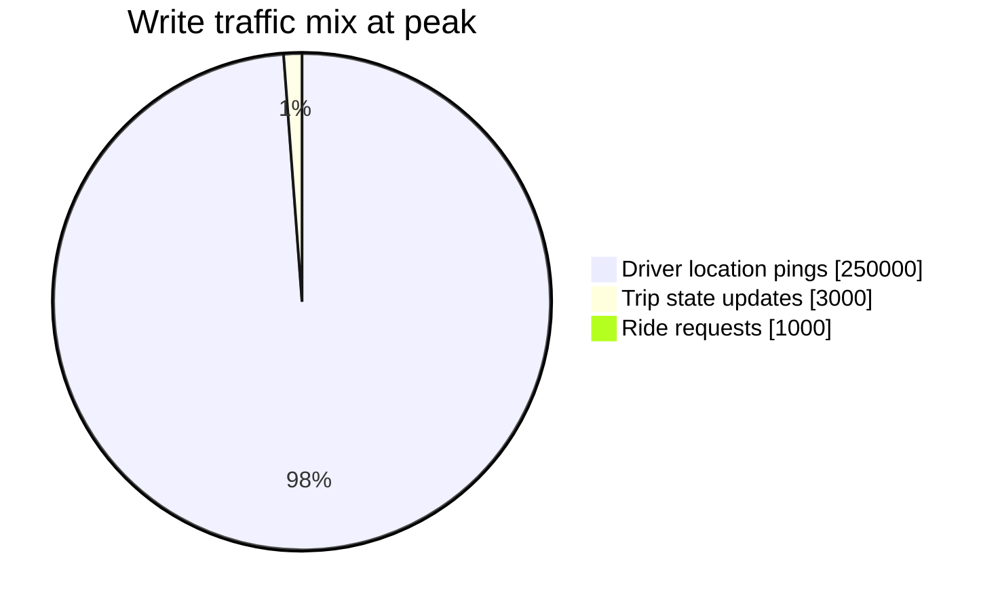
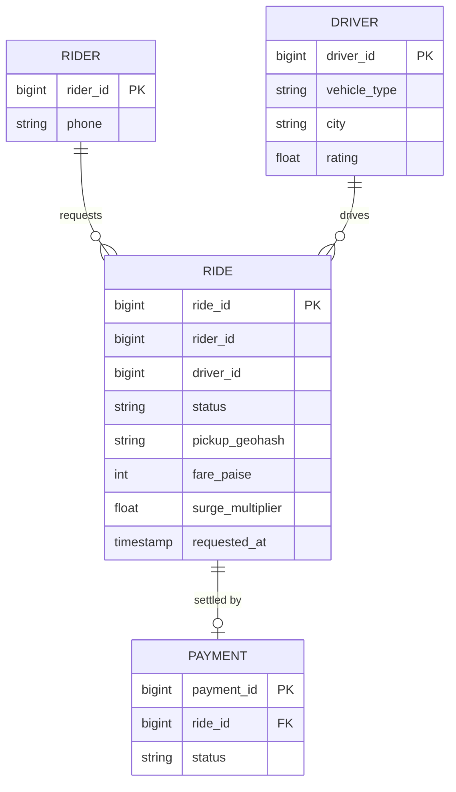
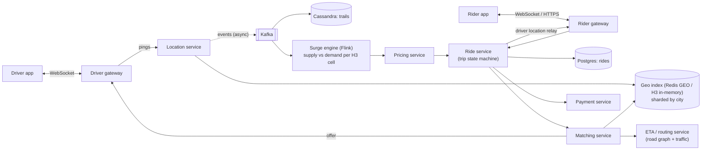
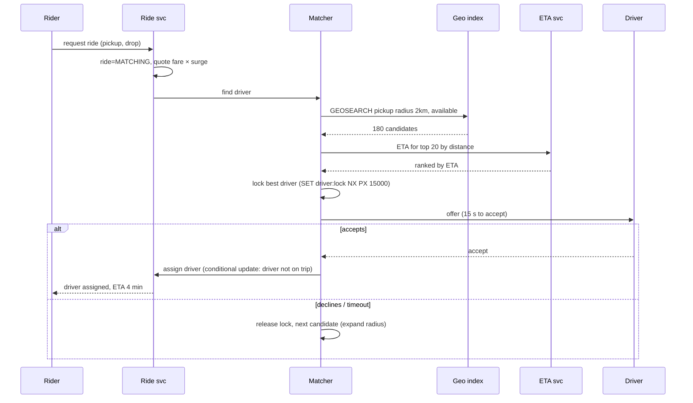
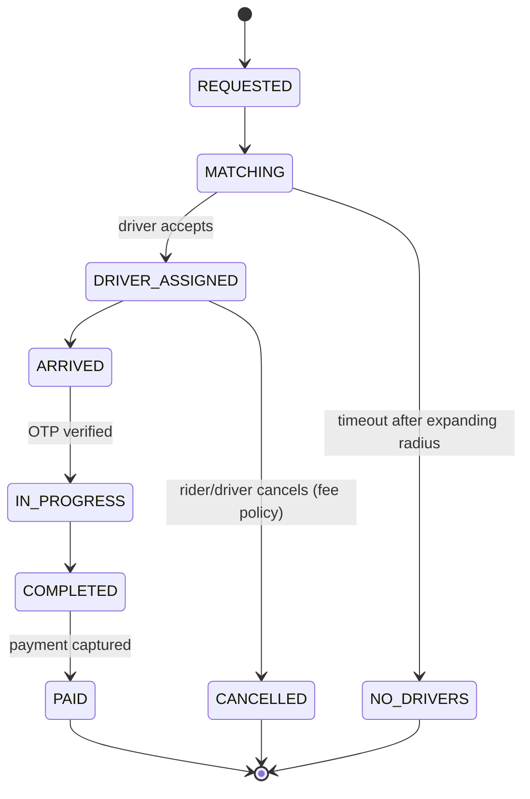

# 🚕 Design a Ride-Sharing App

> [!abstract] Problem
> Riders request a ride; the system finds a nearby available driver, the driver accepts, both see live locations, trip completes, payment happens. Handle surge pricing during demand spikes.

## 1. Clarifying questions

- Scope: request, match, track, pay? → *yes; pricing basic + surge*
- Scale? → *India: 1M active drivers at peak, 10M rides/day*
- Location update frequency? → *drivers every 4 s*
- Pooling/scheduled rides? → *out of scope*

## 2. Requirements

| Functional | Non-functional |
|---|---|
| Driver goes online, sends location | Match within ~10 s |
| Rider requests, sees ETA & fare | Location writes: very high throughput |
| Match driver (accept/decline) | A driver must never get 2 trips at once (consistency for assignment) |
| Live tracking both ways | Tracking freshness ~seconds |
| Trip state machine, payment, rating | High availability; degrade gracefully |

## 3. Estimation

```text
Location writes: 1M drivers / 4 s = 250k writes/s  (in-memory store, not a DB row update)
Ride requests: 10M/day ≈ 115/s avg, ~1k/s peak (rush hour, rain)
Each match query: geo search ~100–300 candidates → ETA ranking
Location history: 250k/s × 100 B ≈ 2 TB/day → Cassandra / lake, sampled
```



## 4. API

```http
POST /v1/drivers/me/status        {online: true}
WS   driver channel: → {lat, lng, heading, ts} every 4 s;  ← offers
POST /v1/rides                     {pickup, drop, product} Idempotency-Key → {rideId, status: MATCHING}
POST /v1/rides/{id}/accept         (driver)
WS   rider channel: ← driverLocation, eta, status
POST /v1/rides/{id}/complete
```

## 5. Data model



Live driver location & availability → **Redis GEO / in-memory geo index per city**; trips → Postgres (sharded by city/ride_id); location trail → Cassandra.

## 6. High-level design



## 7. Key flows

**Request → match:**



**Trip state machine:**



## 8. Deep dives

### Location updates at 250k/s
Don't write to a relational DB. Gateway → location service → **in-memory geo index** (Redis GEO per city or custom H3/quadtree service), TTL so stale drivers vanish; async Kafka for history/analytics. Shard by city (Bengaluru alone is big → sub-shard by H3 cell). → [[Geospatial-Indexing]]

### Matching
Candidates by geo radius → filter (available, vehicle type, rating) → **rank by ETA** (road network, not straight-line). Prevent double assignment with a short **driver lock** + conditional DB update (`UPDATE drivers SET current_ride = :r WHERE id = :d AND current_ride IS NULL`). Batch matching (collect requests for 1–2 s and solve assignment globally) improves overall ETAs at scale.

### Surge pricing
Stream supply (available drivers) and demand (requests, app opens) per **H3 hexagon** in 1-min windows → multiplier → cached per cell; quote locked at request time. → [[Batch-and-Stream-Processing]]

### Live tracking to rider
Driver pings → location service → publish to the rider's gateway via pub/sub (only for active trips). Client-side interpolation smooths the car icon between updates.

### Payments
Authorise at request/complete, capture after trip; idempotent; wallet/UPI/card; driver payouts batched. → [[Design-Payment-System]]

## 9. Bottlenecks & trade-offs

| Risk | Mitigation |
|---|---|
| Hot cells (airport, stadium exit) | Finer sub-sharding, queue-based pickup zones |
| Location service failure | Drivers re-send; short TTL; stale-but-usable data for a few seconds |
| ETA service latency | Cache ETAs between cell pairs; approximate first, refine later |
| Double assignment | Lock + conditional update + idempotent accept |
| Network flakiness in drivers' phones | Idempotent APIs, offline buffering of pings |

## 10. Follow-ups & tricky questions

- *"How do you compute ETA?"* — Road graph (contraction hierarchies), live traffic speeds per segment, ML correction; cache.
- *"Why not query PostGIS for nearby drivers?"* — 250k updates/s on indexed rows would crush it; in-memory index fits the access pattern.
- *"Region-level outage?"* — Cities are natural cells — failover per city/region; trips in progress continue with cached state on devices.
- *"Pool rides?"* — Matching becomes a routing optimisation (insertion heuristics) with detour constraints.

## 11. What each level should cover

| SDE-1 | SDE-2 | Senior |
|---|---|---|
| Location updates + geo search + trip states | 250k/s numbers, in-memory geo sharding, driver locking, ETA ranking, tracking relay | Batch matching, surge streaming with H3, city cells, failure/degradation strategy |

## 🧠 Concepts used
[[Geospatial-Indexing]] · [[Real-Time-Communication]] · [[Redis-Deep-Dive]] · [[Kafka-Deep-Dive]] · [[Batch-and-Stream-Processing]] · [[Distributed-Transactions]] · [[Idempotency]] · [[Multi-Region-and-Disaster-Recovery]]

## My gaps
-

---
**Next:** [[Design-Payment-System]] · **Up:** [[Case-Studies-MOC]]
