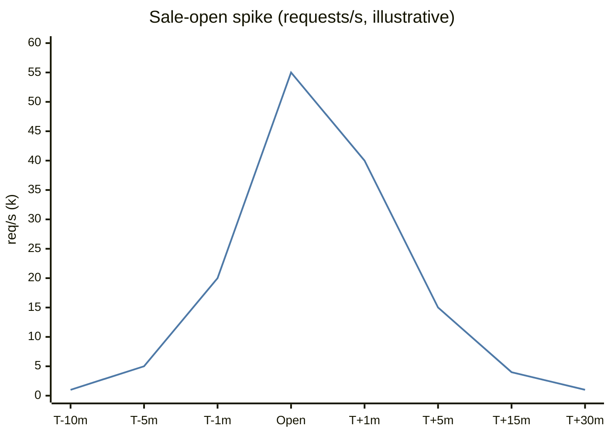
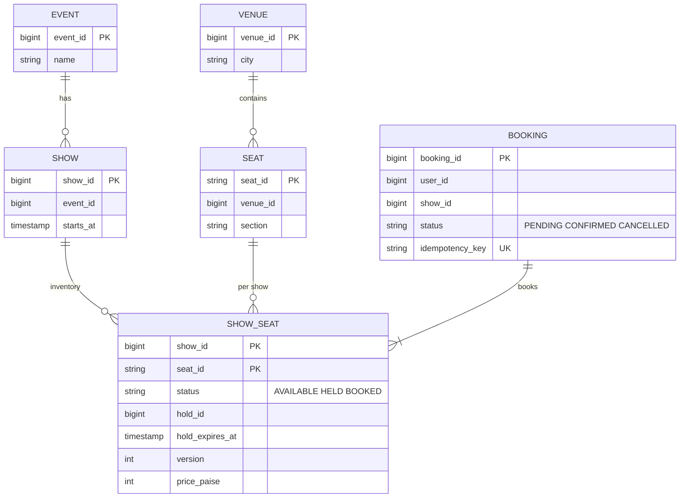
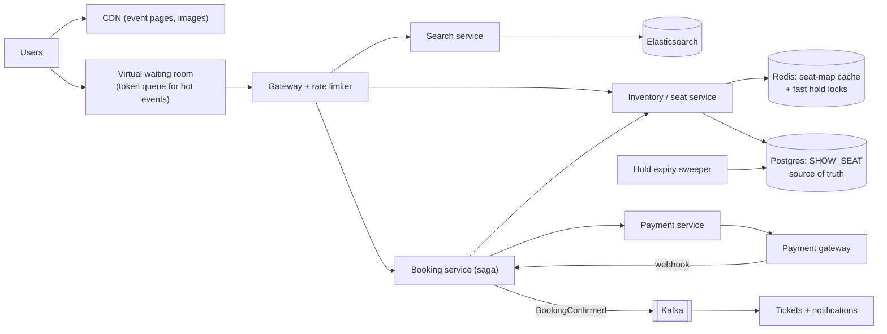
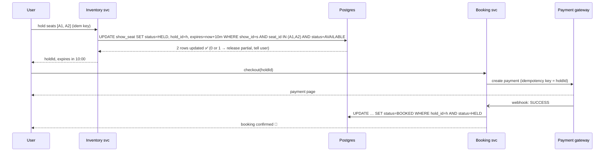
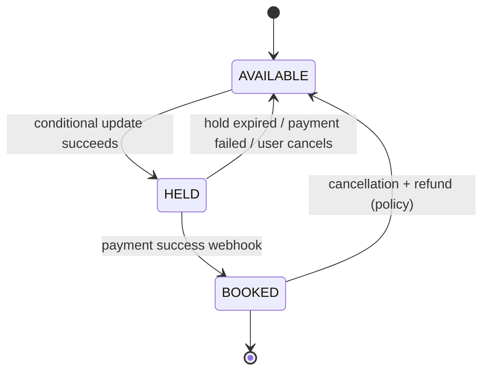

# 🎟️ Design a Ticket Booking System

> [!abstract] Problem
> Users browse shows/events, pick specific seats, hold them briefly while paying, and get a confirmed ticket. **No seat may ever be sold twice.** Popular events (Coldplay India tour, IPL final) cause massive spikes at sale open.

## 1. Clarifying questions

- Assigned seats or general admission? → *assigned seats (harder)*
- Hold duration? → *10 minutes to pay*
- Peak? → *1M users hit "book" within minutes for a 50k-seat concert*
- Payment via external gateway? → *yes*

## 2. Requirements

| Functional | Non-functional |
|---|---|
| Search events/shows, view seat map | **Strong consistency** for seat state (no double booking) |
| Hold selected seats (TTL) | Browse/search highly available, can be stale |
| Pay and confirm; release on expiry/failure | Fairness under spikes; survive 100× traffic at sale open |
| Tickets + notifications | Seat map read latency < 200 ms |

## 3. Estimation

```text
Normal: 10M bookings/month ≈ 4/s — trivial
Spike: 1M users in 10 min for 50k seats → ~1.7k booking attempts/s, 20k+ seat-map reads/s
The problem is CONTENTION, not volume: 20 users per seat
```



## 4. API

```http
GET  /v1/events?city=BLR&q=coldplay
GET  /v1/shows/{showId}/seats              → seat map with status
POST /v1/shows/{showId}/holds   {seatIds[]}   Idempotency-Key → { holdId, expiresAt }
POST /v1/holds/{holdId}/checkout             → { paymentUrl / orderId }
POST /v1/payments/webhook                    (from gateway) → confirm or release
GET  /v1/bookings/{bookingId}
```

## 5. Data model



`SHOW_SEAT` in **Postgres** (strong consistency, row-level locks), sharded by `show_id` if needed (one show never spans shards → single-shard transactions).

## 6. High-level design



## 7. Key flows

**Hold → pay → confirm:**



**Seat state machine:**



## 8. Deep dives

### Preventing double booking — options

| Approach | How | Notes |
|---|---|---|
| **Atomic conditional UPDATE** ✅ | `… WHERE status='AVAILABLE'` and check rows affected | Simplest correct answer; row lock held for microseconds |
| Pessimistic `SELECT … FOR UPDATE` | Lock rows, then update | Fine, but holds locks longer |
| Optimistic version column | `WHERE version = :v` | Retries under contention |
| Redis `SET seat:{show}:{seat} hold NX PX 600000` | Fast hold layer in front of DB | DB still final arbiter at confirm; handle Redis failover |
| Unique constraint on `(show_id, seat_id)` in bookings | DB rejects duplicate | Great safety net |

→ [[Transactions-and-Isolation-Levels]]

### Hold expiry
Store `hold_expires_at`; treat expired holds as available in the conditional update (`… OR (status='HELD' AND hold_expires_at < now())`); a sweeper job cleans up; payment webhook after expiry → **refund** if seat already re-sold. Race-proof because confirm also uses a conditional update.

### Virtual waiting room (spike + fairness)
At sale open, put users in a queue (token issued at the edge, position in Redis/ZSET or a managed queue like Cloudflare Waiting Room), admit N users/minute to the booking flow based on available inventory. Protects the core, gives fair FIFO, and stops bots hammering. → [[Design-Flash-Sale]]

### Seat-map reads
Cache seat maps in Redis/edge for a second or two; mark HELD/BOOKED optimistically; the hold call is the source of truth (user may see a seat as free and get "just taken").

### Payment consistency
Saga: hold → payment → confirm; compensations: release seat / refund. Idempotency keys end to end; reconcile with gateway reports for "unknown" outcomes. → [[Design-Payment-System]] · [[Distributed-Transactions]]

## 9. Bottlenecks & trade-offs

| Risk | Mitigation |
|---|---|
| Hot show row contention | Per-seat rows (not a single counter), single-shard per show, waiting room limits concurrency |
| Bots | Waiting room + CAPTCHA + per-account limits |
| Payment gateway slow | Hold TTL covers it; webhook + polling reconciliation |
| Cache shows stale availability | Accept; final check at hold time |

## 10. Follow-ups & tricky questions

- *"General admission (no seat numbers)?"* — Counter per show: `UPDATE shows SET remaining = remaining - :n WHERE remaining >= :n`, or Redis `DECRBY` with check + DB persistence. → [[Design-Flash-Sale]]
- *"Two users click the same seat at the exact same ms?"* — Conditional update: exactly one gets 1 row affected.
- *"User pays but webhook never arrives?"* — Poll gateway status; reconciliation job; confirm or refund.
- *"Best available seats?"* — Allocation strategy service; try contiguous blocks, fall back.

## 11. What each level should cover

| SDE-1 | SDE-2 | Senior |
|---|---|---|
| Seat table, hold with TTL, transactional booking | Conditional updates/locks compared, expiry races, saga with payment, waiting room | Spike capacity plan, fairness/bot strategy, sharding by show, reconciliation |

## 🧠 Concepts used
[[Transactions-and-Isolation-Levels]] · [[Idempotency]] · [[Distributed-Transactions]] · [[Redis-Deep-Dive]] · [[Design-Rate-Limiter]] · [[Search-Systems]] · [[Resilience-Patterns]]

## My gaps
-

---
**Next:** [[Design-Ride-Sharing]] · **Up:** [[Case-Studies-MOC]]
