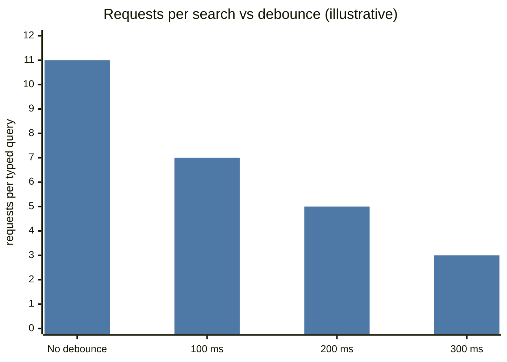
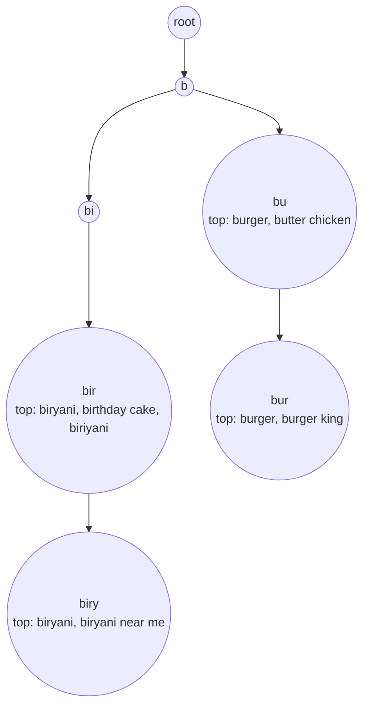
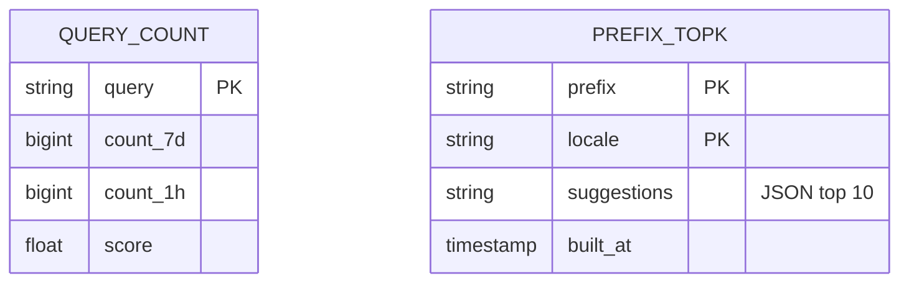
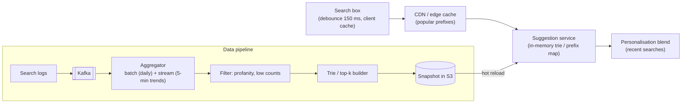
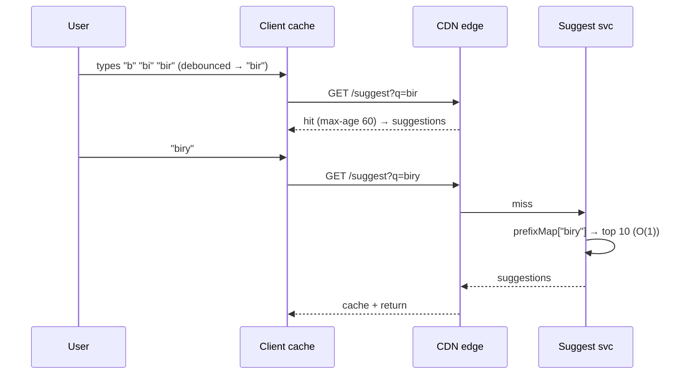

# ⌨️ Design Typeahead / Autocomplete

> [!abstract] Problem
> As the user types in a search box ("biry…"), show the top 5–10 suggestions within ~100 ms, ranked by popularity (and personalisation), updated as trends change.

## 1. Clarifying questions

- Suggest **queries** or **entities** (products/restaurants)? → *queries, with entity boosts*
- Personalised? → *mostly global + light personalisation*
- Freshness of trends? → *within ~15 minutes for trending terms*
- Languages / typo tolerance? → *English + Hinglish, basic typo tolerance*

## 2. Requirements

| Functional | Non-functional |
|---|---|
| Top-k suggestions per prefix | p99 < 100 ms end to end (≈ 20 ms server) |
| Ranked by popularity, trends | Very read-heavy: every keystroke is a request |
| Filter offensive terms | Highly available; stale by minutes is fine |

## 3. Estimation

```text
50M DAU × 10 searches × ~6 keystrokes (after debounce) = 3B requests/day ≈ 35k/s avg, ~100k/s peak
Distinct queries tracked: ~100M; prefixes of length ≤ 15 → top-k per prefix precomputed
Cache: top 10 suggestions per popular prefix ≈ 10M prefixes × 500 B ≈ 5 GB → fits in memory
```



## 4. API

```http
GET /v1/suggest?q=biry&limit=8&locale=en-IN&city=BLR
→ { "suggestions": ["biryani", "biryani near me", "biryani by kilo", ...] }
Cache-Control: public, max-age=60    (edge-cacheable for non-personalised prefixes)
```

## 5. Data structures

**Trie with top-k cached at each node** — lookup is O(length of prefix), no subtree walk at query time:



In practice: build offline into a **prefix → top-k** map stored in a KV/Redis or a serialized trie loaded into memory on suggestion servers (sharded by prefix range).



## 6. High-level design



## 7. Key flow



## 8. Deep dives

### Ranking score
`score = w1·log(count_7d) + w2·trend(count_1h vs baseline) + boosts (locale/city) − penalties`. Trending terms come from the streaming path (e.g., "ipl final tickets"). Top-k per prefix via Count-Min + heap in the stream. → [[Probabilistic-Data-Structures]] · [[Design-Leaderboard-Top-K]]

### Updating without hurting reads
Never mutate the live trie per query. Rebuild periodically (batch daily + small trend overlay every few minutes), write a snapshot, servers **hot-swap** (blue/green in memory).

### Sharding
By prefix range (a–c, d–f, …) — but "s" is huge vs "x" → split by first 2 chars or by hash of prefix with replication; each shard replicated for availability.

### Typos & languages
Fuzzy matching (edit distance 1) for short prefixes is expensive → precompute common misspellings mapping; transliteration for Hinglish ("biryani"/"biriyani").

### Personalisation
Blend global top-k with the user's recent searches (client-side or a small per-user store) — keep the global path cacheable.

## 9. Bottlenecks & trade-offs

| Choice | Trade-off |
|---|---|
| Precomputed top-k per node | Memory vs O(1) query |
| Edge caching | Huge offload vs personalisation (keep personal blend on client) |
| Rebuild frequency | Freshness vs compute |
| Debounce length | Fewer requests vs perceived snappiness |

## 10. Follow-ups & tricky questions

- *"Why not query Elasticsearch on every keystroke?"* — Works with edge n-grams at moderate scale, but a precomputed prefix map is cheaper and faster at 100k/s.
- *"Remove a harmful suggestion immediately?"* — Blocklist checked at serve time (overrides snapshot) + purge CDN keys.
- *"Long-tail prefixes with no data?"* — Fall back to search-engine results or entity names.

## 11. What each level should cover

| SDE-1 | SDE-2 | Senior |
|---|---|---|
| Trie, top-k, caching | Precomputed top-k per node, offline pipeline, sharding, debounce + CDN | Trend streaming, ranking signals, multilingual, safe-content controls |

## 🧠 Concepts used
[[Caching]] · [[CDN]] · [[Search-Systems]] · [[Batch-and-Stream-Processing]] · [[Probabilistic-Data-Structures]] · [[Sharding-and-Partitioning]]

## My gaps
-

---
**Next:** [[Design-File-Storage-Sync]] · **Up:** [[Case-Studies-MOC]]
