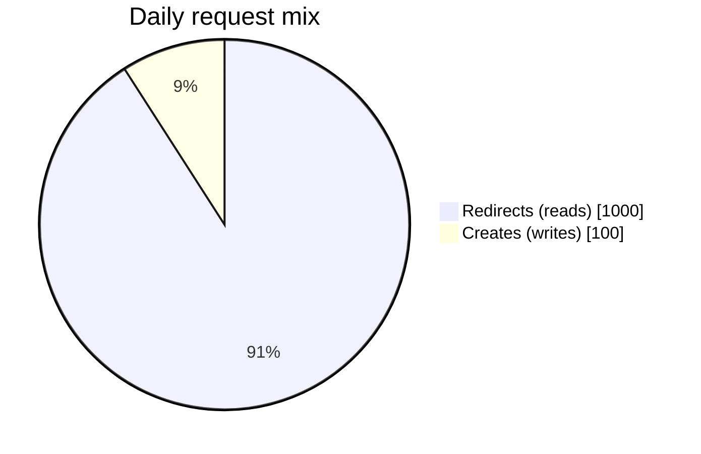
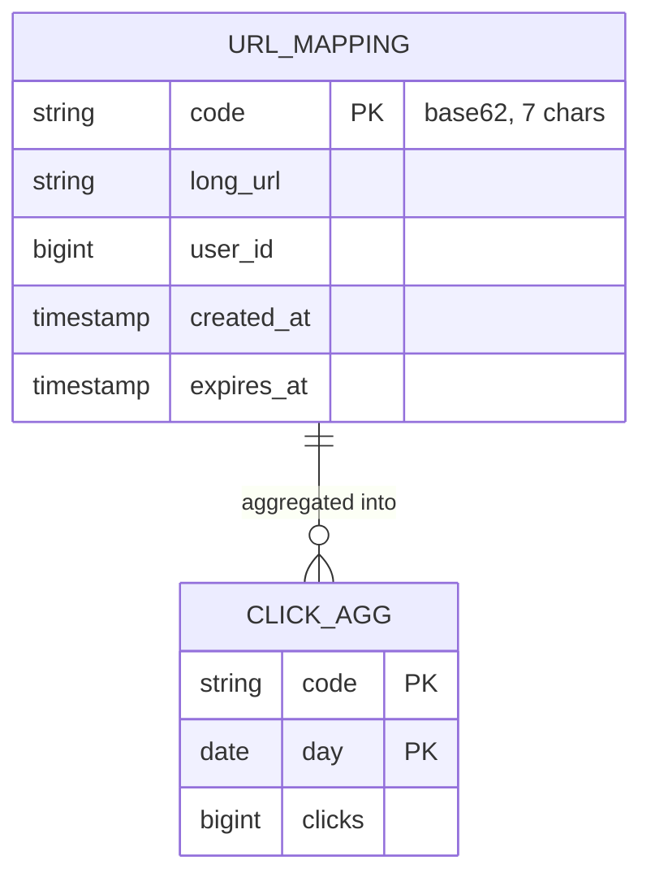
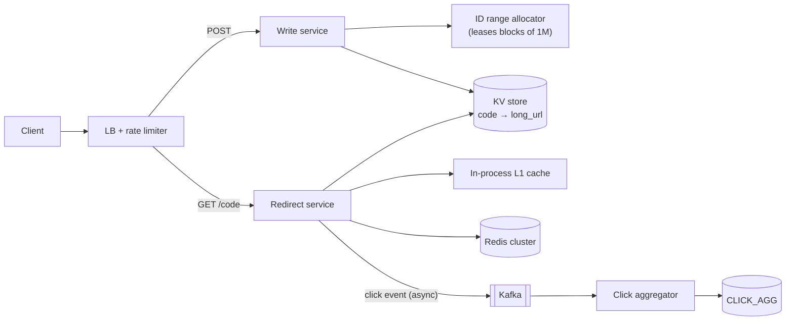
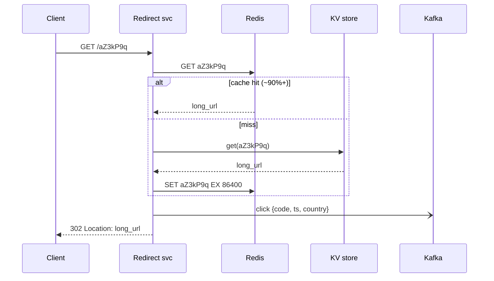

# 🔗 Design a URL Shortener

> [!abstract] Problem
> Users submit a long URL and get a short one (`sho.rt/aZ3kP9q`). Visiting the short URL redirects to the original. Track click counts.

## 1. Clarifying questions

- Custom aliases? Expiry? Edit/delete?  → *aliases optional, expiry optional, no edits*
- Analytics depth? → *click counts, maybe by country/day*
- Scale? → *100M new URLs/day, reads 10× writes*
- Short code length constraints? → *as short as possible*

## 2. Requirements

| Functional | Non-functional |
|---|---|
| Create short URL (optional custom alias, expiry) | Redirect p99 < 50 ms |
| Redirect short → long | 99.99% available on the redirect path |
| Click counts | Codes must be unique, never reassigned |
| | Durable mappings for years |
| | Non-guessable codes (nice to have) |

## 3. Estimation

```text
Writes: 100M/day ≈ 1.2k/s avg, ~3k/s peak
Reads:  1B/day   ≈ 12k/s avg,  ~30k/s peak     → read-heavy, cache the redirect
Storage: 100M × 365 × 5 yrs ≈ 180B URLs × ~500 B ≈ 90 TB → horizontally scalable KV store
Code length: 62^7 ≈ 3.5 trillion  → 7 base62 chars is plenty
Cache: 20% of daily-read URLs ≈ 200M × 500 B ≈ 100 GB → a Redis cluster
```



## 4. API

```http
POST /v1/urls            { "longUrl": "...", "alias": "optional", "expiresAt": "optional" }
  → 201 { "code": "aZ3kP9q", "shortUrl": "https://sho.rt/aZ3kP9q" }
GET  /{code}             → 302 Location: <longUrl>     (404 if missing/expired)
GET  /v1/urls/{code}/stats → { "clicks": 1203, "byDay": [...] }
```

## 5. Data model



Store: **DynamoDB / Cassandra** (key lookups only, 90 TB, horizontal) — or sharded Postgres by `code` hash if you want SQL.

## 6. High-level design



## 7. Key flows



## 8. Deep dives

### Generating the code — options

| Option | How | Pros | Cons |
|---|---|---|---|
| Hash + truncate | `base62(md5(url))[:7]` | Same URL → same code (dedup) | **Collisions** → check-and-retry with salt on every write |
| **Counter + base62** | Global counter → base62 | Unique by construction, no collision check | Sequential = guessable; counter is a coordination point |
| **Range allocation** ✅ | Each write server leases ID blocks (ZooKeeper/DB) | No per-request coordination; tiny gaps on crash | Still sequential within a block |
| Random + check | Random 7 chars, insert-if-absent | Non-guessable | Collision checks grow as space fills |

**My pick:** range allocation + base62, and run the ID through a **reversible bit permutation** (e.g., a Feistel network) if codes must look random. → [[Unique-ID-Generation]]

```python
ALPHABET = "0123456789abcdefghijklmnopqrstuvwxyzABCDEFGHIJKLMNOPQRSTUVWXYZ"
def base62(n: int) -> str:
    s = []
    while n:
        n, r = divmod(n, 62); s.append(ALPHABET[r])
    return "".join(reversed(s)) or "0"
```

### 301 vs 302

| | 301 Permanent | 302 Found (temporary) |
|---|---|---|
| Browser caches | Yes | No |
| Server load | Lower | Higher |
| Click analytics | **Lost** after first visit | ✅ Every click seen |

Need analytics → **302**. (Some use 301 + a CDN for pure speed.)

### Custom aliases
Conditional insert (`PutItem` with `attribute_not_exists(code)` / unique constraint); reserve a namespace so aliases can't collide with generated codes (e.g., generated codes always 7 chars, aliases ≥ 8 or a different prefix).

### Expiry & cleanup
TTL attribute in DynamoDB/Cassandra; redirect service checks `expires_at`; a lazy delete on read plus background sweeps.

### Abuse
Rate limit creates per user/IP → [[Design-Rate-Limiter]]; scan long URLs against malware/phishing lists; block redirect loops to your own domain.

## 9. Bottlenecks, failures & trade-offs

| Risk | Mitigation |
|---|---|
| Viral link = hot key | L1 in-process cache (few seconds), Redis replicas, optionally CDN-cached 302 with short TTL |
| Redis down | Fall back to KV store (sized for peak reads) |
| ID allocator down | Servers hold leased ranges → keep issuing for a while; allocator itself replicated |
| Click pipeline lag | Redirect never waits on it; counts are eventually consistent |
| Guessable codes | Bit permutation / random codes |

## 10. Follow-ups & tricky questions

- *"Same long URL submitted twice — same code?"* — Optional: store `hash(long_url) → code` index for dedup per user; trade-off: extra lookup.
- *"How do you make it multi-region?"* — Reads served regionally from replicated KV; writes with region-prefixed ID ranges to avoid conflicts.
- *"Analytics by country in real time?"* — Kafka → Flink windows → ClickHouse. → [[Design-Ad-Click-Aggregator]]
- *2026 note:* this is now a **phone-screen/early-career** problem — nail it fast and use the spare time for depth.

## 11. What each level should cover

| SDE-1 | SDE-2 | Senior |
|---|---|---|
| API, base62, KV store, cache, 302 vs 301 | ID strategy trade-offs, range allocation, hot keys, async analytics | Multi-region IDs, abuse/security, cost, capacity plan |

## 🧠 Concepts used
[[Unique-ID-Generation]] · [[Caching]] · [[Cache-Pitfalls]] · [[Choosing-a-Database]] · [[Network-Protocols]] · [[Message-Queues]] · [[Design-Rate-Limiter]]

## My gaps
-

---
**Next:** [[Design-Rate-Limiter]] · **Up:** [[Case-Studies-MOC]]
