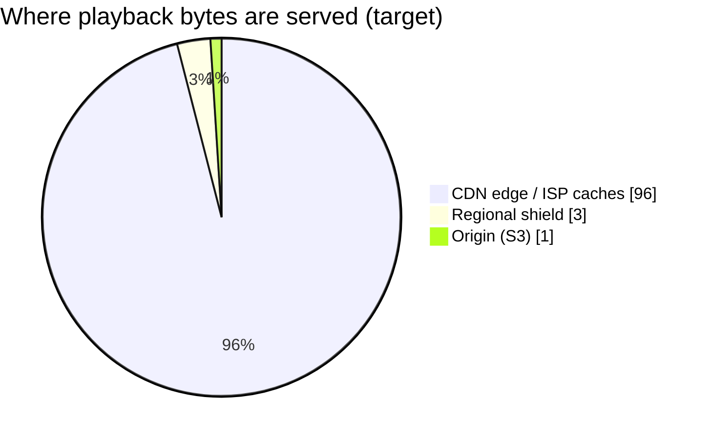
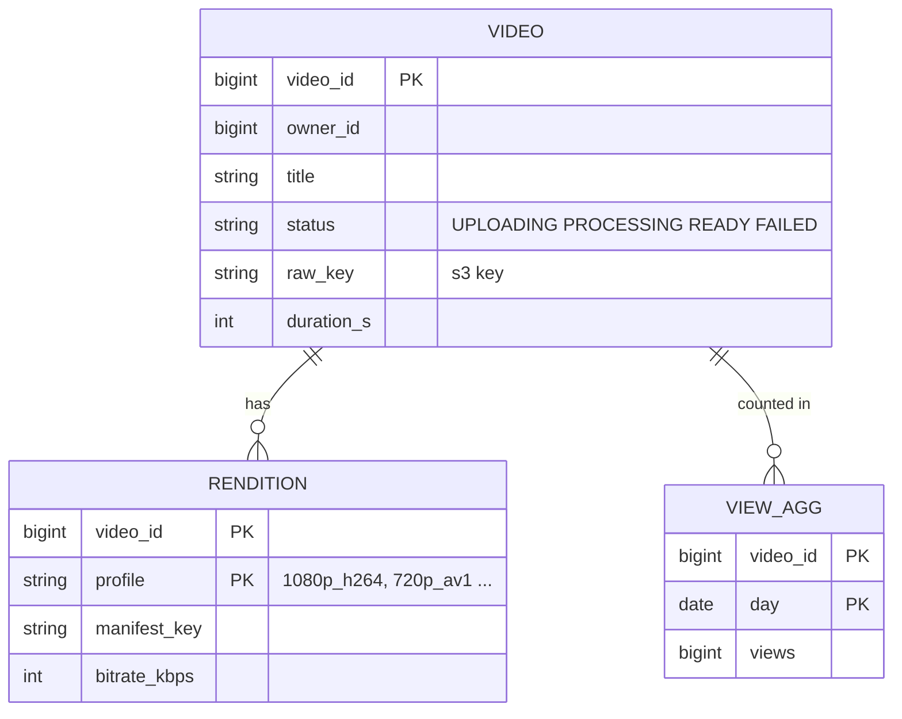
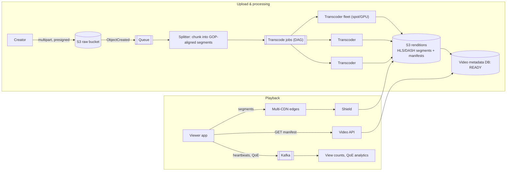
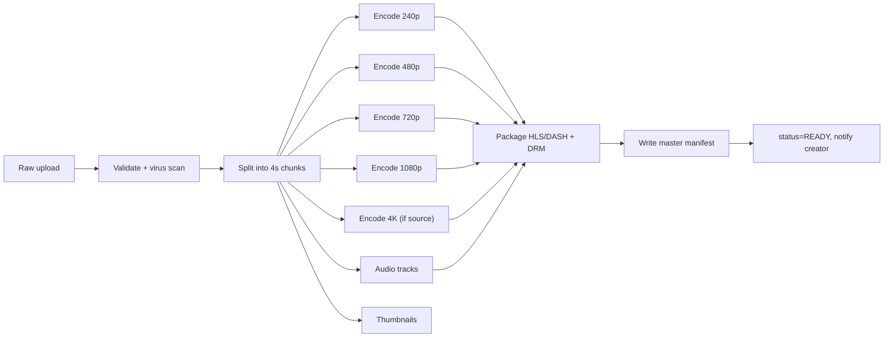
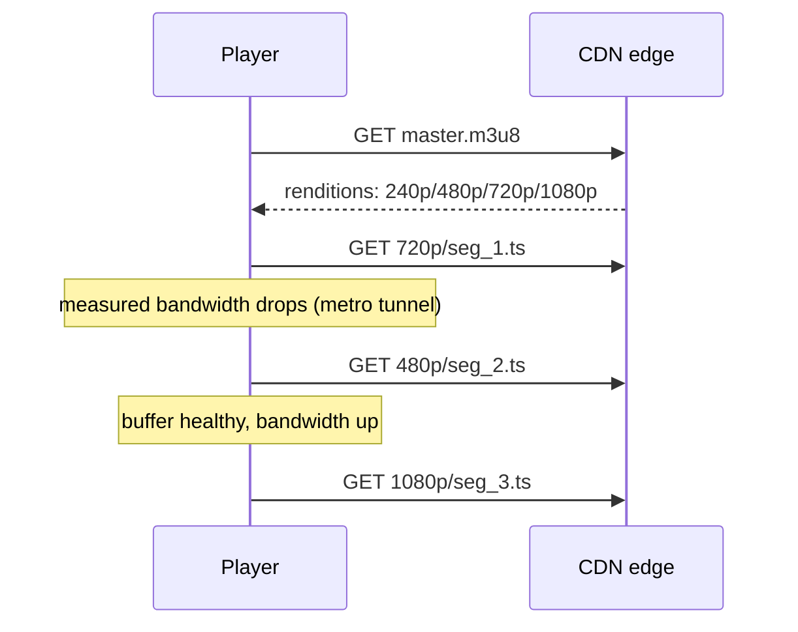
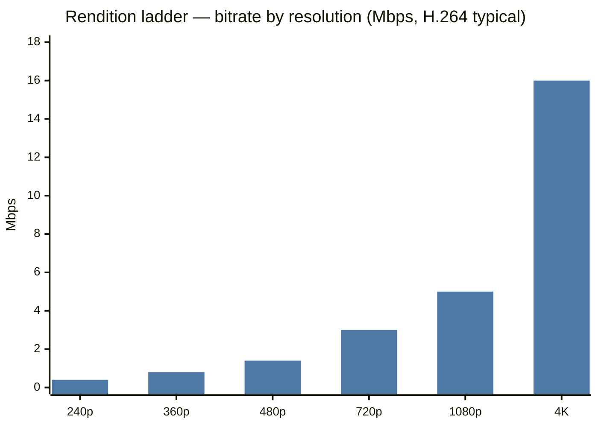

# 🎬 Design a Video Streaming Platform

> [!abstract] Problem
> Users upload videos; others stream them smoothly on any device and network. Handle viral spikes and **live events** (think IPL final on Hotstar — tens of millions concurrent).

## 1. Clarifying questions

- VOD, live, or both? → *VOD first, then live spikes*
- Upload volume vs views? → *views ≫ uploads*
- Devices & networks? → *mobile on 3G/4G to 4K TVs*
- Comments/recommendations? → *out of scope (mention)*

## 2. Requirements

| Functional | Non-functional |
|---|---|
| Upload video (large, resumable) | Start-up time < 2 s; rebuffering < 1% |
| Transcode to many resolutions | Massive read bandwidth, global |
| Stream with adaptive quality | Upload processing in minutes |
| View counts | Highly available playback; cost-efficient storage |

## 3. Estimation

```text
Uploads: 500 hrs of video/min (YouTube-like) — for us: 100k uploads/day × 300 MB raw = 30 TB/day raw
Transcoded renditions ≈ 1.5–2× raw → ~50 TB/day stored → object storage + lifecycle tiers
Views: 1B/day; avg watch 10 min @ 3 Mbps ≈ 225 MB/view → 225 PB/day egress → 95%+ must be CDN
Live peak: 25M concurrent × 3 Mbps ≈ 75 Tbps → multi-CDN + ISP caches
```



## 4. API

```http
POST /v1/uploads            { filename, size } → { uploadId, partUrls[] (presigned) }
POST /v1/uploads/{id}/complete
GET  /v1/videos/{id}        → { title, status, manifestUrl: ".../master.m3u8" }
GET  <CDN>/videos/{id}/720p/seg_00042.ts   (client fetches segments directly)
```

## 5. Data model



## 6. High-level design



## 7. Key flows

**Processing DAG for one video:**



**Adaptive bitrate playback:**



**ABR ladder (typical bitrates):**



## 8. Deep dives

### Transcoding at scale
Split into segments → **parallel** encode (minutes instead of hours) → workers are stateless, autoscaled on queue depth, ideally on spot instances (retry on preemption: idempotent jobs keyed by `(video, profile, segment)`). Per-title/content-aware encoding saves bandwidth. Codecs: H.264 (compat), H.265/VP9/**AV1** (30–50% smaller, costlier to encode). → [[Message-Queues]] · [[Design-Job-Scheduler]]

### Streaming protocols
**HLS / MPEG-DASH**: video split into 2–6 s segments over plain HTTP → cacheable by any CDN; manifest lists renditions; client switches quality per segment (ABR).

### CDN strategy
Popular content pre-positioned (push) to edges/ISP caches (Netflix Open Connect); long tail pulled on demand. Multi-CDN with steering by QoE. Signed URLs/tokens + DRM (Widevine/FairPlay) for paid content. → [[CDN]]

### Live streaming spikes (IPL final)
Ingest (RTMP/SRT) → live transcoder → short segments (2 s; LL-HLS for low latency) → CDN. All viewers request the **same latest segment** → perfect for caching but brutal on origin at segment boundaries → origin shield + request collapsing. Pre-scale everything ahead of known events; degrade gracefully (cap max bitrate for everyone if CDN capacity is tight). Hotstar-style "scale for the toss" planning.

### View counting
Client heartbeats → Kafka → stream aggregation (dedupe per session) → counts; approximate in real time, exact via batch. → [[Batch-and-Stream-Processing]]

## 9. Bottlenecks & trade-offs

| Choice | Trade-off |
|---|---|
| More renditions | Better QoE vs storage + encode cost |
| AV1 | Bandwidth savings vs encode compute & device support |
| Segment length 2 s vs 6 s | Lower latency/faster switching vs more requests & overhead |
| Push vs pull CDN | Predictable hits vs storage at edges |
| Storage tiers | Cold old videos → infrequent-access/archive; re-transcode on demand for rarely viewed renditions |

## 10. Follow-ups & tricky questions

- *"Resume a 5 GB upload on a flaky network?"* — Multipart with per-part retry & checksum. → [[Object-Storage]]
- *"Video in processing but user wants to share it?"* — Show status; publish lowest rendition first, add higher ones as they finish.
- *"Reduce start-up time?"* — Start at low bitrate, preload first segment, CDN edge proximity, smaller first segment.
- *2026:* auto-generated captions/chapters with speech models in the DAG; recommendations → [[Recommendation-and-Ranking-Systems]].

## 11. What each level should cover

| SDE-1 | SDE-2 | Senior |
|---|---|---|
| Upload to S3, transcode queue, CDN playback | Segmented parallel transcoding, HLS/ABR, presigned multipart, view counting | Live event capacity planning, multi-CDN steering, codec/cost trade-offs, DRM |

## 🧠 Concepts used
[[Object-Storage]] · [[CDN]] · [[Message-Queues]] · [[Batch-and-Stream-Processing]] · [[Multi-Region-and-Disaster-Recovery]] · [[Idempotency]]

## My gaps
-

---
**Next:** [[Design-Ticket-Booking]] · **Up:** [[Case-Studies-MOC]]
