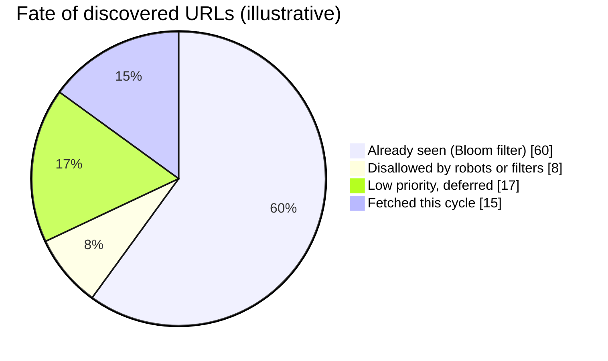
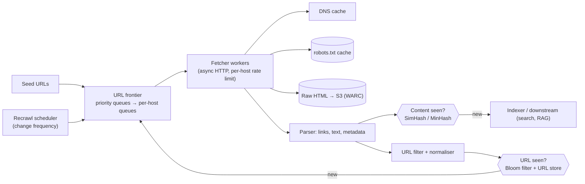
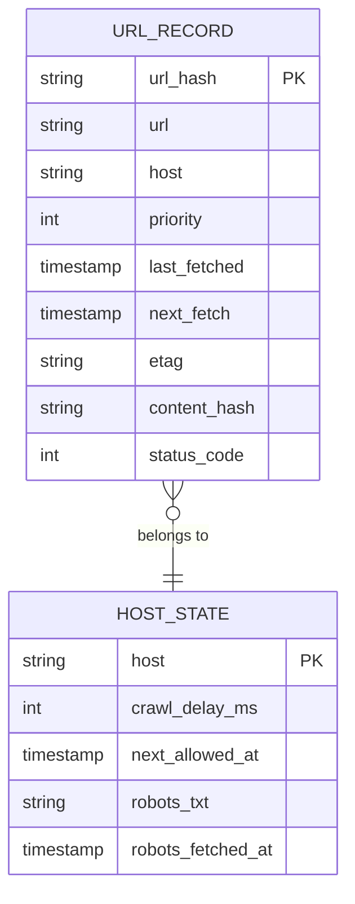
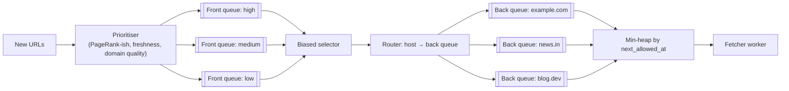
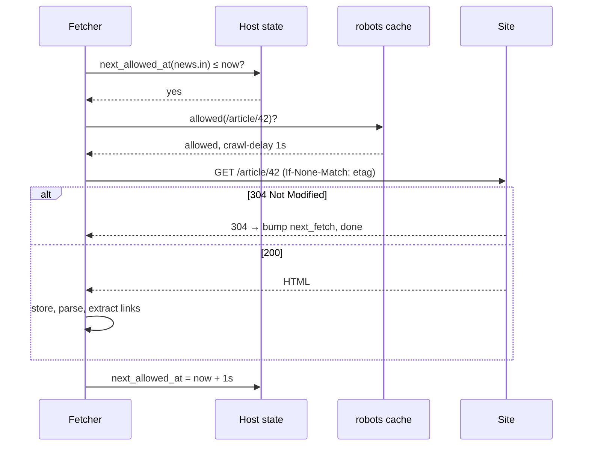

# 🕷️ Design a Web Crawler

> [!abstract] Problem
> Crawl billions of web pages to feed a search index (or, in 2026, an LLM training/RAG corpus): fetch pages, extract links, store content, recrawl changed pages — politely and robustly.

## 1. Clarifying questions

- Purpose? → *search index / data corpus*
- Scale? → *1B pages per month*
- Content types? → *HTML only (mention PDFs/images)*
- Freshness? → *news sites daily, others monthly*
- Respect robots.txt? → *always*

## 2. Requirements

| Functional | Non-functional |
|---|---|
| Fetch pages from seed URLs, extract & follow links | Politeness: ≤ 1 request/s per host (configurable), obey robots.txt |
| Store raw HTML + extracted text + metadata | Scale: 1B pages/month, horizontally |
| Dedupe URLs and near-duplicate content | Robust to traps, malformed HTML, slow servers |
| Prioritise and recrawl | Extensible (new content processors) |

## 3. Estimation

```text
1B pages / 30 days ≈ 400 pages/s avg, ~1k/s peak
Avg page 100 KB → 100 TB/month raw (compressed ~25 TB) → object storage
URL frontier: ~10B discovered URLs × ~100 B ≈ 1 TB → disk-backed queues + Bloom filter for seen URLs
Bloom filter for 10B URLs @ 1% FPR ≈ 12 GB of RAM (sharded)
Bandwidth: 1k pages/s × 100 KB = 100 MB/s ≈ 0.8 Gbps
```



## 4. Components



## 5. Data model



## 6. Key flows

**The frontier (Mercator-style): priority front queues → politeness back queues:**



**Fetching one URL politely:**



## 7. Deep dives

### Politeness
One host → one back queue → at most one in-flight request per host (or a small number), spaced by crawl-delay. Route a host's URLs to the same worker shard (consistent hashing on host) so rate limits are local. → [[Consistent-Hashing]]

### URL dedup
Normalise (lowercase host, strip fragments, sort query params, remove tracking params), hash, check Bloom filter (fast, in memory), confirm in the URL store on "maybe". → [[Probabilistic-Data-Structures]]

### Content dedup
Exact: hash of body. Near-duplicate: **SimHash/MinHash** fingerprints (mirror sites, boilerplate variations).

### Traps & robustness
Infinite calendars, session IDs in URLs, spider traps → max depth per host, max URLs per host, URL length limits, pattern blocklists; timeouts and size caps; handle redirects (limit chain length).

### Recrawl
Estimate change rate per page (adaptive: changed last time → shorter interval); conditional GET with ETag/Last-Modified; news via sitemaps/RSS.

### Security
Fetching arbitrary URLs = **SSRF risk**: block private IP ranges and cloud metadata endpoints; sandbox parsers. → [[Security-Essentials]]

## 8. Bottlenecks & trade-offs

| Choice | Trade-off |
|---|---|
| BFS vs prioritised | Coverage vs quality/freshness |
| Bloom filter | Memory savings vs rare false "seen" (skipping a few new URLs) |
| Per-host politeness | Good citizenship vs throughput on big sites |
| Store raw vs parsed only | Re-processing ability vs storage cost |

## 9. Follow-ups & tricky questions

- *"JavaScript-rendered pages?"* — Headless browser pool (expensive) only for high-value hosts.
- *"Crawl for LLM/RAG corpus in 2026?"* — Respect robots.txt and AI-crawler directives, licensing/opt-outs, quality filters, dedupe aggressively, extract clean text, PII filtering. → [[RAG-and-Vector-Databases]]
- *"Worker crashes mid-batch?"* — Leases on frontier items (visibility timeout); idempotent fetch/store keyed by URL + fetch time.

## 10. What each level should cover

| SDE-1 | SDE-2 | Senior |
|---|---|---|
| Frontier queue, fetch, parse, store, URL dedup | Politeness queues, Bloom filter sizing, robots, recrawl, traps | Prioritisation, near-dup detection, distributed frontier sharding, SSRF/legal concerns |

## 🧠 Concepts used
[[Message-Queues]] · [[Probabilistic-Data-Structures]] · [[Object-Storage]] · [[Consistent-Hashing]] · [[Search-Systems]] · [[Security-Essentials]]

## My gaps
-

---
**Next:** [[Design-Job-Scheduler]] · **Up:** [[Case-Studies-MOC]]
