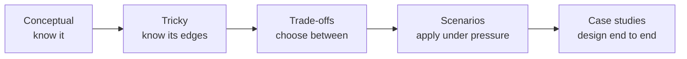

# ❓ 11 · Interview Questions MOC

| Bank | What it trains | Answer format |
|---|---|---|
| [[Conceptual-Questions]] | Crisp definitions & comparisons (service-company rounds, phone screens, SDE-1) | 30-second answers |
| [[Tricky-Questions]] | Gotchas and "it depends" follow-ups that separate levels | Collapsed answers — try first |
| [[Scenario-Questions]] | "Production is on fire" reasoning | Clarify → hypothesise → check → fix |
| [[Trade-off-Questions]] | X vs Y decisions | When to pick each |
| [[Rapid-Fire-Revision]] | 148 flashcards for spaced repetition | `Q::A` format |

> [!tip] How to practise
> Answer **out loud**, then expand the collapsed answer. If your answer missed the "because", mark the question for revision in [[SD-Progress-Tracker]].

**Up:** [[System-Design-MOC]]
