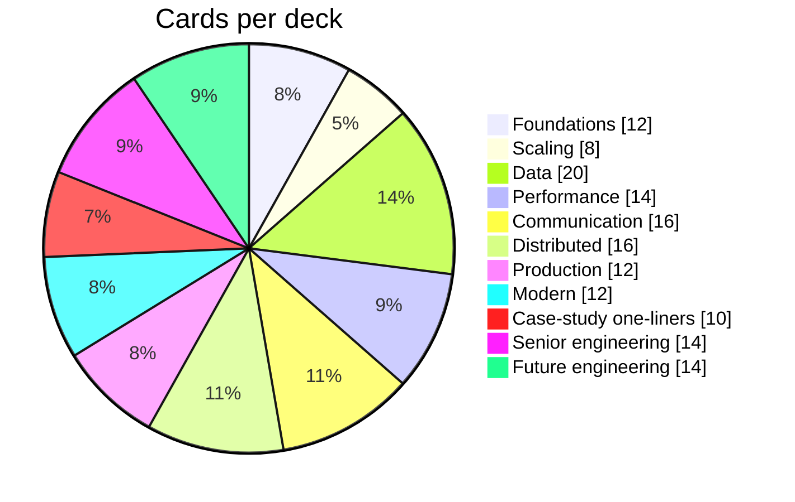

# ⚡ Rapid-Fire Revision — Flashcards

> Format `question::answer` works with the **Spaced Repetition** plugin (each `#flashcards/...` heading is a deck). Without the plugin, cover the right side and recall. Daily drill: 10 random cards → [[SD-Revision-System]].

## #flashcards/system-design/foundations

HLD vs LLD::Components and connections vs classes and interfaces inside a component.
FRs drive the ___; NFRs drive the ___::API; architecture.
99.99% availability allows how much downtime per month?::~4.4 minutes.
Two 99.9% services in series give?::~99.8%.
1M requests/day ≈ ? QPS::~12.
100M requests/day ≈ ? QPS::~1,200.
Peak QPS rule of thumb::2–3× average.
RAM vs SSD random read latency::~100 ns vs ~100 µs.
Little's Law::L = λ × W (in-flight = arrival rate × latency).
Why p99 over average?::Averages hide tail latency, which fan-out amplifies.
Safe + idempotent HTTP methods::GET (safe, idempotent); PUT and DELETE are idempotent; POST is neither.
401 vs 403::Not authenticated vs authenticated but not allowed.

## #flashcards/system-design/scaling

Why stateless app servers?::Any instance serves any request → autoscale, deploy, fail over freely.
Where do sessions go in a stateless design?::Redis/shared store or a signed token (JWT).
L4 vs L7 load balancer::IP/port routing vs HTTP-aware routing (path, host, headers).
Best LB algorithm for WebSockets::Least connections.
Liveness vs readiness::Restart me vs don't send me traffic; liveness must not check dependencies.
Connection draining::Let in-flight requests finish before removing a backend.
First thing to break at 10× traffic::Usually the database (connections, write throughput).
Active-active vs active-passive::All nodes serve vs standby waits for failover.

## #flashcards/system-design/data

ACID::Atomicity, Consistency, Isolation, Durability.
BASE::Basically Available, Soft state, Eventually consistent.
4 NoSQL families with an example each::KV (Redis), document (MongoDB), wide-column (Cassandra), graph (Neo4j).
Postgres default isolation::Read Committed.
MySQL InnoDB default isolation::Repeatable Read.
Lost update fix::Atomic UPDATE x = x - 1, SELECT FOR UPDATE, or optimistic version check.
Anomaly snapshot isolation still allows::Write skew.
B-tree vs LSM::In-place pages, fast reads vs append + compaction, fast writes.
Composite index (a, b) — does WHERE b = ? use it?::No (leftmost-prefix rule).
Covering index::Contains all columns a query needs → no table lookup.
Replication scales ___; sharding scales ___::Reads/availability; writes/storage.
Quorum condition::W + R > N.
Read-your-writes fix with replicas::Read from leader briefly after a write, or pass a version/LSN.
Hinted handoff::A healthy node temporarily stores writes for a down replica.
Merkle trees in KV stores::Cheap anti-entropy — compare hashes, sync only differing ranges.
Bad shard keys::Low cardinality or monotonic (country, created_at, status).
hash % N remaps what fraction when N changes?::~N/(N+1) — almost all keys.
Consistent hashing remaps?::~1/(N+1) of keys.
Redis Cluster partitioning::16,384 hash slots, CRC16(key) mod 16384.
OLTP vs OLAP storage::Row-oriented vs column-oriented.

## #flashcards/system-design/performance

Cache-aside on write::Update DB, then delete the cache key.
Which cache write pattern can lose data?::Write-back.
Hit ratio 90% → 99% changes DB load by::10× less.
Thundering herd fixes::Single-flight/lock, stale-while-revalidate, early refresh.
Cache penetration fixes::Cache nulls with short TTL, Bloom filter, validation, rate limits.
Cache avalanche fix::TTL jitter, pre-warming, protect the DB.
Hot key fixes::Local L1 cache, replicate key with suffixes, read replicas, CDN.
O(1) LRU structure::Hash map + doubly linked list.
Redis structure for a leaderboard::Sorted set (ZSET).
Redis structure for unique counts::HyperLogLog (~12 KB).
Why avoid KEYS * in Redis::O(N), blocks the single command thread — use SCAN.
Presigned URL::Signed, expiring URL letting a client upload/download one object directly.
Best CDN invalidation for static assets::Versioned/hashed filenames.
Anycast vs GeoDNS failover::Anycast is faster (routing), GeoDNS bound by TTL.

## #flashcards/system-design/communication

Idempotency-Key header purpose::Makes POST retries safe — server returns stored result for repeats.
Cursor vs offset pagination::Cursor is fast at depth and stable under inserts.
gRPC transport + payload::HTTP/2 + Protobuf.
GraphQL solves::Over-/under-fetching for varied clients; watch N+1 and query cost.
SSE vs WebSocket::One-way server push over HTTP with auto-reconnect vs bi-directional.
LLM token streaming usually uses::SSE.
How to reach a user on another WebSocket server::Connection registry (user → gateway) + pub/sub or RPC.
Webhook security::HMAC signature + timestamp, HTTPS, idempotent receiver.
Queue vs pub/sub::One consumer per message vs every subscriber gets a copy.
Effectively-once::At-least-once delivery + idempotent processing.
DLQ::Parking for messages that keep failing.
Kafka ordering guarantee::Per partition only.
Max useful consumers in a Kafka group::Number of partitions.
Durable Kafka producer settings::acks=all, RF=3, min.insync.replicas=2, idempotence on.
Transactional outbox solves::Dual-write between DB and message broker.
Microservices primarily solve::Team/organisational scaling and independent deploys.

## #flashcards/system-design/distributed

CAP in one line::During a partition choose consistency or availability.
Why no CA?::Partitions happen in any distributed system.
PACELC adds::Latency vs consistency trade-off during normal operation.
Linearizable vs serializable::Single-object recency vs multi-object transaction order.
Causal consistency guarantees::Effects never appear before their causes.
LWW risk::Silently drops concurrent writes; clock skew picks the wrong winner.
Nodes to tolerate f failures (Raft)::2f + 1.
When is a Raft entry committed?::Replicated on a majority in the current term.
Split brain::Two nodes both act as leader.
Fencing token::Monotonic number with each lease; storage rejects stale holders.
Lamport receive rule::max(local, received) + 1.
Vector clocks detect::Concurrent (conflicting) updates.
Snowflake layout::1 sign + 41 time + 10 machine + 12 sequence bits.
2PC weakness::Blocking if coordinator fails after prepare.
Saga lacks which ACID property?::Isolation.
Three possible causes of a timeout::Request lost, server crashed mid-way, response lost after success.

## #flashcards/system-design/production

Circuit breaker states::Closed, open, half-open.
Why jitter on retries?::Prevents synchronised retry waves.
Retry amplification across 3 layers × 3 attempts::27×.
Bulkhead::Isolated resource pools so one dependency can't exhaust everything.
RPO vs RTO::Max data loss vs max downtime.
Cheapest DR strategy::Backup & restore.
Golden signals::Latency, traffic, errors, saturation.
99.9% monthly error budget::~43 minutes.
OAuth vs OIDC::Delegated authorization vs identity (ID token) on top.
Password hashing algorithm today::Argon2id (bcrypt acceptable).
Inverted index::Term → list of documents containing it.
Event time vs processing time::When it happened vs when it was processed.

## #flashcards/system-design/modern

Bloom filter false negatives?::None (without deletes).
Count-Min Sketch errors::Overestimates only — take the minimum across rows.
Geohash edge problem fix::Query the cell plus its 8 neighbours.
Why H3 hexagons::All neighbours equidistant → smooth aggregation (surge).
CRDT merge properties::Commutative, associative, idempotent.
Ranking funnel stages::Candidate generation → filter → features → rank → re-rank.
Training–serving skew::Features computed differently offline vs online.
TTFT vs TPOT::Time to first token (prefill) vs time per output token (decode).
Continuous batching::Add/remove requests every decode step to keep GPUs busy.
What limits concurrent LLM requests per GPU?::KV-cache memory.
Rate-limit LLM APIs by::Tokens per minute + concurrent streams.
RAG permission enforcement::ACL filter at retrieval time, never in the prompt.

## #flashcards/system-design/case-studies

URL shortener code scheme::Counter/range allocation + base62 (7 chars ≈ 3.5T codes).
URL shortener redirect for analytics::302.
Chat message ordering::Per-conversation server-assigned sequence numbers.
News feed celebrity problem::Hybrid: push for normal users, pull celebrities at read time.
Ticket double-booking prevention::Atomic conditional update on seat row (+ unique constraint), hold with TTL.
Ride-sharing location writes::In-memory geo index (Redis GEO/H3) sharded by city, TTL; history async.
Payment unknown outcome::Mark PENDING/UNKNOWN, query PSP status, reconcile — never re-charge blindly.
Flash sale oversell prevention::Atomic Redis Lua decrement gate + DB truth + waiting room.
Notification priority isolation::Separate queues and worker pools for OTP vs campaigns.
Ad click billing accuracy::Stream for dashboards + batch reconciliation with dedupe for billing.

## #flashcards/system-design/senior-engineering

Expand–contract steps::Expand (additive), dual write, backfill, switch reads, contract (drop old).
Backward vs forward compatibility::New readers read old data vs old readers read new data.
Never reuse a Protobuf field number because::Old data/readers decode it with the wrong meaning → corruption.
Decouple deploy from release with::Feature flags (and canaries).
Response time at 90% utilisation (M/M/1)::~10× service time — keep utilisation ~60–70%.
Amdahl's Law::Speed-up is capped by the serial fraction of the work.
What blocks a Node.js event loop?::Long synchronous CPU work or blocking calls.
Why must workflow code be deterministic (Temporal)?::State is rebuilt by replaying history.
Consumer-driven contract test verifies::The provider still satisfies what each consumer relies on.
Incident priority order::Mitigate first, then diagnose; blameless postmortem after.
Biggest source of outages::Changes to the live system (deploys, config) — ~70% per Google SRE.
DDD transaction rule::One transaction modifies one aggregate; cross-aggregate is eventual.
Shuffle sharding::Each tenant gets a random small subset of workers → tiny blast radius.
ADR contains::Context, decision, consequences (status, date).

## #flashcards/system-design/future-engineering

Scarce skill when code generation is cheap::Verification and validation.
AI-native workflow::Spec → plan → implement → verify → human review → safe deploy.
Slopsquatting::Attackers register package names that AI models hallucinate.
Cheapest LLM eval type::Deterministic checks (schema, regex, executes).
Three RAG metrics::Context recall/precision, faithfulness, answer relevance.
LLM-as-judge biases::Position, verbosity, self-preference.
MCP server exposes::Tools, resources, prompts.
MCP vs A2A::Agent ↔ tool vs agent ↔ agent.
Lethal trifecta::Private data + untrusted content + external communication.
OWASP LLM06::Excessive agency — too many tools, permissions or autonomy.
LLM cost per request::(in tokens × in price + out tokens × out price) / 1M.
Golden path::Opinionated, supported self-service way to build/deploy/run a service.
NIST PQC standards (2024)::FIPS 203 ML-KEM, FIPS 204 ML-DSA, FIPS 205 SLH-DSA.
DPDP substantive obligations apply from::May 2027 (Rules notified 13 Nov 2025, 18-month phase-in).

---
**Up:** [[Interview-Questions-MOC]] · **System:** [[SD-Revision-System]]
