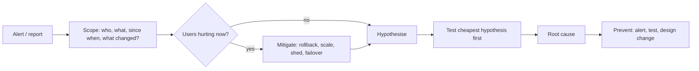

# 🚨 Scenario Questions — "Production is on fire"

> [!important] They grade the method, not the answer
> 1. Clarify scope (all users? one endpoint? since when? what changed?)
> 2. **Mitigate first** if users are hurting (rollback, shed load, fail over)
> 3. Form hypotheses from cheap → expensive checks, saying what each result rules out
> 4. Fix root cause, then prevent recurrence

---

### 1. "DB CPU is at 95% and latency is climbing."
> [!example]- Walkthrough
> **Clarify:** sudden or gradual? after a deploy? reads or writes?
> **Mitigate:** if a deploy correlates → roll back; enable read routing to replicas; rate-limit heavy endpoints.
> **Check:** slow query log / `pg_stat_statements` → a new query without an index? N+1 from an ORM change? Cache hit rate dropped (Redis eviction / restart / key format change)? Connection count spiked (autoscaling app tier)?
> **Fix:** add index, fix N+1, restore cache, pool connections (PgBouncer). **Prevent:** query review, cache hit-rate alert. → [[Indexing]] · [[Caching]]

### 2. "Cache hit ratio dropped from 95% to 40% after a deploy."
> [!example]- Walkthrough
> Likely changed cache key format/version → every key misses; or TTL changed; or serialization change. DB load rises ~12×. **Mitigate:** roll back; rate-limit; warm cache. **Prevent:** versioned keys with gradual rollout, canary + hit-rate dashboards. → [[Cache-Pitfalls]]

### 3. "Users see their own comment disappear after refreshing."
> [!example]- Walkthrough
> Replication lag + reads from replicas → read-your-writes violation; or different replicas per request → non-monotonic reads. **Fix:** read-from-leader window after writes, version tokens, sticky replica per user. → [[Consistency-Models]]

### 4. "Customers report being charged twice."
> [!example]- Walkthrough
> **Mitigate:** identify duplicates via payment logs, auto-refund. **Root cause candidates:** client retry without idempotency key; server generated a new key per retry; webhook processed twice; consumer redelivery without dedupe. **Fix:** client idempotency keys + unique constraints + idempotent callback handler + reconciliation job. → [[Design-Payment-System]] · [[Idempotency]]

### 5. "Kafka consumer lag keeps growing."
> [!example]- Walkthrough
> Producers faster than consumers? Check: consumer count vs partitions; slow downstream (DB) per message; a poison message stuck in retries; rebalancing loops (consumers timing out on `max.poll.interval`). **Fix:** scale consumers up to partition count, batch writes, DLQ for poison messages, tune poll settings, add partitions (carefully). → [[Kafka-Deep-Dive]]

### 6. "One Redis shard is at 100% CPU, others idle."
> [!example]- Walkthrough
> Hot key (viral product/celebrity) or big key (huge hash/list). Find via `--hotkeys`/`--bigkeys` or client metrics. **Fix:** local L1 cache, replicate key with suffixes, split big keys, read from replicas. → [[Cache-Pitfalls]]

### 7. "After a region outage, our recovered service immediately fell over again."
> [!example]- Walkthrough
> Thundering herd on recovery: all clients reconnect/retry simultaneously, caches cold. **Fix:** jittered client backoff, gradual traffic ramp (weighted DNS/LB), cache pre-warming, admission control/load shedding. → [[Resilience-Patterns]]

### 8. "Latency p50 is fine but p99 tripled."
> [!example]- Walkthrough
> Tail issues: GC pauses, a slow dependency on some calls, lock contention, one bad host, noisy neighbour, retries adding delay. Use tracing to find the slow span; check per-host latency; hedged requests for read paths. → [[Observability-and-SLOs]]

### 9. "Flash sale: we oversold 300 units."
> [!example]- Walkthrough
> Read-then-write stock check without atomicity, or cache-based stock with no DB guard. **Fix:** atomic conditional decrement (Redis Lua / `UPDATE … WHERE qty > 0`), unique per-user reservation, reconciliation; apologise + fulfil or refund. → [[Design-Flash-Sale]]

### 10. "Notifications sent at 9:00 are arriving at 9:20."
> [!example]- Walkthrough
> Spike at :00 saturates dispatch; campaigns sharing a pipeline with transactional; provider rate limits. **Fix:** separate priority queues & worker pools, jitter non-critical schedules, pre-scale, more provider capacity. → [[Design-Notification-System]] · [[Design-Job-Scheduler]]

### 11. "Our LLM feature's bill tripled this month."
> [!example]- Walkthrough
> Check tokens per request (prompt growth from long history/RAG chunks), traffic, model mix (smart model used for everything?), retries, abuse. **Fix:** history summarisation, fewer/better chunks via re-ranking, model routing, semantic/prefix caching, token quotas per user. → [[LLM-Serving-and-Inference]]

### 12. "WebSocket servers crash every deploy and users lose messages."
> [!example]- Walkthrough
> No graceful drain; clients don't resync. **Fix:** drain connections gradually, clients reconnect with jitter and fetch since last seq, messages persisted before ack. → [[Design-Chat-App]]

---
**Next:** [[Trade-off-Questions]] · **Up:** [[Interview-Questions-MOC]]
