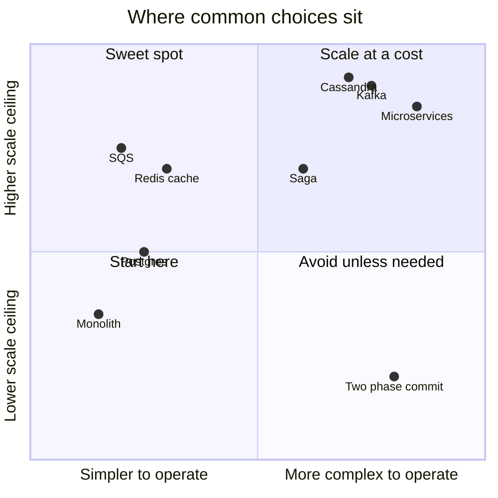

# ⚖️ Trade-off Questions (X vs Y)

> Format for every answer: **pick X when…, pick Y when…, I'd default to… because…** → [[Trade-off-Language]]

| # | Question | Pick the first when… | Pick the second when… | Default |
|---|---|---|---|---|
| 1 | SQL vs NoSQL | Transactions, relations, ad-hoc queries | Known access patterns at huge write scale, flexible schema | Postgres → [[SQL-vs-NoSQL]] |
| 2 | Vertical vs horizontal scaling | Quick win, DB early on | Stateless tiers, beyond one box, HA | Horizontal for app, vertical for DB first |
| 3 | Replication vs sharding | Read scaling + HA | Write/storage scaling | Replicate first, shard late → [[Sharding-and-Partitioning]] |
| 4 | Range vs hash sharding | Range scans (time series per key) | Even distribution | Hash (+ logical shards) |
| 5 | Cache-aside vs write-through | Simple, resilient, read-heavy | Must read fresh right after write | Cache-aside → [[Caching]] |
| 6 | LRU vs LFU | Recency matters | Stable popularity | LRU |
| 7 | Redis vs Memcached | Data structures, persistence, HA | Pure multi-threaded string cache | Redis → [[Redis-Deep-Dive]] |
| 8 | Push vs pull CDN | Predictable big releases | Long tail | Pull → [[CDN]] |
| 9 | REST vs gRPC | Public APIs, browsers, caching | Internal low-latency, streaming, typed | REST out, gRPC in → [[REST-vs-gRPC-vs-GraphQL]] |
| 10 | REST vs GraphQL | Simple CRUD, HTTP caching | Many clients needing different shapes | REST, GraphQL as BFF |
| 11 | WebSocket vs SSE | Bi-directional, frequent client messages | Server→client only, LLM streaming | Depends → [[Real-Time-Communication]] |
| 12 | Polling vs webhooks | Simple, client controls | Server-to-server events | Webhooks with retries |
| 13 | Queue (SQS/RabbitMQ) vs log (Kafka) | Task distribution, per-message retries/delays | Replay, many consumers, streaming, ordering per key | SQS for tasks, Kafka for events → [[Message-Queues]] |
| 14 | At-least-once vs at-most-once | Must not lose (payments, orders) | Loss OK, duplicates harmful & no dedupe (metrics sampling) | At-least-once + idempotency |
| 15 | Monolith vs microservices | Small team, unclear boundaries | Many teams, independent scaling/deploys | Modular monolith first → [[Microservices-vs-Monolith]] |
| 16 | 2PC vs saga | Inside one DB product / short, few participants | Across services, external APIs | Saga → [[Distributed-Transactions]] |
| 17 | Choreography vs orchestration | 2–3 simple steps | Complex, long-running flows | Orchestration for money flows |
| 18 | Strong vs eventual consistency | Money, seats, stock, uniqueness | Feeds, likes, presence | Per feature → [[Consistency-Models]] |
| 19 | Pessimistic vs optimistic locking | High contention, short txns | Low contention, long think time | Atomic conditional update when possible → [[Transactions-and-Isolation-Levels]] |
| 20 | Fan-out on write vs read | Normal users, read-heavy | Celebrities, inactive users | Hybrid → [[Design-News-Feed]] |
| 21 | Snowflake vs UUIDv7 | Compact 64-bit, machine IDs manageable | No coordination wanted | Either; UUIDv7 simplest → [[Unique-ID-Generation]] |
| 22 | Batch vs stream | Exact, complete, cheap per record | Low latency results | Both (stream for live, batch for truth) → [[Batch-and-Stream-Processing]] |
| 23 | Geohash vs quadtree (vs H3) | Simple KV/prefix storage, Redis GEO | Density-adaptive in-memory index; H3 for uniform hex aggregation (surge) | Geohash/Redis GEO first → [[Geospatial-Indexing]] |
| 24 | Active-passive vs active-active | Simpler, OK with minutes RTO | Near-zero RTO, global latency | Active-passive until justified → [[Multi-Region-and-Disaster-Recovery]] |
| 25 | Sessions vs JWT | Easy revocation, classic web | Stateless APIs, microservices | Short JWT + refresh token → [[Authentication-and-Authorization]] |
| 26 | Fail open vs fail closed (rate limiter) | Availability matters more | Security-critical (login/OTP) | Open for most APIs → [[Design-Rate-Limiter]] |
| 27 | Exact counts vs sketches | Billing, compliance | Dashboards, trending, uniques | Sketch live, exact in batch → [[Probabilistic-Data-Structures]] |
| 28 | pgvector vs dedicated vector DB | ≤ tens of millions of vectors, need SQL joins/ACLs | Billions, specialised ANN features | pgvector first → [[RAG-and-Vector-Databases]] |
| 29 | Own GPUs vs LLM provider API | Huge steady volume, control, cost | Early stage, spiky, many models | Provider first, own at scale → [[LLM-Serving-and-Inference]] |
| 30 | OT vs CRDT | Central server, text editing (Google Docs) | Offline-first, P2P, many data types | CRDT (Yjs) for new builds → [[Real-Time-Collaboration-CRDTs]] |

---
**Next:** [[Rapid-Fire-Revision]] · **Up:** [[Interview-Questions-MOC]]
