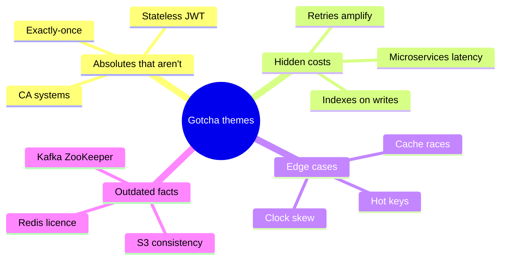

# 🧨 Tricky Questions (the follow-ups that separate levels)

> These are the "are you sure?" questions interviewers ask right after you say the textbook answer. Try each before expanding.

## Data & storage

**1. "Just add an index" — when is that wrong?**
> [!tip]- Answer
> Write-heavy tables (every index slows writes), low-cardinality columns (planner ignores), leading-wildcard `LIKE '%x%'`, functions on the column, wrong composite order. Sometimes the fix is a search engine or a precomputed table. → [[Indexing]]

**2. Can you have a lost update with Read Committed?**
> [!tip]- Answer
> Yes — two read-modify-write cycles in app code. Fix with atomic `UPDATE x = x + 1`, `SELECT … FOR UPDATE`, or optimistic version checks. → [[Transactions-and-Isolation-Levels]]

**3. Is a read replica a backup?**
> [!tip]- Answer
> No. A `DROP TABLE` or corrupting bug replicates instantly. Backups + point-in-time recovery protect against mistakes. → [[Replication]]

**4. Does W + R > N guarantee linearizability?**
> [!tip]- Answer
> No — sloppy quorums, concurrent writes with LWW, and partial failures can still produce stale/conflicting reads. It's a strong-ish approximation. → [[Design-Key-Value-Store]]

**5. Does consistent hashing solve hot keys?**
> [!tip]- Answer
> No. It balances key **count**, not traffic. A single hot key still lands on one node — use replication of the key, local caches, or key splitting. → [[Consistent-Hashing]]

**6. Is S3 eventually consistent?**
> [!tip]- Answer
> Not since December 2020 — S3 provides strong read-after-write consistency for all operations. Many prep resources are outdated. → [[Object-Storage]]

**7. Why is UUIDv4 a poor primary key at scale?**
> [!tip]- Answer
> Random inserts fragment B-tree indexes (page splits, cache misses) and use 16 bytes. Time-ordered IDs (Snowflake, UUIDv7, ULID) append to the index end. → [[Unique-ID-Generation]]

## Caching

**8. On write, update the cache or delete it?**
> [!tip]- Answer
> Delete. Concurrent updates can leave the older value in the cache. Even delete has a narrow race (reader repopulates stale) → short TTL, delayed double delete, or CDC invalidation. → [[Cache-Pitfalls]]

**9. Redis goes down. What happens to your DB?**
> [!tip]- Answer
> With cache-aside, all traffic hits the DB — which may melt (cache was hiding 95% of load). Need circuit breakers, DB rate limits, replicas/persistence for Redis, warm-up. → [[Resilience-Patterns]]

**10. Can a Bloom filter return a false negative?**
> [!tip]- Answer
> No (for standard filters without deletes). False positives only. Deleting bits breaks it → counting Bloom or cuckoo filters. → [[Probabilistic-Data-Structures]]

## Communication

**11. Is exactly-once delivery possible?**
> [!tip]- Answer
> Not end to end across arbitrary systems. Use at-least-once + idempotent consumers = effectively-once. Kafka's EOS covers Kafka→Kafka pipelines. → [[Message-Queues]]

**12. You added 50 consumers to a Kafka topic with 12 partitions. Throughput?**
> [!tip]- Answer
> Only 12 consumers in the group get partitions; 38 sit idle. Parallelism = partitions. → [[Kafka-Deep-Dive]]

**13. Does Kafka still need ZooKeeper?**
> [!tip]- Answer
> No — KRaft (built-in Raft) replaced it; ZooKeeper mode was removed in Kafka 4.0. → [[Kafka-Deep-Dive]]

**14. Why might an L4 load balancer unbalance gRPC traffic?**
> [!tip]- Answer
> gRPC multiplexes many requests over one long-lived HTTP/2 connection; L4 balances connections, not requests. Use L7 or client-side balancing. → [[Load-Balancing]]

**15. PUT is idempotent by spec. Is your PUT handler?**
> [!tip]- Answer
> Only if it doesn't do relative updates or side effects (emails, counters). The spec is a contract you must implement. → [[Idempotency]]

**16. Is a JWT-based system fully stateless?**
> [!tip]- Answer
> Not if you need revocation — a denylist (state) or short TTL + refresh tokens (stored server-side) are required. → [[Authentication-and-Authorization]]

## Distributed systems

**17. "We'll pick CA." Valid?**
> [!tip]- Answer
> No — partitions happen in any distributed system; CA only exists on a single node. → [[CAP-and-PACELC]]

**18. Can you order events across servers by timestamp?**
> [!tip]- Answer
> Not reliably: clock skew and NTP jumps. Use per-entity sequence numbers, a single partition owner, or logical clocks. → [[Clocks-and-Ordering]]

**19. Why do consensus clusters use odd sizes?**
> [!tip]- Answer
> Majority of 4 is 3 → tolerates 1 failure, same as 3 nodes. Even sizes add cost without tolerance. → [[Consensus-and-Leader-Election]]

**20. Your Redis lock expired while the holder was in a GC pause. What now?**
> [!tip]- Answer
> Two holders. Use fencing tokens checked by the storage layer, consensus-backed locks (etcd/ZK), or make the operation idempotent with DB constraints. → [[Redis-Deep-Dive]]

**21. Does a saga give you isolation?**
> [!tip]- Answer
> No. Intermediate states are visible; use semantic locks (status fields), ordering of irreversible steps last, and compensations. → [[Distributed-Transactions]]

**22. Retries made the outage worse. Why?**
> [!tip]- Answer
> Retry amplification across layers (3 attempts × 3 layers = 27×) with no jitter → synchronized waves. Use retry budgets, jitter, circuit breakers, retry at one layer. → [[Resilience-Patterns]]

## Architecture

**23. Microservices make the system faster?**
> [!tip]- Answer
> Usually slower per request (network hops, serialization) and availability multiplies down across sync chains. They make **teams** faster. → [[Microservices-vs-Monolith]]

**24. 301 vs 302 for a URL shortener?**
> [!tip]- Answer
> 301 is cached by browsers → less load but lost analytics; 302 hits you every time → analytics. → [[Design-URL-Shortener]]

**25. Fan-out on write for everyone?**
> [!tip]- Answer
> Celebrities with 100M followers make it explode; hybrid: push for normal users, pull for celebrities at read time. → [[Design-News-Feed]]

**26. Why not decrement inventory in Postgres during a flash sale?**
> [!tip]- Answer
> Correct but every request serializes on one row lock → low throughput. Put a fast atomic gate (Redis Lua / queue) in front; DB stays source of truth. → [[Design-Flash-Sale]]

**27. Geohash: why query neighbouring cells?**
> [!tip]- Answer
> Two points metres apart can sit in different cells (boundary effect). → [[Geospatial-Indexing]]

## Modern / AI

**28. Rate-limit an LLM API by requests per minute?**
> [!tip]- Answer
> Wrong unit — cost and GPU load scale with **tokens**. Limit tokens/min + concurrent streams; reconcile actual usage after completion. → [[LLM-Serving-and-Inference]]

**29. Can the LLM prompt enforce document permissions in RAG?**
> [!tip]- Answer
> Never rely on it. Filter by ACL metadata at retrieval time, before content reaches the model. → [[RAG-and-Vector-Databases]]

**30. Vector search alone is enough for enterprise search?**
> [!tip]- Answer
> No — exact tokens (ticket IDs, error codes, names) get missed. Hybrid BM25 + vector + re-ranking. → [[Search-Systems]]

---
**Next:** [[Scenario-Questions]] · **Up:** [[Interview-Questions-MOC]]
