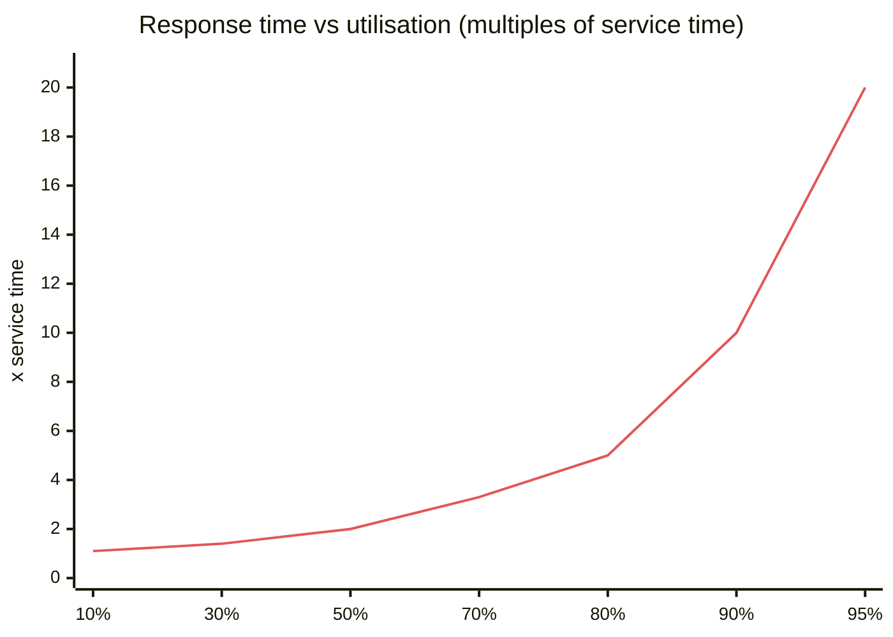
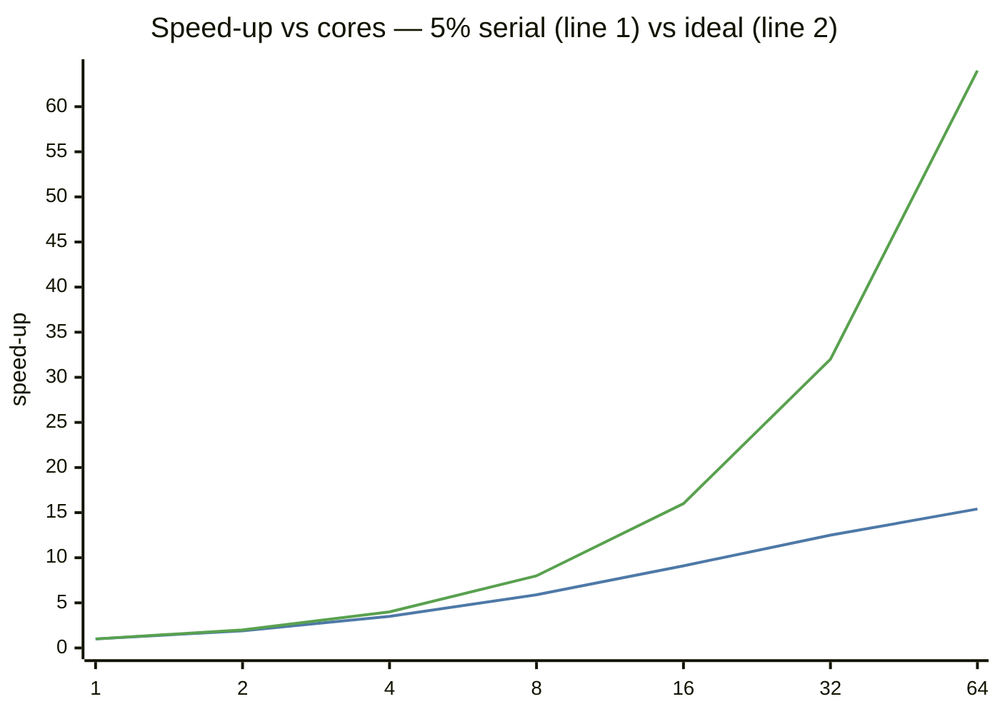
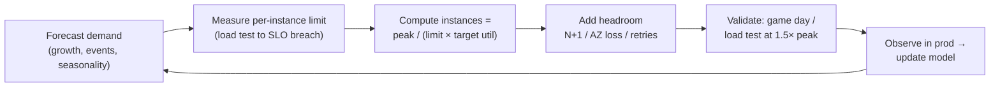

# Capacity Planning and Performance Engineering

## What is it?

- **Capacity planning:** how much infrastructure you need for expected load + headroom, and when you'll run out.
- **Performance engineering:** measuring, explaining and improving latency and throughput. Load testing, profiling, tuning.

## Why it matters at SDE-2/3

Back-of-envelope math gets you through interviews; in production you must **prove** a service survives Big Billion Days or an IPL final. Seniors know *why* latency explodes near full utilisation, how to load-test honestly, and how to find the bottleneck instead of guessing.

## Analogy

A toll plaza. At 50% busy, cars pass instantly. At 90% busy, queues appear. At 99%, the queue grows without limit even though the booths are "only" 1% short. **Utilisation near 100% is where latency dies.**

## Interview definition

> "Capacity planning sizes the system for peak load with headroom, using measured per-instance limits and queueing behaviour, and keeps utilisation well below saturation because latency grows non-linearly as utilisation approaches 100%."

## The math seniors actually use

**Little's Law:** concurrency = arrival rate × time in system.
$$L = \lambda W$$

**Queueing (M/M/1 intuition):** response time grows like
$$W = \frac{S}{1-\rho} \quad (\rho = \text{utilisation},\ S = \text{service time})$$

| Utilisation ρ | Response time multiple of service time |
|---|---|
| 50% | 2× |
| 70% | 3.3× |
| 80% | 5× |
| 90% | 10× |
| 95% | 20× |
| 99% | 100× |

**Amdahl's Law:** speed-up from parallelising is capped by the serial fraction $s$:
$$\text{Speedup}(N) = \frac{1}{s + \frac{1-s}{N}}$$

**Universal Scalability Law (USL):** adds a coherence/crosstalk cost, so adding nodes can make throughput **drop** (lock contention, cache coherence, coordination).

## 📊 Visual model

**The hockey stick — why we target ~60–70% utilisation:**



**Amdahl: serial work caps you (5% serial):**



**Capacity planning loop:**



**Load-test types:**

```mermaid
gantt
    title Load test profiles (time on x-axis)
    dateFormat HH:mm
    axisFormat %H:%M
    section Load test
    Ramp to expected peak, hold      :l1, 10:00, 30m
    section Stress test
    Ramp past peak until SLO breaks  :crit, s1, 10:00, 45m
    section Spike test
    Sudden 10x for 2 minutes         :crit, p1, 10:20, 2m
    section Soak test
    Normal load for hours (leaks)    :k1, 10:00, 240m
```



## Worked capacity plan

```text
Peak (sale day): 60,000 req/s at the API tier
Load test: one pod sustains 1,200 req/s at p99 < 200 ms (SLO), CPU 85% at that point
Target utilisation 60% → usable 1,200 × (60/85) ≈ 850 req/s per pod
Pods = 60,000 / 850 ≈ 71 → survive loss of 1 of 3 AZs → 71 × 1.5 ≈ 107 pods
Retry/headroom +15% → ~125 pods at peak; autoscale min 40, max 140
DB connections: 125 pods × 10 = 1,250 → needs a pooler (PgBouncer) in front of Postgres
```

## Finding the bottleneck (USE + profiling)

| Step | Tool |
|---|---|
| USE per resource: Utilisation, Saturation, Errors | CPU, memory, disk, network, connection pools, thread pools |
| Trace the slow request | OpenTelemetry traces → slowest span → [[Observability-and-SLOs]] |
| CPU profile | Flame graphs (async-profiler, py-spy, Node `--prof`/clinic.js, pprof) |
| Memory / GC | Heap snapshots; GC pause logs |
| DB | `EXPLAIN ANALYZE`, slow query log, lock waits |
| Continuous profiling | Pyroscope / Parca / Datadog in prod |

## Tail-latency techniques
- **Hedged requests:** send to a second replica if the first hasn't answered by p95; take whichever wins (reads only).
- **Request timeouts + deadlines** propagated down the chain.
- **Avoid head-of-line blocking:** separate pools for slow and fast work.
- **Coordinated omission:** load generators that wait for responses under-report latency. Use constant-arrival-rate tools (k6, wrk2, Gatling, Vegeta).

## Common mistakes

> [!warning] Traps to avoid
> 1. Sizing for average load, not peak + AZ failure.
> 2. Running pods at 90% CPU "to save money" → p99 explodes.
> 3. Load testing from one machine/region and measuring the load generator, not the system.
> 4. Optimising without a profile ("I think it's the JSON parsing").
> 5. Ignoring downstream limits (DB connections, third-party rate limits).

## Interview understanding

> [!question] What the interviewer is really testing
> - *"How many servers do you need?"* — Peak QPS ÷ (measured per-instance capacity × target utilisation) + failure headroom.
> - *Tricky:* "Why not run at 95% utilisation?" — Queueing: response time ≈ 20× service time; any burst becomes an outage.
> - *Tricky:* "Adding servers made it slower — how?" — Contention/coherence (USL): shared locks, DB hot rows, cache invalidation chatter.
> - *Tricky:* "What is coordinated omission?" — Closed-loop load generators pause when the system slows, hiding the worst latencies.

## Mini quiz
1. Little's Law?
2. Response-time multiple at 90% utilisation (M/M/1)?
3. What does Amdahl's Law say?
4. Four load-test profiles?
5. What are hedged requests?

> [!success]- Answers (click to reveal)
> 1. L = λW.
> 2. ~10×.
> 3. Speed-up is limited by the serial fraction of the work.
> 4. Load, stress, spike, soak.
> 5. Duplicate a slow request to another replica after a delay and use the first response.

---
**Next:** [[Concurrency-and-Async-Models]] · **Up:** [[Senior-Engineering-MOC]]

## 📚 Resources
- 📄 [Dean & Barroso — The Tail at Scale](https://research.google/pubs/the-tail-at-scale/)
- 📄 [Brendan Gregg — The USE Method](https://www.brendangregg.com/usemethod.html) and [Flame Graphs](https://www.brendangregg.com/flamegraphs.html)
- 📖 *Systems Performance* (Brendan Gregg).
- 📄 [k6 load testing docs](https://grafana.com/docs/k6/latest/)

## My notes
-
