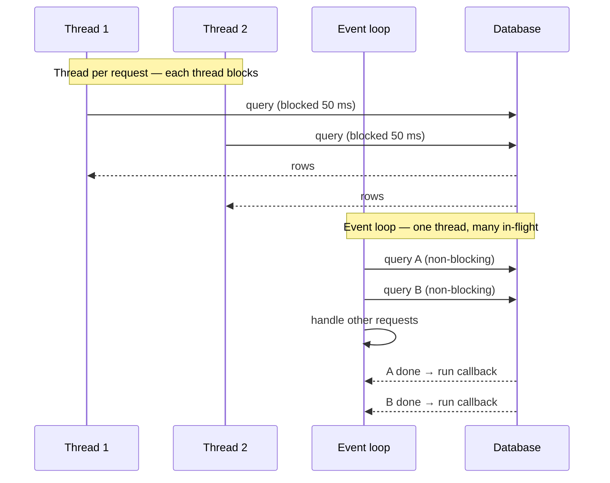
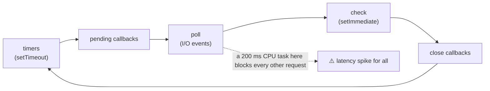
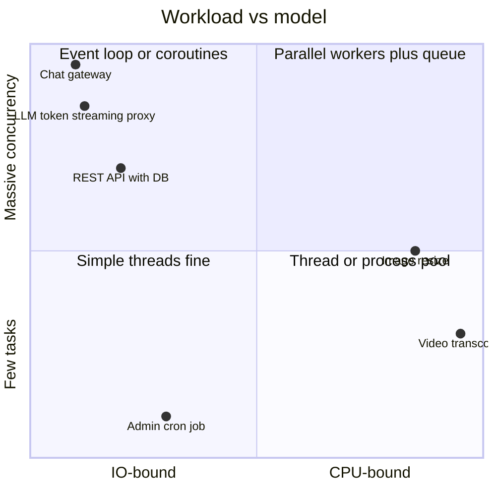
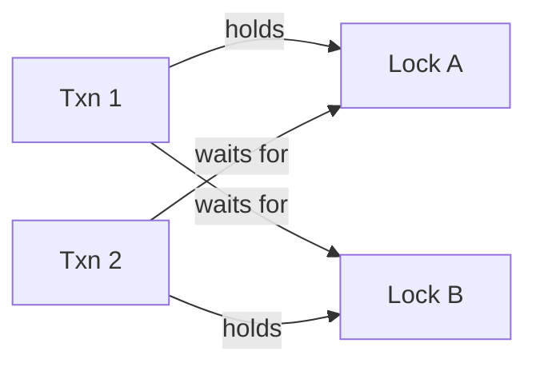

# Concurrency and Async Models

## What is it?

How one program handles many things at once: threads, event loops, coroutines, actors. Plus the bugs that come with it: races, deadlocks, starvation.

## Why it matters at SDE-2/3

HLD assumes services handle thousands of concurrent requests. Whether yours does depends on its **concurrency model**, connection pools and blocking calls. Many production incidents are concurrency bugs: a blocked event loop, an exhausted thread pool, a race in a cache refresh. Machine-coding rounds also ask "make it thread-safe".

## Analogy

- **Thread per request:** a restaurant with one waiter per table. Simple, but waiters are expensive and mostly stand around waiting.
- **Event loop:** one very fast waiter who never waits. Takes the order, moves on, comes back when the kitchen rings. If he stops to cook (CPU-heavy work), everyone waits.
- **Actors:** each chef owns a station and only takes notes through a hatch. No shared knives, no fights.

## Interview definition

> "Concurrency is structuring work so tasks can make progress independently. Parallelism is running them at the same time on multiple cores. I/O-bound services favour event loops or lightweight threads; CPU-bound work needs parallel threads/processes. Shared mutable state must be protected or avoided."

## The models

| Model | How | Strengths | Weaknesses | Seen in |
|---|---|---|---|---|
| **Thread per request** | OS thread blocks on I/O | Simple code | ~1 MB stack each; context switches; pool exhaustion | Classic Java/Spring MVC, Django sync |
| **Event loop (async I/O)** | Single thread + non-blocking I/O + callbacks/promises | Huge I/O concurrency, low memory | One CPU-heavy task blocks all; callback complexity | **Node.js**, nginx, Redis, Python asyncio |
| **Coroutines / green threads** | Cheap user-space threads scheduled by runtime | Sync-looking code, millions of tasks | Runtime-specific pitfalls (pinning, blocking calls) | **Go goroutines**, Java 21 virtual threads, Kotlin coroutines |
| **Actor model** | Isolated actors with mailboxes; message passing | No shared state; fault isolation, supervision | Message ordering/backpressure design | Erlang/Elixir (WhatsApp), Akka, Orleans |
| **Multi-process** | Separate processes + IPC | True parallelism, isolation | Memory, IPC cost | Python multiprocessing, Node cluster/worker_threads, gunicorn workers |
| **Data parallel** | Same op over chunks | CPU/GPU throughput | Only for parallelisable work | SIMD, Spark, GPUs |

## Concurrency bugs and fixes

| Bug | Example | Fix |
|---|---|---|
| **Race condition** | Two requests read stock=1, both sell | Atomic ops, locks, DB conditional update → [[Transactions-and-Isolation-Levels]] |
| **Deadlock** | T1 locks A then B; T2 locks B then A | Global lock ordering, timeouts, avoid nested locks |
| **Livelock / starvation** | Retries collide forever; low priority never runs | Jittered backoff, fair queues |
| **Check-then-act** | `if not exists: create` | Unique constraint / `putIfAbsent` / `SET NX` |
| **Event-loop blocking** | `JSON.parse` of 50 MB or bcrypt in Node main thread | Worker threads, streaming, offload to a queue |
| **Pool exhaustion** | All threads wait on a slow dependency | Timeouts, bulkheads, async I/O → [[Resilience-Patterns]] |
| **Unbounded queues** | In-memory queue grows → OOM | Bounded queues + backpressure |

## 📊 Visual model

**Thread-per-request vs event loop under I/O wait:**



**Node.js event loop phases (why CPU work hurts):**



**Choosing a model:**



**Deadlock in one picture:**



## Backpressure in code

When producers outrun consumers, **slow the producer** instead of buffering forever: bounded channels (Go), Node stream `highWaterMark` + `pipe()`, reactive streams (`request(n)`), semaphores limiting in-flight calls (`p-limit` in Node).

```js
// Node: cap concurrent outbound calls to protect a dependency
import pLimit from "p-limit";
const limit = pLimit(20);                 // at most 20 in flight
const results = await Promise.all(ids.map(id => limit(() => fetchUser(id))));
```

## Common mistakes

> [!warning] Traps to avoid
> 1. CPU-heavy work on the Node/async event loop.
> 2. Calling blocking libraries inside async code (sync DB driver in asyncio).
> 3. Locks held across network calls.
> 4. Unbounded `Promise.all` over 100k items → DDoS your own DB.
> 5. Assuming in-process locks work across multiple instances (they don't — use DB/Redis).

## Interview understanding

> [!question] What the interviewer is really testing
> - *"How does Node handle 10k concurrent connections on one thread?"* — Non-blocking I/O + event loop; libuv thread pool for some ops; CPU work must be offloaded.
> - *Tricky:* "Concurrency vs parallelism?" — Dealing with many things vs doing many things simultaneously.
> - *Tricky:* "Java virtual threads / goroutines — why do they matter?" — Sync-style code with event-loop-like scalability.
> - *Tricky:* "Make this LRU cache thread-safe without killing throughput." — Lock striping / segment locks, or concurrent maps + per-segment LRU.

## Mini quiz
1. Concurrency vs parallelism?
2. What blocks a Node.js server?
3. Two ways to prevent deadlock?
4. What's backpressure?
5. Why don't in-process locks protect a multi-instance service?

> [!success]- Answers (click to reveal)
> 1. Structuring overlapping tasks vs executing simultaneously on multiple cores.
> 2. Long synchronous CPU work or blocking calls on the event loop.
> 3. Consistent global lock ordering; timeouts/try-lock; avoid nested locks.
> 4. Signalling producers to slow down when consumers can't keep up.
> 5. Each instance has its own memory; you need a shared mechanism (DB constraint, distributed lock).

---
**Next:** [[Workflow-Orchestration-and-Durable-Execution]] · **Up:** [[Senior-Engineering-MOC]]

## 📚 Resources
- 📄 [Node.js — The event loop, timers and nextTick](https://nodejs.org/en/learn/asynchronous-work/event-loop-timers-and-nexttick)
- 📄 [Rob Pike — Concurrency is not Parallelism (talk)](https://go.dev/blog/waza-talk)
- 📄 [JEP 444 — Virtual Threads](https://openjdk.org/jeps/444)

## My notes
-
