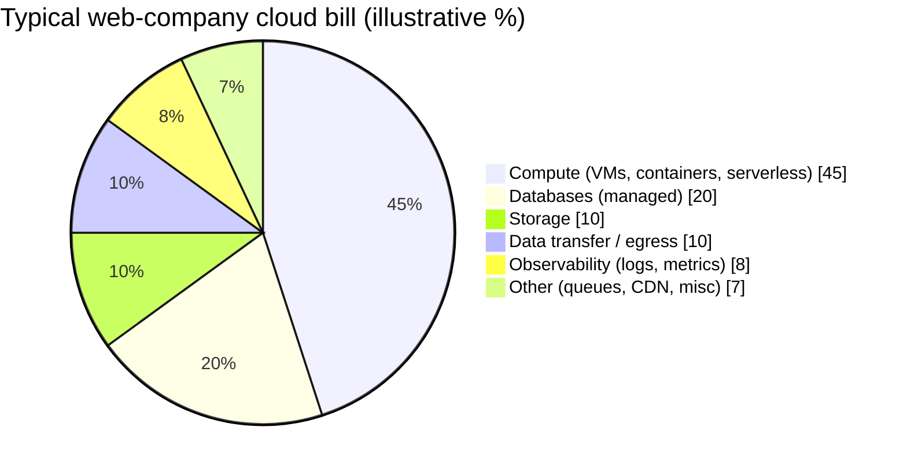
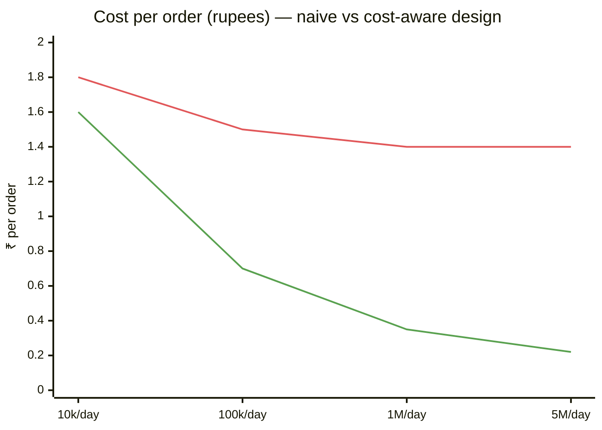
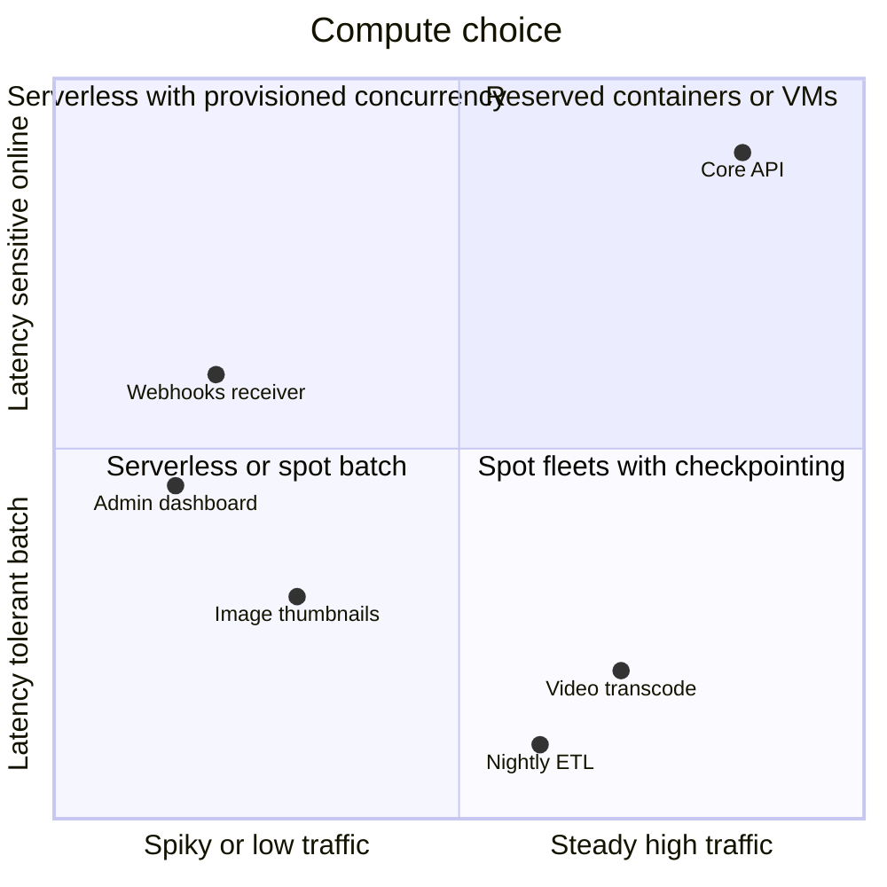
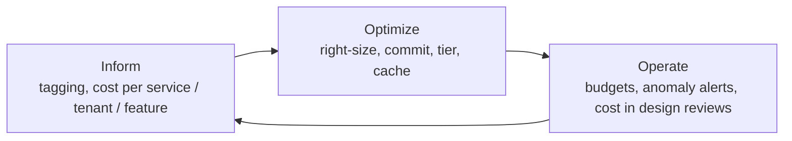
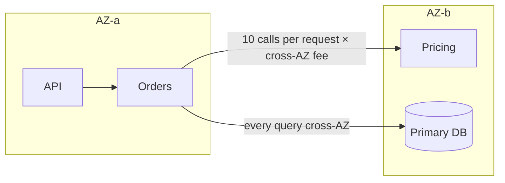

# Cost-Aware Architecture (FinOps for Engineers)

## What is it?

Treating **cost as a non-functional requirement**, measured per request, per tenant or per order, and designing systems that stay affordable as they scale. FinOps is the practice of engineering, finance and product sharing ownership of cloud spend.

## Why it matters now

- After the 2022–2026 efficiency push and layoffs, every company asks "what does this cost per order?"
- **FinOps and cloud governance** are named in the GCC skills shortfall (see [[Market-Research-2026]]).
- LLM features can cost more per request than the entire rest of the stack. → [[AI-Cost-and-Small-Models]]
- Senior engineers who can say "this design costs ₹0.08 per order, and here's how to halve it" stand out.

## Analogy

Running a restaurant: a dish isn't "good" if every plate loses money. Chefs learn food cost per plate; engineers learn **cost per request**.

## Interview definition

> "I design with unit economics: estimate cost per key action, choose architectures whose cost scales sub-linearly with usage, tag and attribute spend, and use pricing levers (commitments, spot, tiering, caching) without hurting reliability."

## Where the money goes (typical cloud bill)

## Cost levers by layer

| Layer | Lever | Typical saving | Trade-off |
|---|---|---|---|
| Compute | Right-sizing; autoscaling; ARM (Graviton) instances | 20–40% | Testing effort |
| Compute | **Spot/preemptible** for stateless + batch workers | 60–90% vs on-demand | Interruptions → idempotent, checkpointed jobs |
| Compute | Savings plans / reserved / committed use | 30–70% | Commitment risk |
| Compute | Serverless for spiky/low traffic; containers for steady load | Varies | Serverless is costly at constant high load |
| Storage | Lifecycle tiers (S3 IA/Glacier), compression, dedup | 50–90% on cold data | Retrieval latency/fees |
| Database | Read replicas vs bigger primary; cache hits; archive old rows | Big | Complexity |
| Network | **Avoid cross-AZ/cross-region chatter**; CDN for egress; keep data near compute | Often surprising | Topology constraints |
| Observability | Sample traces, drop debug logs, metric cardinality limits, log retention tiers | 30–60% | Less detail |
| AI | Model routing, caching, prompt trimming, batch APIs | 50–90% | Quality checks needed |

## 📊 Visual model

**Unit economics: cost per order as volume grows:**

> [!note] Line 1 (red) = linear-cost design (per-request LLM call, no caching, chatty cross-AZ calls). Line 2 (green) = cost-aware design (caching, batching, spot workers, tiered storage). Fixed costs amortise; variable costs are designed down.

**Pick compute by traffic shape:**

**FinOps loop:**

**Hidden cost: cross-AZ traffic in a chatty microservice call graph:**

Fix: zone-aware routing, colocate chatty services, batch calls, cache.

## Practices to adopt
- **Tag everything** (team, service, env, tenant) → cost per service/tenant dashboards.
- Put a **cost estimate in every design doc** (monthly cost at launch and at 10×). → [[Design-Docs-and-ADRs]]
- **Budgets + anomaly alerts** (a runaway loop or log storm can burn lakhs in a night).
- Cost per tenant for SaaS pricing. → [[Multi-Tenancy-and-SaaS-Architecture]]
- Delete idle resources (dev environments off at night, orphaned volumes, old snapshots).
- Kubernetes: requests/limits right-sized, bin packing, cluster autoscaler, Karpenter; OpenCost/Kubecost for visibility.

## Common mistakes

> [!warning] Traps to avoid
> 1. Optimising cost before measuring it (no tags, no attribution).
> 2. Spot instances for stateful, non-checkpointed work.
> 3. Ignoring egress and cross-AZ charges.
> 4. Logging everything at DEBUG in prod forever.
> 5. Serverless for constant high-throughput workloads (often more expensive).
> 6. Cutting redundancy to save money and turning a cost win into an outage.

## Interview understanding

> [!question] What the interviewer is really testing
> - *"What would this design cost? How would you cut it?"* — Order-of-magnitude per-request cost, biggest driver, 2–3 levers with trade-offs.
> - *Tricky:* "When is serverless more expensive?" — Sustained high utilisation; per-invocation pricing exceeds reserved capacity.
> - *Tricky:* "Where do surprise bills come from?" — Egress, cross-AZ traffic, log ingestion, NAT gateways, idle GPUs, runaway retries.
> - *Tricky:* "How do you make spot safe?" — Stateless/idempotent work, checkpointing, diversified instance pools, graceful termination handling.

## Mini quiz
1. What's unit economics in engineering?
2. Three FinOps phases?
3. Two hidden network costs?
4. When is spot appropriate?
5. One observability cost lever?

> [!success]- Answers (click to reveal)
> 1. Cost per business unit (per order, request, tenant), tracked and designed down.
> 2. Inform, optimize, operate.
> 3. Data egress to the internet and cross-AZ/region traffic (also NAT gateway processing).
> 4. Interruptible, stateless or checkpointed work: batch, CI, transcoding, stateless workers.
> 5. Trace sampling, log level/retention tiers, metric cardinality limits.

---
**Next:** [[Design-Docs-and-ADRs]] · **Up:** [[Senior-Engineering-MOC]]

## 📚 Resources
- 📄 [FinOps Foundation — FinOps framework](https://www.finops.org/framework/)
- 📄 [AWS Well-Architected — Cost Optimization pillar](https://docs.aws.amazon.com/wellarchitected/latest/cost-optimization-pillar/welcome.html)
- 📄 [OpenCost](https://www.opencost.io/)

## My notes
-
