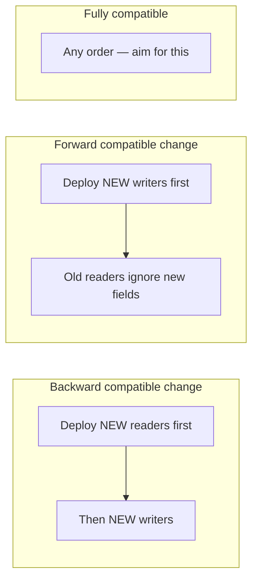
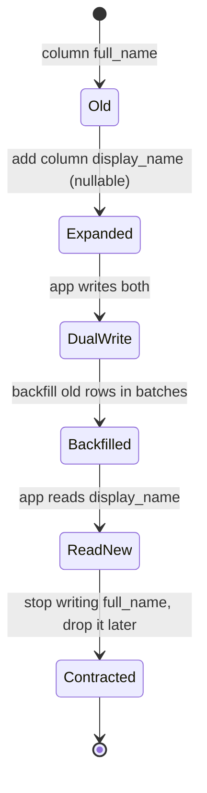

# Data Modeling and Schema Evolution

## What is it?

- **Data modeling:** deciding how data is structured (entities, relationships, keys, denormalisation) so it serves the **access patterns** you need now.
- **Schema evolution:** changing that structure later, in databases, APIs and event streams, **without breaking** readers and writers that are still running old code.

## Why it matters at SDE-2/3

Code gets rewritten; **data lives for a decade**. In a running system, old and new code versions run at the same time (rolling deploys, mobile apps nobody updates, Kafka consumers on last month's build). Every schema change is therefore a **compatibility problem**. Seniors are judged on whether their changes ever break production.

## Analogy

Changing the format of a printed form while thousands of people are filling out the old one. You can't recall the old forms. Your office must accept both until the old ones run out.

## Interview definition

> "Model from access patterns, choose keys for distribution and lookup, and treat every schema change as a contract change. Readers and writers of different versions coexist, so changes must be backward and forward compatible, rolled out in expand–contract steps."

## Part 1 — Modeling from access patterns

**Process seniors follow:**
1. List entities and relationships (ERD).
2. List the **top queries with their QPS and latency targets**. "Get last 20 orders for user, p99 50 ms, 5k QPS."
3. Choose primary keys / partition keys for the hottest queries. → [[Sharding-and-Partitioning]]
4. Decide normalise vs denormalise per query; add indexes. → [[Indexing]]
5. Plan growth: row counts in 3 years, archival, hot vs cold data.

| Pattern | Use when | Example |
|---|---|---|
| Normalised (3NF) | Write-heavy, consistency-critical | Payments, inventory |
| Denormalised read model | Read-heavy, multi-join pages | Order history view, feed |
| Polymorphic table / JSONB | Many sparse attributes | Product catalogue attributes |
| Append-only / event log | Audit, history, ledgers | Ledger entries, order events |
| Soft delete + `deleted_at` | Recoverability, sync | User content |
| Temporal tables (`valid_from/to`) | "What was the price on date X?" | Pricing, policies |
| Single-table design (DynamoDB) | Known access patterns at huge scale | `PK=USER#42, SK=ORDER#2026-11-10#991` |

## Part 2 — Compatibility (the core vocabulary)

| Term | Meaning | Who's protected |
|---|---|---|
| **Backward compatible** | **New** readers can read **old** data | Deploy new consumers first |
| **Forward compatible** | **Old** readers can read **new** data | Deploy new producers first |
| **Full compatibility** | Both | Any deploy order |

**Safe vs breaking changes:**

| Change | DB | API (JSON) | Protobuf/Avro event |
|---|---|---|---|
| Add optional field/column with default | ✅ | ✅ | ✅ |
| Add required field | ⚠️ needs default/backfill | ❌ for old clients | ❌ (Avro: needs default) |
| Remove field | ⚠️ expand–contract | ❌ breaking | ⚠️ only if optional & never reuse tag |
| Rename field | ❌ (do add + copy + remove) | ❌ | ✅ in Protobuf (names don't matter on wire) / ❌ Avro without alias |
| Change type (int → string) | ❌ | ❌ | ❌ |
| Reuse a Protobuf field number | — | — | ❌❌ data corruption — use `reserved` |

**Robustness principle for readers:** ignore unknown fields, tolerate missing optional ones.

## Part 3 — Where schemas live

- **Databases:** migrations as versioned code (Flyway, Liquibase, Prisma Migrate, Alembic, Knex), applied in CI/CD with expand–contract. → [[Zero-Downtime-Migrations-and-Deployments]]
- **APIs:** OpenAPI/Protobuf contracts, versioned, checked in CI for breaking changes (`buf breaking`, `openapi-diff`). → [[API-Design]]
- **Events:** Schema Registry (Confluent/Apicurio) enforcing compatibility mode per topic (BACKWARD is the default). Consumers deserialize with the writer's schema. → [[Kafka-Deep-Dive]]
- **Data contracts:** producer-owned, versioned agreements about a dataset's schema + semantics + quality SLAs, checked in CI. → [[Data-Engineering-for-AI]]

## 📊 Visual model

**Versions coexisting during a rolling deploy:**

```mermaid
gantt
    title Old and new code run at the same time
    dateFormat HH:mm
    axisFormat %H:%M
    section API pods
    v1 pods (draining)        :a1, 10:00, 20m
    v2 pods (rolling in)      :a2, 10:05, 40m
    section Mobile apps
    App v5 (users not updated) :crit, m1, 10:00, 45m
    App v6                     :m2, 10:10, 35m
    section Kafka consumers
    Consumer build of last week :c1, 10:00, 30m
    Consumer new build          :c2, 10:25, 20m
```



**Compatibility direction decides deploy order:**



**Renaming a column safely (never in one step):**



**Protobuf evolution done right:**

```proto
message Order {
  int64  id        = 1;
  string status    = 2;
  // int32 amount  = 3;     // removed → never reuse 3
  reserved 3;
  reserved "amount";
  int64  amount_paise = 4;  // new field, new number
  optional string coupon = 5; // optional: old readers ignore it
}
```

## Common mistakes

> [!warning] Traps to avoid
> 1. Designing tables before listing queries and their volumes.
> 2. Renaming/dropping a column in one deploy while old pods still run.
> 3. Adding a `NOT NULL` column without a default to a 500M-row table (locks/rewrite).
> 4. Reusing Protobuf field numbers or changing field types.
> 5. Breaking event schemas because "only our team consumes it" (someone always does).
> 6. Storing money as float; storing time without time zone.

## Interview understanding

> [!question] What the interviewer is really testing
> - *"How would you change the data model for feature X?"* — Expand–contract steps, backfill plan, compatibility, rollback.
> - *Tricky:* "Backward vs forward compatibility, and which one lets me deploy consumers first?" — Backward: new readers read old data, so deploy consumers first.
> - *Tricky:* "Why can't I just rename the column?" — Old code still running during the rollout breaks immediately.
> - *Tricky:* "How do you enforce event schema compatibility?" — Schema registry with a compatibility mode + CI checks.

## Mini quiz
1. What do you list before designing tables?
2. Backward compatibility protects whom?
3. Safe way to rename a column?
4. Why must Protobuf field numbers never be reused?
5. What is a data contract?

> [!success]- Answers (click to reveal)
> 1. Access patterns: queries, QPS, latency, growth.
> 2. New readers reading old data. Lets you upgrade consumers first.
> 3. Add new column → dual write → backfill → read new → stop writing old → drop old.
> 4. Old data/readers would decode the number with the wrong meaning, corrupting data.
> 5. A versioned, producer-owned agreement on a dataset's schema, semantics and quality, enforced in CI.

---
**Next:** [[Zero-Downtime-Migrations-and-Deployments]] · **Up:** [[Senior-Engineering-MOC]]

## 📚 Resources
- 📖 *DDIA* Ch. 4 — Encoding and Evolution.
- 📄 [Confluent — Schema evolution and compatibility](https://docs.confluent.io/platform/current/schema-registry/fundamentals/schema-evolution.html)
- 📄 [Protocol Buffers — Updating a message type](https://protobuf.dev/programming-guides/proto3/#updating)
- 📄 [Alex DeBrie — The DynamoDB Book / single-table design](https://www.alexdebrie.com/posts/dynamodb-single-table/)

## My notes
-
